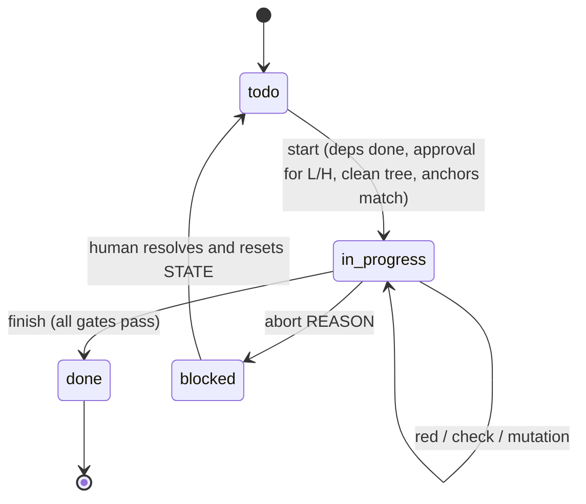
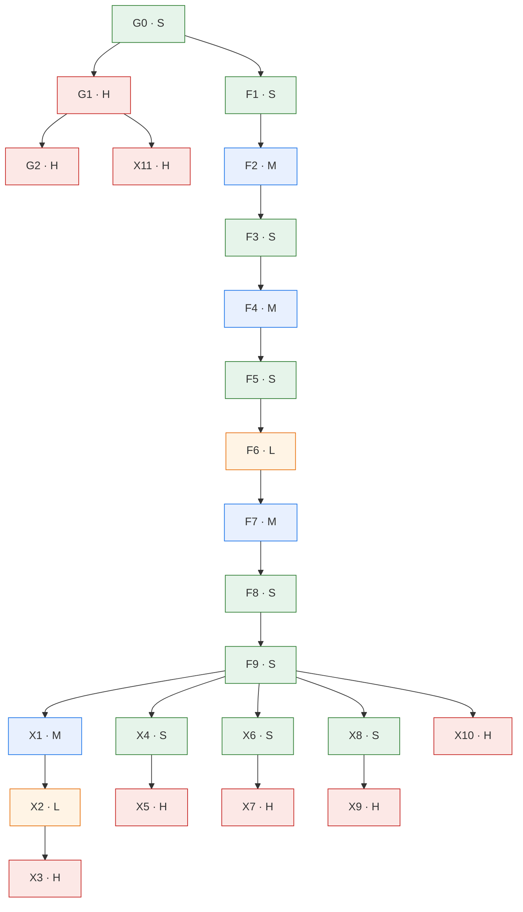

# Switcher v2 remediation: executor design for Claude Code

This document is written for the model that executes the tasks, including small or low-cost models. It assumes no memory of earlier conversations. Everything a task needs is in its section; the machine-readable copy of each task card is `TASKS.json`, and `tools/agent_gate.py` enforces the parts that must not depend on the model's judgement.

Three layers carry the rules, from strongest to weakest:

1. **Harness (deterministic).** `.claude/settings.json` hooks call the gate before every file edit (scope, read-only paths) and whenever the agent tries to stop (scope, forbidden patterns, append-only files, self-audit). Deny rules block `git push`, `approve` and destructive git commands.
2. **Gate (deterministic, run by the agent).** `agent_gate.py start | red | check | finish` checks anchors, red-before-green tests, commands, cargo-mutants survivors and the self-audit record.
3. **This document (advisory).** It explains what to change and why. Where it and the gate disagree, stop and escalate; do not work around the gate.

<a id="quick-start"></a>
## 1. Quick start (the whole loop on one screen)

```text
python3 tools/agent_gate.py next                 # which task, which section
python3 tools/agent_gate.py start <ID>           # refuses if deps, approval, clean tree or anchors fail
# read the task section below, top to bottom, once
# 1) add the task's tests exactly as written (after the marker line)
python3 tools/agent_gate.py red <ID>             # proves the new tests fail on the task's base commit
# 2) apply the edits exactly as written, in order
# 3) run every command of the task card; fix only what the card covers
# 4) fill .agent/STATE.json -> tasks.<ID>.self_audit (section 6.2)
python3 tools/agent_gate.py check <ID>           # fast checks
python3 tools/agent_gate.py finish <ID>          # re-runs commands, red check, mutation gate; marks done
# 5) append a PROGRESS.md entry (section 13.1), then commit with the card's commit_message
# blocked? python3 tools/agent_gate.py abort <ID> "<one-line reason>" and stop.
```

One task per session. After `finish` and the commit, end the session (or `/clear`) before the next task, so that the next task starts from the files, not from a long conversation.

<a id="contract"></a>
## 2. Executor contract

Each rule has a reason, because a model that knows the reason applies the rule to cases the text did not foresee.

| id | rule | reason |
|---|---|---|
| R-01 | Work only on the task returned by `next` and started with `start`. One task at a time. | Doing several changes at once is the main failure mode of long-running agents; the gate keys every check to one task. |
| R-02 | Read the task section in full before the first edit. Do not read other task sections for "context". | Other sections describe states of the code that do not exist yet; mixing them in causes drift. |
| R-03 | Never state or use a symbol, file, line, field or function you have not opened in this session. Grep for it, open the file, then use it. | Invented APIs are the most common error of code models; `symbols_verified` in the self-audit is checked line by line. |
| R-04 | Apply edits as exact text replacements: find the quoted text (it must occur exactly the stated number of times), replace it with the quoted text. Never edit by line number, never retype a block from memory. | Exact anchors make every edit verifiable; line numbers shift. |
| R-05 | Add the task's tests first and run `red`. If a test that should be red passes on the base commit, stop and escalate. | A test that already passes cannot detect the change it is supposed to guard. |
| R-06 | Do not edit, delete, relax or skip any existing test or assertion, except the edits listed under "Existing tests that change" in the task. | Weakening tests is the cheapest way to make a check pass and the hardest to see in review. |
| R-07 | Do not hard-code values to satisfy a test. Implement the general rule written in the task. | Tests verify the rule; they do not define it. |
| R-08 | Make only the changes the task lists. No refactoring, renaming, reformatting of untouched code, extra features or "improvements". | Unrequested changes break the dry-run equivalence that this document relies on. |
| R-09 | Keep the public API additive (INV-08). Never change `Cargo.toml`, `Cargo.lock`, `rust-toolchain.toml`, CI files, this document, `TASKS.json`, `CLAUDE.md`, `.claude/` or the gate. | These are the trust anchors of the process; the hook blocks them anyway. |
| R-10 | Run each command of the task card yourself and record it with its exit code in the self-audit. Report numbers as printed, never estimated. | `finish` re-runs them; a mismatch is a hallucinated result. |
| R-11 | When a numeric result differs from the value in this document, do not adjust the expectation. Stop and escalate. | Every number here was measured; a difference means the code or the environment differs. |
| R-12 | Three failed attempts at the same compiler or test error: stop and escalate. | Repeated blind fixes accumulate unrelated changes. |
| R-13 | Never write a ledger row by hand. Use the row script of section 13.2, and only in tasks with `ledger_required: true`. | Rows are authority claims; the gate checks the schema, append-only order and remote reachability of new rows. |
| R-14 | Never run `git push`, `git reset --hard`, `git checkout -- <path>` on files you did not change, or `agent_gate.py approve`. | Pushing and approving are human decisions. |
| R-15 | Tier L and H tasks start only after a human ran `approve`. Spec-only tasks (`spec_only: true`) have no dry-run-verified code; follow the specification literally and escalate at the first ambiguity. | These tasks need judgement that small models do not reliably supply. |
| R-16 | If anything in this document seems wrong, record it in `open_questions` and abort. Do not "fix" the document. | The document is read-only for agents; the human updates it. |

<a id="environment"></a>
## 3. Environment and commands

- Repository root: the directory that contains `Cargo.toml` and `tools/agent_gate.py`. All commands run from there.
- Toolchain: pinned by `rust-toolchain.toml` (1.94.1, as in CI). If it cannot be installed, prefix cargo commands with `RUSTUP_TOOLCHAIN=stable` (also for `agent_gate.py finish`, which runs cargo) and say so in `PROGRESS.md`. Under stable 1.97, `cargo clippy -p rodas5p-integrators` reports pre-existing lints in `source_owned_graph_schur.rs`; the clippy commands therefore use `--no-deps`, and X4 may need the pinned toolchain.
- `cargo-mutants` 27.x must be installed (`cargo install cargo-mutants --locked`); the gate calls `cargo mutants`.
- The full suite takes 10–20 minutes in release mode. `--no-fail-fast` is part of the command: without it cargo stops at the first failing test binary and hides later failures (this happened during the dry run, see section 11).

| name | command | used by |
|---|---|---|
| contracts | `cargo test --locked -p vigilode --release --test switching_v2_remediation_contracts` | F tasks |
| lib-unit-tests | `cargo test --locked -p vigilode --release --lib` | F tasks |
| vigilode-suite | `cargo test --locked -p vigilode --release --no-fail-fast` | F tasks |
| clippy | `cargo clippy --locked -p vigilode --all-targets --release --no-deps -- -D warnings` | vigilode tasks |
| fmt | `cargo fmt -p vigilode -- --check` | vigilode tasks |
| research-node-check | `python3 tools/check-research-node.py` | governance and experiment tasks |

A single test: `cargo test --locked -p vigilode --release --test switching_v2_remediation_contracts -- <test_name> --exact`.

<a id="protocol"></a>
## 4. Task protocol

### 4.1 States



### 4.2 Steps inside a task

1. `start <ID>`. The gate records `base_sha = HEAD` and creates an empty `self_audit` block.
2. Restate the goal in one sentence in `self_audit.restated_goal`, from the task title and its "Why" paragraph.
3. Open every file named in the task's edits. For each symbol you will touch or call, grep it and record `{symbol, file, line}` in `symbols_verified` (the gate opens that line and checks that the symbol text is on it).
4. Insert the task's tests after the task's marker line in `CT` (or where the task says), exactly as written.
5. `red <ID>`. The gate checks out the task's base commit in a temporary worktree, copies your new test file in, runs the task's red command and checks that every listed red test fails there (or, where the card allows it, does not compile because the new symbol is absent).
6. Apply the edits in the listed order. After each edit, re-read the changed region once.
7. Apply the listed updates of existing tests, if any (only those).
8. Run every command of the task card. Fix failures only inside the task's scope.
9. Fill the self-audit (section 6.2). `check <ID>`.
10. `finish <ID>`. On success: append the PROGRESS.md entry, `git add` the changed and new files, commit with the card's `commit_message`, end the session.

<a id="invariants"></a>
## 5. Invariants

The gate refers to these ids. For each invariant on its task card, the self-audit states `"held: <evidence>"` (the test or command that shows it).

| id | invariant |
|---|---|
| INV-01 | Default-path neutrality: `SwitchingConfig::evidence_driven`, `SwitchingConfig::default()` and the direct Rodas5p/Dopri5 solves keep bit-identical states and identical counters on the registered cells, unless the task kind is default_behaviour. Evidence: `skeleton_helpers_reproduce_registered_counters` stays green. |
| INV-02 | research/LEDGER.jsonl is append-only: one JSON object per line with the ten fields of docs/RESEARCH_LEDGER.md. Existing rows use mixed key orders and separators; new rows are written by the row script of DESIGN.md 13.2. |
| INV-03 | Units: a guard ceiling is in callback units (RHS 1, JVP 1 per vector, dense Jacobian n). WorkModel V2 values are instruction units (Ir). Convert V2 to a callback ceiling only through `v2_entry_callback_cap` / `v2_return_callback_cap`. |
| INV-04 | Decision preservation: an early stop armed by a ceiling never changes a strict entry/return decision compared with the same comparison run without the ceiling. |
| INV-05 | Determinism: no wall clock, randomness, thread timing or HashMap iteration order in any decision path; epoch digests use the FNV-1a hasher after F7. |
| INV-06 | Accounting completeness: every user-callback evaluation made by the library is added to `stats.rhs_calls` / `stats.jvp_vectors` (or the matching counter). |
| INV-07 | Scope: only files listed in the task's files_allowed (plus always_allowed) change. |
| INV-08 | Public API is additive: no public item is removed, renamed or changes signature unless the task says so. |
| INV-09 | Opt-in: new behaviour is reachable only through the named factory or a config field whose default keeps the old behaviour (task kinds opt_in_behaviour, experiment). |
| INV-10 | Tests first: every behavioural test of the task fails on the task's base commit (`agent_gate.py red`) and passes after the change. |
| INV-11 | No weakening: existing assertions, tolerances and test functions are not deleted or relaxed, except the exact lines listed in the task's removals_allowed. |
| INV-12 | No new dependencies, toolchain or lockfile changes; no unsafe code; no lint suppression attributes. |
| INV-13 | Research claims: a verdict comes only from the preregistered gate; PREREGISTRATION.md is never edited above its results section; a ledger row whose commit is not reachable from a remote is not written. |
| INV-14 | Exactness: anchors are matched as exact text with the stated occurrence count; never edit by line number or by approximate match. |
| INV-15 | Traceability: every finished task has one commit with the task's commit_message, a PROGRESS.md entry and a passing gate record in .agent/STATE.json. |

<a id="anti-drift"></a>
## 6. Anti-drift and anti-hallucination controls

### 6.1 Failure modes and the control that catches each

| failure mode (seen in agent-written code and in this repository's history) | control | layer |
|---|---|---|
| editing files outside the task | `files_allowed`; PreToolUse hook blocks the edit; Stop hook and `check` diff the tree | harness + gate |
| changing trust anchors (CI, lockfile, this document, the gate) | `forbidden_paths` | harness + gate |
| invented function, field or file | `symbols_verified` checked line by line; the compiler; anchors with exact counts | gate |
| edit applied at the wrong place | exact anchor text with occurrence count, re-checked at `start` | gate |
| test that cannot fail | `red` on the base commit; cargo-mutants on the task diff | gate |
| weakened or deleted assertion | `forbidden_removed_patterns`; `removals_allowed` lists the only exceptions | gate |
| hard-coded result | mutation gate (a constant-returning mutant must be killed); R-07 | gate + review |
| "all tests pass" without running them | `finish` re-runs every command; `commands_run` must hold exit codes | gate |
| silent change of a default path (audit A-4) | INV-01; the skeleton test pins the registered counters of `evidence_driven` | test |
| post-hoc change of a research gate (audit A-1) | INV-13; preregistrations append-only; ledger rows only through the row script; remote reachability checked | gate + human |
| unit mix-up between work models (audit A-5, A-6) | INV-03; unit tests of the conversion helpers; decision-preservation property tests | test |
| context drift over a long session | one task per session; PROGRESS.md and STATE.json carry state between sessions | process |
| declaring done early | Stop hook blocks the stop while the task is in progress and its checks fail | harness |

### 6.2 Self-audit record

`start` creates the block; the agent fills it before `check` and `finish`. Example for F2 (values abbreviated; line numbers are the ones you see in your session):

```json
{
  "restated_goal": "Arm WorkModel V2 pilot ceilings in callback units so that losing pilots stop as early as under V1.",
  "symbols_verified": [
    {"symbol": "fn strict_entry_callback_ceiling(", "file": "crates/vigilode/src/switching.rs", "line": 1062},
    {"symbol": "pub fn integer_work_v2(", "file": "crates/vigilode/src/work_model.rs", "line": 167}
  ],
  "spec_steps_done": ["tests inserted", "red passed", "edit 1", "edit 2", "edit 3", "edit 4", "commands run"],
  "tests_added": ["f2_v2_entry_ceiling_stops_losing_rotation_pilots_like_v1", "v2_entry_callback_cap_matches_boundary_table",
                  "v2_return_callback_cap_matches_boundary_table", "v2_caps_are_decision_preserving"],
  "commands_run": [{"cmd": "cargo test --locked -p vigilode --release --test switching_v2_remediation_contracts", "exit_code": 0}],
  "invariants_checked": {"INV-03": "held: caps divide V2 Ir by kappa (unit tests)", "INV-04": "held: v2_caps_are_decision_preserving",
                         "INV-07": "held: check passes", "INV-10": "held: red passed on base"},
  "no_unrequested_changes": true,
  "open_questions": []
}
```

Before writing `no_unrequested_changes: true`, run `git diff --stat` and compare it with the task's edit list.

### 6.3 Verification questions (answer each before `finish`; write any "no" into `open_questions`)

1. Does every hunk of my diff correspond to a numbered edit or test of the task, and every numbered edit to a hunk?
2. Did every red test fail on the base commit for the reason the task states?
3. Do the numbers I recorded come from command output I saw in this session?
4. Did I leave every existing assertion as it was, apart from the listed updates?
5. Is the change correct for inputs the tests do not cover (other dimension, other `RhsCost`, `kappa = 0`, empty slices)?

<a id="mutation"></a>
## 7. Mutation gate

- Tool: cargo-mutants with `--in-diff <task diff>`: only mutants overlapping the lines the task changed are generated; test-only changes generate none.
- Tests run per mutant: the `cargo_test_args` of the task's `mutation` acceptance entry (`--test switching_v2_remediation_contracts --lib` for F tasks), so unit tests in `src` count.
- Pass condition: no `missed` or `timeout` mutant without a waiver (`max_missed: 0`).
- A surviving mutant means a behaviour of the new code is untested. The fix is a new test inside the task's scope, not a change of the code to dodge the mutant.
- Waivers are for **equivalent mutants only** (the mutant cannot change observable behaviour in any reachable state). The agent proposes a waiver in `open_questions` and aborts; a human writes it into `.agent/STATE.json` as `tasks.<ID>.mutation_waivers = {"<line from missed.txt>": "<reason>"}` and restarts the task.
- Cost (measured in the dry run): cargo-mutants copies the workspace, including build output, once per job: about 14 GB of disk per job, so keep at least 20 GB free and use `-j 1` (the default in TASKS.json). The unmutated baseline build took 165 s; each mutant took 80–340 s (rebuild of the vigilode test binaries). Whole-function mutants of large functions (for example `replace drive_windows -> DriveState with Default::default()`) appear whenever the diff touches the function. An F task has 5–30 mutants: plan 20–120 minutes for `finish`.
- The gate writes the task diff with `--unified=0`. With git's default three context lines, cargo-mutants also mutated unchanged neighbouring lines (the dry run produced a surviving `delete field entry_seed` mutant on a line no task touches).
- Background: mutation testing as an adequacy check for generated tests follows Meta's ACH work (arXiv:2501.12862); `--in-diff` keeps it incremental.

<a id="escalation"></a>
## 8. Escalation and stop conditions

Abort the task (`abort <ID> "<reason>"`), leave the tree as it is, and end the session when any of these occurs. Each task card adds task-specific conditions.

- an anchor is missing or its occurrence count differs (the code is not the code this document was written for);
- a red test passes on the base commit;
- a test outside the task's own tests fails after the change and is not listed under "Existing tests that change";
- a file outside `files_allowed` would have to change;
- the same compiler or test error survives three fix attempts;
- a counter, digest or verdict differs from the value written here;
- you need a fact that is neither in the task section nor in the files the task names.

<a id="dag"></a>
## 9. Task graph



Tiers: **S** mechanical (exact edits given), **M** small reasoning (exact edits given, more context), **L** multi-site integration (human approval; capable model), **H** human decision or research node (human approval; preregistration). Kinds: `governance`, `bitwise_safe` (no state or counter change on the registered cells), `opt_in_behaviour`, `default_behaviour`, `experiment`, `docs`.

| id | title | tier | kind | depends on | code in this document |
|---|---|---|---|---|---|
| [G0](#t-g0) | Verify the environment and the baseline at the design commit | S | governance | — | procedure |
| [G1](#t-g1) | Supersede ledger row L-0206 with INVALID and keep the as-preregistered rerun | H | governance | G0 | procedure |
| [G2](#t-g2) | Re-scope ledger row L-0205 to default-path neutrality | H | governance | G1 | procedure |
| [F1](#t-f1) | Restore adaptive_evidence without loss-margin backoff (A-4) | S | default_behaviour | G0 | replayed and tested |
| [F2](#t-f2) | Convert WorkModel V2 ceilings to callback units (A-5) | M | opt_in_behaviour | F1 | replayed and tested |
| [F3](#t-f3) | route_registry uses WorkModel V1 until E1 is re-run (A-1) | S | opt_in_behaviour | F2 | replayed and tested |
| [F4](#t-f4) | Sound progress screen for RODAS5P: c_min = 7 callbacks (A-6) | M | opt_in_behaviour | F3 | replayed and tested |
| [F5](#t-f5) | Keep the B7 first-batch rule; document why and pin it (A-7) | S | bitwise_safe | F4 | replayed and tested |
| [F6](#t-f6) | Replay-safety audit: charge it, keep the batch, disable trials (A-9) | L | opt_in_behaviour | F5 | replayed and tested |
| [F7](#t-f7) | Stable FNV-1a epochs; window epoch from endpoints only (A-11) | M | bitwise_safe | F6 | replayed and tested |
| [F8](#t-f8) | Refuse a declared entry_policy that the schedule does not implement (A-10) | S | opt_in_behaviour | F7 | replayed and tested |
| [F9](#t-f9) | Document the switcher route set and pin the post-remediation counters (A-8) | S | docs | F8 | replayed and tested |
| [X1](#t-x1) | Shared per-step Krylov basis module (pure, unused by solvers) | M | opt_in_behaviour | F9 | spec only |
| [X2](#t-x2) | Opt-in shared basis in the matrix-free RODAS5P stage loop | L | opt_in_behaviour | X1 | spec only |
| [X3](#t-x3) | Preregistered node K1: shared basis vs per-stage GMRES | H | experiment | X2 | spec only |
| [X4](#t-x4) | DOPRI5 secant stiffness estimate (pure function) | S | opt_in_behaviour | F9 | replayed and tested |
| [X5](#t-x5) | Stiffness-gated entry pilots (opt-in) and preregistered node D1 | H | experiment | X4 | spec only |
| [X6](#t-x6) | Column colouring for compressed Jacobian assembly (pure module) | S | opt_in_behaviour | F9 | replayed and tested |
| [X7](#t-x7) | Sparse-JVP assembled route and preregistered node C1 | H | experiment | X6 | spec only |
| [X8](#t-x8) | Margin-shifted comparison helpers (hysteresis band, pure) | S | opt_in_behaviour | F9 | replayed and tested |
| [X9](#t-x9) | Hysteresis band in route_registry after a bias measurement (node H1) | H | experiment | X8 | spec only |
| [X10](#t-x10) | B7 first-batch length: preregistered comparison of max and min | H | experiment | F9 | spec only |
| [X11](#t-x11) | Re-run E1 WorkModel v2 calibration with measured callgrind Ir | H | experiment | G1 | spec only |

<a id="tasks"></a>
## 10. Task specifications

Conventions used in every task:

- `CT` is `crates/vigilode/tests/switching_v2_remediation_contracts.rs`. Its helpers `rotation()`, `stiff_forced()`, `bench_options()`, `solve()`, `discarded_rodas_jvp()` and `provided()` already exist.
- "Find" blocks match byte for byte, including leading spaces and blank lines. The count is the number of occurrences in the file when the task starts.
- Tests are inserted directly after the task's marker line (for example `// ---- T-F1 ----...`), separated by one blank line, in the order given.

<a id="t-g0"></a>
### G0 — Verify the environment and the baseline at the design commit

| field | value |
|---|---|
| tier / kind | S / governance |
| depends on | — |
| files_allowed | — (PROGRESS.md only) |
| invariants | INV-01, INV-15 |
| tests_required | `skeleton_helpers_reproduce_registered_counters` (switching_v2_remediation_contracts.rs) |
| red on base | — (no red check) |
| commands | gate-validate, contracts, vigilode-suite, clippy, fmt |
| mutation gate | — |
| pre-reviewed equivalent mutants | — |
| ledger row | no |
| commit message | `chore(agent): G0 baseline verified at the design commit` |

**Why.** Every later check compares against the state at the design commit. G0 proves that this state builds, that the skeleton helpers reproduce the registered counters (rotation 892 attempts / 5,371 RHS / 355 discarded JVPs; stiff-forced 66 / 456), and that the gate itself validates.

**Steps.**

1. `python3 tools/agent_gate.py validate` must print `OK: 23 tasks, anchors verified at 4339facc`.
2. `python3 tools/agent_gate.py start G0`.
3. Run the commands of the card in order. Record each with its exit code in `self_audit.commands_run`.
4. Write `restated_goal`, `spec_steps_done` (the numbers of the steps above), `invariants_checked` (`INV-01`: the skeleton test result; `INV-15`: "held: PROGRESS entry written"), `no_unrequested_changes: true`. `symbols_verified` may stay empty (governance task).
5. Append the first PROGRESS.md entry, including the toolchain used and the wall time of the full suite.
6. `finish G0`, commit (only PROGRESS.md changes).

**Expected.** All commands exit 0. If the pinned toolchain cannot be installed, use `RUSTUP_TOOLCHAIN=stable` for every command and for `finish`, and record it.

**Task-specific escalation.**

- the pinned toolchain is unavailable and RUSTUP_TOOLCHAIN=stable also fails to build

<a id="t-g1"></a>
### G1 — Supersede ledger row L-0206 with INVALID and keep the as-preregistered rerun

| field | value |
|---|---|
| tier / kind | H / governance |
| depends on | G0 |
| files_allowed | `tools/agent_reproduce_e1_prereg.py`<br>`research/switcher_work_model_v2_20261103/RESULTS_AS_PREREGISTERED.json`<br>`research/switcher_work_model_v2_20261103/INVALIDATION.md`<br>`research/LEDGER.jsonl` |
| invariants | INV-02, INV-13 |
| tests_required | — |
| red on base | — (no red check) |
| commands | reproduce, research-node-check |
| mutation gate | — |
| pre-reviewed equivalent mutants | — |
| ledger row | required |
| commit message | `docs(research): G1 supersede L-0206 with INVALID (post-run gate change)` |

**Why.** Ledger row L-0206 (WorkModel v2, PASS) cites commit d164d116, which changed six hand-typed "measured" values and moved the admission threshold from `< 200` to `<= 300` after the preregistered run failed (audit A-1). Rerunning the preregistered inputs of aafc2e0b gives FAIL (maximum relative error 0.5015, transition-39 gate failed). The row must be superseded by an INVALID row; the as-preregistered rerun is kept as numeric evidence.

**Human step before `start`.** A human reads this section and runs `python3 tools/agent_gate.py approve G1 <name>`.

**Step 1 — reproduction script.** Create `tools/agent_reproduce_e1_prereg.py` with exactly this content:

```python
#!/usr/bin/env python3
"""Re-run the E1 WorkModel v2 gate exactly as preregistered (commit aafc2e0b).

Writes research/switcher_work_model_v2_20261103/RESULTS_AS_PREREGISTERED.json.
The sealed row L-0206 cites d164d116, whose eval script changed six "measured"
values and the admission threshold after a failing run (audit A-1). This script
takes both inputs from the preregistration commit, runs them in a temporary
tree, and copies the produced RESULTS.json. Exit code: 0 when the rerun
completed (whatever its verdict), 2 on a reproduction error.
"""
from __future__ import annotations

import json
import subprocess
import sys
import tempfile
from pathlib import Path

ROOT = Path(__file__).resolve().parent.parent
PREREG_COMMIT = "aafc2e0b"
FILES = [
    "crates/vigilode/data/work_model_v2.toml",
    "research/switcher_work_model_v2_20261103/eval_work_model.py",
]
OUT = ROOT / "research/switcher_work_model_v2_20261103/RESULTS_AS_PREREGISTERED.json"


def main() -> int:
    full = subprocess.run(["git", "rev-parse", f"{PREREG_COMMIT}^{{commit}}"], cwd=ROOT,
                          capture_output=True, text=True)
    if full.returncode != 0:
        print(f"cannot resolve {PREREG_COMMIT}: {full.stderr.strip()}", file=sys.stderr)
        return 2
    with tempfile.TemporaryDirectory() as tmp:
        for rel in FILES:
            blob = subprocess.run(["git", "show", f"{PREREG_COMMIT}:{rel}"], cwd=ROOT,
                                  capture_output=True)
            if blob.returncode != 0:
                print(f"missing {rel} at {PREREG_COMMIT}", file=sys.stderr)
                return 2
            dest = Path(tmp) / rel
            dest.parent.mkdir(parents=True, exist_ok=True)
            dest.write_bytes(blob.stdout)
        script = Path(tmp) / FILES[1]
        run = subprocess.run([sys.executable, "-I", str(script)], cwd=tmp, capture_output=True, text=True)
        produced = Path(tmp) / "research/switcher_work_model_v2_20261103/RESULTS.json"
        if not produced.exists():
            print(f"preregistered script produced no RESULTS.json (exit {run.returncode})", file=sys.stderr)
            return 2
        result = json.loads(produced.read_text())
    result["reproduction"] = {
        "prereg_commit": full.stdout.strip(),
        "inputs": FILES,
        "script_exit_code": run.returncode,
    }
    OUT.write_text(json.dumps(result, indent=2, sort_keys=True) + "\n")
    print(f"verdict {result.get('verdict')} -> {OUT.relative_to(ROOT)}")
    return 0


if __name__ == "__main__":
    sys.exit(main())
```

**Step 2 — run it.** `python3 -I tools/agent_reproduce_e1_prereg.py` must print `verdict FAIL -> research/switcher_work_model_v2_20261103/RESULTS_AS_PREREGISTERED.json`. In the written file, the case `transition39_n2_mf` must have `relative_error` 0.5015094339622641. Any other verdict or value: abort.

**Step 3 — INVALIDATION.md.** Create `research/switcher_work_model_v2_20261103/INVALIDATION.md` with these sections and nothing else: `# L-0206 invalidation`; `## Finding` (the paragraph "Why" above, verbatim); `## Reproduction` (the command of step 2 and the printed line); `## Consequence` ("WorkModel v2 is not admitted. `route_registry` uses WorkModel V1 (task F3). A new calibration needs measured callgrind data under a frozen script (task X11).").

**Step 4 — ledger row.** Append one row with the script of section 13.2 and these values:

| field | value |
|---|---|
| id | one more than the last row (L-0207 if the ledger still ends at L-0206) |
| date | the day of the run |
| commit | `4339facc62258b5fb9a2469f16a3af8b93763e24` (on the remote branch; the reproduction itself lands in the G1 commit) |
| command | `UNRECORDED: python3 -I tools/agent_reproduce_e1_prereg.py lands in the G1 commit; rerun after that commit is pushed` |
| profile | `VIGILODE_SWITCHER_V2_E1_INVALIDATION` |
| inputs_sha256 | `research/switcher_work_model_v2_20261103/PREREGISTRATION.md` and `research/switcher_work_model_v2_20261103/eval_work_model.py`, both hashed at the commit above (`sha(path, rev=...)`) |
| outputs_sha256 | `research/switcher_work_model_v2_20261103/RESULTS_AS_PREREGISTERED.json` (`sha(path)`) |
| claim | `L-0206 is invalid: its measured Ir values are literals in eval_work_model.py, six of which and the admission threshold (< 200 to <= 300) changed in d164d116 after the preregistered run; rerunning the preregistered aafc2e0b inputs gives FAIL (max relative error 0.5015, transition-39 gate failed).` |
| verdict | `INVALID` |
| supersedes | `L-0206` |

**Step 5.** Run the card commands, fill the self-audit, `finish G1`, commit.

**Human step after the commit.** Push the branch, then append a FAIL row for the as-preregistered rerun whose `commit` is the pushed G1 commit and whose `command` is the real command. Agents do not write that row (INV-13: its commit is not on a remote until the human pushes).

**Task-specific escalation.**

- the rerun verdict is not FAIL
- tools/check-research-node.py reports a stall or schema error

<a id="t-g2"></a>
### G2 — Re-scope ledger row L-0205 to default-path neutrality

| field | value |
|---|---|
| tier / kind | H / governance |
| depends on | G1 |
| files_allowed | `research/LEDGER.jsonl` |
| invariants | INV-02, INV-13 |
| tests_required | — |
| red on base | — (no red check) |
| commands | research-node-check |
| mutation gate | — |
| pre-reviewed equivalent mutants | — |
| ledger row | required |
| commit message | `docs(research): G2 re-scope L-0205 to default-path neutrality` |

**Why.** L-0205 claims "confirmatory admission of post-audit adapter hardening". The campaign behind it only ran `SwitchingConfig::evidence_driven`, so it shows default-path neutrality, not admission of the opt-in strict, seed, sentinel and dominated-comparator flags (audit A-2). A correction row narrows the claim; the data stay valid.

**Human step before `start`.** `approve G2 <name>`.

**Step 1.** Read the L-0205 row (`grep '"L-0205"' research/LEDGER.jsonl`; that row is written without spaces after the separators). Copy its `commit`, `command`, `profile`, `inputs_sha256` and `outputs_sha256` unchanged.

**Step 2.** Check that every `outputs_sha256` entry of L-0205 still matches the file in the tree (`sha(path)`). If one does not match, abort.

**Step 3.** Append a row with the script of section 13.2: the copied fields; `id` = next id; `date` = today; `verdict` = `PASS`; `supersedes` = `L-0205`; `claim` = `Re-scope of L-0205: default-path neutrality of the post-audit adapter hardening (9 direct cells bit-identical, switching cells with identical counters and decisions between 596dcdfa and a4b08c59 under SwitchingConfig::evidence_driven); the opt-in strict, seed, sentinel and dominated-comparator flags were not exercised and are not admitted by this row.`

**Step 4.** Run the card command, fill the self-audit, `finish G2`, commit.

<a id="t-f1"></a>
### F1 — Restore adaptive_evidence without loss-margin backoff (A-4)

| field | value |
|---|---|
| tier / kind | S / default_behaviour |
| depends on | G0 |
| files_allowed | `crates/vigilode/src/switching.rs`<br>`crates/vigilode/tests/switching_v2_remediation_contracts.rs`<br>`crates/vigilode/tests/switching_economy_contracts.rs` |
| invariants | INV-01, INV-07, INV-10, INV-11 |
| tests_required | `f1_adaptive_evidence_factory_has_no_loss_margin_backoff` (switching_v2_remediation_contracts.rs) |
| red on base | `f1_adaptive_evidence_factory_has_no_loss_margin_backoff` |
| commands | contracts, lib-unit-tests, vigilode-suite, clippy, fmt |
| mutation gate | package `vigilode`, tests `--test switching_v2_remediation_contracts --lib`, max missed 0 |
| pre-reviewed equivalent mutants | — |
| ledger row | no |
| commit message | `fix(vigilode): F1 keep loss-margin backoff out of adaptive_evidence (audit A-4)` |

**Why.** `SwitchingConfig::adaptive_evidence` silently started to build `EntryProbeAdaptation { loss_margin_backoff: true, .. }`, and `AutomaticOde::solve_adaptive` calls this factory, so the change reached the automatic default path without an admission node (audit A-4). F1 restores `EntryProbeAdaptation::default()` (backoff off). `route_registry` keeps the backoff as its opt-in.

**Step 1 — tests.** Insert after the marker line `// ---- T-F1 ----…` in `CT`:

```rust
#[test]
fn f1_adaptive_evidence_factory_has_no_loss_margin_backoff() {
    let a = SwitchingConfig::adaptive_evidence(provided());
    let adaptation = a
        .entry_probe_adaptation
        .expect("adaptive_evidence sets an adaptation");
    assert!(!adaptation.loss_margin_backoff);
    let r = SwitchingConfig::route_registry(provided());
    assert!(
        r.entry_probe_adaptation
            .expect("route_registry sets an adaptation")
            .loss_margin_backoff
    );
}
```

**Red on base** (`python3 tools/agent_gate.py red F1`): at base the factory sets `loss_margin_backoff: true`, so `assert!(!adaptation.loss_margin_backoff)` fails.

**Step 2 — edits** (apply in this order):

**Edit 1 of 1** — `crates/vigilode/src/switching.rs` — find (1 occurrence):

```rust
    pub fn adaptive_evidence(fallback: DerivativeFallback) -> Self {
        Self {
            entry_probe_adaptation: Some(EntryProbeAdaptation {
                loss_margin_backoff: true,
                ..EntryProbeAdaptation::default()
            }),
```

replace with:

```rust
    pub fn adaptive_evidence(fallback: DerivativeFallback) -> Self {
        Self {
            entry_probe_adaptation: Some(EntryProbeAdaptation::default()),
```

**Existing tests that change** (only these; R-06):

**Edit 1 of 1** — `crates/vigilode/tests/switching_economy_contracts.rs` — find (1 occurrence):

```rust
    assert!(
        adaptive_adaptation.loss_margin_backoff,
        "adaptive_evidence must enable loss_margin_backoff"
    );
```

replace with:

```rust
    assert!(
        !adaptive_adaptation.loss_margin_backoff,
        "adaptive_evidence keeps loss_margin_backoff off until a node admits it (DESIGN.md F1)"
    );
```

**Notes and pitfalls.**

- The existing contract `b1_loss_margin_backoff_contracts` asserted the A-4 behaviour; its one assertion is inverted (listed under "Existing tests that change"). The rest of that test sets the flag explicitly and stays as it is.
- Expected counters after F1 (adaptive_evidence): rotation (892, 5371, 355), stiff-forced (58, 394). Before: rotation (882, 5299, 119). The loss of the backoff benefit on rotation is intended (erratum E-4).
- Do not touch `route_registry`; its `loss_margin_backoff: true` is the second occurrence of that text in the file and must remain.

<a id="t-f2"></a>
### F2 — Convert WorkModel V2 ceilings to callback units (A-5)

| field | value |
|---|---|
| tier / kind | M / opt_in_behaviour |
| depends on | F1 |
| files_allowed | `crates/vigilode/src/switching.rs`<br>`crates/vigilode/tests/switching_v2_remediation_contracts.rs` |
| invariants | INV-03, INV-04, INV-07, INV-10 |
| tests_required | `f2_v2_entry_ceiling_stops_losing_rotation_pilots_like_v1` (switching_v2_remediation_contracts.rs)<br>`v2_entry_callback_cap_matches_boundary_table` (switching.rs)<br>`v2_return_callback_cap_matches_boundary_table` (switching.rs)<br>`v2_caps_are_decision_preserving` (switching.rs) |
| red on base | `f2_v2_entry_ceiling_stops_losing_rotation_pilots_like_v1` |
| commands | contracts, lib-unit-tests, vigilode-suite, clippy, fmt |
| mutation gate | package `vigilode`, tests `--test switching_v2_remediation_contracts --lib`, max missed 0 |
| pre-reviewed equivalent mutants | — |
| ledger row | no |
| commit message | `fix(vigilode): F2 arm V2 pilot ceilings in callback units (audit A-5)` |

**Why.** `integer_work_v2` returns instruction units (callbacks × κ + overhead). The pilot guard compares its ceiling with callback units. Under WorkModel V2 the ceiling was therefore about κ = 50 times too large and losing pilots ran to their attempt budget (audit A-5): on rotation 1,509 discarded RODAS JVPs under V2 against 149 under V1. F2 converts the V2 cost to a callback ceiling with rounding that keeps the comparison decision-preserving: a pilot whose charged callbacks exceed `floor((E−1)/κ)` cannot be strictly cheaper than the incumbent E, because its V2 cost is at least κ·c ≥ E.

**Step 1 — tests.** Insert after the marker line `// ---- T-F2 ----…` in `CT`:

```rust
#[test]
fn f2_v2_entry_ceiling_stops_losing_rotation_pilots_like_v1() {
    let mut v2 = SwitchingConfig::route_registry(provided());
    v2.work_model = vigilode::WorkModelVersion::V2;
    let mut v1 = v2.clone();
    v1.work_model = vigilode::WorkModelVersion::V1;
    let a = solve(&rotation(), &[1.0, 0.0], &v2);
    let b = solve(&rotation(), &[1.0, 0.0], &v1);
    assert!(a.success && b.success);
    assert_eq!(a.stats.switches, b.stats.switches);
    assert!(
        discarded_rodas_jvp(&a) <= discarded_rodas_jvp(&b) + 50,
        "V2 pilot JVPs {} vs V1 {}",
        discarded_rodas_jvp(&a),
        discarded_rodas_jvp(&b)
    );
}
```

**Red on base** (`python3 tools/agent_gate.py red F2`): at base the V2 run discards 1,509 RODAS JVPs against 149 for V1 (bound: V1 + 50).

**Step 2 — edits** (apply in this order):

**Edit 1 of 4** — `crates/vigilode/src/switching.rs` — find (1 occurrence):

```rust
    let cost = match work_model {
        WorkModelVersion::V1 => integer_work(incumbent, dimension, false)?,
        WorkModelVersion::V2 => integer_work_v2(incumbent, dimension, rhs_cost)?,
    };
    let ceiling = cost.saturating_sub(1);
```

replace with:

```rust
    let ceiling = match work_model {
        WorkModelVersion::V1 => integer_work(incumbent, dimension, false)?.saturating_sub(1),
        WorkModelVersion::V2 => v2_entry_callback_cap(
            integer_work_v2(incumbent, dimension, rhs_cost)?,
            rhs_cost.ir_cost(),
        )?,
    };
```

**Edit 2 of 4** — `crates/vigilode/src/switching.rs` — find (1 occurrence):

```rust
        WorkModelVersion::V2 => integer_work_v2(candidate, dimension, rhs_cost)?,
    };
    (cost < u64::MAX as u128).then_some(cost as u64)
```

replace with:

```rust
        WorkModelVersion::V2 => v2_return_callback_cap(
            integer_work_v2(candidate, dimension, rhs_cost)?,
            rhs_cost.ir_cost(),
        )?,
    };
    (cost < u64::MAX as u128).then_some(cost as u64)
```

**Edit 3 of 4** — `crates/vigilode/src/switching.rs` — find (1 occurrence):

```rust
fn strict_entry_callback_ceiling(
```

replace with:

```rust
// WorkModel v2 costs are instruction units: v2 = kappa * callbacks + overhead,
// overhead >= 0. The pilot guard counts callbacks. A pilot whose charged
// callbacks c exceed floor((E - 1) / kappa) has v2 >= kappa * c >= E, so it
// cannot be strictly cheaper than the incumbent E: the cap is decision-preserving.
pub(crate) fn v2_entry_callback_cap(incumbent_v2: u128, kappa: u64) -> Option<u128> {
    if kappa == 0 {
        return None;
    }
    Some(incumbent_v2.saturating_sub(1) / kappa as u128)
}

// An implicit comparator whose charged callbacks L exceed floor(E / kappa) has
// v2 >= kappa * L > E, so the completed explicit candidate E is strictly cheaper.
pub(crate) fn v2_return_callback_cap(candidate_v2: u128, kappa: u64) -> Option<u128> {
    if kappa == 0 {
        return None;
    }
    Some(candidate_v2 / kappa as u128)
}

fn strict_entry_callback_ceiling(
```

**Edit 4 of 4** — `crates/vigilode/src/switching.rs` — find (1 occurrence):

```rust
    fn strict_entry_callback_ceiling_is_exact_and_never_truncates_large_costs() {
```

replace with:

```rust
    fn v2_entry_callback_cap_matches_boundary_table() {
        for (e, k, cap) in [
            (0u128, 50u64, Some(0u128)),
            (1, 50, Some(0)),
            (50, 50, Some(0)),
            (51, 50, Some(1)),
            (100, 50, Some(1)),
            (101, 50, Some(2)),
            (7, 1, Some(6)),
            (10, 0, None),
        ] {
            assert_eq!(super::v2_entry_callback_cap(e, k), cap, "e={e} kappa={k}");
        }
    }

    #[test]
    fn v2_return_callback_cap_matches_boundary_table() {
        for (e, k, cap) in [
            (0u128, 50u64, Some(0u128)),
            (49, 50, Some(0)),
            (50, 50, Some(1)),
            (100, 50, Some(2)),
            (7, 1, Some(7)),
            (10, 0, None),
        ] {
            assert_eq!(super::v2_return_callback_cap(e, k), cap, "e={e} kappa={k}");
        }
    }

    #[test]
    fn v2_caps_are_decision_preserving() {
        for kappa in [1u64, 7, 50, 500] {
            for e in 0u128..400 {
                let entry = super::v2_entry_callback_cap(e, kappa).expect("kappa > 0");
                let ret = super::v2_return_callback_cap(e, kappa).expect("kappa > 0");
                for overhead in [0u128, 1, 13, 1000] {
                    for c in 0u128..60 {
                        let pilot = kappa as u128 * c + overhead;
                        if c > entry {
                            assert!(pilot >= e, "entry cap {entry} would stop a winning pilot");
                        }
                        if c > ret {
                            assert!(
                                pilot > e,
                                "return cap {ret} would stop before E < I is proved"
                            );
                        }
                    }
                }
            }
        }
    }

    #[test]
    fn strict_entry_callback_ceiling_is_exact_and_never_truncates_large_costs() {
```

**Notes and pitfalls.**

- `RhsCost::ir_cost()` already exists and returns κ (Cheap 50, Moderate 500, Expensive 5000, or the declared value). Grep it before use (R-03).
- Keep the V1 arms bit-identical: entry ceiling `E − 1`, return ceiling `E`.
- `kappa == 0` returns `None` (no ceiling armed). Do not map it to 0: a zero ceiling would stop every pilot.
- Edit 4 inserts three unit tests in front of an existing unit test in the `#[cfg(test)]` module of `switching.rs`; the existing `#[test]` attribute line above the anchor now belongs to the first new test, and the edit adds a fresh `#[test]` line for the existing one.

<a id="t-f3"></a>
### F3 — route_registry uses WorkModel V1 until E1 is re-run (A-1)

| field | value |
|---|---|
| tier / kind | S / opt_in_behaviour |
| depends on | F2 |
| files_allowed | `crates/vigilode/src/switching.rs`<br>`crates/vigilode/tests/switching_v2_remediation_contracts.rs`<br>`crates/vigilode/tests/switcher_v2_admission_contracts.rs` |
| invariants | INV-07, INV-09, INV-10, INV-11 |
| tests_required | `f3_route_registry_defaults_to_work_model_v1` (switching_v2_remediation_contracts.rs) |
| red on base | `f3_route_registry_defaults_to_work_model_v1` |
| commands | contracts, lib-unit-tests, vigilode-suite, clippy, fmt |
| mutation gate | package `vigilode`, tests `--test switching_v2_remediation_contracts --lib`, max missed 0 |
| pre-reviewed equivalent mutants | `delete field work_model from struct Self expression in SwitchingConfig::route_registry`: equivalent: the struct-update base (adaptive_evidence, then Default) also sets WorkModelVersion::V1; f3_route_registry_defaults_to_work_model_v1 pins the value |
| ledger row | no |
| commit message | `fix(vigilode): F3 route_registry falls back to WorkModel V1 (audit A-1)` |

**Why.** WorkModel v2 rests on the invalid row L-0206 (task G1). Until X11 re-runs the calibration with measured data, the `route_registry` factory uses WorkModel V1. With F2 and F3, `route_registry` on stiff-forced goes from 319 attempts / 1,968 RHS calls (base) to 59 / 400.

**Step 1 — tests.** Insert after the marker line `// ---- T-F3 ----…` in `CT`:

```rust
#[test]
fn f3_route_registry_defaults_to_work_model_v1() {
    let r = SwitchingConfig::route_registry(provided());
    assert_eq!(r.work_model, vigilode::WorkModelVersion::V1);
    let sf = solve(&stiff_forced(), &[1.0], &r);
    assert!(sf.success);
    assert_eq!(sf.stats.switches, 1);
    assert!(
        sf.stats.rhs_calls <= 420,
        "stiff-forced RHS {}",
        sf.stats.rhs_calls
    );
}
```

**Red on base** (`python3 tools/agent_gate.py red F3`): at base the factory sets `WorkModelVersion::V2`.

**Step 2 — edits** (apply in this order):

**Edit 1 of 1** — `crates/vigilode/src/switching.rs` — find (1 occurrence):

```rust
            work_model: WorkModelVersion::V2,
            progress_bound: true,
```

replace with:

```rust
            work_model: WorkModelVersion::V1,
            progress_bound: true,
```

**Existing tests that change** (only these; R-06):

**Edit 1 of 1** — `crates/vigilode/tests/switcher_v2_admission_contracts.rs` — find (1 occurrence):

```rust
    assert_eq!(cfg.work_model, WorkModelVersion::V2);
```

replace with:

```rust
    assert_eq!(cfg.work_model, WorkModelVersion::V1);
```

**Notes and pitfalls.**

- The existing contract `route_registry_factory_defaults_contract` pins `V2`; that one line changes to `V1` (listed under "Existing tests that change").
- Only the `work_model` line of `route_registry` changes; the anchor includes the next line (`progress_bound: true,`) to make it unique.

<a id="t-f4"></a>
### F4 — Sound progress screen for RODAS5P: c_min = 7 callbacks (A-6)

| field | value |
|---|---|
| tier / kind | M / opt_in_behaviour |
| depends on | F3 |
| files_allowed | `crates/vigilode/src/registry.rs`<br>`crates/vigilode/tests/switching_v2_remediation_contracts.rs`<br>`crates/vigilode/tests/switching_economy_contracts.rs` |
| invariants | INV-03, INV-04, INV-07, INV-10 |
| tests_required | `f4_progress_screen_preserves_entry_decisions` (switching_v2_remediation_contracts.rs)<br>`f4_progress_reach_upper_bound_boundary_table` (switching_v2_remediation_contracts.rs) |
| red on base | `f4_progress_reach_upper_bound_boundary_table` |
| commands | contracts, lib-unit-tests, vigilode-suite, clippy, fmt |
| mutation gate | package `vigilode`, tests `--test switching_v2_remediation_contracts --lib`, max missed 0 |
| pre-reviewed equivalent mutants | — |
| ledger row | no |
| commit message | `fix(vigilode): F4 sound RODAS5P progress screen (audit A-6)` |

**Why.** The progress screen discards an entry pilot that cannot reach the window end before its ceiling. It assumed 16 (17 non-autonomous) callbacks per accepted RODAS5P attempt. Under V2 the ceiling was in Ir, so the screen never fired; with callback ceilings (F2) the constant 16 is unsound, because an accepted RODAS5P attempt costs at least 7 callbacks (stages 2–8 evaluate the RHS once each; stage 1 may reuse f(y_n)) (audit A-6). F4 introduces `RODAS5P_MIN_CALLBACKS_PER_ACCEPTED_ATTEMPT = 7` and a pure, tested `progress_reach_upper_bound`. A smaller c_min allows more attempts, so the bound grows and the screen fires less often: it can keep pilots that the old screen discarded, and never discards a pilot that could win.

**Step 1 — tests.** Insert after the marker line `// ---- T-F4 ----…` in `CT`:

```rust
#[test]
fn f4_progress_screen_preserves_entry_decisions() {
    for (p, y0) in [(stiff_forced(), vec![1.0]), (rotation(), vec![1.0, 0.0])] {
        let on = SwitchingConfig::route_registry(provided());
        let mut off = on.clone();
        off.progress_bound = false;
        let a = solve(&p, &y0, &on);
        let b = solve(&p, &y0, &off);
        assert!(a.success && b.success);
        assert_eq!(a.stats.switches, b.stats.switches);
        let entry = |s: &SwitchingSolution| {
            s.stats
                .segments
                .iter()
                .find(|x| x.method == SwitchingMethod::Rodas5p && x.committed)
                .map(|x| x.start_time.to_bits())
        };
        assert_eq!(entry(&a), entry(&b));
    }
}

#[test]
fn f4_progress_reach_upper_bound_boundary_table() {
    use vigilode::progress_reach_upper_bound as reach;
    assert_eq!(reach(1e-3, 5.0, 6, 7), 0.0);
    assert_eq!(reach(1e-3, 5.0, 7, 7), 1e-3f64.next_up());
    assert_eq!(reach(1e-3, 5.0, 14, 7), (1e-3f64 * 6.0).next_up());
    assert_eq!(reach(1e-3, 1.0, 21, 7), (1e-3f64 * 3.0).next_up());
    assert_eq!(reach(1e-3, 5.0, 7 * 401, 7), f64::INFINITY);
    assert_eq!(reach(1e-3, 5.0, 100, 0), f64::INFINITY);
    assert_eq!(reach(0.0, 5.0, 100, 7), f64::INFINITY);
    assert_eq!(reach(1e-3, 0.5, 100, 7), f64::INFINITY);
    assert_eq!(reach(f64::NAN, 5.0, 100, 7), f64::INFINITY);
}
```

**Red on base** (`python3 tools/agent_gate.py red F4`): `progress_reach_upper_bound` does not exist at base, so the test file does not compile (compile-red allowed for this task).

**Step 2 — edits** (apply in this order):

**Edit 1 of 4** — `crates/vigilode/src/registry.rs` — find (1 occurrence):

```rust
/// Progress model for the progress-bound screen (Section 8.2).
```

replace with:

```rust
/// Minimum guard-callback units charged by any accepted RODAS5P attempt:
/// stages 2..=8 each evaluate the RHS once (stage 1 may reuse f(y_n)).
pub const RODAS5P_MIN_CALLBACKS_PER_ACCEPTED_ATTEMPT: u64 = 7;

/// Upper bound on the distance an adaptive run can cover before its guard
/// stops it: at most `ceiling / min_callbacks` accepted attempts fit under the
/// ceiling, the first trial step is at most `h0`, and each accepted step grows
/// the proposal by at most `max_growth`. Returns `INFINITY` when no bound applies.
pub fn progress_reach_upper_bound(
    h0: f64,
    max_growth: f64,
    ceiling_callbacks: u64,
    min_callbacks_per_accepted_attempt: u64,
) -> f64 {
    if !(h0.is_finite() && h0 > 0.0 && max_growth.is_finite() && max_growth >= 1.0)
        || min_callbacks_per_accepted_attempt == 0
    {
        return f64::INFINITY;
    }
    let m = ceiling_callbacks / min_callbacks_per_accepted_attempt;
    if m == 0 {
        return 0.0;
    }
    if m > 400 {
        return f64::INFINITY;
    }
    let reach = if max_growth == 1.0 {
        h0 * m as f64
    } else {
        h0 * (max_growth.powi(m as i32) - 1.0) / (max_growth - 1.0)
    };
    if reach.is_finite() {
        reach.next_up()
    } else {
        f64::INFINITY
    }
}

/// Progress model for the progress-bound screen (Section 8.2).
```

**Edit 2 of 4** — `crates/vigilode/src/registry.rs` — find (1 occurrence):

```rust
            let c_min = 16u64 + if problem.is_autonomous() { 0 } else { 1 };
            let m = (ceiling / c_min) as usize;
            let h0 = req.proposed_h.unwrap_or(req.options.h0);
            let g = 5.0f64;
            let reach = if m == 0 {
                0.0
            } else if m > 400 {
                f64::INFINITY
            } else {
                h0 * (g.powi(m as i32) - 1.0) / (g - 1.0)
            };
```

replace with:

```rust
            let h0 = req.proposed_h.unwrap_or(req.options.h0);
            let reach = progress_reach_upper_bound(
                h0,
                rodas5p_integrators::AdaptiveStepConfig::default().max_factor,
                ceiling,
                RODAS5P_MIN_CALLBACKS_PER_ACCEPTED_ATTEMPT,
            );
```

**Edit 3 of 4** — `crates/vigilode/src/registry.rs` — find (1 occurrence):

```rust
            min_work_per_attempt: 16 + if autonomous { 0 } else { 1 },
```

replace with:

```rust
            min_work_per_attempt: RODAS5P_MIN_CALLBACKS_PER_ACCEPTED_ATTEMPT,
```

**Edit 4 of 4** — `crates/vigilode/src/registry.rs` — find (1 occurrence):

```rust
    fn progress_model(&self, _n: usize, autonomous: bool) -> Option<ProgressModel> {
```

replace with:

```rust
    fn progress_model(&self, _n: usize, _autonomous: bool) -> Option<ProgressModel> {
```

**Existing tests that change** (only these; R-06):

**Edit 1 of 2** — `crates/vigilode/tests/switching_economy_contracts.rs` — find (1 occurrence):

```rust
            min_work_per_attempt: 16,
```

replace with:

```rust
            min_work_per_attempt: 7,
```

**Edit 2 of 2** — `crates/vigilode/tests/switching_economy_contracts.rs` — find (1 occurrence):

```rust
            min_work_per_attempt: 17,
```

replace with:

```rust
            min_work_per_attempt: 7,
```

**Notes and pitfalls.**

- Growth factor: `rodas5p_integrators::AdaptiveStepConfig::default().max_factor` (5.0), the value the old literal used; grep it in `crates/rodas5p-integrators/src/adaptive.rs` before use.
- The bound returns `next_up()` of the computed reach so that rounding never makes it smaller than the true bound.
- pexprb is out of scope (erratum E-3): leave `PexprbWindowDriver`'s `c_min = 12` and its `min_work_per_attempt: 12` unchanged.
- The existing contract `b8_progress_bound_contracts` pins `min_work_per_attempt` 16 and 17; both become 7. Its positive control (ceiling 16, h 1e-4) still triggers `ProgressBound`: m = 2, reach = 6e-4 < 1.

**Task-specific escalation.**

- a pexprb test fails (pexprb is out of scope for F4)

<a id="t-f5"></a>
### F5 — Keep the B7 first-batch rule; document why and pin it (A-7)

| field | value |
|---|---|
| tier / kind | S / bitwise_safe |
| depends on | F4 |
| files_allowed | `crates/vigilode/src/switching.rs`<br>`crates/vigilode/tests/switching_v2_remediation_contracts.rs` |
| invariants | INV-01, INV-07 |
| tests_required | `f5_first_explicit_batch_keeps_configured_budget_on_small_dense_routes` (switching_v2_remediation_contracts.rs) |
| red on base | — (no red check) |
| commands | contracts, lib-unit-tests, vigilode-suite, clippy, fmt |
| mutation gate | — |
| pre-reviewed equivalent mutants | — |
| ledger row | no |
| commit message | `docs(vigilode): F5 document the B7 first-batch rule and pin it (audit A-7)` |

**Why.** Audit A-7 found that the B7 rule `budget = budget.max(k_d0_min)` can only lengthen the first explicit batch and proposed `min`. The dry run refuted that proposal (erratum E-2): with `min`, stiff-forced under `route_registry` needs 298 attempts and 1,840 RHS calls instead of 59 and 400. F5 keeps the code, adds the explanation as a comment, and pins the current first-batch length so that any later change is deliberate. The comparison is preregistered as X10.

**Step 1 — tests.** Insert after the marker line `// ---- T-F5 ----…` in `CT`:

```rust
#[test]
fn f5_first_explicit_batch_keeps_configured_budget_on_small_dense_routes() {
    let cfg = SwitchingConfig::route_registry(provided());
    assert_eq!(cfg.explicit_attempt_budget, 32);
    let sf = solve(&stiff_forced(), &[1.0], &cfg);
    let first = sf
        .stats
        .segments
        .iter()
        .find(|s| s.method == SwitchingMethod::Dopri5 && !s.is_probe)
        .expect("an explicit batch");
    assert_eq!(first.attempts, 32);
}
```

**Step 2 — edits** (apply in this order):

**Edit 1 of 1** — `crates/vigilode/src/switching.rs` — find (1 occurrence):

```rust
                    budget = budget.max(k_d0_min);
```

replace with:

```rust
                    // B7 keeps `max`: for n <= 35 it leaves the configured first
                    // batch unchanged, for larger dense n it lengthens it. The
                    // shortening `min` variant raised stiff-forced RHS calls from
                    // 400 to 1840 in the design dry run (DESIGN.md, task F5); a
                    // change needs the preregistered node of task X10.
                    budget = budget.max(k_d0_min);
```

**Notes and pitfalls.**

- This task changes a comment and adds a characterisation test; it is bitwise-safe and needs no red check.
- Do not change `budget.max(k_d0_min)` itself.

<a id="t-f6"></a>
### F6 — Replay-safety audit: charge it, keep the batch, disable trials (A-9)

| field | value |
|---|---|
| tier / kind | L / opt_in_behaviour |
| depends on | F5 |
| files_allowed | `crates/vigilode/src/switching.rs`<br>`crates/vigilode/tests/switching_v2_remediation_contracts.rs` |
| invariants | INV-06, INV-07, INV-09, INV-10 |
| tests_required | `f6_replay_mismatch_keeps_explicit_progress_and_disables_pilots` (switching_v2_remediation_contracts.rs)<br>`f6_replay_audit_charges_deterministic_jvp_calls` (switching_v2_remediation_contracts.rs)<br>`f6_nondeterministic_jvp_disables_competitive_trials` (switching_v2_remediation_contracts.rs) |
| red on base | `f6_replay_mismatch_keeps_explicit_progress_and_disables_pilots`<br>`f6_replay_audit_charges_deterministic_jvp_calls`<br>`f6_nondeterministic_jvp_disables_competitive_trials` |
| commands | contracts, lib-unit-tests, vigilode-suite, clippy, fmt |
| mutation gate | package `vigilode`, tests `--test switching_v2_remediation_contracts --lib`, max missed 0 |
| pre-reviewed equivalent mutants | — |
| ledger row | no |
| commit message | `fix(vigilode): F6 charged replay audit disables competitive trials (audit A-9)` |

**Why.** The replay-safety audit called the RHS and JVP callbacks directly, outside the counters, and on a mismatch dropped the explicit batch it had just executed (`continue 'windows`). Because the audited flag was already set, later pilots then ran with the non-deterministic callbacks anyway (audit A-9). Plan section 10.4 asks for: charge the audit work, commit the explicit batch, and disable competitive trials for the rest of the solve. F6 moves the audit in front of the pilot decision, charges 2 RHS calls (and 2 JVP vectors when a JVP is supplied), sets `competitive_trials_disabled` on a mismatch, adds that flag to the pilot condition, and labels the retained explicit batch.

**Step 1 — tests.** Insert after the marker line `// ---- T-F6 ----…` in `CT`:

```rust
#[test]
fn f6_replay_mismatch_keeps_explicit_progress_and_disables_pilots() {
    use std::sync::atomic::{AtomicUsize, Ordering};
    static CALLS: AtomicUsize = AtomicUsize::new(0);
    CALLS.store(0, Ordering::SeqCst);
    let p = Problem::new(1, |t, y, o| {
        let k = CALLS.fetch_add(1, Ordering::SeqCst);
        o[0] = -10000.0 * (y[0] - t.cos()) - t.sin();
        if k % 2 == 1 {
            o[0] = f64::from_bits(o[0].to_bits() ^ 1);
        }
        Ok(())
    })
    .jacobian(Jacobian::dense(|_, _, j| {
        j[0] = -10000.0;
        Ok(())
    }))
    .time_derivative(|t, _, o| {
        o[0] = -10000.0 * t.sin() - t.cos();
        Ok(())
    });
    let mut cfg = SwitchingConfig::route_registry(provided());
    cfg.audit_replay_safety = true;
    let sol = solve(&p, &[1.0], &cfg);
    assert!(sol.success);
    assert_eq!(sol.final_time, 1.0);
    assert!(
        !sol.stats
            .segments
            .iter()
            .any(|s| s.method == SwitchingMethod::Rodas5p && s.is_probe),
        "no RODAS pilot may run after a replay mismatch"
    );
    assert!(
        sol.stats
            .segments
            .iter()
            .any(|s| s.decision.contains("competitive trials disabled"))
    );
    let segment_rhs: u64 = sol.stats.segments.iter().map(|s| s.rhs_calls).sum();
    assert_eq!(
        sol.stats.rhs_calls,
        segment_rhs + 2,
        "the two audit RHS calls must be charged"
    );
    assert_eq!(CALLS.load(Ordering::SeqCst) as u64, sol.stats.rhs_calls);
}

#[test]
fn f6_replay_audit_charges_deterministic_jvp_calls() {
    let mut cfg = SwitchingConfig::route_registry(provided());
    cfg.audit_replay_safety = true;
    let sol = solve(&rotation(), &[1.0, 0.0], &cfg);
    assert!(sol.success);
    let segment_rhs: u64 = sol.stats.segments.iter().map(|s| s.rhs_calls).sum();
    let segment_jvp: u64 = sol.stats.segments.iter().map(|s| s.jvp_vectors).sum();
    assert_eq!(sol.stats.rhs_calls, segment_rhs + 2, "two audit RHS calls");
    assert_eq!(
        sol.stats.jvp_vectors,
        segment_jvp + 2,
        "two audit JVP calls"
    );
    assert!(
        sol.stats
            .segments
            .iter()
            .any(|s| s.method == SwitchingMethod::Rodas5p && s.is_probe),
        "deterministic callbacks keep competitive pilots enabled"
    );
}

#[test]
fn f6_nondeterministic_jvp_disables_competitive_trials() {
    use std::sync::atomic::{AtomicUsize, Ordering};
    static JVP_CALLS: AtomicUsize = AtomicUsize::new(0);
    let p = Problem::new(2, |_, y, o| {
        o[0] = -100.0 * y[1];
        o[1] = 100.0 * y[0];
        Ok(())
    })
    .jacobian(Jacobian::jvp(|_, _, v, o| {
        let k = JVP_CALLS.fetch_add(1, Ordering::SeqCst);
        o[0] = -100.0 * v[1];
        o[1] = 100.0 * v[0];
        if k % 2 == 1 {
            o[0] = f64::from_bits(o[0].to_bits() ^ 1);
        }
        Ok(())
    }))
    .autonomous();
    let mut cfg = SwitchingConfig::route_registry(provided());
    cfg.audit_replay_safety = true;
    let sol = solve(&p, &[1.0, 0.0], &cfg);
    assert!(sol.success);
    assert!(
        !sol.stats
            .segments
            .iter()
            .any(|s| s.method == SwitchingMethod::Rodas5p && s.is_probe),
        "no RODAS pilot may run after a JVP replay mismatch"
    );
    assert!(
        sol.stats
            .segments
            .iter()
            .any(|s| s.decision.contains("competitive trials disabled"))
    );
}
```

**Red on base** (`python3 tools/agent_gate.py red F6`): at base a mismatch drops the batch and later pilots still run (RODAS probe segments exist), and the audit calls are not counted, so `stats.rhs_calls != segment sum + 2`.

**Step 2 — edits** (apply in this order):

**Edit 1 of 4** — `crates/vigilode/src/switching.rs` — find (1 occurrence):

```rust
    let mut replay_safety_audited = false;
```

replace with:

```rust
    let mut replay_safety_audited = false;
    let mut competitive_trials_disabled = false;
```

**Edit 2 of 4** — `crates/vigilode/src/switching.rs` — find (1 occurrence):

```rust
                        if config.implicit_pilot_attempt_budget > 0 {
                            let remaining = opts.max_steps - result.stats.attempts;
                            if (pilot_eligible || rearm)
```

replace with:

```rust
                        if config.implicit_pilot_attempt_budget > 0 {
                            if config.audit_replay_safety && !replay_safety_audited {
                                // Plan section 10.4: evaluate the callbacks twice at the
                                // accepted checkpoint, charge the work, and disable all
                                // competitive trials for the rest of the solve on a mismatch.
                                replay_safety_audited = true;
                                let n = problem.dimension;
                                let (mut a, mut b) = (vec![0.0; n], vec![0.0; n]);
                                let ok_a = (problem.rhs)(start, &result.final_state, &mut a);
                                let ok_b = (problem.rhs)(start, &result.final_state, &mut b);
                                result.stats.rhs_calls += 2;
                                let mut replay_ok = ok_a.is_ok()
                                    && ok_b.is_ok()
                                    && a.iter().zip(&b).all(|(x, z)| x.to_bits() == z.to_bits());
                                if replay_ok && let Jacobian::Jvp(jvp) = &problem.jacobian {
                                    let v = vec![1.0; n];
                                    let ok_c = (jvp)(start, &result.final_state, &v, &mut a);
                                    let ok_d = (jvp)(start, &result.final_state, &v, &mut b);
                                    result.stats.jvp_vectors += 2;
                                    replay_ok = ok_c.is_ok()
                                        && ok_d.is_ok()
                                        && a.iter()
                                            .zip(&b)
                                            .all(|(x, z)| x.to_bits() == z.to_bits());
                                }
                                if !replay_ok {
                                    competitive_trials_disabled = true;
                                }
                            }
                            let remaining = opts.max_steps - result.stats.attempts;
                            if (pilot_eligible || rearm)
                                && !competitive_trials_disabled
```

**Edit 3 of 4** — `crates/vigilode/src/switching.rs` — find (1 occurrence):

```rust
                                if config.audit_replay_safety && !replay_safety_audited {
                                    replay_safety_audited = true;
                                    let mut rhs1 = vec![0.0; problem.dimension];
                                    let mut rhs2 = vec![0.0; problem.dimension];
                                    let rhs_ok1 =
                                        (problem.rhs)(start, &result.final_state, &mut rhs1);
                                    let rhs_ok2 =
                                        (problem.rhs)(start, &result.final_state, &mut rhs2);
                                    let mut replay_ok = rhs_ok1.is_ok()
                                        && rhs_ok2.is_ok()
                                        && rhs1
                                            .iter()
                                            .zip(&rhs2)
                                            .all(|(a, b)| a.to_bits() == b.to_bits());
                                    if replay_ok && let Jacobian::Jvp(jvp) = &problem.jacobian {
                                        let v = vec![1.0; problem.dimension];
                                        let mut jvp1 = vec![0.0; problem.dimension];
                                        let mut jvp2 = vec![0.0; problem.dimension];
                                        let jvp_ok1 =
                                            (jvp)(start, &result.final_state, &v, &mut jvp1);
                                        let jvp_ok2 =
                                            (jvp)(start, &result.final_state, &v, &mut jvp2);
                                        replay_ok = jvp_ok1.is_ok()
                                            && jvp_ok2.is_ok()
                                            && jvp1
                                                .iter()
                                                .zip(&jvp2)
                                                .all(|(a, b)| a.to_bits() == b.to_bits());
                                    }
                                    if !replay_ok {
                                        record.decision = "callback replay mismatch: RHS or JVP non-deterministic";
                                        result.stats.segments.push(record);
                                        continue 'windows;
                                    }
                                }
```

replace it with nothing (delete the block, including its trailing newline).

**Edit 4 of 4** — `crates/vigilode/src/switching.rs` — find (1 occurrence):

```rust
                            record.decision = "implicit entry not supported by bounded pilot evidence; retain explicit route";
```

replace with:

```rust
                            record.decision = if competitive_trials_disabled {
                                "callback replay mismatch: RHS or JVP non-deterministic; competitive trials disabled; retain explicit route"
                            } else {
                                "implicit entry not supported by bounded pilot evidence; retain explicit route"
                            };
```

**Notes and pitfalls.**

- `audit_replay_safety` defaults to `false`; only configurations that set it change behaviour.
- The audit now runs at the first pass through the pilot block when `implicit_pilot_attempt_budget > 0`, also in windows where no pilot would have run. That is intended: the audit is a property of the callbacks, not of a pilot.
- Edit 3 deletes the old 35-line block entirely (replace with nothing). After the edit, `batches_since_entry_pilot = 0;` is followed directly by `local.h0 = entry_pilot_checkpoint_seed(`.
- The mismatch decision string keeps the old wording as a prefix, so existing `contains` checks still match.
- The let-chain `if replay_ok && let Jacobian::Jvp(jvp) = &problem.jacobian` needs edition 2024, which the crate uses.
- The two JVP tests exist because the first mutation run showed that a dense-Jacobian test alone leaves the JVP accounting lines untested.

<a id="t-f7"></a>
### F7 — Stable FNV-1a epochs; window epoch from endpoints only (A-11)

| field | value |
|---|---|
| tier / kind | M / bitwise_safe |
| depends on | F6 |
| files_allowed | `crates/vigilode/src/registry.rs`<br>`crates/vigilode/tests/switching_v2_remediation_contracts.rs` |
| invariants | INV-05, INV-07, INV-08, INV-10 |
| tests_required | `f7_window_epoch_ignores_checkpoint_index_and_is_fnv_stable` (switching_v2_remediation_contracts.rs)<br>`f7_tolerance_epoch_is_fnv_stable` (switching_v2_remediation_contracts.rs)<br>`fnv1a64_matches_reference_vectors` (registry.rs)<br>`fnv1a64_feeds_integers_little_endian` (registry.rs) |
| red on base | `f7_window_epoch_ignores_checkpoint_index_and_is_fnv_stable`<br>`f7_tolerance_epoch_is_fnv_stable` |
| commands | contracts, lib-unit-tests, vigilode-suite, clippy, fmt |
| mutation gate | package `vigilode`, tests `--test switching_v2_remediation_contracts --lib`, max missed 0 |
| pre-reviewed equivalent mutants | — |
| ledger row | no |
| commit message | `fix(vigilode): F7 FNV-1a epoch digests and index-free window epoch (audit A-11)` |

**Why.** Epoch digests used `std::collections::hash_map::DefaultHasher`, whose output is not specified across Rust releases, so serialised epochs are not reproducible across toolchains. `run()` also built the window epoch with index 0 while the drive loop used the segment index, giving two epochs for one window (audit A-11). F7 adds a crate-private FNV-1a 64 hasher (little-endian integer feed), maps `InteriorError` to explicit tags instead of `mem::discriminant`, and makes the window epoch depend on the endpoints only. The public signature of `compute_window_epoch` is unchanged; the index parameter is ignored.

**Step 1 — tests.** Insert after the marker line `// ---- T-F7 ----…` in `CT`:

```rust
#[test]
fn f7_window_epoch_ignores_checkpoint_index_and_is_fnv_stable() {
    use vigilode::compute_window_epoch;
    assert_eq!(compute_window_epoch(0, 0.0, 1.0), 0x85c9_d0b9_5f02_e858);
    assert_eq!(compute_window_epoch(7, 0.0, 1.0), 0x85c9_d0b9_5f02_e858);
    assert_eq!(compute_window_epoch(3, 0.25, 0.5), 0x6a67_54f5_60b8_db95);
}

#[test]
fn f7_tolerance_epoch_is_fnv_stable() {
    use vigilode::{InteriorError, compute_tolerance_epoch};
    let o = Options {
        rtol: 1e-6,
        atol: Atol::Scalar(1e-9),
        interior_error: InteriorError::WFilteredEnforce,
        ..Default::default()
    };
    assert_eq!(compute_tolerance_epoch(&o), 0xd700_4aac_7795_c1b0);
    let off = Options {
        interior_error: InteriorError::Off,
        ..o.clone()
    };
    assert_eq!(compute_tolerance_epoch(&off), 0xd700_4cac_7795_c516);
    let vector = Options {
        atol: Atol::Vector(vec![1e-9, 1e-8]),
        ..o.clone()
    };
    assert_eq!(compute_tolerance_epoch(&vector), 0xa1d2_d72c_3b87_d01d);
}
```

**Red on base** (`python3 tools/agent_gate.py red F7`): at base the digests come from SipHash and the window epoch depends on the index, so the golden values differ.

**Step 2 — edits** (apply in this order):

**Edit 1 of 4** — `crates/vigilode/src/registry.rs` — find (3 occurrences):

```rust
let mut hasher = std::collections::hash_map::DefaultHasher::new();
```

replace with:

```rust
let mut hasher = Fnv1a64::default();
```

**Edit 2 of 4** — `crates/vigilode/src/registry.rs` — find (1 occurrence):

```rust
    std::mem::discriminant(&opts.interior_error).hash(&mut hasher);
```

replace with:

```rust
    let interior: u8 = match opts.interior_error {
        crate::options::InteriorError::WFilteredEnforce => 0,
        crate::options::InteriorError::Enforce => 1,
        crate::options::InteriorError::Off => 2,
    };
    interior.hash(&mut hasher);
```

**Edit 3 of 4** — `crates/vigilode/src/registry.rs` — find (1 occurrence):

```rust
/// Compute the 64-bit window epoch digest from checkpoint index and window endpoints.
pub fn compute_window_epoch(checkpoint_index: usize, start: f64, target: f64) -> u64 {
    let mut hasher = Fnv1a64::default();
    checkpoint_index.hash(&mut hasher);
```

replace with:

```rust
/// Compute the 64-bit window epoch digest from the window endpoints.
///
/// `_checkpoint_index` is ignored: a window is identified by its endpoints, so
/// the identity built for a batch and the comparisons in the drive loop agree
/// for the same window. The parameter is kept so the public signature does not
/// change.
pub fn compute_window_epoch(_checkpoint_index: usize, start: f64, target: f64) -> u64 {
    let mut hasher = Fnv1a64::default();
```

**Edit 4 of 4** — `crates/vigilode/src/registry.rs` — find (1 occurrence):

```rust
/// Compute the 64-bit tolerance epoch digest from `Options`.
```

replace with:

```rust
/// FNV-1a 64-bit hasher for epoch digests.
///
/// `DefaultHasher` output is not specified across Rust releases, so digests
/// built with it are not reproducible across toolchains. FNV-1a is fixed by
/// specification; integers are fed as little-endian bytes and `usize`/`isize`
/// as 64-bit values, so the digest is also platform independent.
#[derive(Clone, Copy, Debug)]
pub(crate) struct Fnv1a64(u64);

impl Default for Fnv1a64 {
    fn default() -> Self {
        Self(0xcbf2_9ce4_8422_2325)
    }
}

impl Hasher for Fnv1a64 {
    fn finish(&self) -> u64 {
        self.0
    }
    fn write(&mut self, bytes: &[u8]) {
        for &b in bytes {
            self.0 ^= u64::from(b);
            self.0 = self.0.wrapping_mul(0x0000_0100_0000_01b3);
        }
    }
    fn write_u8(&mut self, i: u8) {
        self.write(&[i]);
    }
    fn write_u16(&mut self, i: u16) {
        self.write(&i.to_le_bytes());
    }
    fn write_u32(&mut self, i: u32) {
        self.write(&i.to_le_bytes());
    }
    fn write_u64(&mut self, i: u64) {
        self.write(&i.to_le_bytes());
    }
    fn write_usize(&mut self, i: usize) {
        self.write(&(i as u64).to_le_bytes());
    }
    fn write_isize(&mut self, i: isize) {
        self.write(&(i as i64).to_le_bytes());
    }
}

#[cfg(test)]
mod fnv_tests {
    use super::Fnv1a64;
    use std::hash::Hasher;

    fn digest(bytes: &[u8]) -> u64 {
        let mut h = Fnv1a64::default();
        h.write(bytes);
        h.finish()
    }

    #[test]
    fn fnv1a64_matches_reference_vectors() {
        assert_eq!(digest(b""), 0xcbf2_9ce4_8422_2325);
        assert_eq!(digest(b"a"), 0xaf63_dc4c_8601_ec8c);
        assert_eq!(digest(b"foobar"), 0x8594_4171_f739_67e8);
    }

    #[test]
    fn fnv1a64_feeds_integers_little_endian() {
        let mut a = Fnv1a64::default();
        a.write_u64(0x0102_0304_0506_0708);
        let mut b = Fnv1a64::default();
        b.write_usize(0x0102_0304_0506_0708);
        assert_eq!(a.finish(), digest(&[8, 7, 6, 5, 4, 3, 2, 1]));
        assert_eq!(b.finish(), a.finish());
    }
}

/// Compute the 64-bit tolerance epoch digest from `Options`.
```

**Notes and pitfalls.**

- Golden values were computed independently in Python from the byte sequence (rtol bits LE, tag byte, atol bits LE, interior tag) and match the Rust implementation.
- Dry run: counters and final states of all three factories on both registered models are bit-identical before and after F7 (bitwise_safe).
- Edit 1 replaces three occurrences at once (count 3). Edit 3 then finds the window-epoch function in its already edited form.

<a id="t-f8"></a>
### F8 — Refuse a declared entry_policy that the schedule does not implement (A-10)

| field | value |
|---|---|
| tier / kind | S / opt_in_behaviour |
| depends on | F7 |
| files_allowed | `crates/vigilode/src/switching.rs`<br>`crates/vigilode/tests/switching_v2_remediation_contracts.rs` |
| invariants | INV-07, INV-08, INV-09, INV-10 |
| tests_required | `f8_declared_entry_policy_must_match_effective_schedule` (switching_v2_remediation_contracts.rs) |
| red on base | `f8_declared_entry_policy_must_match_effective_schedule` |
| commands | contracts, lib-unit-tests, vigilode-suite, clippy, fmt |
| mutation gate | package `vigilode`, tests `--test switching_v2_remediation_contracts --lib`, max missed 0 |
| pre-reviewed equivalent mutants | — |
| ledger row | no |
| commit message | `fix(vigilode): F8 validate declared entry policy against the schedule (audit A-10)` |

**Why.** `entry_policy` only fed `route_registry_active`; a configuration could declare `AdaptiveEvidence` while its fields implemented pressure-only entry (audit A-10). F8 adds `SwitchingConfig::effective_entry_policy()` and refuses, before any callback, a declared policy that differs from it. Production needs no change (erratum E-1).

**Step 1 — tests.** Insert after the marker line `// ---- T-F8 ----…` in `CT`:

```rust
#[test]
fn f8_declared_entry_policy_must_match_effective_schedule() {
    use std::sync::atomic::{AtomicUsize, Ordering};
    use vigilode::EntryPolicy;
    static CALLS: AtomicUsize = AtomicUsize::new(0);
    let counting = Problem::new(1, |_, y, o| {
        CALLS.fetch_add(1, Ordering::SeqCst);
        o[0] = -y[0];
        Ok(())
    })
    .jacobian(Jacobian::jvp(|_, _, v, o| {
        o[0] = -v[0];
        Ok(())
    }))
    .autonomous();
    assert_eq!(
        SwitchingConfig::route_registry(provided()).effective_entry_policy(),
        EntryPolicy::AdaptiveEvidence
    );
    let mut c = SwitchingConfig::evidence_driven(provided());
    assert_eq!(c.effective_entry_policy(), EntryPolicy::Evidence);
    c.implicit_pilot_attempt_budget = 0;
    assert_eq!(c.effective_entry_policy(), EntryPolicy::PressureOnly);
    c.entry_policy = Some(EntryPolicy::Evidence);
    CALLS.store(0, Ordering::SeqCst);
    let err = SwitchingSolver::solve(&counting, (0.0, 1.0), &[1.0], &bench_options(), &c)
        .expect_err("a declared policy that the schedule does not implement is refused");
    assert!(
        err.0.contains("declared entry_policy does not match"),
        "{}",
        err.0
    );
    assert_eq!(
        CALLS.load(Ordering::SeqCst),
        0,
        "refusal happens before callbacks"
    );
    c.entry_policy = Some(EntryPolicy::PressureOnly);
    assert!(SwitchingSolver::solve(&counting, (0.0, 1.0), &[1.0], &bench_options(), &c).is_ok());
    c.entry_policy = None;
    assert!(SwitchingSolver::solve(&counting, (0.0, 1.0), &[1.0], &bench_options(), &c).is_ok());
}
```

**Red on base** (`python3 tools/agent_gate.py red F8`): `effective_entry_policy` does not exist at base, so the test file does not compile (compile-red allowed).

**Step 2 — edits** (apply in this order):

**Edit 1 of 2** — `crates/vigilode/src/switching.rs` — find (1 occurrence):

```rust
    /// Route registry opt-in v2 factory setting (§8.3, §8.4, §8.6).
```

replace with:

```rust
    /// Entry policy actually implied by the scheduling fields. A declared
    /// `entry_policy` must equal this value (checked before any callback).
    pub fn effective_entry_policy(&self) -> EntryPolicy {
        if self.implicit_pilot_attempt_budget == 0 {
            EntryPolicy::PressureOnly
        } else if self.entry_probe_adaptation.is_some() {
            EntryPolicy::AdaptiveEvidence
        } else {
            EntryPolicy::Evidence
        }
    }

    /// Route registry opt-in v2 factory setting (§8.3, §8.4, §8.6).
```

**Edit 2 of 2** — `crates/vigilode/src/switching.rs` — find (1 occurrence):

```rust
    if c.window_count == 0
        || c.window_count > 1_000_000
```

replace with:

```rust
    if let Some(declared) = c.entry_policy
        && declared != c.effective_entry_policy()
    {
        return Err(bad(
            "declared entry_policy does not match the effective entry schedule",
        ));
    }
    if c.window_count == 0
        || c.window_count > 1_000_000
```

**Notes and pitfalls.**

- Mapping: budget 0 → `PressureOnly`; otherwise adaptation present → `AdaptiveEvidence`; otherwise `Evidence`.
- A config with adaptation and budget 0 was already refused by the adaptive-entry check; the new check runs first, so such a config now reports the policy mismatch when it declares a policy.
- `route_registry` declares `AdaptiveEvidence`, has an adaptation and a positive budget, and stays valid.

<a id="t-f9"></a>
### F9 — Document the switcher route set and pin the post-remediation counters (A-8)

| field | value |
|---|---|
| tier / kind | S / docs |
| depends on | F8 |
| files_allowed | `crates/vigilode/src/registry.rs`<br>`crates/vigilode/tests/switching_v2_remediation_contracts.rs` |
| invariants | INV-01, INV-07, INV-15 |
| tests_required | `f9_switcher_route_selection_is_limited_to_legacy_routes` (switching_v2_remediation_contracts.rs)<br>`f9_reference_counters_after_remediation` (switching_v2_remediation_contracts.rs) |
| red on base | — (no red check) |
| commands | contracts, lib-unit-tests, vigilode-suite, clippy, fmt |
| mutation gate | — |
| pre-reviewed equivalent mutants | — |
| ledger row | no |
| commit message | `docs(vigilode): F9 document switcher routes and pin remediation counters (audit A-8)` |

**Why.** `Rodas5pWindowDriver::for_problem` maps only the four legacy routes; `Rodas5pJvpAssembled` and `PexprbWindowDriver` are reachable only in their own tests (audit A-8). F9 states this in the rustdoc, pins the route selection, and pins the counters of all three factories after F1–F8, so that later tasks cannot change them without failing a test.

**Step 1 — tests.** Insert after the marker line `// ---- T-F9 ----…` in `CT`:

```rust
#[test]
fn f9_switcher_route_selection_is_limited_to_legacy_routes() {
    use vigilode::{Rodas5pWindowDriver, RouteId, WindowDriver};
    assert_eq!(
        Rodas5pWindowDriver::for_problem(&stiff_forced()).route(),
        RouteId::Rodas5pDense
    );
    assert_eq!(
        Rodas5pWindowDriver::for_problem(&rotation()).route(),
        RouteId::Rodas5pMatrixFree
    );
}

#[test]
fn f9_reference_counters_after_remediation() {
    let cases = [
        (
            "evidence_driven",
            SwitchingConfig::evidence_driven(provided()),
            (892, 5371, 355),
            (66, 456),
        ),
        (
            "adaptive_evidence",
            SwitchingConfig::adaptive_evidence(provided()),
            (892, 5371, 355),
            (58, 394),
        ),
        (
            "route_registry",
            SwitchingConfig::route_registry(provided()),
            (883, 5307, 149),
            (59, 400),
        ),
    ];
    for (name, cfg, rot_expected, sf_expected) in cases {
        let rot = solve(&rotation(), &[1.0, 0.0], &cfg);
        assert!(rot.success, "{name}");
        assert_eq!(
            (
                rot.stats.attempts,
                rot.stats.rhs_calls,
                discarded_rodas_jvp(&rot)
            ),
            rot_expected,
            "{name} rotation"
        );
        let sf = solve(&stiff_forced(), &[1.0], &cfg);
        assert!(sf.success, "{name}");
        assert_eq!(
            (sf.stats.attempts, sf.stats.rhs_calls),
            sf_expected,
            "{name} stiff-forced"
        );
        assert_eq!(sf.stats.switches, 1, "{name} stiff-forced switches");
    }
}
```

**Step 2 — edits** (apply in this order):

**Edit 1 of 1** — `crates/vigilode/src/registry.rs` — find (1 occurrence):

```rust
    /// Create a Rodas5p driver for the given problem's Jacobian configuration.
    pub fn for_problem(problem: &Problem) -> Self {
```

replace with:

```rust
    /// Create a Rodas5p driver for the given problem's Jacobian configuration.
    ///
    /// This is the only route selection the switcher performs: it yields
    /// `Rodas5pDense`, `Rodas5pBanded`, `Rodas5pMatrixFree` or
    /// `Rodas5pFiniteDifference`. `Rodas5pJvpAssembled` (via [`Self::with_route`])
    /// and `PexprbWindowDriver` are stand-alone drivers until a preregistered
    /// admission wires them in.
    pub fn for_problem(problem: &Problem) -> Self {
```

**Notes and pitfalls.**

- The counter test is the regression oracle for every later task. If it fails after F1–F8 were done as written, do not edit the numbers: abort (R-11).
- pexprb records still carry `SwitchingMethod::Rodas5p` as their method label (A-8); fixing that needs a new enum variant and belongs to a pexprb admission node.

<a id="t-x1"></a>
### X1 — Shared per-step Krylov basis module (pure, unused by solvers)

| field | value |
|---|---|
| tier / kind | M / opt_in_behaviour / spec only |
| depends on | F9 |
| files_allowed | `crates/rodas5p-krylov/src/shared_basis.rs`<br>`crates/rodas5p-krylov/src/lib.rs`<br>`crates/rodas5p-krylov/tests/shared_basis_contracts.rs` |
| invariants | INV-07, INV-08, INV-10, INV-12 |
| tests_required | `shared_basis_meets_budget_on_shifted_diagonal` (shared_basis_contracts.rs)<br>`shared_basis_reuses_directions_across_stages` (shared_basis_contracts.rs)<br>`shared_basis_refuses_invalid_input` (shared_basis_contracts.rs) |
| red on base | — (no red check) |
| commands | krylov-tests, krylov-clippy, krylov-fmt |
| mutation gate | package `rodas5p-krylov`, tests `--test shared_basis_contracts --lib`, max missed 0 |
| pre-reviewed equivalent mutants | — |
| ledger row | no |
| commit message | `feat(rodas5p-krylov): X1 shared per-step Krylov basis (unused, opt-in)` |

**Why.** Theory T1 (shift invariance of polynomial Krylov spaces): all eight RODAS5P stage systems `(I/(hγ) − J) U_i = b_i` share one basis Q with Z = JQ, because every stage right-hand side except the nonlinear remainder lies in range Q + range Z. The prototype reduced JVPs per step 2.6–6× at matched steps (flop speedup about 1.3–5× depending on JVP cost). X1 builds the solver as a pure, unused module.

**Spec only.** No dry-run-verified Rust exists. Reference prototype: `rodas_shared_krylov_wp.py` (delivered with the re-audit).

**File** `crates/rodas5p-krylov/src/shared_basis.rs`; register it in `crates/rodas5p-krylov/src/lib.rs` by inserting `pub mod shared_basis;` on the line after the anchor `mod gmres_into;` (the existing modules are private and re-exported with `pub use`; the new one is public as a module).

**API (exact names).**

```rust
/// Configuration of a shared per-step Krylov basis.
#[derive(Clone, Copy, Debug, PartialEq)]
pub struct SharedBasisConfig {
    /// Maximum basis dimension (prototype: 60).
    pub max_dim: usize,
    /// Residual budget: stop when h_gamma * ||r||_w <= theta (prototype: 1e-3).
    pub theta: f64,
}

/// Outcome of one shifted solve.
#[derive(Clone, Copy, Debug, PartialEq)]
pub struct SharedSolveStats {
    pub new_jvps: usize,
    pub basis_dim: usize,
    pub weighted_residual: f64,
    pub converged: bool,
}

pub struct SharedBasis { /* n, cfg, q: Vec<f64> (column-major n x k), z: Vec<f64> (n x k), k */ }

impl SharedBasis {
    /// Err when n == 0, max_dim == 0 or theta is not finite and positive.
    pub fn new(n: usize, cfg: SharedBasisConfig) -> Result<Self, String>;
    /// Forget the basis (call once per step: J changes between steps).
    pub fn reset(&mut self);
    pub fn dim(&self) -> usize;
    /// Approximately solve (I / h_gamma - J) x = b with x in range Q.
    /// `weights[i]` = 1 / (atol_i + rtol * |y_i|); `jvp(v, out)` computes out = J v.
    pub fn solve_shifted<E>(
        &mut self,
        h_gamma: f64,
        b: &[f64],
        weights: &[f64],
        jvp: &mut dyn FnMut(&[f64], &mut [f64]) -> Result<(), E>,
        x: &mut [f64],
    ) -> Result<SharedSolveStats, E>;
}
```

**Algorithm of `solve_shifted`** (n = dimension, `||v||_w = sqrt(mean((v_i * w_i)^2))`):

1. Check `b.len() == weights.len() == x.len() == n` and that `h_gamma` is finite and positive; otherwise zero `x` and return stats with `converged: false` (no panic, no JVP).
2. If `k == 0`: if `||b||_2 == 0`, set x = 0 and return converged. Else q₁ = b / ||b||₂, z₁ = J q₁ (one JVP), k = 1.
3. Loop:
   a. Form A = Q / h_gamma − Z (n × k). Solve min_y ||b − A y||₂ with a Householder QR of A (k ≤ max_dim; recompute each pass, O(n k²)).
   b. x = Q y; r = b − A y.
   c. If `h_gamma * ||r||_w <= theta`: return converged.
   d. If k == max_dim: return `converged: false` (the caller falls back to per-stage GMRES).
   e. v = r − Q (Qᵀ r); repeat once (two-pass Gram–Schmidt). If ||v||₂ ≤ 1e-14 ||r||₂: return `converged: false` (breakdown).
   f. q_{k+1} = v / ||v||₂; z_{k+1} = J q_{k+1} (one JVP; propagate its error); k += 1.
4. `new_jvps` counts the JVPs made in this call; `basis_dim` = k at return.

**Tests** (`crates/rodas5p-krylov/tests/shared_basis_contracts.rs`; names fixed by the card):

- `shared_basis_meets_budget_on_shifted_diagonal`: J = diag(−10, −20, …, −320) (n = 32), h_gamma = 0.01, weights all 1, b_i = 1 + i/32, theta = 1e-8. Recompute the true residual b − (x / h_gamma − J x) and assert `h_gamma * ||r||_w <= theta` and `converged`.
- `shared_basis_reuses_directions_across_stages`: same J; solve b₁, then b₂ = 0.5 b₁ + 0.1 (x₁ / h_gamma) (a vector in range Q + range Z). Assert the second call reports `new_jvps <= 1` and converges, and that a fresh basis solving b₂ alone needs more JVPs.
- `shared_basis_refuses_invalid_input`: `new` with n = 0, max_dim = 0, theta = 0 and theta = NaN returns Err; `solve_shifted` with a wrong slice length returns `converged: false` without calling the JVP (count calls in the closure).

**Not allowed:** wiring into any solver (that is X2), new dependencies, `unsafe`.

**Task-specific escalation.**

- the module layout of crates/rodas5p-krylov/src/lib.rs differs from the anchor `mod gmres_into;`

<a id="t-x2"></a>
### X2 — Opt-in shared basis in the matrix-free RODAS5P stage loop

| field | value |
|---|---|
| tier / kind | L / opt_in_behaviour / spec only |
| depends on | X1 |
| files_allowed | `crates/rodas5p-integrators/src/rodas5p_matrix_free_fast.rs`<br>`crates/rodas5p-integrators/tests/shared_basis_mf_contracts.rs` |
| invariants | INV-01, INV-06, INV-07, INV-09, INV-10 |
| tests_required | `shared_basis_off_is_bit_identical` (shared_basis_mf_contracts.rs)<br>`shared_basis_on_heat_uses_fewer_jvps_at_matched_steps` (shared_basis_mf_contracts.rs) |
| red on base | — (no red check) |
| commands | integrators-tests, integrators-clippy, integrators-fmt, vigilode-suite |
| mutation gate | package `rodas5p-integrators`, tests `--test shared_basis_mf_contracts`, max missed 0 |
| pre-reviewed equivalent mutants | — |
| ledger row | no |
| commit message | `feat(rodas5p-integrators): X2 opt-in shared Krylov basis in MF RODAS5P` |

**Why.** Use the X1 basis inside the matrix-free RODAS5P stage loop behind an opt-in flag, with bit-identical behaviour when the flag is off.

**Spec only; tier L (human approval).**

**Integration point.** `crates/rodas5p-integrators/src/rodas5p_matrix_free_fast.rs`, `Rodas5pMfFastWorkspace::attempt_inner`, stage loop `for i in 0..s`. After the `if staged { ... continue; }` branch, the code builds `GmresConfig { restart, max_arnoldi, rtol, atol: linear_atol }` and, when `self.gmres_into && self.config.method == LinearMethod::Gmres`, calls `solve_gmres_into_with_accounting(&shifted, &self.preconditioner, &self.stage_rhs, x0, &gmres_config, None, stage, &mut self.gmres, ...)`. The operator there is `I − hγJ` with the right-hand side scaled by hγ; `(I/(hγ) − J) U = b` is the same system.

**Changes.**

1. Field `shared_basis: Option<rodas5p_krylov::shared_basis::SharedBasis>` (default `None`) and setter `set_shared_basis(&mut self, cfg: Option<SharedBasisConfig>)`, following the existing `set_gmres_into(on)` pattern.
2. At the start of each attempt: `reset()` the basis.
3. In the stage loop, before the GMRES branch, if the basis is set and the stage is not staged: call `solve_shifted` with the JVP routed through `apply_counted(op, x, y, counters, ApplyCategory::Krylov)` so that every JVP is charged. If `converged`, use x as the stage solution and skip GMRES; otherwise fall through to the unchanged GMRES call.
4. `weights` = the error weights the step controller already uses for this attempt (grep the existing weight vector; do not compute a new norm).

**Tests** (`crates/rodas5p-integrators/tests/shared_basis_mf_contracts.rs`):

- `shared_basis_off_is_bit_identical`: on the 1-D heat equation (n = 64) and on a 2-component rotation, outputs and counters with no setter call equal those with `set_shared_basis(None)`, bit for bit.
- `shared_basis_on_heat_uses_fewer_jvps_at_matched_steps`: 1-D heat, n = 64, rtol 1e-6, atol 1e-8, theta 1e-3: accepted steps within ±1 of the GMRES run, final error within 10× of the GMRES run's error, total JVPs at most half.

**Task-specific escalation.**

- the stage loop no longer matches the description in DESIGN.md X2
- flag-off output is not bit-identical

<a id="t-x3"></a>
### X3 — Preregistered node K1: shared basis vs per-stage GMRES

| field | value |
|---|---|
| tier / kind | H / experiment / spec only |
| depends on | X2 |
| files_allowed | `research/k1_shared_krylov_basis_*/*`<br>`research/LEDGER.jsonl`<br>`examples/k1_shared_basis_bench.rs` |
| invariants | INV-02, INV-13 |
| tests_required | — |
| red on base | — (no red check) |
| commands | research-node-check |
| mutation gate | — |
| pre-reviewed equivalent mutants | — |
| ledger row | required |
| commit message | `docs(research): X3 K1 shared Krylov basis node (preregistered)` |

**Why.** Decide K1 (shared basis) on measured work, not on prototype JVP counts.

**Tier H; preregistered node.** Directory `research/k1_shared_krylov_basis_<YYYYMMDD>/`. Write PREREGISTRATION.md (template 13.3) with:

- arms: per-stage GMRES (current), per-stage GMRES with the existing preconditioner option, shared basis (X2), all on the MF RODAS5P route;
- cells: 1-D heat and 1-D Brusselator (n = 256), 2-D heat and 2-D Brusselator (n = 10⁴), rtol ∈ {1e-4, 1e-6, 1e-8};
- metric: callgrind Ir per solve at matched achieved error (work–precision curves), deterministic JVP and step counters;
- PASS: Ir per solve lower by ≥ 1.3× on ≥ 3 of 4 families against the per-stage arm, and no family worse than the preconditioned per-stage arm;
- KILL: Ir not lower than the preconditioned per-stage arm on any family, or any accounting gap (JVPs not charged).

Ledger profile name: `K1_SHARED_KRYLOV_BASIS`. Commit and push the preregistration before the first run.

**Task-specific escalation.**

- the preregistration is not committed and pushed before the first run

<a id="t-x4"></a>
### X4 — DOPRI5 secant stiffness estimate (pure function)

| field | value |
|---|---|
| tier / kind | S / opt_in_behaviour |
| depends on | F9 |
| files_allowed | `crates/rodas5p-integrators/src/dopri5_stiffness.rs`<br>`crates/rodas5p-integrators/src/lib.rs` |
| invariants | INV-07, INV-08, INV-12 |
| tests_required | `weights_equal_tableau_difference_and_sum_to_zero` (dopri5_stiffness.rs)<br>`scalar_linear_mode_is_recovered` (dopri5_stiffness.rs)<br>`gate_flags_stiff_forced_regime_and_not_rotation` (dopri5_stiffness.rs)<br>`degenerate_inputs_return_none` (dopri5_stiffness.rs) |
| red on base | — (no red check) |
| commands | integrators-lib, integrators-clippy, integrators-fmt |
| mutation gate | package `rodas5p-integrators`, tests `--lib dopri5_stiffness`, max missed 0 |
| pre-reviewed equivalent mutants | — |
| ledger row | no |
| commit message | `feat(rodas5p-integrators): X4 DOPRI5 secant stiffness estimate` |

**Why.** Theory T3: DOPRI5's stages 6 and 7 are both at t + h, so the secant g = k7 − k6 along d = Y7 − Y6 gives a Rayleigh-quotient estimate q of the dominant real eigenvalue at no RHS cost. On a dissipative mode the step controller settles at h|λ| ≈ 0.8–0.97·x*, x* = 3.306568 (real-axis stability boundary), so h·q ≤ −0.8·x* marks a stability-limited step. X4 adds the estimate as a pure function.

**Edits** (apply in this order):

**Edit 1 of 2** — create `crates/rodas5p-integrators/src/dopri5_stiffness.rs` with exactly this content:

```rust
//! Secant stiffness estimate from one DOPRI5 trial (pure, no RHS calls).

/// Exact coefficients of `Y7 - Y6 = h * sum_j W[j] * k_j` (fifth-order output
/// minus the sixth stage state; both at `t + h`). The weights sum to zero.
pub const DOPRI5_Y7_MINUS_Y6: [f64; 6] = [
    -34913.0 / 12672.0,
    355.0 / 33.0,
    -310624.0 / 36729.0,
    787.0 / 2112.0,
    -3645.0 / 74624.0,
    11.0 / 84.0,
];

/// Magnitude of the point where the DOPRI5 stability region meets the
/// negative real axis: R(x) = -1 at x = -3.306568... (25-digit Wolfram root,
/// rounded down so the threshold below is never above the true boundary).
pub const DOPRI5_REAL_AXIS_BOUNDARY: f64 = 3.306_568;

/// Secant estimate `h * q` with `q = <d, g> / <d, d>`, `d = Y7 - Y6`,
/// `g = k7 - k6 = f(t+h, Y7) - f(t+h, Y6)`. `stages` holds the seven stage
/// derivatives of one trial, `k_j = stages[j*n..(j+1)*n]`.
/// Returns `None` when `n == 0`, the slice is too short, `d` vanishes or a
/// value is not finite.
pub fn dopri5_secant_h_lambda(h: f64, stages: &[f64], n: usize) -> Option<f64> {
    if n == 0 || stages.len() < 7 * n || !(h.is_finite() && h > 0.0) {
        return None;
    }
    let (mut dd, mut dg) = (0.0f64, 0.0f64);
    for i in 0..n {
        let mut d = 0.0;
        for (j, &w) in DOPRI5_Y7_MINUS_Y6.iter().enumerate() {
            d += w * stages[j * n + i];
        }
        d *= h;
        let g = stages[6 * n + i] - stages[5 * n + i];
        dd += d * d;
        dg += d * g;
    }
    if !(dd.is_finite() && dg.is_finite()) || dd == 0.0 {
        return None;
    }
    let h_lambda = h * dg / dd;
    h_lambda.is_finite().then_some(h_lambda)
}

/// True when the secant estimate is dissipative and at least `fraction` of the
/// real-axis stability boundary (`fraction = 0.8` in the preregistered gate).
pub fn dopri5_stability_limited(h_lambda: f64, fraction: f64) -> bool {
    h_lambda < 0.0 && -h_lambda >= fraction * DOPRI5_REAL_AXIS_BOUNDARY
}

#[cfg(test)]
mod tests {
    use super::*;
    const A: [[f64; 7]; 7] = [
        [0.0; 7],
        [1.0 / 5.0, 0.0, 0.0, 0.0, 0.0, 0.0, 0.0],
        [3.0 / 40.0, 9.0 / 40.0, 0.0, 0.0, 0.0, 0.0, 0.0],
        [44.0 / 45.0, -56.0 / 15.0, 32.0 / 9.0, 0.0, 0.0, 0.0, 0.0],
        [
            19372.0 / 6561.0,
            -25360.0 / 2187.0,
            64448.0 / 6561.0,
            -212.0 / 729.0,
            0.0,
            0.0,
            0.0,
        ],
        [
            9017.0 / 3168.0,
            -355.0 / 33.0,
            46732.0 / 5247.0,
            49.0 / 176.0,
            -5103.0 / 18656.0,
            0.0,
            0.0,
        ],
        [
            35.0 / 384.0,
            0.0,
            500.0 / 1113.0,
            125.0 / 192.0,
            -2187.0 / 6784.0,
            11.0 / 84.0,
            0.0,
        ],
    ];

    /// Stage derivatives of one DOPRI5 trial for the linear system y' = diag(lam) y.
    fn linear_stages(h: f64, y: &[f64], lam: &[f64]) -> Vec<f64> {
        let n = y.len();
        let mut k = vec![0.0; 7 * n];
        for s in 0..7 {
            for i in 0..n {
                let mut yi = y[i];
                for j in 0..s {
                    yi += h * A[s][j] * k[j * n + i];
                }
                k[s * n + i] = lam[i] * yi;
            }
        }
        k
    }

    #[test]
    fn weights_equal_tableau_difference_and_sum_to_zero() {
        let mut sum = 0.0;
        for j in 0..6 {
            let diff = A[6][j] - A[5][j];
            assert!(
                (DOPRI5_Y7_MINUS_Y6[j] - diff).abs() <= 4.0 * f64::EPSILON * diff.abs().max(1.0)
            );
            sum += DOPRI5_Y7_MINUS_Y6[j];
        }
        assert!(sum.abs() < 1e-14);
    }

    #[test]
    fn scalar_linear_mode_is_recovered() {
        for (h, lam) in [(1e-3, -1.0e4), (3.2e-4, -1.0e4), (0.01, -2.0), (0.01, 3.0)] {
            let k = linear_stages(h, &[1.0], &[lam]);
            let hl = dopri5_secant_h_lambda(h, &k, 1).expect("valid test input");
            assert!(
                (hl - h * lam).abs() <= 1e-9 * (h * lam).abs(),
                "h={h} lam={lam} got {hl}"
            );
        }
    }

    #[test]
    fn gate_flags_stiff_forced_regime_and_not_rotation() {
        // stiff-forced: DOPRI5 settles at h*lambda ~ -3.2 .. -3.30.
        let k = linear_stages(3.2e-4, &[1.0], &[-1.0e4]);
        assert!(dopri5_stability_limited(
            dopri5_secant_h_lambda(3.2e-4, &k, 1).expect("valid test input"),
            0.8
        ));
        // rotation y' = [-100 y1, 100 y0]: no real dissipative direction.
        let h = 1.0e-3;
        let n = 2;
        let mut kk = vec![0.0; 7 * n];
        let y = [1.0, 0.0];
        for s in 0..7 {
            let mut ys = y;
            for j in 0..s {
                ys[0] += h * A[s][j] * kk[j * n];
                ys[1] += h * A[s][j] * kk[j * n + 1];
            }
            kk[s * n] = -100.0 * ys[1];
            kk[s * n + 1] = 100.0 * ys[0];
        }
        let hl = dopri5_secant_h_lambda(h, &kk, n).expect("valid test input");
        assert!(hl.abs() < 0.05, "rotation secant {hl}");
        assert!(!dopri5_stability_limited(hl, 0.8));
    }

    #[test]
    fn degenerate_inputs_return_none() {
        assert_eq!(dopri5_secant_h_lambda(1e-3, &[0.0; 7], 1), None);
        assert_eq!(dopri5_secant_h_lambda(1e-3, &[1.0; 6], 1), None);
        assert_eq!(dopri5_secant_h_lambda(0.0, &[1.0; 7], 1), None);
        assert_eq!(dopri5_secant_h_lambda(1e-3, &[1.0; 7], 0), None);
        assert!(!dopri5_stability_limited(f64::NAN, 0.8));
        assert!(!dopri5_stability_limited(-2.0, 0.8));
        assert!(dopri5_stability_limited(-2.7, 0.8));
    }
}
```

**Edit 2 of 2** — `crates/rodas5p-integrators/src/lib.rs` — find (1 occurrence):

```rust
mod dopri5_dense;
```

replace with:

```rust
mod dopri5_dense;
pub mod dopri5_stiffness;
```

The module's unit tests are part of the created file and are the task's tests. A new module has no red check (nothing exists that could fail); the mutation gate takes its place.

**Notes and pitfalls.**

- `DOPRI5_Y7_MINUS_Y6` = last tableau row minus row 6, in exact rationals (checked with Python fractions); the first unit test checks it against the tableau.
- Stage layout `k_j = stages[j*n..(j+1)*n]` matches `Dopri5Workspace::trial` in `dopri5.rs` (grep it before relying on it in X5).
- Under stable 1.97, clippy of `rodas5p-integrators` fails on pre-existing code in `source_owned_graph_schur.rs` even with `--no-deps`; use the pinned toolchain for this task or escalate.

<a id="t-x5"></a>
### X5 — Stiffness-gated entry pilots (opt-in) and preregistered node D1

| field | value |
|---|---|
| tier / kind | H / experiment / spec only |
| depends on | X4 |
| files_allowed | `crates/vigilode/src/switching.rs`<br>`crates/rodas5p-integrators/src/dopri5.rs`<br>`crates/vigilode/tests/switching_v2_remediation_contracts.rs`<br>`research/d1_stiffness_gate_*/*`<br>`research/LEDGER.jsonl` |
| invariants | INV-01, INV-04, INV-09, INV-13 |
| tests_required | — |
| red on base | — (no red check) |
| commands | contracts, lib-unit-tests, vigilode-suite, clippy, fmt, research-node-check |
| mutation gate | — |
| pre-reviewed equivalent mutants | — |
| ledger row | required |
| commit message | `feat(vigilode): X5 opt-in stiffness-gated entry pilots (node D1)` |

**Why.** Use the X4 estimate as an entry-pilot gate (pilot at once in flagged windows, maximal backoff elsewhere).

**Spec only; tier H.** Opt-in field `SwitchingConfig::stiffness_gate_fraction: Option<f64>` (default `None`, valid range (0, 1]). DOPRI5 batches report the minimum `dopri5_secant_h_lambda` over their accepted steps (new telemetry field, `None` when unavailable). In a window whose batch reports `h_lambda <= -fraction * DOPRI5_REAL_AXIS_BOUNDARY`, an eligible pilot runs without waiting for `adaptive_due`; in other windows the adaptive backoff uses its maximum.

Preregistered node D1 (`research/d1_stiffness_gate_<YYYYMMDD>/`): arms adaptive factory vs adaptive + gate (fraction 0.8). PASS: identical entry decisions on all registered cells; discarded pilot work on rotation and gyro lower by ≥ 90%; agreement of the gate with an intervention test ("the step does not grow when rtol is loosened 10×") ≥ 0.9 on ≥ 3 nonlinear problems with n ≥ 50. KILL: any lost registered entry, or agreement < 0.9 off the registry (the prototype saw 0.58 on the Brusselator at rtol 1e-6).

<a id="t-x6"></a>
### X6 — Column colouring for compressed Jacobian assembly (pure module)

| field | value |
|---|---|
| tier / kind | S / opt_in_behaviour |
| depends on | F9 |
| files_allowed | `crates/vigilode/src/coloring.rs`<br>`crates/vigilode/src/lib.rs` |
| invariants | INV-07, INV-08, INV-12 |
| tests_required | `tridiagonal_needs_three_colours` (coloring.rs)<br>`dense_row_forces_n_colours` (coloring.rs)<br>`five_point_colouring_is_valid_and_bounded` (coloring.rs)<br>`recovery_reproduces_dense_jacobian` (coloring.rs)<br>`malformed_patterns_are_refused` (coloring.rs) |
| red on base | — (no red check) |
| commands | coloring-unit, clippy, fmt |
| mutation gate | package `vigilode`, tests `--lib coloring`, max missed 0 |
| pre-reviewed equivalent mutants | — |
| ledger row | no |
| commit message | `feat(vigilode): X6 column colouring for compressed JVP assembly` |

**Why.** Theory T4 (Curtis–Powell–Reid): for a declared sparsity pattern, columns that share no row can share one JVP probe, so J is assembled exactly from as many JVPs as there are colours (≥ Δ+1; 3 for a tridiagonal pattern, 4 for the interleaved 1-D Brusselator, 5 for the 2-D 5-point stencil with the (i+2j) mod 5 colouring). X6 adds a deterministic greedy colouring, the probe vectors and the recovery map as a pure module.

**Edits** (apply in this order):

**Edit 1 of 2** — create `crates/vigilode/src/coloring.rs` with exactly this content:

```rust
//! Column colouring of a declared sparsity pattern for exact
//! Jacobian assembly from compressed JVP probes (Curtis-Powell-Reid).

/// Row-compressed sparsity pattern of an n x n Jacobian.
#[derive(Clone, Debug, PartialEq, Eq)]
pub struct SparsityPattern {
    n: usize,
    row_ptr: Vec<usize>,
    col_idx: Vec<usize>,
}

impl SparsityPattern {
    /// Build from per-row column lists. Columns must be < n, strictly increasing per row.
    pub fn from_rows(n: usize, rows: &[Vec<usize>]) -> Result<Self, String> {
        if rows.len() != n {
            return Err(format!("expected {n} rows, got {}", rows.len()));
        }
        let mut row_ptr = Vec::with_capacity(n + 1);
        let mut col_idx = Vec::new();
        row_ptr.push(0);
        for (i, r) in rows.iter().enumerate() {
            for w in r.windows(2) {
                if w[0] >= w[1] {
                    return Err(format!("row {i}: columns must be strictly increasing"));
                }
            }
            if r.iter().any(|&c| c >= n) {
                return Err(format!("row {i}: column index out of range"));
            }
            col_idx.extend_from_slice(r);
            row_ptr.push(col_idx.len());
        }
        Ok(Self {
            n,
            row_ptr,
            col_idx,
        })
    }
    /// Dimension n of the n x n pattern.
    pub fn n(&self) -> usize {
        self.n
    }
    /// Number of structural nonzeros.
    pub fn nnz(&self) -> usize {
        self.col_idx.len()
    }
    /// Column indices of row `i`, strictly increasing.
    pub fn row(&self, i: usize) -> &[usize] {
        &self.col_idx[self.row_ptr[i]..self.row_ptr[i + 1]]
    }
}

/// Greedy colouring in natural column order: two columns that share a row get
/// different colours. Deterministic. Returns (colour per column, colour count).
pub fn column_coloring(p: &SparsityPattern) -> (Vec<usize>, usize) {
    let n = p.n();
    let mut rows_of_col: Vec<Vec<usize>> = vec![Vec::new(); n];
    for i in 0..n {
        for &c in p.row(i) {
            rows_of_col[c].push(i);
        }
    }
    let mut color = vec![usize::MAX; n];
    let mut forbidden = vec![usize::MAX; n + 1];
    let mut count = 0;
    for c in 0..n {
        for &i in &rows_of_col[c] {
            for &other in p.row(i) {
                if color[other] != usize::MAX {
                    forbidden[color[other]] = c;
                }
            }
        }
        let k = (0..=n)
            .find(|&k| forbidden[k] != c)
            .expect("n + 1 colours always suffice");
        color[c] = k;
        count = count.max(k + 1);
    }
    (color, count)
}

/// True when no two columns sharing a row have the same colour.
pub fn coloring_is_valid(p: &SparsityPattern, color: &[usize]) -> bool {
    (0..p.n()).all(|i| {
        let r = p.row(i);
        r.iter()
            .enumerate()
            .all(|(a, &x)| r[a + 1..].iter().all(|&y| color[x] != color[y]))
    })
}

/// Probe vector for colour `k`: 1 at columns of that colour, 0 elsewhere.
pub fn seed_vector(color: &[usize], k: usize, out: &mut [f64]) {
    for (o, &c) in out.iter_mut().zip(color) {
        *o = if c == k { 1.0 } else { 0.0 };
    }
}

/// Recover the nonzeros (row-major, pattern order) from compressed products
/// `compressed[k] = J * seed_vector(k)`.
pub fn recover_values(
    p: &SparsityPattern,
    color: &[usize],
    compressed: &[Vec<f64>],
    values: &mut [f64],
) {
    let mut slots = values.iter_mut();
    for (i, w) in p.row_ptr.windows(2).enumerate() {
        for &c in &p.col_idx[w[0]..w[1]] {
            *slots.next().expect("values has nnz slots") = compressed[color[c]][i];
        }
    }
}

#[cfg(test)]
mod tests {
    use super::*;

    fn tridiagonal(n: usize) -> SparsityPattern {
        let rows: Vec<Vec<usize>> = (0..n)
            .map(|i| (i.saturating_sub(1)..=(i + 1).min(n - 1)).collect())
            .collect();
        SparsityPattern::from_rows(n, &rows).expect("valid test input")
    }

    fn five_point(m: usize) -> SparsityPattern {
        let n = m * m;
        let rows: Vec<Vec<usize>> = (0..n)
            .map(|k| {
                let (i, j) = (k / m, k % m);
                let mut r = vec![k];
                if i > 0 {
                    r.push(k - m);
                }
                if i + 1 < m {
                    r.push(k + m);
                }
                if j > 0 {
                    r.push(k - 1);
                }
                if j + 1 < m {
                    r.push(k + 1);
                }
                r.sort_unstable();
                r
            })
            .collect();
        SparsityPattern::from_rows(n, &rows).expect("valid test input")
    }

    #[test]
    fn tridiagonal_needs_three_colours() {
        let p = tridiagonal(10);
        let (c, k) = column_coloring(&p);
        assert_eq!(k, 3);
        assert!(coloring_is_valid(&p, &c));
    }

    #[test]
    fn dense_row_forces_n_colours() {
        let n = 6;
        let mut rows: Vec<Vec<usize>> = (0..n).map(|i| vec![i]).collect();
        rows[0] = (0..n).collect();
        let p = SparsityPattern::from_rows(n, &rows).expect("valid test input");
        let (c, k) = column_coloring(&p);
        assert_eq!(k, n);
        assert!(coloring_is_valid(&p, &c));
    }

    #[test]
    fn five_point_colouring_is_valid_and_bounded() {
        let p = five_point(8);
        let (c, k) = column_coloring(&p);
        assert!(coloring_is_valid(&p, &c));
        // Delta(G) + 1 = 5 <= chi(G^2) <= greedy <= Delta(G^2) + 1 = 13.
        assert!((5..=13).contains(&k), "colours {k}");
    }

    #[test]
    fn recovery_reproduces_dense_jacobian() {
        let p = five_point(5);
        let n = p.n();
        let value = |i: usize, j: usize| 1.0 + (3 * i + 7 * j) as f64 / 11.0;
        let (c, k) = column_coloring(&p);
        let mut compressed = vec![vec![0.0; n]; k];
        let mut seed = vec![0.0; n];
        for (kk, out) in compressed.iter_mut().enumerate() {
            seed_vector(&c, kk, &mut seed);
            for (i, o) in out.iter_mut().enumerate() {
                *o = p.row(i).iter().map(|&j| value(i, j) * seed[j]).sum();
            }
        }
        let mut values = vec![0.0; p.nnz()];
        recover_values(&p, &c, &compressed, &mut values);
        let mut v = 0;
        for i in 0..n {
            for &j in p.row(i) {
                assert_eq!(values[v].to_bits(), value(i, j).to_bits());
                v += 1;
            }
        }
    }

    #[test]
    fn malformed_patterns_are_refused() {
        assert!(SparsityPattern::from_rows(2, &[vec![1, 0], vec![1]]).is_err());
        assert!(SparsityPattern::from_rows(2, &[vec![0, 2], vec![1]]).is_err());
        assert!(SparsityPattern::from_rows(2, &[vec![0]]).is_err());
    }
}
```

**Edit 2 of 2** — `crates/vigilode/src/lib.rs` — find (1 occurrence):

```rust
mod cofactor_chart;
```

replace with:

```rust
mod cofactor_chart;
pub mod coloring;
```

The module's unit tests are part of the created file and are the task's tests. A new module has no red check (nothing exists that could fail); the mutation gate takes its place.

**Notes and pitfalls.**

- Greedy colouring in natural column order is deterministic and valid but not optimal (the 2-D 5-point pattern may get more than 5 colours). The test bounds it between Δ+1 and Δ(G²)+1.
- A dense row forces n colours with forward JVPs; that is the expected result of `dense_row_forces_n_colours`.

<a id="t-x7"></a>
### X7 — Sparse-JVP assembled route and preregistered node C1

| field | value |
|---|---|
| tier / kind | H / experiment / spec only |
| depends on | X6 |
| files_allowed | `crates/vigilode/src/*.rs`<br>`crates/vigilode/tests/sparse_jvp_contracts.rs`<br>`research/c1_coloured_assembly_*/*`<br>`research/LEDGER.jsonl` |
| invariants | INV-01, INV-06, INV-08, INV-09, INV-13 |
| tests_required | — |
| red on base | — (no red check) |
| commands | contracts, lib-unit-tests, vigilode-suite, clippy, fmt, research-node-check |
| mutation gate | — |
| pre-reviewed equivalent mutants | — |
| ledger row | required |
| commit message | `feat(vigilode): X7 sparse-JVP assembled route (node C1)` |

**Why.** Assemble J from coloured JVP probes and factor it directly when the pattern allows it.

**Spec only; tier H.** New constructor `Jacobian::sparse_jvp(pattern: SparsityPattern, jvp)` (additive; existing variants unchanged), a route that assembles J with `column_coloring` + `recover_values` (one JVP per colour, each charged as a JVP vector) and factors it with the banded or a sparse direct path when the pattern is banded or has a small elimination width, and falls back to the MF route otherwise.

Preregistered node C1 (`research/c1_coloured_assembly_<YYYYMMDD>/`): arms MF (current), shared basis (X2), coloured assembly. PASS: JVPs per step ≤ colours + 1; Ir lower than X2 on banded and tree-like families; states identical to the dense-Jacobian route up to rounding. KILL: assembled J differs from a finite-difference reference beyond rounding.

<a id="t-x8"></a>
### X8 — Margin-shifted comparison helpers (hysteresis band, pure)

| field | value |
|---|---|
| tier / kind | S / opt_in_behaviour |
| depends on | F9 |
| files_allowed | `crates/vigilode/src/margin.rs`<br>`crates/vigilode/src/lib.rs` |
| invariants | INV-04, INV-07, INV-08 |
| tests_required | `ratio_validation` (margin.rs)<br>`boundary_table` (margin.rs)<br>`caps_are_decision_preserving` (margin.rs)<br>`unit_ratio_reduces_to_existing_strict_rules` (margin.rs) |
| red on base | — (no red check) |
| commands | margin-unit, clippy, fmt |
| mutation gate | package `vigilode`, tests `--lib margin`, max missed 0 |
| pre-reviewed equivalent mutants | — |
| ledger row | no |
| commit message | `feat(vigilode): X8 margin-shifted comparison helpers` |

**Why.** Theory T5: with strict comparisons on both sides (`route_registry`) the hysteresis band has width zero and switching near break-even is unbounded; with entry ratio ρ_e and return ratio ρ_r, ρ_e·ρ_r < 1, the number of switches is at most 1 + TV(ln Φ̂)/w with w = −ln ρ_e − ln ρ_r. X8 adds integer helpers for margin-shifted comparisons and their decision-preserving callback caps; with ratio 1/1 they reduce to the current strict rules (tested).

**Edits** (apply in this order):

**Edit 1 of 2** — create `crates/vigilode/src/margin.rs` with exactly this content:

```rust
//! Margin-shifted strict comparisons (hysteresis band) and their
//! decision-preserving callback caps. A ratio is `num / den` with `0 < num <= den`.

/// Hysteresis ratio `num / den` in (0, 1].
#[derive(Clone, Copy, Debug, PartialEq, Eq)]
pub struct MarginRatio {
    /// Numerator, `0 < num <= den`.
    pub num: u64,
    /// Denominator.
    pub den: u64,
}

impl MarginRatio {
    /// `Some` when `0 < num <= den`.
    pub fn new(num: u64, den: u64) -> Option<Self> {
        (num > 0 && num <= den).then_some(Self { num, den })
    }
}

/// True when the band is non-degenerate: `rho_e * rho_r < 1`.
pub fn band_is_open(entry: MarginRatio, ret: MarginRatio) -> bool {
    (entry.num as u128) * (ret.num as u128) < (entry.den as u128) * (ret.den as u128)
}

/// Enter iff `candidate < rho_e * incumbent`, evaluated as
/// `candidate * den < incumbent * num` in u128. `None` on overflow.
pub fn margin_entry_wins(candidate: u128, incumbent: u128, rho: MarginRatio) -> Option<bool> {
    let lhs = candidate.checked_mul(rho.den as u128)?;
    let rhs = incumbent.checked_mul(rho.num as u128)?;
    Some(lhs < rhs)
}

/// Largest callback prefix L that can still win entry when the candidate cost
/// is at least L: floor((incumbent * num - 1) / den), or 0 when incumbent * num == 0.
pub fn margin_entry_cap(incumbent: u128, rho: MarginRatio) -> Option<u128> {
    let scaled = incumbent.checked_mul(rho.num as u128)?;
    Some(scaled.saturating_sub(1) / rho.den as u128)
}

/// Return to explicit iff `explicit < rho_r * implicit`, i.e.
/// `explicit * den < implicit * num`. `None` on overflow.
pub fn margin_return_wins(explicit: u128, implicit: u128, rho: MarginRatio) -> Option<bool> {
    let lhs = explicit.checked_mul(rho.den as u128)?;
    let rhs = implicit.checked_mul(rho.num as u128)?;
    Some(lhs < rhs)
}

/// An implicit comparator whose callback prefix L exceeds floor(explicit * den / num)
/// already proves the return: cap = floor(explicit * den / num).
pub fn margin_return_cap(explicit: u128, rho: MarginRatio) -> Option<u128> {
    Some(explicit.checked_mul(rho.den as u128)? / rho.num as u128)
}

#[cfg(test)]
mod tests {
    use super::*;

    #[test]
    fn ratio_validation() {
        assert_eq!(MarginRatio::new(0, 5), None);
        assert_eq!(MarginRatio::new(6, 5), None);
        assert_eq!(MarginRatio::new(4, 5), Some(MarginRatio { num: 4, den: 5 }));
        let r = MarginRatio::new(4, 5).expect("valid");
        let one = MarginRatio::new(1, 1).expect("valid");
        assert!(band_is_open(r, r));
        assert!(!band_is_open(one, one));
        assert!(band_is_open(r, one));
    }

    #[test]
    fn boundary_table() {
        let r = MarginRatio::new(4, 5).expect("valid");
        assert_eq!(margin_entry_wins(79, 100, r), Some(true));
        assert_eq!(margin_entry_wins(80, 100, r), Some(false));
        assert_eq!(margin_entry_cap(100, r), Some(79));
        assert_eq!(margin_entry_cap(0, r), Some(0));
        assert_eq!(margin_return_wins(79, 100, r), Some(true));
        assert_eq!(margin_return_wins(80, 100, r), Some(false));
        assert_eq!(margin_return_cap(80, r), Some(100));
        assert_eq!(margin_entry_wins(u128::MAX, 1, r), None);
        assert_eq!(margin_return_cap(u128::MAX, r), None);
    }

    #[test]
    fn caps_are_decision_preserving() {
        for (num, den) in [(1u64, 1u64), (4, 5), (1, 3), (7, 10)] {
            let r = MarginRatio::new(num, den).expect("valid");
            for inc in 0u128..200 {
                let cap = margin_entry_cap(inc, r).expect("small");
                for cost in 0u128..300 {
                    let wins = margin_entry_wins(cost, inc, r).expect("small");
                    if wins {
                        assert!(
                            cost <= cap,
                            "winner cost {cost} above cap {cap} (inc {inc}, {num}/{den})"
                        );
                    }
                }
                let rcap = margin_return_cap(inc, r).expect("small");
                for imp in 0u128..400 {
                    if imp > rcap {
                        assert_eq!(
                            margin_return_wins(inc, imp, r),
                            Some(true),
                            "imp {imp} cap {rcap}"
                        );
                    }
                }
            }
        }
    }

    #[test]
    fn unit_ratio_reduces_to_existing_strict_rules() {
        let one = MarginRatio::new(1, 1).expect("valid");
        for e in 0u128..100 {
            assert_eq!(margin_entry_cap(e, one), Some(e.saturating_sub(1)));
            assert_eq!(margin_return_cap(e, one), Some(e));
        }
    }
}
```

**Edit 2 of 2** — `crates/vigilode/src/lib.rs` — find (1 occurrence):

```rust
mod lawson;
```

replace with:

```rust
mod lawson;
pub mod margin;
```

The module's unit tests are part of the created file and are the task's tests. A new module has no red check (nothing exists that could fail); the mutation gate takes its place.

**Notes and pitfalls.**

- All arithmetic is checked u128; overflow returns `None`, never a wrapped value.
- The helpers are not wired into any comparison; X9 does that after a bias measurement.

<a id="t-x9"></a>
### X9 — Hysteresis band in route_registry after a bias measurement (node H1)

| field | value |
|---|---|
| tier / kind | H / experiment / spec only |
| depends on | X8 |
| files_allowed | `crates/vigilode/src/switching.rs`<br>`crates/vigilode/tests/switching_v2_remediation_contracts.rs`<br>`research/h1_hysteresis_band_*/*`<br>`research/LEDGER.jsonl` |
| invariants | INV-01, INV-04, INV-09, INV-13 |
| tests_required | — |
| red on base | — (no red check) |
| commands | contracts, lib-unit-tests, vigilode-suite, clippy, fmt, research-node-check |
| mutation gate | — |
| pre-reviewed equivalent mutants | — |
| ledger row | required |
| commit message | `feat(vigilode): X9 hysteresis band (node H1)` |

**Why.** Use the X8 band in `route_registry` only after measuring the bias of the work-ratio estimate.

**Spec only; tier H.** Opt-in fields `entry_margin: Option<MarginRatio>` and `return_margin: Option<MarginRatio>` on `SwitchingConfig` (default `None`, which keeps the strict rules); validation requires `band_is_open`. With V1 the caps are `margin_entry_cap` / `margin_return_cap`; with V2 they are divided by κ as in F2.

Preregistered node H1 (`research/h1_hysteresis_band_<YYYYMMDD>/`): first measure the bias b of ln Φ̂ on the transition-39/79 models (measured incumbent against the challenger's observed prefix). Choose ρ only if |b| < w/2 for the chosen band. PASS: switches on a preregistered break-even family ≤ the Theorem-H bound; no registered decision lost. KILL: |b| ≥ w/2 for every candidate band, or no reduction of switches.

<a id="t-x10"></a>
### X10 — B7 first-batch length: preregistered comparison of max and min

| field | value |
|---|---|
| tier / kind | H / experiment / spec only |
| depends on | F9 |
| files_allowed | `research/b7_first_batch_*/*`<br>`research/LEDGER.jsonl`<br>`examples/b7_first_batch_bench.rs` |
| invariants | INV-02, INV-13 |
| tests_required | — |
| red on base | — (no red check) |
| commands | research-node-check |
| mutation gate | — |
| pre-reviewed equivalent mutants | — |
| ledger row | required |
| commit message | `docs(research): X10 B7 first-batch node (preregistered)` |

**Why.** Decide the B7 first-batch length on measured cells (erratum E-2).

**Spec only; tier H.** Preregistered node `research/b7_first_batch_<YYYYMMDD>/`. Arms: `max(budget, k_d0)` (current), `min(budget, k_d0)`, `min(budget, max(k_d0, 24))`. Cells: stiff-forced, transition-39, transition-79, dense n ∈ {64, 256} with `route_registry`. Metric: total callbacks (RHS + JVP + n·Jacobian builds) and entry time. PASS: an arm lowers total callbacks by ≥ 10% on ≥ 3 of 5 cells and raises none by more than 5%, with identical entry decisions. KILL: every `min` arm raises stiff-forced work (the dry run measured 400 → 1,840 RHS calls for plain `min`).

<a id="t-x11"></a>
### X11 — Re-run E1 WorkModel v2 calibration with measured callgrind Ir

| field | value |
|---|---|
| tier / kind | H / experiment / spec only |
| depends on | G1 |
| files_allowed | `research/e1r_work_model_v2_*/*`<br>`research/LEDGER.jsonl`<br>`crates/vigilode/data/work_model_v2.toml` |
| invariants | INV-02, INV-13 |
| tests_required | — |
| red on base | — (no red check) |
| commands | research-node-check |
| mutation gate | — |
| pre-reviewed equivalent mutants | — |
| ledger row | required |
| commit message | `docs(research): X11 E1 re-run with measured callgrind data` |

**Why.** Re-run E1 (WorkModel v2 calibration) with measured callgrind instruction counts under a frozen script.

**Spec only; tier H.** New node `research/e1r_work_model_v2_<YYYYMMDD>/`. The preregistration reuses the gate text of the aafc2e0b preregistration verbatim (maximum relative error ≤ 25% per case, Spearman ρ ≥ 0.90, transition-39 admission threshold as originally written). The measurement script runs `valgrind --tool=callgrind` on a frozen example binary per case and reads Ir from the callgrind output; no measured value may appear as a literal in any script. WorkModel v2 may return to a factory only through a PASS row of this node.


<a id="evidence"></a>
## 11. Dry-run evidence

The F-task edits and tests of section 10 come from one source file. They were replayed on base commit `4339facc` in task order, and the replayed tree was built and tested (stable 1.97.0 because the pinned 1.94.1 was not downloadable in the dry-run environment; release mode; x86_64 Linux). Counters are `(attempts, RHS calls, discarded RODAS pilot JVPs)` on `rotation` and `(attempts, RHS calls)` on `stiff-forced`, both with `bench_options()` over `(0, 1)`.

| factory | base `4339facc`: rotation | base: stiff-forced | after F1–F9: rotation | after F1–F9: stiff-forced |
|---|---|---|---|---|
| `evidence_driven` | (892, 5371, 355) | (66, 456) | (892, 5371, 355) | (66, 456) |
| `adaptive_evidence` | (882, 5299, 119) | (58, 394) | (892, 5371, 355) | (58, 394) |
| `route_registry` | (925, 5641, 1509) | (319, 1968) | (883, 5307, 149) | (59, 400) |
| `route_registry` with the rejected B7 `min` variant (not applied) | — | — | — | (298, 1840) |

Final states (bit patterns of `y(1)`) of `evidence_driven` are identical before and after. F7 alone changes no counter or state of any factory on either model.

Verification of the replayed tree:

- Replay: all F1–F9 edits and tests, and the X4, X6 and X8 modules, applied to 4339facc in task order with every find-text at its stated count; the replayed files equal the tree that was tested.
- `switching_v2_remediation_contracts`: 15 passed (skeleton plus 14 task tests).
- `cargo test -p vigilode --release --lib`: passed (includes the F2 cap tests, the F7 FNV tests and the X6/X8 module tests).
- `cargo test -p vigilode --release --no-fail-fast`: 44 test binaries, 374 passed, 0 failed, 0 ignored.
- `cargo clippy -p vigilode --all-targets --release --no-deps -- -D warnings`: clean. `cargo fmt -p vigilode -- --check`: clean (after the formatting corrections that are already in the task code).
- After the formatting corrections: lib unit tests 52 passed; clippy (vigilode, --no-deps) clean; `switching_economy_contracts` 13 passed and `switcher_v2_admission_contracts` 6 passed with the listed updates.
- `cargo test -p rodas5p-integrators --release --lib dopri5_stiffness`: 4 passed; `cargo fmt -p rodas5p-integrators -- --check`: clean. `cargo clippy -p rodas5p-integrators --no-deps -D warnings` under stable 1.97 reports 10 errors, all in the pre-existing `source_owned_graph_schur.rs`, none in `dopri5_stiffness.rs`.
- Red check on base: every test listed as red failed on 4339facc (F4 and F8 by compile error on the missing symbol); the non-red guards `f4_progress_screen_preserves_entry_decisions`, `f5_...` and `f9_switcher_route_selection_...` passed on base, as intended.
- X4, X6 and X8 modules were also built and tested as a stand-alone crate (13 tests, clippy and rustfmt clean) before being placed in the workspace.

Existing tests that the remediation changes (each appears in its task under "Existing tests that change"):

- F1: `switching_economy_contracts.rs::b1_loss_margin_backoff_contracts` — one assertion inverted (it pinned the A-4 behaviour).
- F3: `switcher_v2_admission_contracts.rs::route_registry_factory_defaults_contract` — `WorkModelVersion::V2` becomes `V1`.
- F4: `switching_economy_contracts.rs::b8_progress_bound_contracts` — `min_work_per_attempt` 16 and 17 become 7.
- The first dry-run suite was run without `--no-fail-fast` and reported only the F3 failure; the two F1/F4 failures appeared only once the flag was added (erratum E-5).

Mutation runs:

- A first cargo-mutants run (26 mutants of the F2 caps and the F6 audit, two jobs) was stopped after 13 mutants when the two workspace copies (14 GB each) exhausted the disk: 11 caught, 2 missed.
- Missed 1: `delete field work_model from struct Self expression in SwitchingConfig::route_registry` — an equivalent mutant (the struct-update base also yields V1); recorded as a pre-reviewed waiver on F3.
- Missed 2: `delete field entry_seed ...` on an unchanged neighbouring line, generated only because the diff had context lines; the gate now writes `--unified=0` diffs.
- Analysis of the F6 mutant list showed that the JVP accounting lines had no test (the first F6 test uses a dense Jacobian); the two F6 JVP tests were added before the run reached those mutants.

End-to-end run of the harness (gate, hooks, red check, mutation gate):

- The gate itself was exercised end to end in a throwaway clone (stable 1.97): the design bundle committed on 4339facc, then G0 and F1 executed the way an executor would.
- Refusals before any task: `pre-edit` blocked an edit with no current task (exit 2); `start F1` refused (G0 not done); `start G1` refused.
- G0: `check` and `finish` passed; `finish` re-ran validate, contracts, the full suite, clippy and fmt (about 10 minutes).
- F1: `pre-edit` blocked `registry.rs` (outside scope) and `DESIGN.md` (forbidden path) and allowed `switching.rs` and `.agent/STATE.json`; `red F1` built the task base in a temporary worktree and reported the new test as failing there.
- F1 negative checks: `stop` exited 2 while the self-audit was empty (9 itemised findings); `check` caught an injected `dbg!` line; `stop` caught a fabricated symbol (`pub fn adaptive_evidence_v2(` at a wrong line) as a hallucinated reference.
- A hand-edited `"status": "done"` for F2 showed up as `done?NO-RECEIPT` in `status` and did not unlock F3.
- F1 `finish`: all commands re-run, red record ok, mutation gate 2 caught / 0 missed (about 20 minutes in total); F2 became READY.
- The run found one gate defect, now fixed: `finish` required tests that already existed at the task base (G0's skeleton test) to be listed in `tests_added`; the gate now asks only for tests that are new in the task.

<a id="errata"></a>
## 12. Errata to the earlier reports

| id | earlier statement | correction | evidence |
|---|---|---|---|
| E-1 | Re-audit A-10: "`ProductionConfig` accepts `entry_policy: None` with `implicit_pilot_attempt_budget = 0`, which is pressure-only." | Wrong. `ProductionConfig::validate_provider` refuses `implicit_pilot_attempt_budget == 0` for `DerivativeFallback::ProvidedOnly`, and `Forbidden` has no implicit route, so pressure-only is unreachable in production. F8 changes only `SwitchingConfig` validation. | `crates/vigilode/src/production.rs`, `validate_provider` |
| E-2 | Re-audit A-7: "Use `min` (with a floor)" for the B7 first batch. | Not admissible as a fix. With `budget.min(k_d0_min.max(1))` the route-registry first batch on `stiff-forced` shrinks to 12 attempts, the first pilot is discarded as uneconomical, and adaptive backoff delays entry to t ≈ 0.074: 298 attempts and 1,840 RHS calls against 59 and 400 with `max`. F5 keeps `max`; X10 preregisters the comparison. | dry run, section 11 |
| E-3 | Re-audit A-6 asked for a route-derived `c_min` for every route. | F4 changes only RODAS5P (`c_min = 7`). The pexprb value 12 stays and is documented as unverified: pexprb is not a switcher route (A-8), and the trivially sound value 1 breaks the existing negative control in `pexprb_window_driver_execution_contract_harmonic_and_decay`. | dry run |
| E-4 | F1 "restores the earlier default" sounds free. | It gives up a measured benefit: with backoff, `adaptive_evidence` discards 119 RODAS pilot JVPs on `rotation`, without it 355. The benefit can return only through a preregistered node; `route_registry` keeps the backoff as its opt-in. | section 11 |
| E-5 | Re-audit, "the suites pass: 480 passed". | That count came from a run that did not exercise the remediation; the dry run shows that `cargo test` without `--no-fail-fast` hides failing binaries that come later in alphabetical order. All suite commands here use `--no-fail-fast`. | section 11 |

<a id="templates"></a>
## 13. Templates

### 13.1 PROGRESS.md entry (append; never edit earlier entries)

```markdown
## <ID> — <title> — <YYYY-MM-DD>
- result: done | blocked (<reason>)
- commit: <short sha after commit, or "uncommitted">
- toolchain: pinned 1.94.1 | RUSTUP_TOOLCHAIN=stable (<version>)
- commands: <name: exit code>, ...
- red: <test: reason>, ...
- mutation: caught <n>, missed <n>, waived <n>
- notes: <one or two lines; numbers as printed>
```

### 13.2 Ledger row script (tasks with `ledger_required: true` only)

```python
# Run from the repository root:  python3 - <<'EOF' ... EOF   (edit only the ROW values)
import hashlib, json, subprocess
def sha(path, rev=None):
    if rev:
        data = subprocess.run(["git", "show", f"{rev}:{path}"], capture_output=True, check=True).stdout
    else:
        data = open(path, "rb").read()
    return hashlib.sha256(data).hexdigest()
ROW = {
    "id": "L-NNNN",                      # one more than the id of the last row
    "date": "YYYY-MM-DD",
    "commit": "<40-hex, reachable from a remote branch>",
    "command": "<exact command, or 'UNRECORDED: ...' for INCONCLUSIVE/INVALID only>",
    "profile": "<PROFILE_NAME>",
    "inputs_sha256": {},                 # {path: sha(path, rev=<commit>)}
    "outputs_sha256": {},                # {path: sha(path)}; the files must exist in the tree
    "claim": "<one sentence, at most 600 characters>",
    "verdict": "PASS|FAIL|INCONCLUSIVE|INVALID",
    "supersedes": None,
}
line = json.dumps(ROW, sort_keys=True, ensure_ascii=False)
assert len(ROW["claim"]) <= 600 and "\n" not in line
text = open("research/LEDGER.jsonl", encoding="utf-8").read()
assert text.endswith("\n"), "last ledger line has no newline; escalate"
with open("research/LEDGER.jsonl", "a", encoding="utf-8") as fh:
    fh.write(line + "\n")
print(line)
```

### 13.3 PREREGISTRATION.md skeleton (research nodes)

```markdown
# <node title>
- written: YYYY-MM-DD (committed and pushed before the first run)
- question: <one sentence>
- arms: <baseline arm>, <candidate arm(s)>; everything else identical
- cells: <problems, dimensions, tolerances; registered cells first>
- command: <exact command that writes RESULTS.json>
- inputs: <paths, frozen at the preregistration commit; no measured values typed into scripts>
- metrics: <deterministic counters; callgrind Ir as authority; wall time diagnostic only>
- PASS gate: <numeric condition>
- KILL gate: <numeric condition>
- holdout: <cells not looked at before the run, or "none">
- analysis: <exact script; no threshold chosen after seeing results>

## Results (appended after the run; nothing above this line changes)
```

### 13.4 Commit message

The card's `commit_message`, a blank line, then `Task: <ID> (docs/agent/switcher_v2_remediation/DESIGN.md, section <design_section>)` and `Gate: finish passed; mutation caught <n>, missed 0`.

<a id="references"></a>
## 14. Research basis

- Claude Code best practices: give the agent a check it can run, keep `CLAUDE.md` to what the code cannot tell, move rules without exceptions into hooks and deny rules; a Stop hook that exits 2 sends the agent back to work. https://code.claude.com/docs/en/best-practices ; hooks: https://code.claude.com/docs/en/hooks
- Claude prompting best practices: give the reason behind each instruction; "never speculate about code you have not opened"; "do not hard-code values … tests are there to verify correctness, not to define the solution"; avoid over-engineering; structured state in JSON, progress notes in text. https://platform.claude.com/docs/en/build-with-claude/prompt-engineering/claude-prompting-best-practices
- Anthropic, Effective harnesses for long-running agents: a JSON feature list that agents may only mark as passing, one feature per session, progress file plus git history, a fixed start-of-session routine. https://www.anthropic.com/engineering/effective-harnesses-for-long-running-agents
- Anthropic, Effective context engineering for AI agents: small high-signal context, just-in-time retrieval, structured note-taking. https://www.anthropic.com/engineering/effective-context-engineering-for-ai-agents
- Yang et al., SWE-agent: agent–computer interfaces with concise feedback and edit guardrails. arXiv:2405.15793
- Xia et al., Agentless: a fixed localize → repair → validate pipeline. arXiv:2407.01489
- Mathews and Nagappan, Test-driven development for code generation. arXiv:2402.13521
- Foster et al. (Meta), Mutation-guided LLM-based test generation (ACH). arXiv:2501.12862
- Spracklen et al., package hallucinations by code-generating LLMs. arXiv:2406.10279
- Dhuliawala et al., Chain-of-Verification. arXiv:2309.11495 (basis of the questions in 6.3)
- cargo-mutants `--in-diff`: https://mutants.rs/in-diff.html
