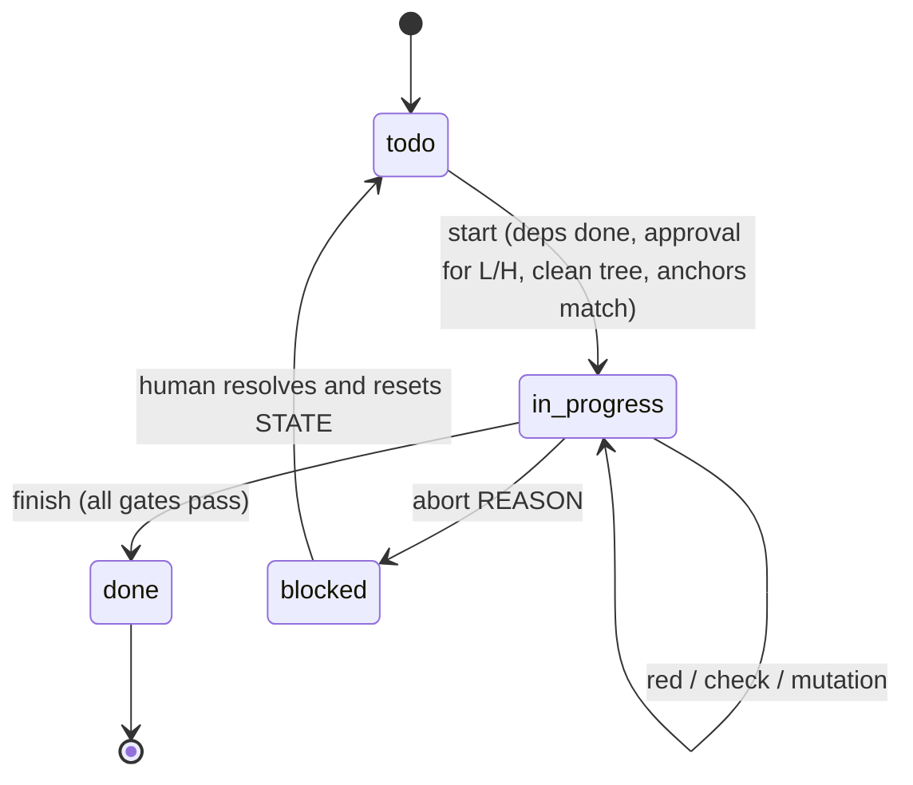

# Switcher v2 remediation: executor design for Claude Code

This document is written for the model that executes the tasks, including small or low-cost models. It assumes no memory of earlier conversations. Everything a task needs is in its section; the machine-readable copy of each task card is `TASKS.json`, and `tools/agent_gate.py` enforces the parts that must not depend on the model's judgement.

Three layers carry the rules, from strongest to weakest:

1. **Harness (deterministic).** `.claude/settings.json` hooks call the gate before every file edit (scope, read-only paths) and whenever the agent tries to stop (scope, forbidden patterns, append-only files, self-audit). Deny rules block `git push`, `approve` and destructive git commands.
2. **Gate (deterministic, run by the agent).** `agent_gate.py start | red | check | finish` checks anchors, red-before-green tests, commands, cargo-mutants survivors and the self-audit record.
3. **This document (advisory).** It explains what to change and why. Where it and the gate disagree, stop and escalate; do not work around the gate.

<a id="quick-start"></a>
## 1. Quick start (the whole loop on one screen)

```text
python3 tools/agent_gate.py next                 # which task, which section
python3 tools/agent_gate.py start <ID>           # refuses if deps, approval, clean tree or anchors fail
# read the task section below, top to bottom, once
# 1) add the task's tests exactly as written (after the marker line)
python3 tools/agent_gate.py red <ID>             # proves the new tests fail on the task's base commit
# 2) apply the edits exactly as written, in order
# 3) run every command of the task card; fix only what the card covers
# 4) fill .agent/STATE.json -> tasks.<ID>.self_audit (section 6.2)
python3 tools/agent_gate.py check <ID>           # fast checks
python3 tools/agent_gate.py finish <ID>          # re-runs commands, red check, mutation gate; marks done
# 5) append a PROGRESS.md entry (section 13.1), then commit with the card's commit_message
# blocked? python3 tools/agent_gate.py abort <ID> "<one-line reason>" and stop.
```

One task per session. After `finish` and the commit, end the session (or `/clear`) before the next task, so that the next task starts from the files, not from a long conversation.

<a id="contract"></a>
## 2. Executor contract

Each rule has a reason, because a model that knows the reason applies the rule to cases the text did not foresee.

| id | rule | reason |
|---|---|---|
| R-01 | Work only on the task returned by `next` and started with `start`. One task at a time. | Doing several changes at once is the main failure mode of long-running agents; the gate keys every check to one task. |
| R-02 | Read the task section in full before the first edit. Do not read other task sections for "context". | Other sections describe states of the code that do not exist yet; mixing them in causes drift. |
| R-03 | Never state or use a symbol, file, line, field or function you have not opened in this session. Grep for it, open the file, then use it. | Invented APIs are the most common error of code models; `symbols_verified` in the self-audit is checked line by line. |
| R-04 | Apply edits as exact text replacements: find the quoted text (it must occur exactly the stated number of times), replace it with the quoted text. Never edit by line number, never retype a block from memory. | Exact anchors make every edit verifiable; line numbers shift. |
| R-05 | Add the task's tests first and run `red`. If a test that should be red passes on the base commit, stop and escalate. | A test that already passes cannot detect the change it is supposed to guard. |
| R-06 | Do not edit, delete, relax or skip any existing test or assertion, except the edits listed under "Existing tests that change" in the task. | Weakening tests is the cheapest way to make a check pass and the hardest to see in review. |
| R-07 | Do not hard-code values to satisfy a test. Implement the general rule written in the task. | Tests verify the rule; they do not define it. |
| R-08 | Make only the changes the task lists. No refactoring, renaming, reformatting of untouched code, extra features or "improvements". | Unrequested changes break the dry-run equivalence that this document relies on. |
| R-09 | Keep the public API additive (INV-08). Never change `Cargo.toml`, `Cargo.lock`, `rust-toolchain.toml`, CI files, this document, `TASKS.json`, `CLAUDE.md`, `.claude/` or the gate. | These are the trust anchors of the process; the hook blocks them anyway. |
| R-10 | Run each command of the task card yourself and record it with its exit code in the self-audit. Report numbers as printed, never estimated. | `finish` re-runs them; a mismatch is a hallucinated result. |
| R-11 | When a numeric result differs from the value in this document, do not adjust the expectation. Stop and escalate. | Every number here was measured; a difference means the code or the environment differs. |
| R-12 | Three failed attempts at the same compiler or test error: stop and escalate. | Repeated blind fixes accumulate unrelated changes. |
| R-13 | Never write a ledger row by hand. Use the row script of section 13.2, and only in tasks with `ledger_required: true`. | Rows are authority claims; the gate checks the schema, append-only order and remote reachability of new rows. |
| R-14 | Never run `git push`, `git reset --hard`, `git checkout -- <path>` on files you did not change, or `agent_gate.py approve`. | Pushing and approving are human decisions. |
| R-15 | Tier L and H tasks start only after a human ran `approve`. Spec-only tasks (`spec_only: true`) have no dry-run-verified code; follow the specification literally and escalate at the first ambiguity. | These tasks need judgement that small models do not reliably supply. |
| R-16 | If anything in this document seems wrong, record it in `open_questions` and abort. Do not "fix" the document. | The document is read-only for agents; the human updates it. |

<a id="environment"></a>
## 3. Environment and commands

- Repository root: the directory that contains `Cargo.toml` and `tools/agent_gate.py`. All commands run from there.
- Toolchain: pinned by `rust-toolchain.toml` (1.94.1, as in CI). If it cannot be installed, prefix cargo commands with `RUSTUP_TOOLCHAIN=stable` (also for `agent_gate.py finish`, which runs cargo) and say so in `PROGRESS.md`. Under stable 1.97, `cargo clippy -p rodas5p-integrators` reports pre-existing lints in `source_owned_graph_schur.rs`; the clippy commands therefore use `--no-deps`, and X4 may need the pinned toolchain.
- `cargo-mutants` 27.x must be installed (`cargo install cargo-mutants --locked`); the gate calls `cargo mutants`.
- The full suite takes 10–20 minutes in release mode. `--no-fail-fast` is part of the command: without it cargo stops at the first failing test binary and hides later failures (this happened during the dry run, see section 11).

| name | command | used by |
|---|---|---|
| contracts | `{{CMD:contracts}}` | F tasks |
| lib-unit-tests | `{{CMD:lib-unit-tests}}` | F tasks |
| vigilode-suite | `{{CMD:vigilode-suite}}` | F tasks |
| clippy | `{{CMD:clippy}}` | vigilode tasks |
| fmt | `{{CMD:fmt}}` | vigilode tasks |
| research-node-check | `{{CMD:research-node-check}}` | governance and experiment tasks |

A single test: `cargo test --locked -p vigilode --release --test switching_v2_remediation_contracts -- <test_name> --exact`.

<a id="protocol"></a>
## 4. Task protocol

### 4.1 States



### 4.2 Steps inside a task

1. `start <ID>`. The gate records `base_sha = HEAD` and creates an empty `self_audit` block.
2. Restate the goal in one sentence in `self_audit.restated_goal`, from the task title and its "Why" paragraph.
3. Open every file named in the task's edits. For each symbol you will touch or call, grep it and record `{symbol, file, line}` in `symbols_verified` (the gate opens that line and checks that the symbol text is on it).
4. Insert the task's tests after the task's marker line in `CT` (or where the task says), exactly as written.
5. `red <ID>`. The gate checks out the task's base commit in a temporary worktree, copies your new test file in, runs the task's red command and checks that every listed red test fails there (or, where the card allows it, does not compile because the new symbol is absent).
6. Apply the edits in the listed order. After each edit, re-read the changed region once.
7. Apply the listed updates of existing tests, if any (only those).
8. Run every command of the task card. Fix failures only inside the task's scope.
9. Fill the self-audit (section 6.2). `check <ID>`.
10. `finish <ID>`. On success: append the PROGRESS.md entry, `git add` the changed and new files, commit with the card's `commit_message`, end the session.

<a id="invariants"></a>
## 5. Invariants

The gate refers to these ids. For each invariant on its task card, the self-audit states `"held: <evidence>"` (the test or command that shows it).

{{INVARIANTS_TABLE}}

<a id="anti-drift"></a>
## 6. Anti-drift and anti-hallucination controls

### 6.1 Failure modes and the control that catches each

| failure mode (seen in agent-written code and in this repository's history) | control | layer |
|---|---|---|
| editing files outside the task | `files_allowed`; PreToolUse hook blocks the edit; Stop hook and `check` diff the tree | harness + gate |
| changing trust anchors (CI, lockfile, this document, the gate) | `forbidden_paths` | harness + gate |
| invented function, field or file | `symbols_verified` checked line by line; the compiler; anchors with exact counts | gate |
| edit applied at the wrong place | exact anchor text with occurrence count, re-checked at `start` | gate |
| test that cannot fail | `red` on the base commit; cargo-mutants on the task diff | gate |
| weakened or deleted assertion | `forbidden_removed_patterns`; `removals_allowed` lists the only exceptions | gate |
| hard-coded result | mutation gate (a constant-returning mutant must be killed); R-07 | gate + review |
| "all tests pass" without running them | `finish` re-runs every command; `commands_run` must hold exit codes | gate |
| silent change of a default path (audit A-4) | INV-01; the skeleton test pins the registered counters of `evidence_driven` | test |
| post-hoc change of a research gate (audit A-1) | INV-13; preregistrations append-only; ledger rows only through the row script; remote reachability checked | gate + human |
| unit mix-up between work models (audit A-5, A-6) | INV-03; unit tests of the conversion helpers; decision-preservation property tests | test |
| context drift over a long session | one task per session; PROGRESS.md and STATE.json carry state between sessions | process |
| declaring done early | Stop hook blocks the stop while the task is in progress and its checks fail | harness |

### 6.2 Self-audit record

`start` creates the block; the agent fills it before `check` and `finish`. Example for F2 (values abbreviated; line numbers are the ones you see in your session):

```json
{
  "restated_goal": "Arm WorkModel V2 pilot ceilings in callback units so that losing pilots stop as early as under V1.",
  "symbols_verified": [
    {"symbol": "fn strict_entry_callback_ceiling(", "file": "crates/vigilode/src/switching.rs", "line": 1062},
    {"symbol": "pub fn integer_work_v2(", "file": "crates/vigilode/src/work_model.rs", "line": 167}
  ],
  "spec_steps_done": ["tests inserted", "red passed", "edit 1", "edit 2", "edit 3", "edit 4", "commands run"],
  "tests_added": ["f2_v2_entry_ceiling_stops_losing_rotation_pilots_like_v1", "v2_entry_callback_cap_matches_boundary_table",
                  "v2_return_callback_cap_matches_boundary_table", "v2_caps_are_decision_preserving"],
  "commands_run": [{"cmd": "cargo test --locked -p vigilode --release --test switching_v2_remediation_contracts", "exit_code": 0}],
  "invariants_checked": {"INV-03": "held: caps divide V2 Ir by kappa (unit tests)", "INV-04": "held: v2_caps_are_decision_preserving",
                         "INV-07": "held: check passes", "INV-10": "held: red passed on base"},
  "no_unrequested_changes": true,
  "open_questions": []
}
```

Before writing `no_unrequested_changes: true`, run `git diff --stat` and compare it with the task's edit list.

### 6.3 Verification questions (answer each before `finish`; write any "no" into `open_questions`)

1. Does every hunk of my diff correspond to a numbered edit or test of the task, and every numbered edit to a hunk?
2. Did every red test fail on the base commit for the reason the task states?
3. Do the numbers I recorded come from command output I saw in this session?
4. Did I leave every existing assertion as it was, apart from the listed updates?
5. Is the change correct for inputs the tests do not cover (other dimension, other `RhsCost`, `kappa = 0`, empty slices)?

<a id="mutation"></a>
## 7. Mutation gate

- Tool: cargo-mutants with `--in-diff <task diff>`: only mutants overlapping the lines the task changed are generated; test-only changes generate none.
- Tests run per mutant: the `cargo_test_args` of the task's `mutation` acceptance entry (`--test switching_v2_remediation_contracts --lib` for F tasks), so unit tests in `src` count.
- Pass condition: no `missed` or `timeout` mutant without a waiver (`max_missed: 0`).
- A surviving mutant means a behaviour of the new code is untested. The fix is a new test inside the task's scope, not a change of the code to dodge the mutant.
- Waivers are for **equivalent mutants only** (the mutant cannot change observable behaviour in any reachable state). The agent proposes a waiver in `open_questions` and aborts; a human writes it into `.agent/STATE.json` as `tasks.<ID>.mutation_waivers = {"<line from missed.txt>": "<reason>"}` and restarts the task.
- Cost (measured in the dry run): cargo-mutants copies the workspace, including build output, once per job: about 14 GB of disk per job, so keep at least 20 GB free and use `-j 1` (the default in TASKS.json). The unmutated baseline build took 165 s; each mutant took 80–340 s (rebuild of the vigilode test binaries). Whole-function mutants of large functions (for example `replace drive_windows -> DriveState with Default::default()`) appear whenever the diff touches the function. An F task has 5–30 mutants: plan 20–120 minutes for `finish`.
- The gate writes the task diff with `--unified=0`. With git's default three context lines, cargo-mutants also mutated unchanged neighbouring lines (the dry run produced a surviving `delete field entry_seed` mutant on a line no task touches).
- Background: mutation testing as an adequacy check for generated tests follows Meta's ACH work (arXiv:2501.12862); `--in-diff` keeps it incremental.

<a id="escalation"></a>
## 8. Escalation and stop conditions

Abort the task (`abort <ID> "<reason>"`), leave the tree as it is, and end the session when any of these occurs. Each task card adds task-specific conditions.

- an anchor is missing or its occurrence count differs (the code is not the code this document was written for);
- a red test passes on the base commit;
- a test outside the task's own tests fails after the change and is not listed under "Existing tests that change";
- a file outside `files_allowed` would have to change;
- the same compiler or test error survives three fix attempts;
- a counter, digest or verdict differs from the value written here;
- you need a fact that is neither in the task section nor in the files the task names.

<a id="dag"></a>
## 9. Task graph

```mermaid
{{DAG_MERMAID}}
```

Tiers: **S** mechanical (exact edits given), **M** small reasoning (exact edits given, more context), **L** multi-site integration (human approval; capable model), **H** human decision or research node (human approval; preregistration). Kinds: `governance`, `bitwise_safe` (no state or counter change on the registered cells), `opt_in_behaviour`, `default_behaviour`, `experiment`, `docs`.

{{TASK_TABLE}}

<a id="tasks"></a>
## 10. Task specifications

Conventions used in every task:

- `CT` is `crates/vigilode/tests/switching_v2_remediation_contracts.rs`. Its helpers `rotation()`, `stiff_forced()`, `bench_options()`, `solve()`, `discarded_rodas_jvp()` and `provided()` already exist.
- "Find" blocks match byte for byte, including leading spaces and blank lines. The count is the number of occurrences in the file when the task starts.
- Tests are inserted directly after the task's marker line (for example `// ---- T-F1 ----...`), separated by one blank line, in the order given.

{{TASK_SECTIONS}}

<a id="evidence"></a>
## 11. Dry-run evidence

The F-task edits and tests of section 10 come from one source file. They were replayed on base commit `{{BASE_SHORT}}` in task order, and the replayed tree was built and tested (stable 1.97.0 because the pinned 1.94.1 was not downloadable in the dry-run environment; release mode; x86_64 Linux). Counters are `(attempts, RHS calls, discarded RODAS pilot JVPs)` on `rotation` and `(attempts, RHS calls)` on `stiff-forced`, both with `bench_options()` over `(0, 1)`.

{{COUNTERS_TABLE}}

{{DRYRUN_NOTES}}

<a id="errata"></a>
## 12. Errata to the earlier reports

| id | earlier statement | correction | evidence |
|---|---|---|---|
| E-1 | Re-audit A-10: "`ProductionConfig` accepts `entry_policy: None` with `implicit_pilot_attempt_budget = 0`, which is pressure-only." | Wrong. `ProductionConfig::validate_provider` refuses `implicit_pilot_attempt_budget == 0` for `DerivativeFallback::ProvidedOnly`, and `Forbidden` has no implicit route, so pressure-only is unreachable in production. F8 changes only `SwitchingConfig` validation. | `crates/vigilode/src/production.rs`, `validate_provider` |
| E-2 | Re-audit A-7: "Use `min` (with a floor)" for the B7 first batch. | Not admissible as a fix. With `budget.min(k_d0_min.max(1))` the route-registry first batch on `stiff-forced` shrinks to 12 attempts, the first pilot is discarded as uneconomical, and adaptive backoff delays entry to t ≈ 0.074: 298 attempts and 1,840 RHS calls against 59 and 400 with `max`. F5 keeps `max`; X10 preregisters the comparison. | dry run, section 11 |
| E-3 | Re-audit A-6 asked for a route-derived `c_min` for every route. | F4 changes only RODAS5P (`c_min = 7`). The pexprb value 12 stays and is documented as unverified: pexprb is not a switcher route (A-8), and the trivially sound value 1 breaks the existing negative control in `pexprb_window_driver_execution_contract_harmonic_and_decay`. | dry run |
| E-4 | F1 "restores the earlier default" sounds free. | It gives up a measured benefit: with backoff, `adaptive_evidence` discards 119 RODAS pilot JVPs on `rotation`, without it 355. The benefit can return only through a preregistered node; `route_registry` keeps the backoff as its opt-in. | section 11 |
| E-5 | Re-audit, "the suites pass: 480 passed". | That count came from a run that did not exercise the remediation; the dry run shows that `cargo test` without `--no-fail-fast` hides failing binaries that come later in alphabetical order. All suite commands here use `--no-fail-fast`. | section 11 |

<a id="templates"></a>
## 13. Templates

### 13.1 PROGRESS.md entry (append; never edit earlier entries)

```markdown
## <ID> — <title> — <YYYY-MM-DD>
- result: done | blocked (<reason>)
- commit: <short sha after commit, or "uncommitted">
- toolchain: pinned 1.94.1 | RUSTUP_TOOLCHAIN=stable (<version>)
- commands: <name: exit code>, ...
- red: <test: reason>, ...
- mutation: caught <n>, missed <n>, waived <n>
- notes: <one or two lines; numbers as printed>
```

### 13.2 Ledger row script (tasks with `ledger_required: true` only)

```python
# Run from the repository root:  python3 - <<'EOF' ... EOF   (edit only the ROW values)
import hashlib, json, subprocess
def sha(path, rev=None):
    if rev:
        data = subprocess.run(["git", "show", f"{rev}:{path}"], capture_output=True, check=True).stdout
    else:
        data = open(path, "rb").read()
    return hashlib.sha256(data).hexdigest()
ROW = {
    "id": "L-NNNN",                      # one more than the id of the last row
    "date": "YYYY-MM-DD",
    "commit": "<40-hex, reachable from a remote branch>",
    "command": "<exact command, or 'UNRECORDED: ...' for INCONCLUSIVE/INVALID only>",
    "profile": "<PROFILE_NAME>",
    "inputs_sha256": {},                 # {path: sha(path, rev=<commit>)}
    "outputs_sha256": {},                # {path: sha(path)}; the files must exist in the tree
    "claim": "<one sentence, at most 600 characters>",
    "verdict": "PASS|FAIL|INCONCLUSIVE|INVALID",
    "supersedes": None,
}
line = json.dumps(ROW, sort_keys=True, ensure_ascii=False)
assert len(ROW["claim"]) <= 600 and "\n" not in line
text = open("research/LEDGER.jsonl", encoding="utf-8").read()
assert text.endswith("\n"), "last ledger line has no newline; escalate"
with open("research/LEDGER.jsonl", "a", encoding="utf-8") as fh:
    fh.write(line + "\n")
print(line)
```

### 13.3 PREREGISTRATION.md skeleton (research nodes)

```markdown
# <node title>
- written: YYYY-MM-DD (committed and pushed before the first run)
- question: <one sentence>
- arms: <baseline arm>, <candidate arm(s)>; everything else identical
- cells: <problems, dimensions, tolerances; registered cells first>
- command: <exact command that writes RESULTS.json>
- inputs: <paths, frozen at the preregistration commit; no measured values typed into scripts>
- metrics: <deterministic counters; callgrind Ir as authority; wall time diagnostic only>
- PASS gate: <numeric condition>
- KILL gate: <numeric condition>
- holdout: <cells not looked at before the run, or "none">
- analysis: <exact script; no threshold chosen after seeing results>

## Results (appended after the run; nothing above this line changes)
```

### 13.4 Commit message

The card's `commit_message`, a blank line, then `Task: <ID> (docs/agent/switcher_v2_remediation/DESIGN.md, section <design_section>)` and `Gate: finish passed; mutation caught <n>, missed 0`.

<a id="references"></a>
## 14. Research basis

- Claude Code best practices: give the agent a check it can run, keep `CLAUDE.md` to what the code cannot tell, move rules without exceptions into hooks and deny rules; a Stop hook that exits 2 sends the agent back to work. https://code.claude.com/docs/en/best-practices ; hooks: https://code.claude.com/docs/en/hooks
- Claude prompting best practices: give the reason behind each instruction; "never speculate about code you have not opened"; "do not hard-code values … tests are there to verify correctness, not to define the solution"; avoid over-engineering; structured state in JSON, progress notes in text. https://platform.claude.com/docs/en/build-with-claude/prompt-engineering/claude-prompting-best-practices
- Anthropic, Effective harnesses for long-running agents: a JSON feature list that agents may only mark as passing, one feature per session, progress file plus git history, a fixed start-of-session routine. https://www.anthropic.com/engineering/effective-harnesses-for-long-running-agents
- Anthropic, Effective context engineering for AI agents: small high-signal context, just-in-time retrieval, structured note-taking. https://www.anthropic.com/engineering/effective-context-engineering-for-ai-agents
- Yang et al., SWE-agent: agent–computer interfaces with concise feedback and edit guardrails. arXiv:2405.15793
- Xia et al., Agentless: a fixed localize → repair → validate pipeline. arXiv:2407.01489
- Mathews and Nagappan, Test-driven development for code generation. arXiv:2402.13521
- Foster et al. (Meta), Mutation-guided LLM-based test generation (ACH). arXiv:2501.12862
- Spracklen et al., package hallucinations by code-generating LLMs. arXiv:2406.10279
- Dhuliawala et al., Chain-of-Verification. arXiv:2309.11495 (basis of the questions in 6.3)
- cargo-mutants `--in-diff`: https://mutants.rs/in-diff.html
