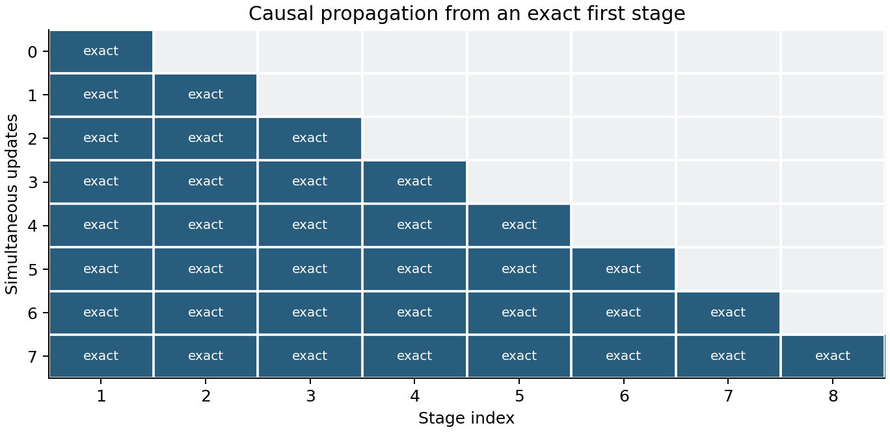
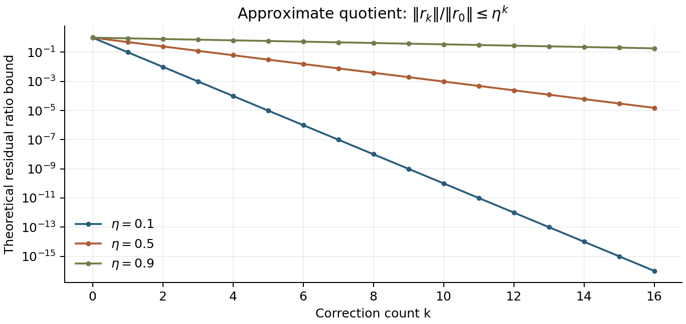
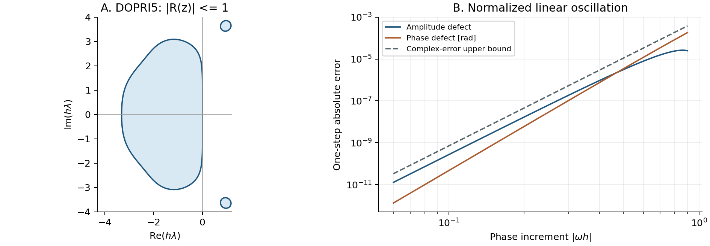

# 초록

VigilODE는 시간 적분 공식과 그 단계 방정식을 푸는 대수 알고리즘을 함께 설계한다. 비강성 문제에는 Dormand–Prince 5(4)를 [1], 강성 문제의 공통 기반에는 RODAS5P를 사용한다 [2]. 그 위에서 여덟 단계의 증분을 하나의 공유 공간으로 표현하고, 엄밀한 하삼각 의존성을 이용하여 현재 단계의 미분 평가와 Newton 반복을 제거한다. 같은 단계 목표를 동시 갱신으로 표현하면 유한 전파 구조에 따른 병렬 평가가 가능하다. 별도로 낮은 차수의 다항식 관계가 선언된 연산자는 몫 다항식과 잔차 보정으로 처리하여 일반적인 선형 대수의 비용을 줄인다. 이러한 특수화의 적용 조건과 실패 비용은 실행 중 선택 알고리즘이 관리한다.

본 문서는 공통 `GeneralOde` 인터페이스와 조건별로 명시적으로 호출하는 특수 알고리즘을 구분하여 설명한다. 인과적 제거, 동시 갱신의 유한 전파, homotopy의 삼각 정칙성, 근사 다항식 관계의 잔차 수축 및 단계 잔차의 출력 증폭을 직접 유도한다. 이어서 시간 적분 계수, 국소 오차 제어, 보간과 실패 처리의 전체 맥락을 기술한다. 전체 Jacobian을 구성하지 않는 것, 도함수를 전혀 사용하지 않는 것 및 Newton 반복을 제거하는 것은 서로 다른 사양이다. 각 경로에서 실제 사용하는 연산과 필요한 가정을 명시하며, 국소 허용오차와 전역 오차를 구별한다.

# 문제 설정과 설계의 동기

## 적분 대상과 전제

대상은 유한한 전진 시간 구간에서 정의된 초기값 문제

$$
 y'(t)=f(t,y(t)),\qquad y(t_0)=y_0\in\mathbb R^n,
 \qquad t_0\le t\le T
 \tag{1}
$$

이다. 상태와 시간은 IEEE 754 배정밀도 실수로 표현한다. 일반 인터페이스의 질량행렬은 항등행렬이다. 콜백은 동일한 시간과 상태에 대해 동일한 우변을 반환해야 하며, 수락되지 않은 시도 중에 외부의 모델 매개변수를 바꾸어서는 안 된다. 상태 차원, 성분의 의미 및 허용오차의 단위도 한 적분 실행 동안 고정된다. 이 전제는 수학적 방법뿐 아니라 거절한 시간 간격의 재시도와 저장된 우변 값의 재사용에 필요하다.

오차 차수에 대한 명제에는 추가 가정을 둔다. 정확해를 포함하는 근방에서 $f$가 필요한 차수까지 미분 가능하고, 해와 관련 도함수가 유계이며, 시간 간격이 해당 방법의 안정성과 오차 전개가 유효한 범위에 있어야 한다. 불연속 우변, 구간별 모델 전환 또는 특이점을 포함하는 문제를 매끄러운 문제의 차수 정리로 해석하지 않는다. 알려진 불연속점은 적분 구간을 나누는 경계로 처리할 수 있다.

## 하나의 고비용 방법으로 모든 문제를 처리하지 않는 이유

강성 문제에서는 해가 천천히 변하더라도 빠르게 감쇠하는 성분 때문에 명시적 방법의 안정성 제한이 엄격해질 수 있다. 반대로 이러한 제한이 없는 작은 문제에서 매 시간 간격마다 Jacobian과 LU 분해를 구성하면 우변을 평가하는 비용보다 부수적인 연산이 더 커질 수 있다. 따라서 범용성은 모든 문제에 동일한 대수 연산을 적용하는 것으로 정의하지 않는다. 서로 다른 계산 구조를 가진 두 방법을 공통의 입력과 실패 계약으로 제공하는 데서 출발한다.

고주파 진동 역시 강성과 구분한다. $y'=i\omega y$의 진폭은 일정하지만, 수치해의 위상은 작은 간격별 오차를 장시간 누적할 수 있다. 왼쪽 반평면에서의 안정성은 이러한 위상 정확도를 대신하지 않는다. 따라서 문제의 강성 선언은 방법 선택에 필요한 정보이고, 실제로 필요한 시간 해상도는 허용오차와 관측량의 정확도 요구에 의해 정해진다.

# 방법 선택과 공개 사양

## 공통 인터페이스의 선언에 따른 선택

일반 진입점은 `GeneralOde::solve`이다. `GeneralOdePolicy`는 문제 유형을 `ProblemRegime`으로 지정하고, `derivatives: DerivativeFallback`으로 도함수 계산 허용 여부를, `max_dense_dimension`으로 조밀 행렬 사용의 자원 한계를 명시한다. 기본 선택에서 강성이 알려지지 않은 문제는 명시적 방법으로 시작한다. 이 공통 진입점의 방법 선택은 실행 전 선언으로 정해진다. 뒤에서 설명하는 인과적 단계 알고리즘과 실행 중 선택은 별도의 명시적 진입점을 가지며, 사용자에게 허용받지 않은 도함수 계산을 새로 부여하지 않는다.

| 입력 조건 | 선택 방법 | 핵심 연산 | 사용자에게 요구하는 정보 |
|:--|:--|:--|:--|
| `Unknown` | DOPRI5 | 우변 평가와 벡터 결합 | $f(t,y)$ |
| `Nonstiff` | DOPRI5 | 우변 평가와 벡터 결합 | $f(t,y)$ |
| `Stiff`, 도함수 계산 허용 | RODAS5P | 우변, Jacobian 정보, 선형 풀이 | 제공 도함수 또는 허용된 수치 미분 |
| `Stiff`, 도함수 계산 불허 | 실행 전 오류 | 없음 | 허용 정책 변경 또는 다른 방법의 직접 선택 |

기본 조밀 행렬 차원 한계는 $n=64$이다. 이는 수학적 적용 한계가 아니라 메모리와 분해 비용을 통제하는 구성값이다. 사용자는 해당 비용을 알고 한계를 변경할 수 있다. 대역 구조가 주어진 경우에는 그 구조를 이용하는 경로를 선택한다. 조밀 Jacobian 콜백에 대역 선언을 덧붙인 경우에는 여전히 조밀 배열을 구성하므로 차원 한계가 적용된다. 압축된 대역 콜백이나 대역 유한차분만 이 한계에서 제외된다. Jacobian–벡터 곱을 이용하는 경로는 `allow_matrix_free=true`를 요구하며 기본값은 `false`이다. 알려지지 않은 강성에 대해 명시적 방법을 선택한다는 것은 그 문제에서 빠른 완료를 보장한다는 뜻이 아니다. 시간 간격 축소나 시도 횟수 소진은 진단 가능한 결과로 반환된다.

`DerivativeFallback::Forbidden`은 도함수 계산을 금지하는 기본값이다. `ProvidedOnly`는 제공된 Jacobian 또는 JVP와, 비자율 문제에서 제공된 시간 편미분을 요구한다. 자율 문제는 `autonomous()`로 시간 편미분이 0임을 선언할 수 있다. `AllowFiniteDifference`는 빠진 도함수를 수치 미분으로 계산하도록 허용한다. `GeneralOde::select`는 우변을 호출하지 않고 이 기능과 권한의 조합을 확인한다. 시간 구간, 초기 상태 및 허용오차의 수치적 유효성은 `solve`에서 검사한다.

## 공통 인터페이스의 지원 범위

일반 인터페이스는 항등 질량행렬의 ODE와 고정 차원 상태를 다루며 끝점 결과를 반환한다. `dense_output=true`인 요청은 거부하고, 연속 출력은 방법별 직접 인터페이스에서 요청한다. 사건 함수에 따른 근 위치 탐색, 사건 직후 상태 변경, 질량행렬 및 대수 제약은 이 인터페이스의 계약에 포함되지 않는다. 지원하지 않는 조합은 우변을 호출하기 전에 거부한다. 각 방법의 직접 인터페이스에서 제공하는 출력 기능은 아래와 같다. 이 직접 인터페이스의 출력 확장은 자동 방법 선택 기능과 구별한다.

| 기능 | DOPRI5 | RODAS5P |
|:--|:--|:--|
| 끝점 적분 | 지원 | 지원 |
| 성분별 절대 허용오차 | 지원 | 선택한 직접 선형 풀이 경로에서 지원 |
| 지정 시각에 실제 시간 간격 종료 | `solve_observed` | 공개 인터페이스는 구간 양 끝점만 제공 |
| 지정 시각의 연속 보간 표본 | `solve_dense_observed` | 연속 출력 경로 |
| 실행 후 임의 시각의 보간 객체 | 일반 DOPRI5 진입점에서는 제공하지 않음 | 조밀 또는 대역 연속 출력 경로 |
| 수락한 상태에서 일시 중지와 재개 | `Dopri5::with_session` | 본 문서의 일반 인터페이스에는 포함하지 않음 |
| 우변만으로 수행 | 예 | 아니오 |
| Newton 비선형 반복 | 없음 | 없음 |

`Options::dense_output`은 실행 뒤에도 보관할 연속 출력 객체를 요청하는 설정이다. 이 설정을 DOPRI5에 주는 것과 `solve_dense_observed`로 표본만 요청하는 것은 서로 다른 계약이다. 전자는 거부되고, 후자는 지원된다. RODAS5P의 Jacobian–벡터 곱 경로는 끝점 출력에 한정되며, 성분별 절대 허용오차도, 연속 출력도 해당 경로에서 지원하지 않는다. 스칼라 절대 허용오차를 사용한 끝점 출력만 지원한다.

<!-- DISTINCTIVE_CHAPTER_BEGIN -->

# VigilODE의 인과적 단계 계산과 대수적 연산 축약

## 연구의 동기와 구현의 층위

VigilODE의 수학적 설계는 표준 시간 적분 공식의 선택과 그 공식을 계산하는 대수 알고리즘의 선택을 함께 다룬다. 전자는 비강성 문제의 명시적 적분과 강성 문제의 Rosenbrock 적분을 구분한다. 후자는 같은 단계 방정식을 더 적은 도함수 평가, 더 작은 선형 문제 또는 더 짧은 계산 의존 경로로 풀 수 있는지를 묻는다. 이 두 선택은 서로 다른 문제이다. `GeneralOde`가 보수적인 공통 진입점을 제공한다는 사실만으로, 별도의 명시적 호출로 사용할 수 있는 인과적 단계 풀이와 대수적 특수화가 사라지는 것은 아니다.

이 장에서는 구현된 알고리즘을 수학적 대상으로 삼는다. 시간 적분의 계수는 기존 RODAS5P를 사용하고 [2], 같은 계수가 정의하는 여덟 단계의 결합 문제에서 인과성, 공통 선형 연산자 및 낮은 차수의 다항식 관계를 이용한다. 따라서 새로운 기여를 논할 때에는 시간 적분 공식, 단계 풀이, 구조를 이용한 연산 축약 및 실행 중 선택을 구분해야 한다. 아래의 직접 유도는 해당 알고리즘의 정확성 또는 조건부 비용 감소를 설명한다. 기존 문헌 전체에 대한 최초성 주장은 이로부터 따라오지 않는다.

| 구현 층위 | 계산 대상 | 사용하는 정보 | 제공하는 효과 |
|:--|:--|:--|:--|
| 공통 시간 적분 | 전체 초기값 문제 | 우변과 허용된 도함수 | 명시적·선형 음시적 방법의 안전한 선택 |
| 인과적 축소 단계 풀이 | 한 시도의 여덟 단계 | 기준점 JVP와 공유 기저 | 현재 단계의 도함수와 Newton 반복 제거 |
| 동시 단계 갱신 | 같은 단계 근 | 동일한 이전 반복값의 우변 묶음 | 단계 평가의 병렬 실행 기회 |
| 다항식 몫 연산 | 선형 resolvent 또는 흐름 | 선언된 연산자 관계와 노름 상한 | 직교화와 일반 조밀 분해의 대체 |
| 조건별 적응 선택 | 특수화와 보호된 풀이 사이 | 실제 비용, 잔차, 실패 이력 | 반복되는 부적합 시도의 억제 |

여기서 *Jacobian-free*는 전체 상태 좌표의 Jacobian 배열을 구성하지 않는다는 뜻으로 사용한다. *Matrix-free*는 큰 연산자를 작용으로 다룬다는 뜻이며 작은 투영 행렬까지 금지하는 표현은 아니다. *Derivative-free*는 실제로 도함수 또는 JVP를 요구하지 않는 경로에만 사용한다. *Newton-free*는 비선형 Newton 반복을 하지 않는다는 뜻이다. 이 구분에 따르면 인과적 투영 경로는 전체 Jacobian을 조립하지 않고 현재 단계의 미분과 Newton 반복을 제거하지만, 기준점에서 제공된 JVP와 작은 행렬 분해를 사용한다. 반면 구조가 선언된 회전·감쇠 흐름이나 다항식 작용은 해당 연산자 관계를 직접 이용하므로 별도의 Jacobian 추정을 요구하지 않는다.

## 공유 기저에서의 증강 단계 방정식

자율 초기값 문제 $y'=f(y)$의 수락 상태를 $y_n$이라 하자. $J_0=f'(y_n)$의 작용을 제공하고, 두 번의 재직교화를 거친 기저를 $Q\in\mathbb R^{n\times m}$, $Q^TQ=I_m$으로 쓴다. 실제 구현은 $Q$의 열과 $J_0Q$를 보관한다. 전체 $n\times n$ Jacobian을 만들지 않는다. 이때

$$
 B=Q^TJ_0Q,\qquad W_m=I_m-h\gamma B,\qquad u_i\approx Qz_i
 \tag{C1}
$$

를 정의한다. $u_i$는 원래 상태 공간의 단계 증분이고 $z_i\in\mathbb R^m$는 그 축소 좌표이다. 여덟 $z_i$를 하나의 벡터로 모으면 차원 $8m$의 증강 미지수를 얻는다. 여기서 증강은 물리적 상태에 새로운 방정식을 임의로 더한다는 뜻이 아니라, 한 시도의 단계들을 함께 표현한다는 뜻이다.

RODAS5P의 원래 단계 좌표를 사용하면 투영된 최종 목표는

$$
 W_m z_i=h\gamma Q^T f\!\left(y_n+Q\sum_{j<i}a_{ij}z_j\right)
       +\gamma\sum_{j<i}c_{ij}z_j,\qquad i=0,\ldots,7.
 \tag{C2}
$$

$a_{ij}$와 $c_{ij}$는 엄밀한 하삼각 계수이다. 구현은 대각선과 상삼각에 0이 아닌 항이 있으면 이 인과적 풀이를 거부한다. 수학적으로 작은 항이라도 그대로 무시하지 않는다. 이 검사 덕분에 식 (C2)의 우변에는 현재 미지수 $z_i$가 들어가지 않는다.

**명제 C1 — 공통 인자를 이용한 인과적 제거.** $W_m$이 가역이고 필요한 단계 상태에서 $f$가 정의되면 식 (C2)는 유일한 해를 가지며, 한 번의 $W_m$ 분해와 여덟 번의 전진 단계 풀이로 그 해를 구성할 수 있다.

**증명.** 첫 단계의 우변은 $h\gamma Q^Tf(y_n)$로 이미 알려져 있다. $W_m$의 가역성으로 $z_0$가 유일하게 정해진다. $z_0,\ldots,z_{i-1}$가 정해졌다고 가정하면 $i$번째 우변도 알려져 있으므로 $z_i$가 유일하게 정해진다. 여덟 단계에 대한 귀납법으로 결론을 얻는다. $\square$

이는 비선형 단계 방정식의 구조를 직접 사용한 연산 제거이다. 각 단계의 상태에서 새로운 Jacobian이나 JVP를 평가할 이유가 없고, 현재 $z_i$에 대한 Newton 보정도 필요하지 않다. 조밀한 축소 행렬을 사용할 때 공통 인자분해와 여덟 선형 풀이의 비용은 $O(m^3+8m^2)$이다. 단계 결합 자체에는 $O(8^2m)$, 승강과 투영에는 $O(8nm)$가 추가되며, 기저 구성·우변·원래 공간 잔차 검사도 따로 계산해야 한다. 따라서 이 식은 전체 적분 비용이 항상 $O(m^3)$이라는 주장이 아니다. 작은 문제에서는 $m=n$일 수도 있다.

공통 기저를 사용하는 이유도 여기에 있다. 매 단계마다 별도의 큰 선형 풀이를 준비하는 대신, 같은 기준점의 작용을 축소 공간에 모아 여러 단계가 재사용한다. 반대로 매우 넓은 스펙트럼이나 큰 투영 누출을 가진 문제에서는 작은 $m$으로 원래 단계 방정식을 재현하기 어렵다. 이 경우 기저 확장 또는 원래 공간의 보호된 풀이가 필요하다.

## 유한 전파와 단계 병렬화

단계들을 같은 이전 반복값에서 동시에 평가하려면 비선형 나머지를

$$
 N_i(z)=Q^T\!\left[f\!\left(y_n+Q\sum_{j<i}a_{ij}z_j\right)
              -f(y_n)-J_0Q\sum_{j<i}a_{ij}z_j\right]
 \tag{C3}
$$

로 분리한다. 공통 대각 블록 $W_m$을 가진 하삼각 선형 행렬을 $L$이라 쓰면 최종 목표는 $Lz=g+h\gamma N(z)$가 된다. 동시 갱신은

$$
 z^{(k+1)}=L^{-1}\{g+h\gamma N(z^{(k)})\}
 \tag{C4}
$$

이다. 모든 $N_i$는 같은 $z^{(k)}$를 읽으므로 우변 평가들을 병렬로 실행할 수 있다. 단계 하나의 쓰기 결과를 다른 단계가 같은 묶음 안에서 읽는 방식과 구별된다.

**명제 C2 — 인과적 유한 전파.** 정확한 산술에서, 식 (C4)의 시작값이 첫 단계를 정확히 만족하면 일곱 번의 갱신 뒤에는 여덟 단계 모두 식 (C2)의 해와 일치한다. 이 명제에는 전역 수축 상수 $\|T'\|<1$이 필요하지 않다.

**증명.** $N_i$는 $z_0,\ldots,z_{i-1}$에만 의존하고 $L^{-1}$도 하삼각이다. 따라서 갱신 사상 $T_i$는 이전 반복의 $z_0,\ldots,z_{i-1}$에만 의존한다. 첫 단계가 정확하면 다음 갱신에서 두 번째 단계가 정확해진다. 첫 $k+1$단계가 정확하면 다음 갱신에서 첫 $k+2$단계가 정확해진다. 선형 시작값 $L^{-1}g$는 첫 단계를 정확히 만족하므로 일곱 번을 적용하면 충분하다. $\square$

이 성질은 단계 방향의 엄밀한 정보 전파에 관한 것이다. 배정밀도에서는 반올림과 선형 풀이 오차가 남으므로 구현은 실제 잔차를 확인하고 유한 횟수 안에서 종료한다. 또한 벽시계 시간은 별도 문제이다. 순차 인과적 풀이가 새 우변을 일곱 번 평가한다면, 동시 반복은 각 갱신에 앞선 잔차 평가와 마지막 성공 확인을 포함한다. $k$번 갱신 뒤 성공하면 평가 묶음 수는 $b=k+1$이며, 새 우변은 $7b$번 필요하다. 일곱 작업을 $p$개 작업자에 배분하는 단순 비용 모델에서

$$
 b\left\lceil\frac7p\right\rceil C_f+bC_{\rm sync}+C_{\rm small}
       <7C_f+C_{\rm forward}
 \tag{C5}
$$

일 때 병렬 실행의 이득을 기대할 수 있다. $C_f$는 한 우변의 시간이고 나머지 항은 동기화와 축소 선형 대수의 시간이다. 두 경로 모두 원래 공간에서 수행하는 최종 잔차 검사는 이 간단한 비교식에서 공통 비용으로 분리하였다. 식 (C5)는 해당 비용 모델에서의 교차 조건이다. 실제 선택에는 초기 준비, 검증 및 실패 후 대체 비용을 포함한 측정이 필요하다. 저렴한 우변에서 관측된 손해는 비싼 우변의 가능성을 배제하지 않지만, 작업자 수만으로 가속을 보장하지도 않는다.

## Homotopy의 역할과 삼각 구조의 정칙성

선형 시작 문제와 비선형 단계 목표를 연결하는 homotopy는

$$
 H_\lambda(z)=L_{\eta(\lambda)}z-g-\lambda h\gamma N(z)=0,
 \qquad \eta(\lambda)=\theta+\lambda(1-\theta),\quad0\le\lambda\le1
 \tag{C6}
$$

로 표현된다. 구현은 $\lambda=1$의 직접 보정을 먼저 시도하고, 필요할 때만 구간을 세분한다. 일반 보정 경로는 현재 단계 도함수와 Newton 보정을 사용할 수 있다. 따라서 저장소의 모든 homotopy 구현을 하나의 Newton-free 방법으로 부르는 것은 정확하지 않다.

**명제 C3 — 인과적 homotopy의 정칙성.** $f$가 관련 영역에서 $C^1$이고 $W_m$이 가역이라고 하자. 식 (C6)의 해가 그 영역 안에 머무르면, 모든 $\lambda$에서 $\partial_zH_\lambda$는 대각 블록이 $W_m$인 하삼각 행렬이고

$$
 \det(\partial_zH_\lambda)=\det(W_m)^8\ne0.
 \tag{C7}
$$

따라서 이 영역의 경로에는 단계 결합 자체에서 생기는 Jacobian 특이점이 없다.

**증명.** $N_i$의 현재 단계 및 후속 단계에 대한 편미분은 0이다. $\eta$가 바꾸는 선형 결합도 엄밀한 하삼각 부분에만 위치한다. 모든 대각 블록은 $W_m$으로 유지되므로 블록 삼각 행렬의 행렬식 공식이 식 (C7)을 준다. 해의 국소 $C^1$ 의존성은 음함수 정리로 얻는다. 각 $\lambda$의 해 자체는 명제 C1과 같은 전진 구성으로 정해진다. 영역 밖으로 나가는 문제는 이 정칙성 가정에 포함되지 않는다. $\square$

이 결과는 homotopy를 이용한 연구가 인과적 직접 풀이로 이어지는 수학적 이유를 보여 준다. 삼각 구조가 유지되는 목표에서는 연속 경로를 추적하는 반복을 전진 제거로 대체할 수 있다. 반대로 단계 간 양방향 결합, 경계 조건, 여러 시간 구간을 함께 맞추는 문제에서는 식 (C7)의 구조가 사라질 수 있으므로 continuation과 근 검증이 다시 독립적인 역할을 갖는다.

여러 시간 구간의 affine 사상 $y_{j+1}=A_jy_j+b_j$를 합성할 때에는 결합법칙에 따라 prefix 계산을 병렬화할 수 있다. 합성은 $(A_2,b_2)\circ(A_1,b_1)=(A_2A_1,A_2b_1+b_2)$이다. 비선형 시간 전파가 곧바로 affine 사상으로 바뀌지는 않는다. 저장소의 별도 nonlinear window 구현은 선언된 모델의 부분 흐름과 보정, 독립 오차 검증을 사용한다. 이러한 모델 전용 계산과 임의의 우변을 받는 범용 적분은 서로 다른 호출 계약이다.

## 다항식 몫 공간에서의 선형 풀이

시간 간격과 선형 계수를 포함한 연산자를 $B$라 하고 $C=I-B$를 풀어야 한다고 하자. 낮은 차수의 관계 $q(B)=0$가 알려져 있으면, 계산은 형식적인 다항식환 $\mathbb R[z]/(q)$에서 낮은 차수의 대표원으로 옮겨진다. 여기서 핵심은 추상적 명칭이 아니라 실제로 필요한 연산자 작용의 수가 줄어든다는 것이다.

**명제 C4 — 몫 다항식 resolvent.** $q$가 차수 $d\ge1$인 실수 다항식이고 $q(1)\ne0$라고 하자. 다항식

$$
 p(z)=\frac{q(1)-q(z)}{q(1)(1-z)}
 \tag{C8}
$$

는 차수가 최대 $d-1$이고, $q(B)=0$이면 $(I-B)^{-1}=p(B)$이다.

**증명.** 분자는 $z=1$에서 0이므로 $(1-z)$로 나누어떨어진다. 식 (C8)에 $1-z$를 곱하고 $z=B$를 대입하면 $(I-B)p(B)=I-q(B)/q(1)=I$이다. 유한 차원에서 오른쪽 역행렬은 역행렬이므로 결론을 얻는다. $\square$

Horner 계산은 최대 $d-1$회의 $B$ 작용으로 $p(B)b$를 구성한다. 원래 공간의 잔차 확인에는 한 번의 작용이 추가된다. 이는 $d$가 작고 관계가 실제 연산자 전체에 대해 성립할 때 유용하다. 몇 개 벡터에서 관측한 일치만으로 전체 연산자 관계를 증명할 수는 없다.

인수분해나 고유벡터 구성이 이 공식의 선행 조건은 아니다. 중근을 가진 $q$에도 같은 증명이 적용된다. 예를 들어 $B=\mu I+N$, $N^d=0$이면

$$
 (I-B)^{-1}=\frac1{1-\mu}\sum_{j=0}^{d-1}
                   \left(\frac{N}{1-\mu}\right)^j,\qquad\mu\ne1.
 \tag{C9}
$$

비정규 행렬도 포함하는 유한 급수이다. $\|N\|$이 크거나 $\mu$가 1에 가까우면 역연산의 크기와 반올림 민감도가 커질 수 있으므로, 유한한 차수만으로 수치 안정성을 판단하지 않는다. 구현은 $q(1)$의 크기를 계수 절댓값 합과 비교하고, 원래 좌표의 잔차를 확인한다.

### 근사 관계를 잔차 보정으로 활용

정확한 관계가 약간 깨진 경우에도 식 (C8)은 유용할 수 있다. $D=q(B)/q(1)$라 두면 항상

$$
 Cp(B)=I-D.
 \tag{C10}
$$

**명제 C5 — 근사 몫 다항식의 잔차 수축.** 어떤 유도 행렬 노름에서 $\|D\|\le\eta<1$이고, 정확한 산술로

$$
 r_k=b-Cx_k,\qquad x_{k+1}=x_k+p(B)r_k
 \tag{C11}
$$

를 계산하면 $r_{k+1}=Dr_k$이고 $\|r_k\|\le\eta^k\|r_0\|$이다. 또한

$$
 \|C^{-1}\|\le\frac{\|p(B)\|}{1-\eta}.
 \tag{C12}
$$

**증명.** 식 (C10)을 식 (C11)의 새 잔차에 대입하면 $r_{k+1}=r_k-Cp(B)r_k=Dr_k$이다. 노름의 곱셈 부등식을 반복 적용하면 수축 한계를 얻는다. $\|D\|<1$이므로 $I-D$의 Neumann 급수가 수렴하며, $C^{-1}=p(B)(I-D)^{-1}$에서 식 (C12)가 따른다. $\square$

**계산량에 대한 따름정리.** $B=-\alpha I+E$, $\alpha\ge0$이고 $\|E\|/(1+\alpha)\le\eta_*<1$인 상한이 차원 $n$과 무관하게 유지된다고 하자. $q(z)=z+\alpha$를 택하면 $p(B)=I/(1+\alpha)$이고 결함은 $E/(1+\alpha)$이다. 상대 잔차 목표 $0<\varepsilon<1$에 필요한 보정 수는 $O(\log(1/\varepsilon))$이며 $n$에 의존하지 않는다. 한 연산자 작용이 $O(n^2)$이면 전체 비용은 $O(n^2\log(1/\varepsilon))$로, 매번 새 조밀 LU 분해를 구성하는 $O(n^3)$ 비용을 줄인다. 이미 분해한 LU를 재사용하는 풀이도 우변당 $O(n^2)$이므로 그 경우에는 점근적 우위를 주장할 수 없으며 실제 반복 수와 준비 비용을 비교해야 한다.

이 명제는 원래 $B$가 수축해야 한다고 요구하지 않는다. 필요한 것은 낮은 차수 다항식이 남긴 결함 $D$의 수축이다. 따라서 큰 감쇠 또는 일부 비정규 연산자를 $B$ 자체의 무조건적인 Neumann 반복에서 제외했더라도, 별도의 몫 다항식 전처리 뒤에는 잔차 보정이 가능하다. 정확히 확인한 관계, 분모 여유 및 결함 상한이 실제 사용 조건이다.

배정밀도 구현에서는 매 보정 뒤 원래 잔차를 다시 계산한다. 주어진 허용오차를 통과한 결과만 외부 출력에 기록하고, 비유한 값·콜백 오류·비용 한도 소진·관측된 정체를 구분한다. 조건부 오차 추정은 잔차 평가의 산술 오차까지 포함한 상한을 입력으로 필요로 한다. 상한 계산을 일반 부동소수점으로 평가한 결과와 바깥쪽 반올림 구간 증명은 구별한다.

### 고유값 군집, 불변 부분공간과 선언된 흐름

다항식 $q=q_1\cdots q_g$의 인수들이 서로소이면 중국인의 나머지 정리로 각 인수에 대응하는 다항식 사영을 구성할 수 있다. 구체적으로 $q/q_j$의 $q_j$에 대한 역원을 $s_j$라 하고 $e_j=s_jq/q_j$를 $q$로 나눈 나머지를 취하면 $e_j\equiv1\pmod{q_j}$, $e_j\equiv0\pmod{q_k}$ ($k\ne j$)이다. 따라서 $q(B)=0$일 때 $P_j=e_j(B)$는 $P_j^2=P_j$, $P_iP_j=0$, $\sum_jP_j=I$를 만족한다. 서로 다른 완화 시간이나 진동군을 분리하여 각 부분공간에 짧은 다항식 또는 정확한 흐름을 적용할 수 있다. 이 구성의 비용에는 사영 작용과 그 조건수가 포함된다.

현재의 선언된 감쇠 회전 흐름은 이 원리의 단순한 실현이다. 블록 $A=-dI+\omega R$, $R^2=-I$, $d\ge0$에 대해

$$
 e^{tA}=e^{-dt}\{\cos(\omega t)I+\sin(\omega t)R\}
 \tag{C13}
$$

이고, 연산은 원소별 곱과 합으로 끝난다. 같은 블록들은 삼각함수 계수를 공유한다. 추가 비선형 나머지 $N(t,y)$가 있는 $y'=Ay+N(t,y)$에는 구현된 Lawson형 적분이 이 흐름을 사용한다. 이때 빠른 선형 진동을 정확한 대수식으로 처리하는 이점과 비선형 나머지의 시간 해상도는 분리해서 판단한다. 고정 $A$와 매끄러운 나머지에서의 고전적 차수는 강성 한계 전체에서 균일한 차수 보장과 같지 않다.

일반적인 다항식 사영의 자동 구성, 부분공간의 온라인 추적 및 매개변수 공간 전체의 역연산 상한 재사용은 추가 구현 대상으로 남아 있다. 각 구성은 실행되는 연산자와 식별값, 관계식, 노름 상한 및 비용으로 연결되어야 한다. 선언된 회전 블록의 존재만으로 임의의 입력 우변을 이 구조로 자동 분해하지 않는다.

중복근이 있는 인수 $(z-\lambda)^r$를 사용하는 경우에는 함수의 값만으로 충분하지 않고 $r-1$차까지의 도함수 정보가 필요하다. 이는 행렬 함수의 Jordan 및 Hermite 표현과 연결되는 기존 원리이다 [3]. 가까운 서로 다른 근에 대한 사영의 노름이 커지면, 근을 따로 나누는 표현 대신 군집 전체의 다항식과 도함수 정보를 유지하는 표현을 선택할 수 있다. 이러한 구조는 저장소의 shared-shift 및 complex-shift jet 연산과 연결된다. 다항식 전처리와 적응적 선택 자체도 선행 연구가 있는 방법이며 [4], 현재 구현의 대상은 선언된 낮은 차수 관계, 원래 잔차 및 실패 처리의 결합이다.

### 확장 가능한 homotopy와 불변 관계

후속 확장을 위한 두 가지 구성을 명시한다. 첫째, 현재 선형 단계 연산자 $M(\vartheta)$가 준비 지점의 $M(\vartheta_0)$에서 변할 때, 저장한 근사 역연산자 $P_0$의 오른쪽 결함은

$$
 I-M(\vartheta)P_0=E_0-[M(\vartheta)-M(\vartheta_0)]P_0,
 \qquad E_0=I-M(\vartheta_0)P_0.
 \tag{C14}
$$

따라서 어떤 매개변수 셀 전체에서 오른쪽의 노름이 1보다 작다는 상한을 확보하면, 같은 $P_0$로 현재 방정식의 잔차를 줄일 수 있다. 현재 잔차에는 반드시 현재 $M(\vartheta)$를 사용한다. 이전 시도의 잔차 자체를 재사용하는 것은 이 항등식과 다르다. Homotopy를 통한 역연산자 재사용과 잔차 보정은 선행 연구와도 연결된다 [5]. 새 준비 비용의 절감이 셀 확인, 추가 보정 및 실패 비용보다 클 때 전체 비용이 감소한다.

비선형 근 $F(x,\lambda)=0$에도 구체적인 충분조건을 줄 수 있다. 닫힌 볼 $\mathcal B(x_c,r)$에서 $F$가 $x$에 대해 $C^1$이고, 고정된 정방 선형 연산자 $P$가

$$
 \sup_{x\in\mathcal B,\lambda}\|I-P\partial_xF(x,\lambda)\|\le q<1,
 \qquad \sup_\lambda\|PF(x_c,\lambda)\|\le(1-q)r
 \tag{C15}
$$

를 만족한다고 하자. 그러면 $T_\lambda(x)=x-PF(x,\lambda)$는 볼을 자기 자신으로 보내는 $q$-수축이다. 평균값 정리로 첫 조건이 수축을 주고, 중심에서의 이동량과 삼각 부등식으로 두 번째 조건이 자기 사상을 준다. Banach 고정점 정리에 따라 반복은 각 $\lambda$의 유일한 근으로 수렴한다. 첫 조건은 $P\partial_xF$와 $P$의 가역성도 보장하므로 고정점은 실제 $F=0$의 근이다. 구조를 아는 다항식 모델에서 식 (C15)의 상한을 사전에 확보하면 온라인 보정은 $F$의 값과 $P$의 작용만으로 수행할 수 있다. 현재의 일반 우변 인터페이스가 이러한 상한을 자동 생성하는 것은 아니며, 이 구성은 명시적인 다음 구현 계약이다.

둘째, 다항식 제약 $g(y)=0$에 대해 $Dg(y)f(y)=C(y)g(y)$가 성립하면, 초기 $g(y_0)=0$인 해는 그 제약 위에 머문다. 합성함수 $g(y(t))$가 영 초기값의 동차 선형 방정식을 만족하기 때문이다. 추가로 사상 $\pi$가

$$
 D\pi(y)f(y)=\phi(\pi(y))+R(y)g(y)
 \tag{C16}
$$

를 만족하면 $z=\pi(y)$는 제약 위에서 정확히 $z'=\phi(z)$를 따른다. 이는 불변 ideal에 대한 계산이 실제 ODE 차원 축약으로 연결되는 조건이다.

예를 들어 $y'=Ay+U\psi(V^Ty)$이고 $q(A)=0$인 monic 다항식의 차수가 $d$이면, $m_k=V^TA^ky$ ($k=0,\ldots,d-1$)에 대해

$$
 m_k'=m_{k+1}+V^TA^kU\psi(m_0)
 \tag{C17}
$$

이다. 마지막 $m_d$는 $q$의 계수로 앞선 모멘트들의 선형 결합이 된다. 따라서 $V$의 열 수가 $r$일 때 $rd$개의 모멘트로 닫힌 비선형 문제를 얻는다. 필요한 출력이 이 모멘트들이면 원래 차원 $n$의 비선형 적분을 줄일 수 있다. 전체 상태가 필요하면 초기의 나머지 성분과 재구성 비용을 보존해야 한다. 이 일반 모멘트 provider와 자동 전환은 후속 구현 대상이며, 저랭크 구조의 기존 특수 코드가 임의의 우변에 대한 자동 차원 축약을 제공한다고 해석하지 않는다.

## 잔차, 시간 오차 및 조건별 선택

작은 투영 잔차는 원래 공간의 단계 오차와 같지 않다. 투영 공간 밖의 성분은 $Q^T$에서 사라질 수 있으므로, 후보는 원래 $n$차원 단계 방정식에 다시 대입된다. 이 검사와 시간 오차에 대한 내장 추정은 별개의 판단이다. 원래 단계 잔차를 통과해도 내장 시간 오차가 크면 시간 간격을 줄이고 다시 시도한다.

**명제 C6 — 인과적 잔차의 단계별 증폭.** 원래 단계 연산자 $W=I-h\gamma J_0$에 대해 $\|W^{-1}\|\le\kappa$이고, 정확한 단계와 후보 단계 사이의 관련 영역에서 $f$가 Lipschitz 상수 $L$을 가진다고 하자. 원래 좌표에서의 후보 잔차를 $r_i$, 단계 오차를 $e_i$라 하면

$$
 \|e_i\|\le\kappa\left(\|r_i\|+
      \sum_{j<i}\bigl(|h\gamma|L|a_{ij}|+|\gamma c_{ij}|\bigr)\|e_j\|\right).
 \tag{C18}
$$

**증명.** 정확한 단계 방정식과 후보 방정식을 빼고 $W^{-1}$을 적용한다. 우변의 두 $f$ 값의 차이는 $L\sum_{j<i}|a_{ij}|\|e_j\|$로 제한된다. 삼각 부등식을 적용하면 식 (C18)를 얻는다. $\square$

따라서 출력 가중치가 $b_i^{\rm u}$이면 단계 풀이가 만드는 끝점 섭동은 $\sum_i|b_i^{\rm u}|\|e_i\|$로 제한된다. 이 계산에는 실제 역노름과 영역의 Lipschitz 상한이 필요하다. 큰 인과적 증폭이 발생하면 작은 잔차라도 요구된 출력 오차를 만족하지 못할 수 있으며, 그때에는 잔차 목표를 강화하거나 보호된 풀이와 더 작은 시간 간격을 사용해야 한다.

조건별 선택은 이러한 정확성 검사를 바꾸지 않고 계산 경로만 바꾼다. 구조를 가진 후보가 실패하거나 비용이 반복해서 커질 때에는 다음 시도들을 보호된 경로로 보내고, 제한된 횟수의 재탐색만 허용한다. 전환 근거에는 후보가 성공한 비용뿐 아니라 기저 구성, 거절한 후보, 잔차 검사와 대체 풀이의 비용을 포함한다. 모델 변경과 치명적인 콜백 오류는 수치 알고리즘을 바꿔 숨기지 않고 실행을 종료한다.

### 실행 중 선택의 구체적 절차

`integrate_switching_causal_observed`는 같은 원래 단계 방정식을 푸는 보호된 경로와 하나의 지정된 후보를 선택한다. 후보는 순차 인과적 풀이, 동시 Picard 또는 잔차 우선 보정 중 하나이다. 적분 중에 다른 후보를 임의로 만들어 넣거나 새로운 도함수 권한을 부여하지 않는다. 비교용 `integrate_sequential_raw_observed`는 같은 좌표의 목표와 출력 계약을 사용한다.

선택 비용은 우변, JVP, 직교화 내적, 작은 인자분해 및 작은 선형 풀이의 시도 횟수에 사용자가 정한 가중치를 곱한 값이다. 기본값은 우변과 JVP의 횟수만 같은 가중치로 센다. 따라서 기본 비용은 벽시계 시간이 아니며, 작은 행렬 대수와 할당이 지배적인 문제에서는 실제 측정에 맞게 가중치를 지정해야 한다. 다음 절차가 구현된다.

1. 보호된 경로가 한 번의 시간 간격을 수락하면 그 비용으로 비교 기준을 초기화한다.
2. 후보가 원래 잔차와 내장 오차 검사를 통과하면 비용을 비교한다. 기본 유지 한계는 최근 보호된 비용의 1.25배이다.
3. 후보 단계 풀이가 실패하면 실제 탐색 비용에 따라 다음 재탐색까지의 대기 길이를 정한다. 아래 식의 기본 추가 비용 목표는 0.25이고, 대기 길이는 보호된 수락 간격 1개 이상 64개 이하이다. 정확성 검사는 통과했지만 비용 유지 한계를 넘은 후보에는 별도로 4개부터 시작하여 두 배로 늘리는 대기를 사용한다.
4. 재진입에는 더 엄격한 비용 비율 1.0을 사용한다. 실제 보호된 수락 비용이 추가되면 기준은 이전 값 0.75, 새 값 0.25의 가중 평균으로 갱신된다.
5. 단순한 내장 오차 거절은 시간 간격을 줄여 같은 경로로 재시도한다. 대기 횟수는 거절된 시도가 아니라 보호된 경로가 실제 수락한 간격만으로 센다.

기본 비율들은 정책의 구성값이다. 후보를 유지할 수 있는 허용 손실과 빈번한 전환을 막는 이력 효과를 정하며, 수학적으로 최적인 상수로 주장하지 않는다. 비교 기준은 다른 시간 간격의 과거 비용이므로, 급변하는 문제에서 동일 상태의 반사실적 비용을 정확히 안다고 가정하지 않는다. 단계마다 모든 풀이를 중복 실행하는 비용을 피하는 대신 이 지연을 허용한다.

실패한 후보의 비용을 $C$, 보호된 풀이의 비용을 $P>0$, 허용 탐색 비율을 $\varepsilon$이라 하자. 비용에 따른 재탐색 정책의 기본값은 $\varepsilon=0.25$이며, 이때 대기 횟수는

$$
 L=\min\!\left(L_{\max},\;\max\!\left(1,\left\lceil
                       \frac{C}{\varepsilon P}\right\rceil-1\right)\right)
 \tag{C19}
$$

개의 보호된 수락 간격 뒤 재탐색한다. 같은 시도의 보호된 풀이가 성공했으면 그 비용을 $P$로 쓰고, 그렇지 않으면 마지막으로 성공한 유한 양의 비용을 사용한다. 이러한 기준이 없거나 비용 계산이 유한하지 않으면 기존의 지수적 대기를 유지한다. 정책을 `None`으로 설정하면 처음부터 지수적 대기만 사용한다.

모든 실패한 재탐색 뒤 보호된 풀이가 그 물리적 시도를 수락하고, 비용 $C,P$가 동일하게 대표성을 유지하는 정상 영역을 가정하자. 상한 $L_{\max}$에 잘리지 않고 정확한 산술로 식 (C19)를 계산하면 $C/((L+1)P)\le\varepsilon$이다. $L$개의 보호된 수락 간격과 한 번의 실패한 재탐색 뒤 보호된 수락으로 이루어진 주기를 세면 이 부등식이 탐색의 평균 추가 비용을 제한한다. 보호된 재시도도 거절되어 과거 $P$를 사용하는 경우에는 이 비율을 기록된 비용에 근거한 예측으로만 사용한다. 저렴한 탐색은 짧게 기다리므로 이후 유리해진 영역으로 복귀할 기회를 더 자주 얻는다. 실제 구현은 배정밀도 비용과 올림 연산을 사용하며, 상한에 잘렸는지와 예측 비율을 결과에 기록한다. 이 값은 실행 시간 또는 바깥쪽 반올림으로 인증된 비용 상한이 아니라 선택 정책의 비용 예측이다.

지속적으로 부적합한 후보에 대한 재탐색 횟수도 제한된다. 각 재탐색의 비용 한도가 $P_{\max}$이고 최소 대기 길이가 $c_0$이면, $N$개의 보호된 수락 간격 동안 후보 재탐색 비용은 $P_{\max}(1+\lfloor N/c_0\rfloor)$ 이하이다. 이는 각 재탐색 사이에 적어도 $c_0$개의 보호된 수락 간격이 필요하다는 사실에서 따른다. 비용에 따른 대기를 쓰는 기본 설정에서는 $c_0=1$이며, 지수적 대기만 사용하는 설정에서는 초기 대기 길이가 이 역할을 한다. 이 명제는 재탐색 비용만을 제한하며 보호된 풀이 자체의 비용이나 총 실행 시간의 우위를 보장하는 식으로 해석하지 않는다.

다항식 경로의 선택은 다른 지표를 사용한다. `apply_refined_checked`는 선언된 결함 비율, 최대 보정 횟수, 연산자 작용 예산과 실제 잔차 감소를 함께 확인한다. 기본 결함 비율 한계는 0.5이고, 한 보정 뒤 잔차가 이전 값의 0.95배 이상이면 정체로 처리한다. `apply_refined_or_fallback`은 이러한 수치적 중단 뒤 호출자가 제공한 대체 풀이를 사용할 수 있다. 대체 결과도 같은 원래 잔차 허용오차를 통과해야 한다. 이 경로는 네 개의 상태 벡터를 준비한 뒤 보정 중 추가 할당 없이 실행되며, 현재는 선형 작용 수준의 특수화이다. 임의의 비선형 ODE 단계에 자동 삽입되는 경로로 기술하지 않는다.

## 수학적 결과와 실행 코드의 대응

| 수학적 대상 | 실행 위치 | 현재 의미 |
|:--|:--|:--|
| 식 (C2)의 순차 인과적 제거 | `vigilode-coupled/src/causal.rs` | 제공된 기준점 JVP를 쓰는 Newton-free 단계 풀이 |
| 식 (C4)의 동시 반복 | 같은 파일의 Picard 경로 | 공통 반복값에서의 단계 묶음 평가 |
| 식 (C6)의 homotopy | `vigilode-coupled/src/solver.rs` | 직접 보정과 제한된 continuation |
| 식 (C8)의 다항식 작용 | `rodas5p-integrators/src/polynomial_resolvent.rs` | 선언된 전체 공간 관계와 원래 잔차 검사 |
| 식 (C13)의 정확한 선형 흐름 | `rodas5p-integrators/src/quotient_flow.rs` | 회전·감쇠 구조의 직접 작용 |
| 물리적 시간 수락과 대체 풀이 | `vigilode-coupled/src/adaptive.rs` | 단계 잔차와 내장 시간 오차를 분리한 상태 갱신 |

저장소 경로는 모두 `crates/` 아래에 있다. 미분을 사용하지 않는 경로와 JVP가 필요한 경로의 호출 계약은 분리되어 있다. 현재의 공통 진입점은 임의의 강성 문제에 먼저 완전 무미분 방법을 시도한 뒤 측정 결과에 따라 JVP를 허용하는 전역 정책을 구현하지 않는다. 그러한 정책에는 사용자 권한, 구조 검증, 총비용 측정과 되돌림 계약을 함께 갖춘 추가 설계가 필요하다. 여기서 구체화한 선택은 그중 조건이 확인된 특수 경로의 활용과 반복 실패 비용의 제한을 담당한다.

<!-- DISTINCTIVE_CHAPTER_END -->

# 명시적 Dormand–Prince 5(4) 방법

## 단계식과 계수

Dormand–Prince 방법은 같은 우변 평가로 5차 근사와 4차 근사를 구성하는 내장 Runge–Kutta 쌍이다 [1]. 시간 간격 $h>0$에 대하여 일곱 단계의 도함수 값을

$$
 k_i=f\!\left(t_n+c_i h,\;y_n+h\sum_{j<i}a_{ij}k_j\right),
 \qquad i=1,\ldots,7
 \tag{2}
$$

로 계산한다. 수락 후보와 내장 오차 벡터는

$$
 y_{n+1}=y_n+h\sum_{i=1}^7 b_i k_i,\qquad
 e_n=h\sum_{i=1}^7(b_i-\widehat b_i)k_i
 \tag{3}
$$

이다. 구현은 두 끝점 벡터를 계산한 뒤 빼는 대신 마지막 식의 가중합을 직접 계산한다. 이 선택은 큰 상태값끼리의 불필요한 상쇄를 피한다.

$$
\renewcommand{\arraystretch}{1.25}
\begin{array}{c|rrrrrrr}
0&0&0&0&0&0&0&0\\
1/5&1/5&0&0&0&0&0&0\\
3/10&3/40&9/40&0&0&0&0&0\\
4/5&44/45&-56/15&32/9&0&0&0&0\\
8/9&19372/6561&-25360/2187&64448/6561&-212/729&0&0&0\\
1&9017/3168&-355/33&46732/5247&49/176&-5103/18656&0&0\\
1&35/384&0&500/1113&125/192&-2187/6784&11/84&0\\\hline
b&35/384&0&500/1113&125/192&-2187/6784&11/84&0\\
\widehat b&5179/57600&0&7571/16695&393/640&-92097/339200&187/2100&1/40
\end{array}
\tag{4}
$$

표의 첫 열은 $c_i$이며 나머지 열은 $a_{ij}$이다. $b$를 사용한 끝점의 국소 절단오차는 매끄러운 문제에서 $O(h^6)$, 내장 차이는 일반적으로 $O(h^5)$이다. 따라서 간격 제어기의 지수는 $1/5$이다. 끝점 공식이 5차라는 이유로 내장 차이에 $1/6$을 적용하지 않는다.

## 차수 조건의 대수적 확인

**명제 1.** 식 (4)의 유리수 계수는 일반 비선형 ODE에 대한 명시적 Runge–Kutta 방법의 5차 조건을 만족하며, $\widehat b$는 4차 조건을 만족한다.

**증명.** 뿌리 나무 $\tau$의 꼭짓점 수를 $|\tau|$라 하고,

$$
 d(\bullet)=1,\qquad
 d([\tau_1,\ldots,\tau_m])=|\tau|\prod_{q=1}^m d(\tau_q)
 \tag{5}
$$

를 정의한다. 단계별 기본 가중치는

$$
 \Phi_i(\bullet)=1,\qquad
 \Phi_i([\tau_1,\ldots,\tau_m])
 =\prod_{q=1}^m\left(\sum_j a_{ij}\Phi_j(\tau_q)\right)
 \tag{6}
$$

이다. 미분의 연쇄법칙으로 정확한 흐름과 식 (2)를 전개하면, 같은 나무에 대응하는 기본 미분항의 계수가 일치할 필요충분조건은 $b^T\Phi(\tau)=1/d(\tau)$이다. 비동차 시간 의존성은 $t'=1$을 추가한 자율계로 옮긴다. 이때 필요한 $c=A\mathbf1$도 식 (4)에서 성립한다.

차수 $1,2,3,4,5$에서 서로 다른 나무의 수는 각각 $1,1,2,4,9$개이다. 예를 들어 1차 조건은 $b^T\mathbf1=1$, 2차 조건은 $b^Tc=1/2$, 3차 조건은 $b^Tc^2=1/3$ 및 $b^TAc=1/6$이다. 식 (5)와 (6)에 식 (4)의 유리수를 대입하면 5차까지 17개 등식의 잔차가 모두 정확히 0이다. 같은 계산에서 $\widehat b$는 4차까지 8개 등식을 만족한다. 나머지 Taylor 항은 필요한 도함수가 유계인 근방에서 각각 $O(h^6)$와 $O(h^5)$이므로 결론을 얻는다. 실제 기계 연산에서는 유리수의 배정밀도 표현과 반올림 오차가 추가된다. $\square$

## 마지막 단계의 재사용

**명제 2.** 수락한 단계의 $k_7$은 다음 단계의 $k_1$으로 재사용할 수 있다. 단, 우변 함수와 상태의 의미가 바뀌지 않아야 한다.

**증명.** 식 (4)에서 $c_7=1$, $a_{7j}=b_j$이고 $b_7=0$이다. 따라서

$$
 k_7=f\!\left(t_n+h,y_n+h\sum_jb_jk_j\right)
     =f(t_{n+1},y_{n+1}).
 \tag{7}
$$

이는 다음 시간 간격의 첫 우변 값과 같다. 거절한 시도에서는 $(t_n,y_n)$가 유지되므로 기존의 첫 우변을 재사용할 수 있지만, 거절한 후보 끝점의 $k_7$을 재사용해서는 안 된다. $\square$

첫 시도에는 일곱 번의 우변 평가가 필요하고, 정상적인 연속 수락에서는 이후 한 시도당 여섯 번의 새 평가가 필요하다. 이 절감은 추가적인 근사에 의한 것이 아니라 계수 항등식에 의한 것이다. 저장된 도함수는 모델, 상태 또는 설정의 유효성이 바뀌면 폐기해야 한다.

## 안정성과 진동 오차

선형 시험방정식 $y'=\lambda y$에 식 (2)를 대입하고 $z=h\lambda$라 하면

$$
 y_{n+1}=R(z)y_n,\qquad
 R(z)=\sum_{j=0}^{5}\frac{z^j}{j!}+\frac{z^6}{600}.
 \tag{8}
$$

이는 유한 다항식이므로 모든 왼쪽 반평면에서 안정한 방법은 아니다. 음의 실축에서 큰 $|z|$를 갖는 강성 성분에는 시간 간격 제한이 생긴다. 반면 충분히 작은 진동 간격 $z=i\theta$에서는 정확한 증폭인자 $e^{i\theta}$와 가깝다. 진폭 오차는 $|R(i\theta)|-1$, 한 간격의 위상 오차는 $\arg R(i\theta)-\theta$로 구분하여 해석한다.

**명제 3.** $y'=i\omega y$, $|y_0|=1$에 가변 간격 $h_j>0$를 적용하고, $\sum_jh_j=T$ 및 $|\omega|h_j\le0.9$라 하자. 정확한 산술에서

$$
 \left|y_N-e^{i\omega T}y_0\right|
 \le T|\omega|^6 h_{\max}^5
 \left(\frac1{3600}+\frac{0.9e^{0.9}}{5040}\right).
 \tag{9}
$$

**증명.** 다항식 (8)을 전개하면

$$
 |R(i\theta)|^2-1
 =\frac{\theta^6}{360000}
 \left(\theta^6-25\theta^4+225\theta^2-200\right).
 \tag{10}
$$

$x=\theta^2\in[0,0.81]$에서 괄호는 $x^3-25x^2+225x-200\le0$이다. 따라서 $|R(i\theta)|\le1$이다. Taylor 나머지를 이용하면

$$
 |R(i\theta)-e^{i\theta}|
 \le\frac{|\theta|^6}{3600}
   +\frac{|\theta|^7e^{|\theta|}}{7!}.
 \tag{11}
$$

수치 증폭인자들의 곱과 정확한 증폭인자들의 곱의 차이를 망원합으로 쓰면, 다른 인자들의 절댓값이 1 이하이므로 전체 차이는 식 (11)의 합 이하이다. 마지막으로 $\sum_j h_j^6\le h_{\max}^5T$를 적용한다. $\square$

이 명제는 선형 정규 진동에 대한 구체적인 충분조건이다. 일반적인 비정규 행렬, 시간 의존 주파수 또는 비선형 진동에 같은 상수를 적용하지 않는다. 또한 간격별 국소 오차 검사를 통과했다는 사실만으로 식 (9)의 가정인 최대 위상 간격이 자동으로 주어지는 것은 아니다.

# 강성 문제를 위한 RODAS5P

## 한 시간 간격에서 하나의 선형 연산자를 공유하는 구조

RODAS5P는 5(4)차 Rosenbrock 방법이며, 본 구현의 계수 집합은 여덟 단계를 갖는다. Steinebach의 구성은 강성 문제에서의 차수 저하를 완화하는 조건과 4차 연속 출력 계수를 함께 고려한다 [2]. 여기서는 구현에 직접 대응하는 변환된 단계 변수 $u_i$를 사용한다. $J_n$은 $f_y(t_n,y_n)$ 또는 허용된 근사이고 $f_{t,n}$은 상태를 고정한 시간 편미분이다. 다음을 정의한다.

$$
 \gamma=0.21193756319429014,\qquad
 W_n=\frac{I}{h\gamma}-J_n.
 \tag{12}
$$

계수 행렬 $A=(a_{ij})$와 $C=(C_{ij})$는 엄밀히 하삼각이다. 시간 절점은 $c_i$, 출력 가중치는 $b_i^{\rm u}$이다. 단계식은

$$
\begin{split}
 Y_i&=y_n+\sum_{j<i}a_{ij}u_j,\\
 W_nu_i&=f(t_n+c_i h,Y_i)
       +\frac1h\sum_{j<i}C_{ij}u_j
       +h g_i f_{t,n},\qquad i=1,\ldots,8,\\
 y_{n+1}&=y_n+\sum_{i=1}^8 b_i^{\rm u}u_i,
 \qquad e_n=u_8.
\end{split}
\tag{13}
$$

이다. 여기서

$$
 \Gamma=\left(\gamma^{-1}I_8-C\right)^{-1},\qquad
 g=\Gamma\mathbf1.
 \tag{14}
$$

이다. 조밀 및 대역 직접 풀이에서는 한 시도마다 $W_n$을 한 번 분해하고, 여덟 우변에 대해 전후진 대입을 수행한다. 단계별 비선형 방정식을 Newton 반복으로 풀지 않는다. 다만 선형계와 Jacobian 정보는 실제 계산의 일부이다.

## 변수 변환의 동등성과 연산 절감

**명제 4.** 식 (13)은 $u=\Gamma K$와 $\alpha=A\Gamma$를 사용하는 Rosenbrock 단계식

$$
 (I-h\gamma J_n)K_i
 =h f\!\left(t_n+c_i h,y_n+\sum_{j<i}\alpha_{ij}K_j\right)
 +hJ_n\sum_{j<i}\Gamma_{ij}K_j+h^2g_if_{t,n}
 \tag{15}
$$

과 정확한 산술에서 동등하다.

**증명.** 여덟 단계의 벡터를 묶어 식 (15)를 쓰면

$$
 \frac1hK-J_n\Gamma K=F+hgf_{t,n}.
 \tag{16}
$$

$u=\Gamma K$를 대입하고 $\Gamma^{-1}=\gamma^{-1}I_8-C$를 사용하면

$$
 \left(\frac{I}{h\gamma}-J_n\right)u_i
 =F_i+\frac1h\sum_{j<i}C_{ij}u_j+hg_if_{t,n}.
 \tag{17}
$$

또한 $A u=A\Gamma K=\alpha K$이므로 단계의 우변 평가점도 같다. $\Gamma$는 대각성분이 $\gamma\ne0$인 하삼각행렬이므로 변환은 가역이다. $\square$

식 (13)은 식 (15)의 $J_n\sum_{j<i}\Gamma_{ij}K_j$를 직접 계산할 필요가 없다. 따라서 동일한 방법을 적용하면서 단계 우변 구성에 필요한 Jacobian–벡터 곱을 제거한다. 이 항등식이 단계 사이의 인과적 의존성을 없애는 것은 아니다. $Y_i$는 이전 $u_j$를 사용하므로 본 구현의 한 궤적에 대한 여덟 단계는 순서대로 평가된다.

실제 계수는 배정밀도로 파싱한 십진 상수이다. 저자의 수학적 방법이 갖는 형식적 차수와 특정 계수 파일을 유한 정밀도로 실행할 때의 오차를 구분한다. 이 문서의 변수 변환 증명은 주어진 계수에 대한 항등식을 보장한다. 임의의 근사 Jacobian이나 부정확한 선형 풀이에서도 5차가 유지된다는 주장은 이 증명에 포함되지 않는다.

## 도함수와 선형 대수의 의미

제공된 조밀 또는 대역 Jacobian은 사용자가 계산한 $f_y$를 반환한다. 도함수가 제공되지 않고 수치 미분이 허용된 경우, 조밀 전진차분은

$$
 \begin{aligned}
 (J_n)_{ij}&\approx
 \frac{f_i(t_n,y_n+\delta_j e_j)-f_i(t_n,y_n)}{\delta_j},\\
 \delta_j&=\operatorname{fl}(y_{n,j}+\eta_j)-y_{n,j},\qquad
 \eta_j=\sqrt{\varepsilon_{\rm mach}}\max(1,|y_{n,j}|).
 \end{aligned}
 \tag{18}
$$

를 사용한다. 양의 방향 이동이 유한 범위를 벗어나면 음의 방향 차분을 사용한다. 분모는 수학적으로 요청한 이동량이 아니라 실제 표현된 이동량이다. 한 조밀 Jacobian 구성에는 $n+1$회의 우변 평가가 필요하다. 유한차분은 사용자가 해석적 도함수를 제공할 필요를 줄이지만, 도함수를 전혀 사용하지 않는 알고리즘은 아니다.

하부 및 상부 대역폭을 $\ell,u$라 하면, 서로 $w=\ell+u+1$열씩 떨어진 열들의 비영 행 범위가 겹치지 않는다. 이 구조가 모든 관련 상태에서 정확하다는 전제 아래 같은 묶음의 열을 한 번에 섭동할 수 있다. 한 Jacobian에 필요한 우변 평가 수는 $1+\min(w,n)$회로 줄어든다. 대역을 잘못 선언하면 누락된 결합을 수치적으로 복구할 수 없으므로, 대역 선언은 사용자의 수학적 계약이다.

비자율 문제에서 $f_t$를 제공하지 않으면 상태를 고정한 중심차분

$$
 f_{t,n}\approx\frac{f(t_n+\epsilon_t,y_n)-f(t_n-\epsilon_t,y_n)}{2\epsilon_t},
 \qquad \epsilon_t=\sqrt{\varepsilon_{\rm mach}}\max(1,|t_n|)
 \tag{19}
$$

을 사용한다. 이는 두 번의 우변 평가를 더 요구하며, 시간 정의역 바깥의 평가가 허용되지 않는 문제에서는 사용자가 시간 편미분을 제공해야 한다. `autonomous()`는 실제로 $f_t=0$인 문제에서만 지정한다. 잘못된 자율성 선언은 단계식 자체를 바꾼다.

Jacobian–벡터 곱 $v\mapsto J_nv$를 제공하면 전체 Jacobian을 저장하지 않는 선형 반복 풀이가 가능하다. 이 경로는 행렬을 명시적으로 구성하지 않는다는 의미에서 matrix-free이며, 도함수의 작용을 사용한다는 사실은 변하지 않는다. 자동미분은 사용자가 제공하는 도함수 작용의 계산 방식일 수 있으나, 일반 선택기가 자동으로 실행하는 기본 연산이 아니다. 선택된 JVP 경로는 재시작 길이 40, 전체 Arnoldi 반복 상한 200, 선형 상대 허용오차 $10^{-10}$, 설정된 절대 허용오차 $10^{-14}$인 GMRES를 사용한다. 실제로 푸는 $(I-h\gamma J_n)u=b_u$ 좌표에서는 절대 잔차 예산을 $|\gamma|10^{-14}$로 변환하고 보수적으로 아래 방향 반올림한다. 상대 잔차의 척도는 이 좌표의 우변 $b_u$의 2-노름이다. 실제 종료 조건은 $\|r_u\|_2\le\max(\operatorname{atol}_u,10^{-10}\|b_u\|_2)$이다. 초기 선형해는 0이며 전처리기는 사용하지 않는다. 일반 선택 인터페이스는 별도의 전처리기를 주입하는 기능을 노출하지 않는다.

## 선형 잔차와 상태 오차

**명제 5.** 가역 행렬 $W$에 대한 정확해 $u$와 근사해 $\widetilde u$가 $Wu=b$, $r=b-W\widetilde u$를 만족하면

$$
 \|u-\widetilde u\|\le\|W^{-1}\|\,\|r\|.
 \tag{20}
$$

**증명.** $W(u-\widetilde u)=r$에 $W^{-1}$을 곱하고 일관된 노름의 부곱셈성을 적용한다. $\square$

작은 잔차만으로 작은 상태 오차가 보장되지는 않는다. 식 (20)에는 역연산자의 증폭이 함께 들어간다. 단계 간 오차 전파도 다음과 같이 정량화할 수 있다. 동일한 $W$, $y_n$, $f_t$를 쓰고, 각 단계 우변의 상태 Lipschitz 상수를 $L_i$라 하자. 여기서 $r_i$는 근사된 이전 단계들로 구성한 실제 선형 우변 $b_i(\widetilde u_1,\ldots,\widetilde u_{i-1})$에 대한 잔차, 즉 $r_i=b_i(\widetilde u_1,\ldots,\widetilde u_{i-1})-W\widetilde u_i$이다. $d_i=\|u_i-\widetilde u_i\|$, $\kappa=\|W^{-1}\|$이면

$$
 d_i\le\kappa\|r_i\|+
 \sum_{j<i}\kappa\left(L_i|a_{ij}|+\frac{|C_{ij}|}{h}\right)d_j.
 \tag{21}
$$

**증명.** 두 단계식의 차이를 취하고, 비선형 우변의 차이에 Lipschitz 부등식을 적용한 뒤 식 (20)을 사용한다. $q_{ij}=\kappa(L_i|a_{ij}|+|C_{ij}|/h)$를 원소로 하는 엄밀히 하삼각행렬 $Q$를 정의하면 $Q^8=0$이다. 따라서

$$
 d\le(I-Q)^{-1}\kappa\rho
   =\left(I+Q+\cdots+Q^7\right)\kappa\rho,
 \quad \rho_i=\|r_i\|,
 \tag{22}
$$

이며 끝점 오차는 $|b^{\rm u}|^Td$ 이하이다. $\square$

이 결과는 선형 풀이 허용오차를 상태 허용오차와 연결하는 충분조건이다. 현재 모든 직접 풀이에서 이 역노름을 계산하여 인증한다는 뜻은 아니다. Jacobian 근사 오차, 우변 계산 오차 및 반올림은 별도 섭동으로 추가된다. 따라서 선형 반복 횟수만으로 시간 적분 정확도를 판정하지 않는다.

# 적응형 시간 간격과 정확도 계약

## 성분별 오차 척도

끝점 후보 $y_{n+1}$와 오차 벡터 $e_n$에 대해

$$
 s_i=\operatorname{atol}_i+\operatorname{rtol}
       \max(|y_{n,i}|,|y_{n+1,i}|),\qquad
 E_n=\left[\frac1n\sum_{i=1}^n\left(\frac{e_{n,i}}{s_i}\right)^2\right]^{1/2}
 \tag{23}
$$

를 사용한다. $E_n\le1$이고 그 밖의 계산이 유효할 때 해당 시도를 수락한다. 절대 허용오차는 스칼라 또는 길이 $n$인 벡터이다. 각 성분의 단위가 다를 때 성분별 절대 허용오차는 필요한 물리적 척도를 표현한다. 가중 RMS이므로 모든 성분에서 $|e_i|\le s_i$가 성립한다는 뜻은 아니며, 개별 성분에 대해서는 $|e_i|\le\sqrt n\,s_i$만 따른다.

척도 $s_i=0$인 성분에서 오차도 0이면 그 성분의 기여를 0으로 정한다. 척도가 0인데 오차가 0이 아니면 수락할 수 없다. 모든 절대 및 상대 허용오차가 동시에 0인 입력은 거부한다. NaN, 무한대 또는 일부만 작성된 우변 결과도 정상적인 수치 결과로 취급하지 않는다.

## 기본 간격 제어

두 방법의 기본 내장 추정 차수는 5이다. 양의 유한한 오차 추정에 대하여 기본 제어 인자는

$$
 q=\operatorname{clip}(0.9 E_n^{-1/5},q_{\min},q_{\max}),
 \qquad h_{\rm next}=q h
 \tag{24}
$$

이다. 수락한 시도에서는 $q_{\min}=0.2$, $q_{\max}=5$이고, 거절한 시도에서는 상한이 $0.9$이다. 수락한 오차 추정이 0이면 기본 최대 증가 인자를 사용한다. 수치 실패에 의한 거절과 유한한 국소 오차에 의한 거절은 구분하여 기록한다.

| 설정 | 기본값 | 의미 |
|:--|--:|:--|
| 상대 허용오차 | $10^{-6}$ | 상대 척도 |
| 절대 허용오차 | $10^{-9}$ | 성분별 절대 척도 |
| 최초 요청 간격 | $10^{-3}$ | 자동 초기간격 추정값이 아닌 설정값 |
| 최소 요청 간격 | $10^{-14}$ | 기본 적응형 제어의 하한 |
| 전체 시도 횟수 | $100000$ | 수락과 거절을 합한 횟수 |

관측 시각 또는 끝점에 맞추기 위해 간격을 줄일 때는 실제 실행 간격과 원래 요청 간격을 구분한다. 아주 짧은 끝점 맞춤 간격을 자연스러운 오차 표본으로 오인하면 이후 간격이 불필요하게 작아질 수 있다. 따라서 구현은 이러한 간격의 정보량을 구분하고 이전 요청을 유지할 수 있다. 표의 최소 요청 간격을 모든 표현 가능한 끝점 맞춤 차이의 엄격한 하한으로 해석하지 않는다. 또한 $t+h=t$로 반올림되어 시간이 진행하지 않는 경우에는 계속 반복하지 않고 실패를 반환한다.

## 국소 허용오차와 전역 정확도

국소 허용오차는 각 시도에서 계산한 내장 추정의 크기를 제어한다. 이는 널리 사용되는 적응형 ODE 적분의 표준 계약이며, 전역 오차 인증서를 요구하는 계약과 구별된다. 전역 정확도에는 흐름의 안정성, 적분 길이, 도함수 근사 및 관측 방식이 함께 영향을 준다.

**명제 6.** 정확한 흐름 $\varphi_h$와 수치 한 단계 사상 $\Psi_h$에 대해, 계산된 상태를 포함하는 공통 근방에서

$$
 \|\varphi_h(v)-\varphi_h(w)\|\le e^{Lh}\|v-w\|,\qquad
 \|\varphi_h(v)-\Psi_h(v)\|\le C h^{p+1}
 \tag{25}
$$

가 성립한다고 하자. $L\ge0$, $\sum_jh_j=T-t_0$이면

$$
 \|y(T)-y_N\|
 \le e^{L(T-t_0)}\|y(t_0)-y_0\|
 +C e^{L(T-t_0)}(T-t_0)h_{\max}^{p}.
 \tag{26}
$$

**증명.** 정확한 해와 수치해 사이에 $\varphi_{h_n}(y_n)$를 더하고 빼면

$$
 \epsilon_{n+1}\le e^{Lh_n}\epsilon_n+Ch_n^{p+1}.
 \tag{27}
$$

이를 반복하고 $\sum_jh_j^{p+1}\le h_{\max}^p(T-t_0)$를 사용한다. $\square$

$p=5$이면 해당 가정 아래 끝점 전역 오차가 $O(h_{\max}^5)$이다. 그러나 식 (23)의 $E_n$은 식 (25)의 상수 $C$를 검증한 상한이 아니다. 따라서 `rtol=10^{-6}`은 모든 시각에서 정확해에 대한 상대 오차가 반드시 $10^{-6}$ 이하라는 의미가 아니다. 장시간 위상, 작은 보존량의 차이 또는 큰 비정규 증폭이 중요한 문제에서는 그 관측량을 기준으로 허용오차 감소에 따른 결과의 변화를 확인해야 한다.

# 연속 출력과 관측 시각

## 시간 간격 종료와 보간의 차이

관측 시각마다 실제 시간 간격을 종료하면 그 시각의 값은 적분기의 수락한 끝점이다. 이 방식은 해석이 직접적이지만, 매우 조밀한 관측 요청이 시간 간격 선택을 제한한다. 연속 출력은 수락한 두 끝점 사이의 다항식을 평가하므로 관측 빈도가 내부 시간 간격을 강제로 줄이지 않는다. 두 방식은 같은 출력 시간을 주더라도 연산 경로와 오차가 다를 수 있다.

DOPRI5의 표본 출력은 Shampine 계열의 4차 다항식 연속 확장을 사용한다 [6]. $\theta=(t-t_n)/h\in[0,1]$라 하면

$$
 P_n(\theta)=y_n+h\sum_{j=1}^7 k_j
                \sum_{q=1}^{4}P_{jq}\theta^q.
 \tag{28}
$$

이미 계산한 단계만 사용하므로 표본 추가에 따른 우변 평가는 없다. 매끄러운 문제에서 한 시간 간격 안의 보간 오차는 $O(h^5)$이다. 끝점 값은 저장된 수락 상태를 그대로 반환한다. 내장 끝점 추정은 보간 오차의 독립적인 상한이 아니며, 현재 표본 인터페이스는 실행 후 다시 질의할 연속 함수 객체를 저장하지 않는다.

## RODAS5P 연속 출력

RODAS5P는 여덟 단계의 선형 결합 $d_q=\sum_{j=1}^8 H_{qj}u_j$ ($q=0,1,2$)으로 세 개의 보간 보정 벡터를 구성한다. 연속 확장은

$$
 P_n(\theta)=(1-\theta)y_n+\theta\left[y_{n+1}+(1-\theta)(d_0+\theta d_1+\theta^2d_2)\right]
$$

이다. 따라서 양 끝점에서 원래 수락 상태를 재현하는 4차 다항식이다. 선택한 연속 출력 경로의 기본 내부 오차 검사는 중간 시각의 결함에 같은 선형 연산자를 적용한다. $P(t)$를 연속 다항식, $d(t)=P'(t)-f(t,P(t))$를 결함으로 정의하면 검사량의 형태는

$$
 \eta_{1/2}=(I-h\gamma J_n)^{-1}
                  \frac h2 d(t_n+h/2)
 \tag{29}
$$

이다. 끝점 내장 추정과 이 검사량의 가중 노름 중 큰 값을 사용한다. 이미 분해한 연산자를 재사용하는 경로에서는 한 번의 추가 우변 평가와 한 번의 선형 풀이가 필요하다. 이는 유용한 국소 결함 지표지만, 모든 내부 시각의 오차를 엄밀하게 둘러싸는 구간 상한은 아니다. 같은 보간 다항식에 대한 내부 검사 여부는 출력 정확도를 해석할 때 함께 명시해야 한다.

# 실행 상태, 재개 및 실패 처리

## 수락 상태를 중심으로 한 실행

한 시도는 수락 상태 $(t_n,y_n)$에서 시작하여 후보 상태, 오차 및 필요한 보간 데이터를 별도로 구성한다. 모든 수락 조건을 통과하기 전에는 외부에 확정 상태로 공개하지 않는다. 거절하면 상태는 그대로 유지되고 시간 간격과 거절 통계만 갱신된다. 이 규칙은 중간 단계의 실패가 계산된 궤적의 일부로 섞이는 것을 방지한다.

우변 콜백은 복구 가능한 오류와 치명적인 오류를 구분할 수 있다. 복구 가능한 오류는 해당 시도를 거절하고 더 작은 시간 간격으로 재시도할 수 있다. 치명적인 오류는 즉시 적분을 종료하며, 마지막으로 수락한 상태와 수행한 연산 정보를 보존한다. 지원하지 않는 설정이나 잘못된 입력은 적분 시작 전의 오류이다. 수치적 실패로 반환된 부분해와 성공한 끝점 해를 호출자가 구분할 수 있도록 `ensure_success`와 명시적인 성공 여부가 제공된다.

## 명시적 적분 세션

`Dopri5::with_session`은 전체 시간 구간과 관측 일정을 먼저 정의하고, closure 안에서 제한된 시도 횟수만큼 진행할 수 있는 세션을 제공한다. 세션은 `advance_to`를 통해 진행하고, 수락 상태를 가리키는 체크포인트를 조회한다. 일시 중지는 새 적분을 반복해서 시작하는 것과 다르다. 저장된 첫 우변, 제어기 정보, 전체 시도 예산을 보존한다.

**명제 7.** 같은 초기 상태, 동일한 전체 관측 일정, 같은 유효성 식별값을 사용하는 결정적 우변에 대해, 시도 경계에서의 일시 중지가 상태를 변경하지 않는다면 세션 실행은 중단 없는 실행과 같은 수락 궤적을 갖는다.

**증명.** 초기 상태와 내부 작업공간이 같다고 하자. 다음 시도의 우변 입력, 저장된 첫 도함수, 요청 간격 및 남은 예산이 같으면 단계 계산과 수락 판단도 같다. 일시 중지는 이 값을 바꾸지 않으므로 수락 여부와 갱신된 상태가 일치한다. 시도 횟수에 대한 귀납법을 적용한다. $\square$

이 명제는 사전에 동일한 관측 일정이 주어진 경우에 한정된다. 중간에 새로운 관측 경계를 삽입하거나, 우변의 숨은 상태를 바꾸거나, 모델 매개변수를 갱신한 실행이 원래 궤적과 같다는 뜻은 아니다. 세션의 유효성 식별값은 모델과 설정의 변경을 식별하기 위한 계약이다. 식별값이 바뀐 호출은 우변을 실행하지 않고 오류를 반환하며, 변경된 모델에는 새 세션을 구성해야 한다. closure가 반환되면 세션도 종료되어 바깥에서 재개할 수 없다. 정상 완료 전에 반환한 결과는 부분해이며 성공 여부는 `false`이다. 수락 끝점에서 멈추는 사용자 판단도 연속 사건 함수의 근을 찾는 기능과 구별한다.

# 계산량과 메모리

$C_f$를 한 우변 평가 비용, $C_J$를 한 Jacobian 구성 비용, $b$를 고정 대역폭 규모, $m$을 선형 반복 풀이에서 저장하는 기저 크기로 쓰자. 아래 비용은 한 시도에 대한 점근적 연산량이며, 벽시계 시간의 보장이 아니다.

| 방법과 구조 | 주요 비용 | 작업공간 |
|:--|:--|:--|
| DOPRI5 | 최초 $7C_f$, 정상 연속 시도 $6C_f$ 및 $O(n)$ 벡터 연산 | $O(n)$ |
| 조밀 RODAS5P | $C_J+8C_f+O(n^3)+8O(n^2)$ | $O(n^2)$ |
| 고정 폭 대역 RODAS5P | $C_J+8C_f+O(nb^2)+8O(nb)$ | $O(nb)$ |
| 제공 JVP를 쓰는 선형 반복 풀이 | 반복 수에 따른 JVP 및 직교화 비용 | 기저 저장 $O(nm)$ |
| 공유 기저의 인과적 풀이 | 준비·검증 외 $7C_f+O(m^3+8m^2+8nm)$ | 기저·저장된 작용 $O(nm)$와 축소 배열 |
| 몫 다항식 잔차 보정 | $a$회 다항식 적용·잔차 확인에 $ad$회의 연산자 작용 | 새 작업공간의 벡터 네 개, $O(n)$ |

RODAS5P의 $8C_f$는 단계의 우변 비용이다. Jacobian을 유한차분으로 만들거나 비자율 시간 편미분을 차분하면 그 평가가 별도로 더해진다. 거절 후 같은 시작 상태에서 재시도할 때는 유효한 Jacobian, 시작 우변 및 시간 편미분을 재사용할 수 있다. 다만 간격 $h$가 바뀌므로 $W_n$의 분해는 다시 필요하다.

대역의 복잡도는 대역 저장을 실제로 사용하는 경로에 대한 것이다. 조밀 배열에 우연히 0이 많다는 이유만으로 모든 경로의 저장량이 $O(nb)$가 되는 것은 아니다. 또한 선형 반복법의 반복 횟수는 차원만으로 정해지지 않는다. 연산자의 스펙트럼, 비정규성 및 조건수에 따라 달라진다. 본 선택 경로가 쓰는 GMRES에는 전처리기가 없으므로, 대규모 또는 조건이 나쁜 문제의 비용을 소수 반복으로 가정할 수 없다.

고정된 정렬 관측 일정의 길이를 $M$이라 하면, 세션은 이진 탐색으로 각 진행 목표의 등록 여부를 확인한다. 한 번의 확인은 $O(\log M)$ 비교를 요구하고, 모든 관측점에 대한 진행 호출을 합하면 이 부분의 비용은 $O(M\log M)$이다. 매번 처음부터 일정을 찾는 $O(M^2)$ 방식과 달리 추가 저장 공간을 요구하지 않는다. 이는 목표 검증에 대한 복잡도이며 우변 평가나 출력 저장의 비용을 줄였다는 주장은 아니다.

적분 작업공간의 재사용은 단계별 임시 벡터 할당을 줄인다. 그러나 전체 공개 함수가 어떤 입력에서도 힙 할당을 전혀 하지 않는다는 사양은 아니다. 입력 검증, 우변이 내부적으로 수행하는 작업, 유한차분 Jacobian의 구성, 출력 표본 저장 및 세션 종료 시의 결과 소유권 이동에는 별도 비용이 생길 수 있다. 보관하는 표본 수가 $M$이면 출력 상태 저장 자체에 $O(Mn)$가 필요하다.

# 사용자가 지켜야 할 수학적 계약

다음 조건은 계산 결과를 해석하는 데 직접 필요하다.

1. 우변은 모든 출력 성분을 유한한 값으로 작성한다. 재시도 중 모델을 바꾸지 않는다.
2. `Nonstiff`와 `Stiff` 선언은 문제에 대한 사전 정보이다. 모르는 경우에는 `Unknown`을 사용하고, 완료 여부와 작업량을 확인한다.
3. 대역, 자율성, Jacobian 및 JVP의 선언은 실제 우변과 일치해야 한다. 우변만 정확하고 도함수 정보가 틀린 구성도 잘못된 문제 정의이다.
4. 절대 허용오차는 상태 성분의 척도를 반영한다. 국소 RMS와 개별 성분의 전역 오차를 구별한다.
5. 시간 정의역의 경계에서 수치 시간 편미분이 허용되는지 확인한다. 필요하면 $f_t$를 제공한다.
6. 반환된 수치 상태의 성공 여부를 확인한다. 시도 예산 소진 또는 콜백 실패 뒤의 부분해를 완료된 적분으로 사용하지 않는다.
7. 장시간 진동과 민감한 파생 관측량에서는 해당 관측량의 수렴을 확인한다. 안정한 계산과 충분히 정확한 계산은 서로 다른 성질이다.

이 설계는 비강성 문제의 우변 전용 적분과 강성 문제의 공유 연산자 풀이를 공통 기반으로 둔다. 추가로 단계의 인과성을 이용하여 현재 단계의 Newton 반복을 제거하고, 선언된 대수 관계가 있는 영역에서는 다항식 작용과 잔차 보정으로 계산을 축약한다. 실행 중 선택은 이러한 특수화의 비용과 적용 범위를 관리하면서 원래 잔차와 시간 오차 검사를 유지한다. 실제로 허용한 연산, 출력의 의미 및 실패 이후 상태의 해석은 모든 경로의 공통 계약이다.

# 참고문헌

[1] Dormand, J. R. and Prince, P. J. (1980). A family of embedded Runge-Kutta formulae. *Journal of Computational and Applied Mathematics*, **6**(1), 19–26. DOI: [10.1016/0771-050X(80)90013-3](https://doi.org/10.1016/0771-050X(80)90013-3).

[2] Steinebach, G. (2023). Construction of Rosenbrock–Wanner method Rodas5P and numerical benchmarks within the Julia Differential Equations package. *BIT Numerical Mathematics*, **63**, Article 27. DOI: [10.1007/s10543-023-00967-x](https://doi.org/10.1007/s10543-023-00967-x).

[3] Higham, N. J. and Lin, L. (2013). *Matrix Functions: A Short Course*. MIMS EPrint 2013.73. [저자 기관 원고](https://eprints.maths.manchester.ac.uk/2067/1/paper.pdf).

[4] Joubert, W. (1994). A robust GMRES-based adaptive polynomial preconditioning algorithm for nonsymmetric linear systems. *SIAM Journal on Scientific Computing*, **15**, 427–439. DOI: [10.1137/0915029](https://doi.org/10.1137/0915029).

[5] Pan, V. Y., Kunin, I. A., Rosholt, R. E. and Kodal, A. (2006). Homotopic residual correction processes. *Mathematics of Computation*, **75**, 345–368. DOI: [10.1090/S0025-5718-05-01771-0](https://doi.org/10.1090/S0025-5718-05-01771-0).

[6] Shampine, L. F. (1986). Some practical Runge-Kutta formulas. *Mathematics of Computation*, **46**(173), 135–150. DOI: [10.1090/S0025-5718-1986-0815836-3](https://doi.org/10.1090/S0025-5718-1986-0815836-3).

\Needspace{20\baselineskip}

# 부록: 계수와 구현의 대응

계수와 단계식의 재현에는 다음 파일을 사용한다. 이 목록은 수학적 사양과 실제 실행 코드를 대조하기 위한 것이다.

| 내용 | 저장소 경로 |
|:--|:--|
| DOPRI5 단계와 유리수 계수 | `crates/rodas5p-integrators/src/dopri5.rs` |
| DOPRI5 연속 확장 계수 $P$ | `crates/rodas5p-integrators/src/dopri5_dense.rs` |
| RODAS5P의 $\gamma,A,C,c,b^{\rm u},H$ | `fixtures/rodas5p_coefficients_snapshot.json` |
| $\Gamma$, $\alpha$, 출력 계수 변환 | `crates/rodas5p-core/src/coefficients.rs` |
| 변환된 RODAS5P 단계 계산 | `crates/rodas5p-integrators/src/rodas5p_fast.rs` |
| 유한차분 Jacobian | `crates/vigilode/src/fd.rs` |
| 적응형 제어 | `crates/rodas5p-integrators/src/adaptive.rs` |
| 일반 방법 선택 | `crates/vigilode/src/selection.rs` |
| 명시적 세션 | `crates/vigilode/src/session.rs` |
| 공유 기저와 공통 작은 인자 | `crates/vigilode-coupled/src/algebra.rs` |
| 인과적 제거 및 유한 전파 반복 | `crates/vigilode-coupled/src/causal.rs` |
| 조건별 실행 중 선택 | `crates/vigilode-coupled/src/switching.rs` |
| 몫 다항식 및 잔차 보정 | `crates/rodas5p-integrators/src/polynomial_resolvent.rs` |
| 선언된 회전·감쇠 흐름 | `crates/rodas5p-integrators/src/quotient_flow.rs` |

RODAS5P 계수 파일은 8행 8열의 $A,C$, 여덟 개의 시간 절점 및 출력 가중치, 3행 8열의 연속 출력 계수 $H$를 포함한다. 계수의 현재 배정밀도 표현을 넘어서는 고정밀 정확값이 있다고 가정하지 않는다. 표의 경로와 함께 읽을 수 있도록 별도 기계 가독형 사양에는 단계 수, 오차 차수, 기본값 및 지원 범위를 기록한다.
