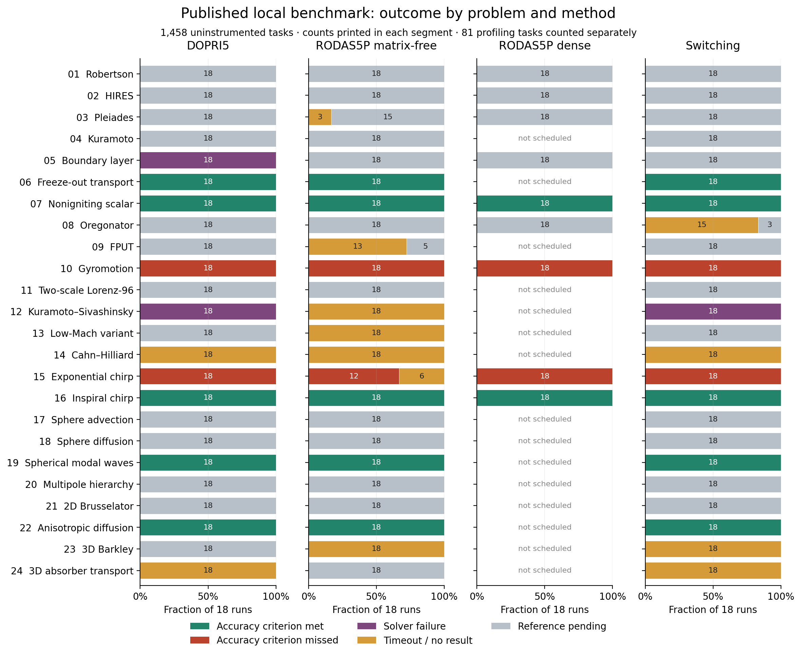
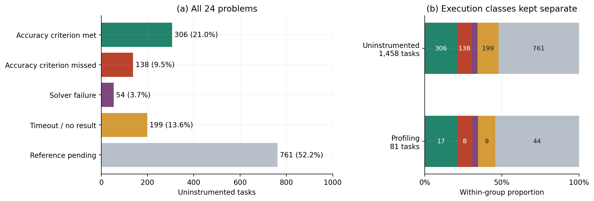
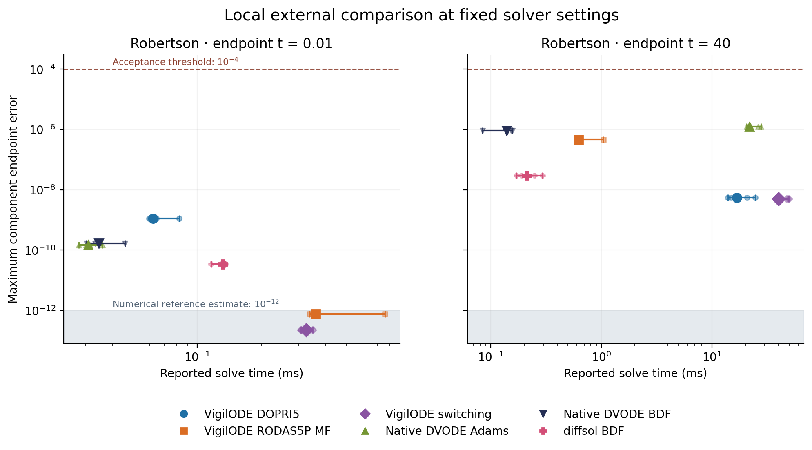
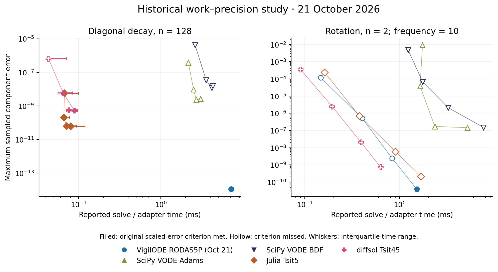
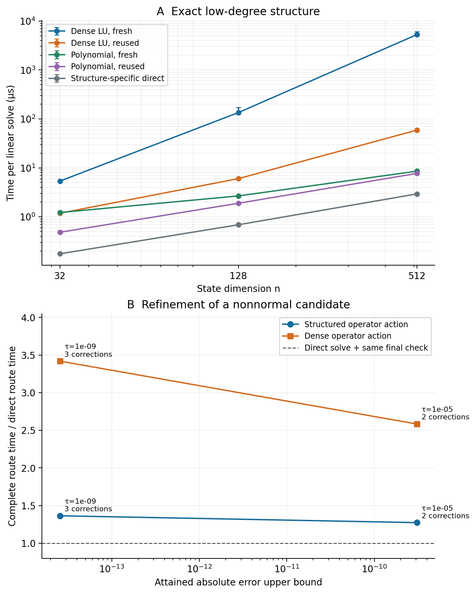
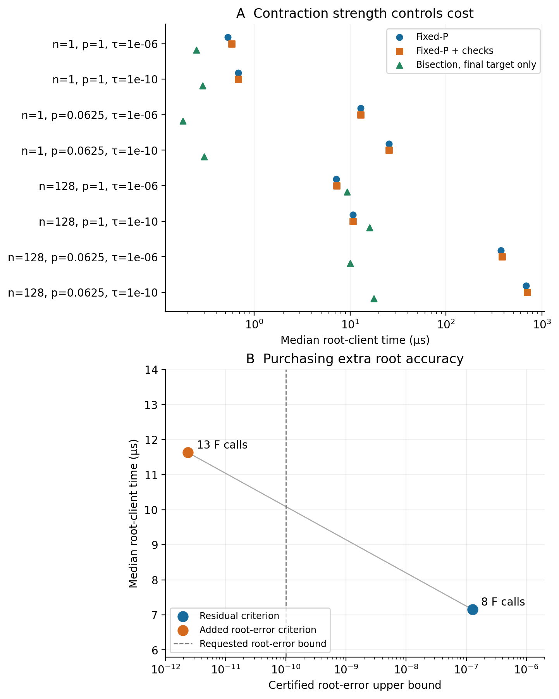
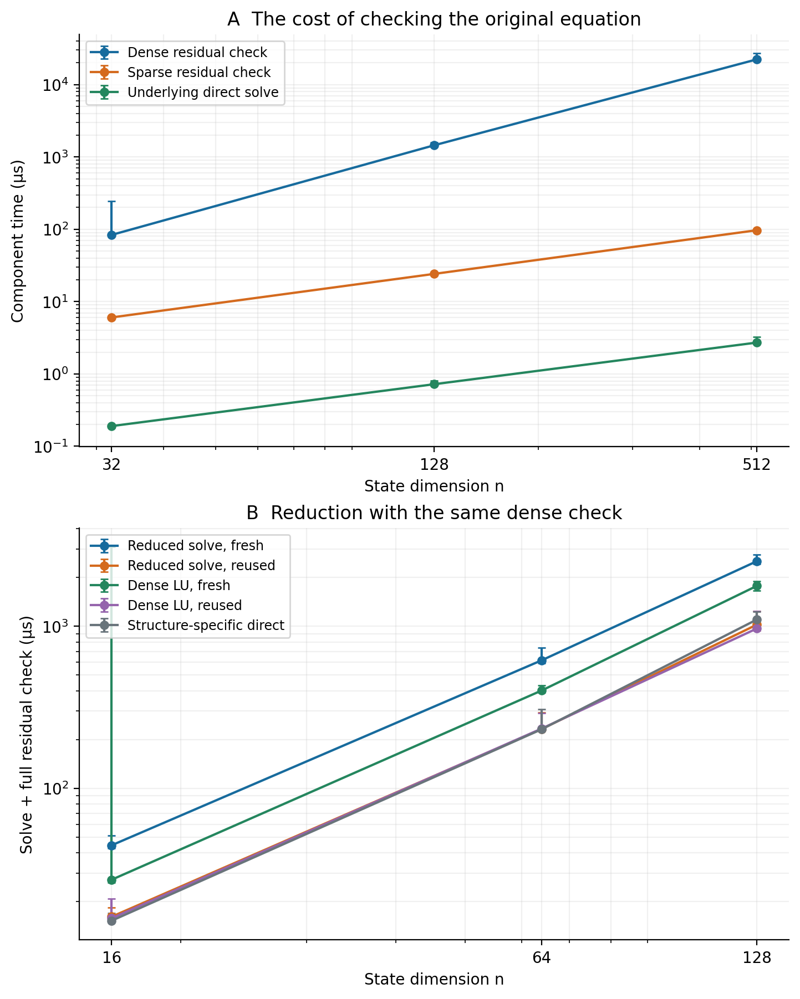
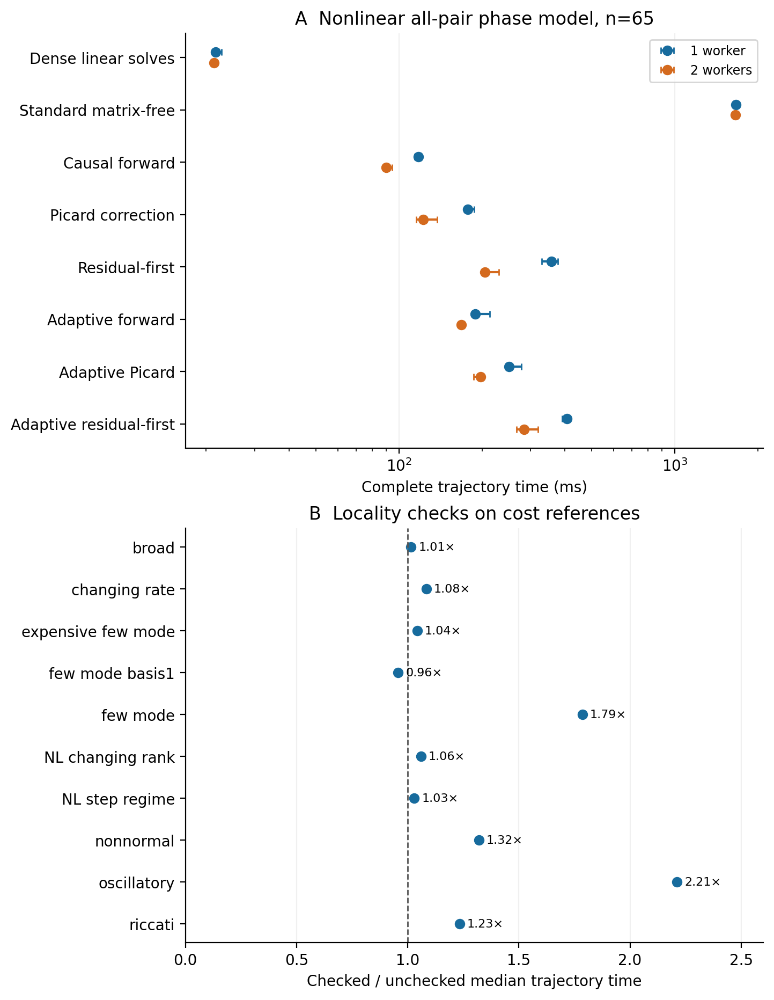

# VigilODE의 정확도, 계산 비용과 적용 범위

## 게시된 실험 자료에 대한 독립 벤치마킹 분석

**자료 기준일: 2026년 10월 25일 · 일반 상미분방정식 솔버**

### 초록

VigilODE는 명시적 적분과 Rosenbrock 적분의 기본 경로를 제공하며, 다항식 역작용, 부분공간 축소, 함수값 기반 연속화와 단계 병렬화를 명시적으로 선택하는 구조별 구현도 포함한다. 이 보고서는 게시된 실행 자료를 원자료에서 다시 집계하고, 전체 적분과 내부 계산의 성능을 각각 분석한다. 최신 로컬 시험의 비계측 작업 1,458개 중 306개가 지정된 끝점 정확도를 충족하였고, 138개는 오차 기준을 초과하였다. 54개는 솔버가 실패를 반환하였으며, 199개는 시간 제한에 도달하였다. 나머지 761개는 정확도를 비교할 참조해가 준비되지 않았다. 오차 초과는 gyromotion과 exponential chirp 두 문제에 집중된다.

강성 Robertson 반응계의 t=40 비교에서 VigilODE의 matrix-free RODAS5P는 자체 명시적 방법보다 약 27.0배 빨랐다. 같은 끝점 허용기준에서 native DVODE-BDF와 diffsol BDF는 이 경로보다 각각 4.46배와 2.95배 빨랐다. 구조가 주어진 선형계에서는 재사용 다항식 계산이 재사용 LU보다 2.45–7.67배 빨랐고, 추가 근 오차 조건을 적용한 연속화 계산은 시간 62.6% 증가로 오차 상계를 약 5.38만 배 낮추었다. 이 결과들은 문제의 구조와 요구 정확도를 식별하는 선택 규칙의 필요성을 보여준다. 다음 개선의 중심은 진동 문제의 누적 오차, 지속적인 작은 스텝, 검증 비용과 병렬 실행 비용이다.

## 1. 무엇을 비교하는가

범용 ODE 솔버는 한 개의 적분 공식만으로 평가하기 어렵다. 같은 방법도 오차 제어, 선형계 풀이, 우변 계산과 메모리 사용에 따라 비용이 달라진다. 자동 선택이 들어가면 어떤 계산을 피했는지와 선택 자체에 얼마를 썼는지도 중요해진다. 우리는 이 구분을 유지하면서 다음 세 질문을 조사한다. 주어진 정확도에 도달하는가, 그 정확도까지 얼마의 계산이 필요한가, 그리고 어떤 입력에서 추가 구조를 활용하는 편이 유리한가.

VigilODE의 기본 비교에는 DOPRI5, matrix-free RODAS5P, dense RODAS5P와 자동 전환 방법이 포함된다. RODAS5P는 8단계의 5차 Rosenbrock–Wanner 공식이며, 내장 4차 공식은 7단계를 사용한다 [1]. VigilODE의 추가 기여는 이러한 적분 공식의 단계 방정식을 수행하는 방법과, 계산 경로를 선택하고 검사하는 방식에 있다. 따라서 기본 공식과 그 위의 구조 활용을 함께 기술한다.

| 계산 경로 | 실제로 사용하는 정보 | 이 보고서의 측정 단위 |
|---|---|---|
| DOPRI5 | 우변 함수값, 내장 오차 추정 | 전체 ODE 적분 |
| matrix-free RODAS5P | 우변과 선택적으로 제공된 JVP, 반복 선형 풀이 | 전체 ODE 적분 |
| dense RODAS5P | 명시적인 작은 행렬과 분해 | 전체 ODE 적분 |
| 자동 전환 | 명시적·음해적 경로와 관측된 계산 정보 | 전체 ODE 적분 |
| 저차 다항식 역작용 | 선언된 연산자 관계와 원래 잔차 | 선형계 계산 |
| 고정 P 연속화 | F(x,λ)와 고정 P 작용, 영역별 수축 정보 | 비선형 근 찾기 |
| 부분공간 축소·희소 잔차 검사 | 불변 구조 또는 소유한 희소 연산자 | 선형계와 오차 검사 |
| causal 단계 병렬화 | 결합된 단계 방정식과 단계별 잔차 | 제조해를 가진 ODE 궤적 |

함수값만으로 수행하는 계산은 고정 P 연속화에 실제 구현되어 있다. 다항식 경로는 낮은 차수의 연산자 관계를 이용한다. 한편 이번 로컬 RODAS 비교에는 선택적 JVP가 들어가며, 단계 병렬화 시험에도 해석적 JVP가 사용되었다. 이 구별로 각 결과를 재현하는 데 필요한 정보를 명확히 한다.

## 2. 자료와 비교 방법

최신 자료는 10월 25일 게시된 로컬 실행 요약과 끝점·시간 기록이다 [D1]. 비교 대상 코드는 마지막 보고서의 고정 버전 [D0]에서 출발하였고, native DVODE와 diffsol 비교 및 참조해 개발은 별도 후속 버전에서 진행되었다. 이외에 10월 21일의 전체 적분 비교 [D2], 10월 24일의 구조별 계산 실험 [D3], 별도 개발 브랜치의 영역 검사와 연속 출력 결과 [D4–D7]를 포함한다. 버전과 실험의 대응은 부록에 모았다.

이번 작업은 게시 자료의 재분석이다. 새로 수행한 계산은 집계, 비용 모형, 진폭·위상 오차 분해 및 자료 추출 도구의 검증이다. 사용자의 실행 중인 로컬 벤치마크에는 개입하지 않았다. 과거 원격 호스트 측정과 최근 로컬 측정의 절대시간을 하나의 순위에 섞지 않는다.

로컬 기본 시험은 상대 허용오차 10⁻⁶, 절대 허용오차 10⁻⁹, 최대 시도 200,000회, 프로세스당 60초를 사용하였다. 비계측 반복은 3회이며, 스레드 수는 1, 2, 4, 8, 12를 시험한다. 작은 문제의 ensemble 작업은 서로 독립인 256개 궤적을 계산한다. 직렬 적분시간, 우변의 병렬 계산, 독립 궤적의 처리량은 서로 다른 비교다. 상태 차원 256을 초과하는 문제에서는 dense 방법을 편성하지 않았다.

끝점 판정은 각 ensemble 구성원 전체의 최대 성분 차이에 참조 오차 상계 또는 추정 u를 더한 E=max|y−y_ref|+u≤10⁻⁴를 사용한다. 이는 스텝 제어에 입력하는 상대·절대 허용오차와 별도의 기준이다. 동일한 허용오차 설정이 동일한 실제 오차를 뜻하지 않으므로, 시간과 실제 오차를 함께 표시한다. 독립 참조해가 없는 결과에는 시간에 따른 정확도 순위를 부여하지 않는다. 참조해의 수치 불확실성 아래에 있는 차이값은 그 불확실성과 함께 표시한다 [3].

중앙값과 산포는 실제 반복 구조에 맞추었다. Robertson 비교는 준비 실행 1회를 제외한 독립 프로세스 5회이다. 여러 구조별 실험은 한 프로세스 안의 반복이다. 그림에 표시한 최솟값–최댓값 또는 사분위 범위는 해당 기록의 산포이며, 서로 다른 CPU의 성능에 대한 신뢰구간으로 사용하지 않는다. 최신 전체 실행 요약에는 호스트 사양과 모든 시간값이 함께 게시되어 있지 않아, 전체 문제의 시간 순위는 후속 자료 추출 뒤에 완성할 수 있다.

## 3. 전체 문제에서 드러나는 정확도와 완료 양상

최신 요약에는 24개 문제에서 생성한 1,539개 작업이 있다. 문제·방법·스레드·반복·계측 여부로 구성된 원래 작업 식별자를 재계산하여, 비계측 1,458개와 계측 81개를 모두 구분하였다. 그림 1은 비계측 결과만 비교한다.

**그림 1.** 각 가로 막대는 한 문제와 방법에 편성한 18개 비계측 작업을 나타낸다. 색은 정확도 충족, 오차 기준 초과, 솔버 실패, 시간 초과, 참조 부족을 구분한다. 숫자는 작업 수이며 회색의 참조 부족을 오답으로 세지 않는다. 작은 문제에는 직렬·ensemble, 큰 문제에는 직렬·우변 병렬 작업이 들어 있다. 편성하지 않은 dense 계산은 빈칸으로 남겼다.

| 결과 | 비계측 작업 | 계측 작업 | 합계 |
|---|---:|---:|---:|
| 끝점 정확도 기준 충족 | 306 | 17 | 323 |
| 끝점 오차 기준 초과 | 138 | 8 | 146 |
| 솔버가 실패 반환 | 54 | 3 | 57 |
| 시간 제한 내 결과 없음 | 199 | 9 | 208 |
| 비교 참조해 부족 | 761 | 44 | 805 |
| 전체 | 1,458 | 81 | 1,539 |

**그림 2.** 왼쪽은 비계측 작업의 결과 구성, 오른쪽은 계측 여부별 구성이다. 작업 수는 실험 설계의 반복과 차원 제한을 반영한다. 이 비율을 임의 ODE를 만났을 때의 성공 확률로 해석하지 않는다.

정확도 기준을 초과한 146개 작업은 gyromotion 76개와 exponential chirp 70개로 나뉜다. 후자에는 추가로 시간 초과 6개가 있다. 반대로 freeze-out transport, 비점화 대조 문제, inspiral chirp, 선형 구면 모드 파동, 비등방 확산은 편성된 작업 전체에서 지정된 끝점 기준을 충족하였다. 같은 ‘진동 문제’라는 이름 안에서도 차이가 크다. 위상과 진폭, 적분 구간, 주파수 변화율을 각각 보고 선택 규칙을 평가할 필요가 있다.

Cahn–Hilliard 문제는 57개 작업 모두에서 시간 제한에 도달하였다. Kuramoto–Sivashinsky 문제에서는 명시적 방법과 자동 전환의 실패 38개, matrix-free 시간 초과 19개가 기록되었다. 비계측 시간 초과 199개 중 126개는 Cahn–Hilliard, 3차원 Barkley, 3차원 수송 세 문제에 모인다. 이 분포는 큰 격자 계산이 다음 성능 개선의 주요 대상임을 보여준다.

실패의 내부 양상도 다르다. 게시된 경계층 문제의 DOPRI 실행은 195,112개 스텝을 수락하고 4,888개를 거절한 뒤, 목표 t=2에 앞선 t=0.645496에서 시도 한도에 도달하였다. Kuramoto–Sivashinsky의 DOPRI는 195,117개를 수락하여 t=3.75746에 도달하였다. 두 경우 모두 거절 폭증보다 지속적인 작은 스텝이 문제다. 한도 증가는 관측 구간을 늘릴 수 있지만, 계산량 감소를 위해서는 그 스텝을 제한하는 강성·오차 조건을 구분해야 한다.

## 4. 강성 Robertson 반응계: 명시적 방법과 음해적 방법의 차이

Robertson 반응계에는 짧은 초기 과도구간과 훨씬 긴 반응 시간이 공존한다. 게시 자료에는 t=0.01과 t=40에 대해 6개 방법, 준비 실행 1회와 측정 5회의 총 72개 끝점·시간 기록이 있다. 참조해는 정밀도를 높인 BDF 계산과 별도 방법 및 문헌 끝점으로 비교되었으며, 수치 불확실성 추정은 10⁻¹²이다. 모든 방법은 공통 최대성분 끝점 기준 10⁻⁴를 충족하였다.

**그림 3.** 고정된 솔버 설정에서 얻은 시간–오차 점들이다. 표식은 측정 5회의 중앙값, 수평선은 최솟값–최댓값이다. 회색 영역은 참조해의 수치 불확실성 추정 아래를 나타낸다. 비교군의 준비 비용 포함 범위는 원래 구현을 따른다. 이 그림은 각 방법의 허용오차를 연속 조정하여 얻은 동일 정확도 곡선과 구분한다.

| 방법 | t=40 시간 중앙값 | 기록된 최대 끝점 오차 |
|---|---:|---:|
| native DVODE-BDF | 0.1395 ms | 8.96×10⁻⁷ |
| diffsol BDF | 0.2114 ms | 2.95×10⁻⁸ |
| VigilODE matrix-free RODAS5P | 0.6229 ms | 4.55×10⁻⁷ |
| VigilODE DOPRI5 | 16.817 ms | 5.42×10⁻⁹ |
| native DVODE-Adams | 21.946 ms | 1.23×10⁻⁶ |
| VigilODE 자동 전환 | 40.000 ms | 4.99×10⁻⁹ |

음해적 계산이 긴 강성 구간에서 필요한 이유가 드러난다. VigilODE의 matrix-free 경로는 DOPRI보다 약 27.0배, 자동 전환보다 64.2배 빠르다. 외부 비교군을 포함하면 native DVODE-BDF와 diffsol BDF가 다시 유리하다. VODE는 가변계수 Adams와 BDF를 사용하며, 분해 재사용을 포함한 오랜 최적화가 축적되어 있다 [2].

이 결과에서 자동 전환의 우선 진단 대상은 명시적 경로의 체류시간과 반복 탐색의 비용이다. 40.000 ms의 원인을 구분하려면 경로별 시간과 탐색 작업량을 추가로 추출해야 한다. 다음 비교에서는 matrix-free를 강제로 유지한 실행과 자동 전환의 작업량을 나란히 기록하는 것이 직접적이다. 강성이 지속되는 구간에서 불필요한 명시적 시도가 확인되면 전환 유지기간과 재탐색 빈도를 조정할 수 있다.

## 5. 이전 전체 적분 비교의 재분석

10월 21일 자료는 대각 감쇠와 회전 문제에서 허용오차를 바꾼 실험을 포함한다. 그림 4는 원래 측정값의 실제 오차와 내부 풀이·adapter 시간을 다시 대응시켰다. VODE의 Python callback, Julia adapter, native 경로는 구현 경계가 다르므로, 이 그림은 당시 구현들의 비교로 읽는다.

**그림 4.** 2026년 10월 21일 자료의 비준비 실행 280행을 사용하였다. 각 점은 반복 중앙값, 수평 범위는 시간의 사분위 범위다. 채운 표식은 당시 scaled-error 기준을 충족한 경우, 빈 표식은 기준을 초과한 경우다. 왼쪽은 128차원 대각 감쇠, 오른쪽은 2차원 회전이다. 선은 같은 방법의 서로 다른 허용오차 설정을 연결한다. 최근 버전과의 전후 개선율은 이 그림에서 계산하지 않는다.

원자료를 재집계하여 기존 문장의 오류를 바로잡았다. 회전 실험의 ‘0/140 충족’이라는 서술과 달리, VigilODE의 상대 허용오차 10⁻¹⁰ 설정은 측정 7회 모두에서 기준을 충족하였다. 최대 scaled error는 0.387683, 최대 절대오차는 3.87683×10⁻¹¹이다. 나머지 133행은 기준을 초과하였다. 원래 수치 요약에는 이미 이 7회가 기록되어 있었고, 설명문에서 누락되었다.

또한 native 풀이시간과 프로세스 전체시간을 구분하였다. 해당 회전 설정의 중앙값은 내부 풀이 1.515 ms, 프로세스 전체 5.560 ms다. 짧은 계산에서는 시작 비용의 비중이 커진다. 따라서 알고리즘의 시간과 한 번 실행하는 사용 경험을 함께 보되, 서로 다른 시간 경계를 같은 열에서 비교하지 않는다.

## 6. 다항식 역작용: 좌표를 바꾸어 줄어드는 계산

낮은 차수의 연산자 관계를 알면 큰 행렬의 역작용을 작은 다항식으로 나타낼 수 있다. 목표를 A=I−B, B=cI+sC로 쓰고 s>0라 하자. q(C)=0이고 α=(1−c)/s에서 q(α)≠0이면, q(α)−q(z)=(α−z)r(z)에서

\[
A^{-1}=p(C),\qquad p(z)=\frac{r(z)}{s\,q(\alpha)}.
\]

근사 관계와 저장 계수 오차가 있을 때는 ‖I−Ap̂(C)‖≤δ<1인 상계를 확인하고, 원래 잔차에 대한 보정을 수행한다. 정확 산술에서 x⁺=x+p̂(C)(b−Ax)의 잔차는 δ배 이하로 수축한다. 차수 d가 작고 연산자 작용이 O(n)이면 한 번의 후보·보정 계산은 O(dn)이다. 이 구조는 Jacobian 전체의 구성이나 dense 분해를 피할 수 있는 구체적인 근거다.

**그림 5.** 위: 정확한 저차 관계에서 새 계산과 재사용 계산을 비교하였다. 원래 잔차와 참조값 검사를 시간에 포함한다. 아래: 32차원 비정규 블록 문제에서 보정 후의 오차 상계와 전체 비용을 나타낸다. 가로축은 입력 허용오차가 아닌 얻어진 오차 상계다. 위 패널의 오차막대는 반복의 관측 범위다.

차원 32, 128, 512에서 재사용 다항식은 재사용 LU보다 각각 2.446, 3.187, 7.666배 빨랐다. 구조 전용 직접식은 다시 이 다항식보다 약 2.62–2.75배 빨랐다. 직접식이 알려져 있으면 그것이 우선 비교 대상이며, 다항식은 더 넓은 연산자 관계에서 같은 계산 축소를 실현하는 방법이다.

근사 관계의 보정은 정확도 선택에도 유용하다. 두 번과 세 번의 보정으로 오차 상계가 각각 3.084×10⁻¹⁰, 2.554×10⁻¹⁴가 되었고, 구조 작용을 사용한 전체 비용은 동일 검사를 포함한 직접 풀이의 1.274배와 1.365배였다. dense 작용을 사용하면 같은 비교가 2.583배와 3.419배가 된다. 정확도를 끌어올리는 추가 연산이 저렴하려면 연산자 작용 자체의 구조가 유지되어야 한다.

## 7. 함수값 기반 연속화: 수축률에 맞춘 정확도 선택

가역인 고정 P에 대해 Tλ(x)=x−PF(x,λ)가 완비 노름공간의 닫힌 구를 자신으로 보내고, 그 구 전체에서 수축률 q<1을 가지면 그 구에 F(x,λ)=0의 유일한 근이 존재한다. 구 안의 x에서 평가 오차까지 포함한 ‖PF(x,λ)‖의 상계를 d라 할 때 근 오차는 d/(1−q)로 제한된다. 이전 근의 오차 구가 다음 영역 안에 포함되는지 검사하여 λ=0에서 λ=1로 이어간다. 반복은 F와 P의 작용을 사용한다.

**그림 6.** 위: 분리 가능한 단조 3차식에서 고정 P 반복과 최종 목표만 푸는 이분법을 비교하였다. P=pI이며, 작은 p에서는 수축이 약해져 반복 비용이 증가한다. 아래: 동일한 문제에서 근 오차 요구를 추가한 결과다. 각 시간은 31회 반복의 저장된 중앙값이다.

128차원, p=1에서 검사까지 포함한 연속화는 최종 목표 이분법보다 약 1.29–1.49배 빨랐다. 스칼라나 약한 수축에서는 이분법이 유리했다. 따라서 이 선택은 차원과 관측 수축률에 따라 달라져야 한다.

추가 근 오차 조건은 상계를 1.276×10⁻⁷에서 2.372×10⁻¹²로 낮추었다. 함수 호출은 8회에서 13회, 시간은 7.150 μs에서 11.628 μs로 증가하였다. 약 5.38만 배 낮은 오차 상계를 얻는 데 62.6%의 추가 시간이 필요했던 것이다. 반대로 현재 평가 오차 모형으로 보증할 수 없는 목표는 사전에 거부하여 불필요한 함수 호출 33회를 피했다. 이 두 동작을 결합하면 필요한 정확도만 계산하고 현재의 평가 정밀도로 보증할 수 없는 목표에 반복을 낭비하지 않을 수 있다.

## 8. 차원 축소 이후에 남는 원래 잔차의 비용

BV=VH인 m차원 부분공간에서 b=Vc이고 I−aH가 가역이면, x=V(I−aH)⁻¹c로 원래 선형계의 해를 얻는다. 분해의 차원이 n에서 m으로 줄지만 실제 관계가 근사적이면 원래 공간의 잔차를 확인해야 한다. 이 검사가 dense O(n²)로 남으면 작은 분해만 빨라져도 전체 비용은 충분히 줄지 않는다. 실제 저장된 B의 대칭 부분이 음의 준정부호이고 a≥0이면 ‖(I−aB)⁻¹‖₂≤1이므로, 원래 잔차의 2-노름은 해 오차의 상계가 된다.

**그림 7.** 위: 동일한 직접해에 대한 dense 잔차 검사, sparse 잔차 검사와 직접 풀이 자체의 비용이다. 아래: 같은 dense 잔차 검사를 포함한 부분공간 축소와 LU를 비교한다. 첫 구성과 재사용을 분리하였고 관측된 긴 실행도 범위에 남겼다.

원래 연산자를 희소 형식으로 소유하면 누락 항이 정확히 0이라는 정보를 사용할 수 있다. 시험한 대각·비정규·상쇄 문제에서 잔차 검사 비용은 dense 대비 13.84–330.53배 줄었다. 동시에 sparse 검사 자체는 매우 싼 직접 삼각 풀이의 21.03–42.18배였다. 이 결과가 지시하는 최적화는 검증을 없애는 일이 아니라, 필요한 검증을 원래 연산자의 구조에 맞추는 일이다.

부분공간 축소는 새 LU보다 유리하지만, 이미 분해를 재사용하는 LU와 비교하면 이득이 작거나 사라진다. 구성 비용을 S, 반복 비용을 T라 하고 동일 구조를 m번 사용한다면 C(m)=S+mT다. 축소의 추가 구성비 ΔS≥0에서, 반복비용 절감 ΔT>0이면 이득의 조건은 m>ΔS/ΔT다. 게시된 중앙값으로 64차원의 교차점을 계산하면 161회이며, 16차원과 128차원에서는 반복 비용 자체가 더 높다. 64차원의 차이는 약 0.58%로 산포가 겹치므로, 161회는 상수 비용 모형의 예상값이다. 다음 시험은 같은 구조의 연속 재사용 횟수를 직접 바꾸어 이를 확인할 수 있다.

## 9. 자동 선택과 단계 병렬화

단계의 인과적 의존성은 병렬화의 핵심 제약이다. VigilODE의 실험은 단계 전체의 결합식을 다루고 잔차를 갱신하는 방식으로 병렬 계산을 시도한다. 이때 병렬로 수행한 추가 반복과 검사가 직렬 의존성을 줄인 이득을 상쇄할 수 있다. 그림 8은 실제 비선형 우변을 계산한 시험과 비용 재사용 검사를 함께 보여준다.

**그림 8.** 위: 65차원 전역 위상 결합 모델의 전체 궤적 시간이다. 1개와 2개 worker를 비교하고, 같은 입력의 dense 및 일반 matrix-free 방법을 함께 표시했다. 아래: 상태·스텝 크기·경과 범위에 따라 비용 기준을 재보정하는 검사의 시간비다. 1보다 크면 추가 검사가 더 비싸다.

동일한 단계 방식에서 worker를 1개에서 2개로 늘릴 때 Picard는 1.449배, residual-first는 1.742배 빨라졌다. 모든 48개 궤적은 지정 정확도를 충족하였다. 하지만 가장 빠른 전체 방법은 직렬 dense 계산이었다. 이 시험 문제에서 dense 중앙값은 21.659 ms이며, 두 worker의 causal forward는 89.769 ms다. 병렬화의 가치는 worker 수만으로 결정되지 않는다. 우변 비용과 상태 차원, 추가 반복 수를 동시에 바꾸어 교차 구간을 찾아야 한다.

비용 기준의 유효범위 검사는 231개 궤적에서 정확도 기준을 유지하였다. 시간비는 10개 조건에서 0.957–2.212였다. 상태나 스텝 크기가 달라진 뒤 오래된 비용 정보를 계속 쓰지 않는 기능은 유용하지만, 모든 문제에 동일 빈도로 검사할 이유는 없다. 변화가 큰 구간에서는 재보정하고 안정된 구간에서는 검사 빈도를 줄이는 정책이 다음 비교 대상이다.

## 10. 별도 개발에서 얻은 안정성과 계산량 개선

별도 개발 브랜치도 원문과 실행 결과를 확인하였다. 단계 입력을 우변 평가 전에 검사하는 연구에서는 12개 제조해 궤적에서 허용영역 밖의 함수 평가를 507회에서 0회로 줄였다. 실패할 때 항상 스텝을 절반으로 줄이는 방법에 비해, 변화율 정보를 이용한 재시도는 시도 수를 1,032회에서 602회, 벡터 RHS 평가를 5,323회에서 4,816회로 줄였다. 각각 41.7%, 9.52% 감소다. 비선형 입력의 제안 스텝은 실제 단계 검사로 다시 확인된다.

연속 출력 연구는 z′ⱼ=−λⱼzⱼ−αzⱼ², λⱼ∈{1,20,300}, α∈{0,4}인 문제에서 저장된 cubic·quintic 곡선의 영역과 결함을 Bernstein 계수로 제한하였다. 같은 전체 상태 오차 목표에서 quintic은 단계와 출력 곡선의 RHS 평가 수를 2.34–7.61배 줄였다. 8개 궤적의 1,188개 수락 구간과 1,484개 조회에서, 48,972개 성분을 고정밀 참조와 비교한 최대 실제오차/상계 비는 0.4774였다. 이 비교에는 추가 Jf 및 구간연산 비용이 있으므로, 다음 단계는 전체시간을 측정하는 것이다.

출력 전달과 callback 계약 연구는 각각 유한한 상태 전이와 함수 계약의 일관성을 확인하였다. 이들은 실패 후 잘못된 상태를 전달하지 않는 강건성에 기여한다. 전체 궤적 성능은 아직 별도로 측정해야 한다. 이러한 연구 결과를 최근 전체 시험의 성능표에 합산하지 않고, 다음 통합 시험에서 확인할 개선으로 연결한다.

## 11. 이번 재분석에서 추가한 진단

### 11.1 진폭과 위상 오차를 나누어 보는 방법

복소 상태 z=r exp(iθ), 참조 z*=R exp(iθ*)를 생각하자. r,R>0일 때 δ=arg(z/z*)를 주값으로 택하면 다음 항등식이 성립한다.

\[
|z-z_*|^2=(r-R)^2+4rR\sin^2(\delta/2).
\]

좌변을 전개하면 r²+R²−2rR cosδ이고, 1−cosδ=2sin²(δ/2)를 적용하면 오른쪽을 얻는다. 첫 항은 진폭 오차, 둘째는 각도 오차의 기여다. gyromotion과 chirp의 오차 초과를 분석할 때 이 둘을 분리하면 감쇠 오차와 위상 지연 중 무엇을 줄여야 하는지 확인할 수 있다. 반경이 0 근처이면 위상을 정의하지 않는다. 끝점의 주값은 여러 주기 누적된 회전수를 복원하지 못하므로, 긴 구간의 위상은 여러 시점의 값으로 별도 추적한다.

이 항등식과 참조 오차를 고려하는 작은 분석 코드를 추가하였다. 참인 참조 오차 상계가 u이고 측정 차이가 d이면 삼각부등식으로 실제 오차는 [max(0,d−u),d+u] 안에 있다. 구현은 입력된 d와 u의 합·차를 바깥 방향으로 반올림한다. d를 계산하는 노름 평가에도 반올림 오차가 있으면 그 상계를 u에 더한다. 수치적으로 추정한 u를 사용할 때에는 그 추정의 근거를 함께 기록한다.

### 11.2 내부 가속을 전체시간으로 옮기는 비용식

원래 계산시간에서 비율 f를 차지하는 부분을 r배 빠르게 바꾸면 전체 가속은 1/(1−f+f/r)이다. 준비 비용 S₀, 후보 풀이 비용 P, 필수 검사 비용 C, 비교 방법 비용 B를 같은 단위로 측정하면 m회 재사용의 가속은 mB/[S₀+m(P+C)]다. 이 식은 같은 비용 항목을 양쪽에 넣었을 때의 직접적인 산술 관계다. 따라서 잔차 검사가 수백 배 빨라졌다는 관측을 전체 적분의 같은 배수로 옮기려면, 원래 시간에서 그 검사가 차지한 비율을 먼저 측정해야 한다.

### 11.3 실제 실패 자료의 자원 사용

공개된 6개 대표 실패의 원래 출력과 해시를 검사하여 시간·오차·작업량을 추출하였다. Kuramoto–Sivashinsky의 우변 병렬 DOPRI 실행은 8개 스레드에서 풀이 32.739초, 사용자 CPU 135.76초, 시스템 CPU 84.51초를 사용했다. 비자발적 문맥 교환은 약 1,541만 회였다. 반면 경계층 ensemble의 2개 스레드 실행은 풀이 15.470초, 사용자 CPU 30.83초, 시스템 CPU 0초를 기록했다. 전자는 OS·스레드 비용을 함께 조사할 이유가 있고, 후자는 많은 작은 스텝의 수를 줄이는 일이 더 직접적이다. 원인 분리는 같은 문제의 직렬 실행과 맞비교하여 진행할 수 있다.

## 12. 다음 로컬 결과에서 확인할 사항

가장 먼저 필요한 것은 현재 실행의 원자료를 손실 없이 보고서에 연결하는 일이다. 이를 위해 완료된 실행 기록만 읽는 자료 추출기를 추가하였다. 기존 솔버, 설정, 실행 디렉터리를 바꾸지 않고, 시간·오차·함수 호출·참조 정보·바이너리 해시를 별도 표로 내보낸다. 실행 중인 항목은 미완료로 남긴다. 같은 원자료를 여러 wrapper가 가리키는 경우에는 중복 식별자를 함께 보존한다. 비교 실행기의 종료 시각 검사에서 NaN을 수락하는 경계 오류도 합성 입력으로 재현하고 수정하였다. 수정본은 비유한 종료 시각과 상태값을 거부하며, 유효한 유한 입력 200개에서는 기존 판정과 일치했다. 이 수정은 다음 새 비교 실행부터 적용한다.

| 우선 질문 | 다음 관측 | 개선을 판단하는 기준 |
|---|---|---|
| 진동 문제의 오차는 어디서 쌓이는가 | 여러 시점의 성분·진폭·위상 오차, 허용오차별 비용 | 같은 실제 오차에서 더 낮은 시간과 안정된 수렴 |
| 자동 전환이 강성 구간에서 오래 머무는가 | 경로별 체류시간, 탐색과 실패 비용, 강제 음해법 비교 | 정확도를 유지하며 명시적 시도·재보정 비용 감소 |
| 큰 격자의 시간 초과는 무엇이 지배하는가 | 별도 짧은 진단의 도달 시간·수락 수·RHS 시간 | 물리 시간당 작업량과 완료시간 감소 |
| 우변 병렬화의 교차점은 어디인가 | 같은 모델의 1/2/4/8 스레드 시간·CPU·문맥 교환 | 총시간 개선과 과도한 OS 비용 억제 |
| 구조 재사용이 실제로 이득인가 | 동일 구조 1/4/16/64/256회 호출과 재구성 횟수 | 준비·검사·실패 복귀를 포함한 전체 비용 절감 |
| 연속 출력의 작업량 감소가 시간으로 이어지는가 | cubic/quintic의 동일 정확도·동일 조회 수 | Jf와 구간연산을 포함한 전체시간 개선 |

HIRES, Pleiades와 경계층의 새 참조 후보는 모델·초기값·구간·성분 순서가 일치하는지 확인한 뒤 후속 계산에 사용한다. 특히 2차원 Brusselator와 3차원 Barkley의 상태는 셀마다 u,v가 교차 배치되어 있다. 참조 구현도 같은 순서를 따라야 한다. 완료한 과거 결과의 분류는 원래 벡터와 참조를 실제 대조할 수 있을 때에만 갱신한다.

현재 결과는 적용 범위가 분명한 경로부터 사용하는 방향을 지지한다. 저차 구조의 선형 계산과 강한 수축의 근 찾기에는 실제 이득이 있고, 비강성 및 일부 PDE 문제에는 정확도 기준을 충족하는 전체 실행이 있다. 범용 기본 솔버로 채택하려면 gyromotion·chirp의 오차 초과와 큰 격자 문제의 완료시간, 자동 전환의 불필요한 비용을 우선 해결해야 한다. 이번 보고서는 그 다음 시험을 선택하는 데 필요한 위치와 수치를 제시한다.

## 부록 A. 재현 자료와 버전

그림의 데이터 선택, 집계와 원자료 SHA256은 `analysis/whole_solver_summary.json`, `analysis/conditional_summary.json`에 있다. `analysis/HISTORICAL_CORRECTION.json`에는 정정한 7행과 원문·자료의 대응이 보존되어 있다. 그림 재생성 명령과 로컬 자료 추출 방법은 함께 제공한 `README.md`, `LOCAL_CODEX_HANDOFF_KO.md`를 따른다.

| 자료 | 고정 버전 또는 위치 | 용도 |
|---|---|---|
| [D0] 기존 로컬 솔버 | aaf1f834d4c589e734ca7851a56c11bb44f7047a | 24개 문제와 구조별 계산의 기준 소스 |
| [D1] 최신 게시 로컬 결과 | 2a4bf90d1445b67542bdac5030b4c5d10da20445 | 1,539개 작업과 Robertson 끝점·시간 |
| [D2] 10월 21일 비교 | external_audits/vigilode_ncp_intensive_120m_v1_20261021 | 감쇠·회전의 이전 구현 비교 |
| [D3] 구조별 계산 | research/local_frontier_20261024 | 다항식·연속화·축소·병렬화 원자료 |
| [D4] 단계 영역 검사 | 1c829f206ab67585191231be7f5135fd0d4c804e | 허용영역과 재시도 작업량 |
| [D5] 연속 출력 | 02060cc9dc4551dc5cf6ec86ad9b53b697a2c3ce | 저장 곡선의 오차와 평가 수 |
| [D6] 출력 전달 | 3c8877ea0409495752dcfab42426e679e3ba92d3 | 상태 전달 계약 검증 |
| [D7] callback 계약 | a01f1c5c78e6b06e23565cd4e482716f99efbe97 | 입력·평가 계약 검증 |

Robertson 측정의 비교 adapter 소스는 9b31da59b6d30a092af52357d3bc257b13ce043f이며, 이후 결과를 게시한 버전과 구분된다. 참조 오차 10⁻¹²는 정밀도 증가와 독립 비교로 얻은 수치 추정이다. 최신 전체 작업의 시간·오차 원문 대부분은 사용자의 로컬에 보존되어 있고, 게시 요약에는 해시만 있다. 이번 분석은 공개된 값으로 표와 그림을 구성하였다.

## 참고문헌

[1] G. Steinebach, “Construction of Rosenbrock–Wanner method Rodas5P and numerical benchmarks within the Julia Differential Equations package,” *BIT Numerical Mathematics* (2023). https://doi.org/10.1007/s10543-023-00967-x

[2] P. N. Brown, G. D. Byrne and A. C. Hindmarsh, “VODE: A Variable-Coefficient ODE Solver,” *SIAM Journal on Scientific and Statistical Computing* **10**(5), 1038–1051 (1989). https://doi.org/10.1137/0910062

[3] SciML, *SciMLBenchmarks.jl: Benchmarks for Scientific Machine Learning and Equation Solvers*, reference-solution and work–precision methodology. https://sciml.github.io/SciMLBenchmarks.jl/ (2026-10-25 확인).
