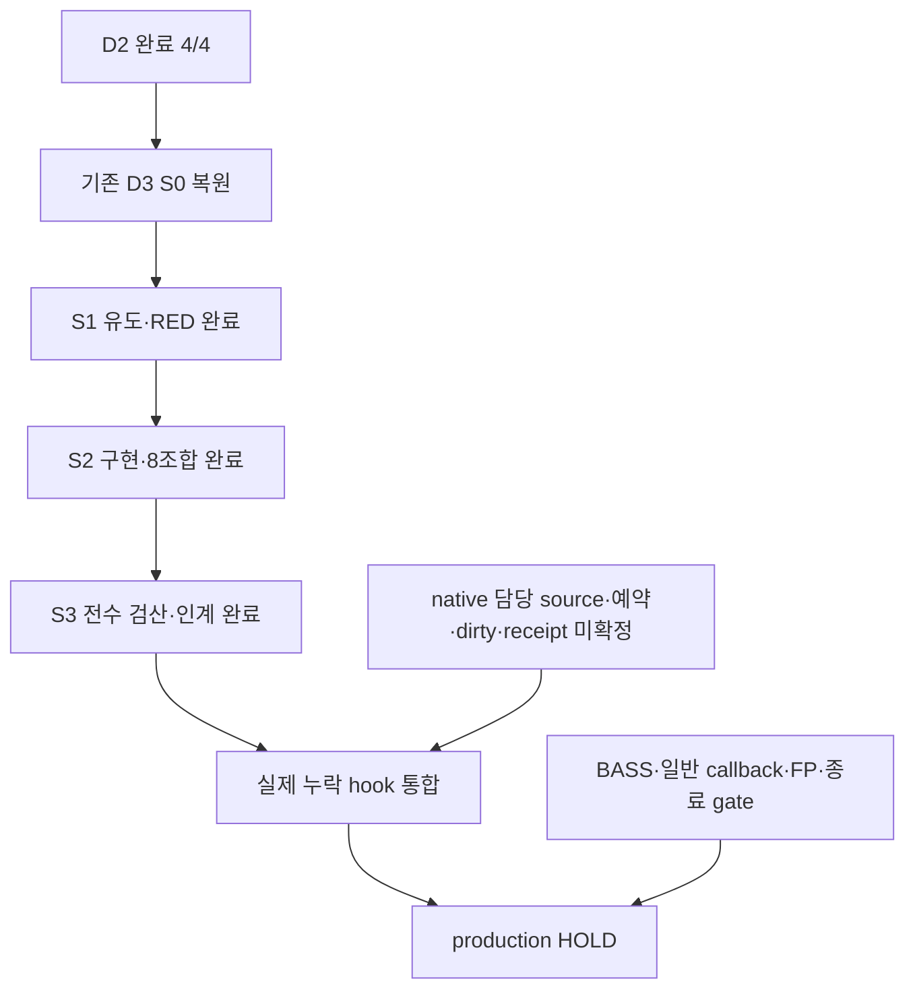

# VigilODE D3 — 연속 곡선 인증 연구·구현 결과

## 판정

기존 `research/d3-dense-certificate-20261024`의 S0를 복원해 같은 연구 단위를 마쳤다. **D3 S0–S3 4/4, 이론 R1–R10·코딩 C1–C10은 아래에 명시한 범위에서 완료**다. 고정된 Riccati 제조 모델의 실제 저장 cubic/quintic 곡선에 대해 domain, 원래 벡터장의 defect, 이전 구간의 오차 상속, full33 오차 예산 및 실제 반환 query의 반올림을 연결했다. 새 고정8조합과15개 계약 시험이 통과했다.

전체 VigilODE 완성도는 `null`, production은 **HOLD**다. 실제 native 담당 source/예약/live dirty/완료 receipt는 `UNRESOLVED_INPUT_DEPENDENCY`다. 현황은 구현 부재·예약 해제·다른 스레드 종료의 증거가 아니다. 이 작업은 기존 D3 연구 subtree에서 진행됐으며 native production source를 대체하지 않았다. 결과 게시 위치는 [Draft PR86](https://github.com/cosmosapjw-quantum/vigilode/pull/86)이다.

## 1. 조사와 재사용으로 결정한 연구 위치

조사 시점 VigilODE branch205개와 PR85개의 metadata pagination을 끝까지 읽었다. Library의 VigilODE 제목220개, Dropbox 제목42개, 기존 Drive backup 폴더 직접 항목33개를 조사했고, 현재 publication/ACK7개 및 관련 원문을 읽었다. 전체 branch의 모든 파일 또는 모든 비공개 대화·다른 폴더를 읽었다는 주장은 하지 않는다. 대화 검색은 D3 발견의 단서로만 사용했고 실행 근거는 실제 source/backup/provider receipt로 연결했다. 자세한 범위와 한계는 SOURCE_SURVEY_KO.md, BACKUP_SURVEY_KO.md에 있다. PR86은 이 intake 이후 생성했다.

그 결과 이미 게시된 D3 S0 `d702012e06eeafda5ce30b7c017e51b2c9bcbe4c`와 원본 backup을 찾았다. Drive의26708bytes를 복원해15payload 전체 size/SHA256와 ZIP CRC를 확인했다. 원본 SHA256은 `feb6685e7d7fec6c2a1c09df2c8979460c2ccc6e8a46c44160e10b3834a38970`다. 원본에는 D3 S1 이후 구현·실행 근거가 없었으며, 비게시 후속 작업의 존재 여부는 여전히 미관측이다.

현재 중앙 PR222, BASS PR186, REI PR224의 관련 계약도 읽었다. BASS finite LINE01 transaction과 REI REC-HISTORY adapter는 각각의 물리 결과이며, VigilODE native consumer 완료 근거로 바꾸지 않았다. 기존 native `dense_output_v2.rs`, `generic_verified.rs`, packet 경로에 residual transport, inherited radius, prepare-before-commit이 이미 존재함을 확인했다. 해당 원리를 재사용하고 D2 제조 consumer에 필요한 곡선/인증 연결만 추가했다. 같은 목적의 norm-only 파생 노드는 만들지 않았다.

D2 원본6파일과 native directed interval source는 실제 Git blob identity에 결속했다. 관련11개 source snapshot은7+4 byte identity 체크로 확인했다. AGENTS는 D3 고정 HEAD의 root/research/D3 subtree에서 실제404를 확인했으며 다른 경로나 사용자 host 전체의 부재로 일반화하지 않는다.

## 2. 이론: 저장 곡선의 defect에서 전역 오차까지

고정 모델은 normalized coordinate에서

$$z'_j=-\lambda_jz_j-\alpha z_j^2,\qquad \lambda_j\in\{1,20,300\},\quad\alpha\in\{0,4\}.$$

초깃값은 기존 `trajectory::initial`이 반환한 binary64 배열 그 자체가 정의하는 IVP다. compact30에서 full33으로 가는 affine lift의 offset도 실제 represented 상수1,0.5,0.2를 사용한다. Exact IVP는 양수이고 단조감소하므로 정해진 보존 complement의 양성도 유지된다.

각 구간의 저장된 times가 정의하는 정확한 차이를 $\Delta=t_1-t_0$라 두고, 실제 binary64 Bernstein controls $b_i$로

$$p(\theta)=\sum_{i=0}^n b_i B_i^n(\theta),\qquad\theta=(t-t_0)/\Delta,\quad n=3,5$$

를 정의한다. Cubic은 양 끝의 값·RHS, quintic은 추가로 analytic $Jf$를 사용한다. 생성 산술의 반올림은 허용하되, 인증 대상은 이상적인 Hermite식이 아니라 **실제로 저장된 다항식**이다. 해당 controls와 model/time을 외부에서 변경할 수 없게 묶었다.

Bernstein 기저의 비음성·partition of unity를 사용해 각 compact 및 affine complement의 control lower bound가0 이상이면 구간 전체 domain을 인증한다. 음의 control은 충분조건의 실패이며 다항식 자체가 음수라는 판정이 아니다. 유한 sampling의 한계는 $q(\theta)=(\theta-1/10)(\theta-3/20)$로 구별했다. 다섯 sample0,1/4,1/2,3/4,1에서는 양수지만1/8에서−1/1600이다. 이 계산과 endpoint/product/error 항등식을 Wolfram으로 확인했다.

원래 벡터장의 defect는

$$r_j=p'_j+\lambda_jp_j+\alpha p_j^2$$

이며 degree $2n$ Bernstein 계수를 outward interval로 만든다. 모든 계수 절댓값의 상계 $\rho_j$가 전 구간의 $|r_j|$를 덮는다. Binomial 비율과 정확한 represented 시간 차도 interval로 포함한다.

$e_j=z_j-p_j$라 두면 정확히

$$e'_j=-[\lambda_j+\alpha(z_j+p_j)]e_j-r_j$$

다. $z_j\ge0$는 IVP 성질, $p_j\ge0$는 독립 domain 증거이므로 수축률은 최소 $\lambda_j$다. 따라서

$$|e_j(t_0+s)|\le e^{-\lambda_js}E_{0,j}+\frac{1-e^{-\lambda_js}}{\lambda_j}\rho_j,\qquad0\le s\le\Delta.$$

이 식은 불확실성 tube 전체의 양성을 전제로 삼지 않아 순환 논증이 없다. 끝점 반경 $E_1$을 outward 계산하고 $U_j=\max(E_{0,j},E_{1,j})$로 구간 전체를 덮는다. 다음 accepted 구간의 $E_0$는 앞 구간의 $E_1$를 bit 그대로 받는다. 초기 반경은0이다. Full33 반경은 affine lift 행별 component 반경의 합이다.

Query에서는 정확한 represented query time으로 interval de Casteljau를 수행하고 별도 binary64 반환값과의 차이를 `qround`로 제한한다. 반환 반경은 full33 균일 반경에 `qround`를 upward로 더한 값이다. Frozen budget을 넘으면 거절한다. 모든 requested/interior query를 준비한 다음에만 `Session::finish`가 accepted state를 commit한다. Exact flow는 controller·candidate·acceptance에 사용하지 않았다.

완전한 유도·수치식·조건은 THEORY.md, 독립 유도 및 원전 위치는 INDEPENDENT_THEORY_REVIEW.md에 있다. Bernstein 범위법과 수축 defect transport 자체는 기존 방법이다. [Garloff](https://interval.louisiana.edu/reliable-computing-journal/1993/interval-computations-1993-2-pp-154-168.pdf), [Neumaier](https://arnold-neumaier.at/ms/ode.pdf)의 조건을 이 모델에 맞추어 재사용했다. 새 방법의 novelty 또는 strong no-go를 주장하지 않는다.

## 3. 새8조합의 실제 결과

모든 run은 $t_f=0.25$, $h_0=0.004$, attemptcap20000, rtol=curve budget, atol=budget×1e−3, 기존 stage guard와 rate proposal cap을 사용했다. 요청 시각37개는 강제 integration landing point로 바꾸지 않았다. 각 accepted 구간에 strict interior query1개를 추가했다. 아래 값은 같은 frozen 수용 예산에서의 작업량과 반환 정확도다.

| alpha | full33 budget | degree | accepted/attempts | stage RHS + curve RHS | dense 거절 | 최대 실제 query 절대오차 | 최대 반환 반경 |
|---:|---:|---:|---:|---:|---:|---:|---:|
| 0 | 2e-06 | 3 | 92/164 | 1,312 + 324 | 70 | 2.87725e-07 | 1.99429e-06 |
| 0 | 2e-08 | 3 | 350/853 | 6,824 + 1,698 | 499 | 2.60128e-09 | 1.99879e-08 |
| 0 | 2e-06 | 5 | 57/59 | 472 + 228 | 0 | 7.44295e-08 | 6.05585e-07 |
| 0 | 2e-08 | 5 | 91/95 | 760 + 364 | 0 | 4.20259e-10 | 6.20317e-09 |
| 4 | 2e-06 | 3 | 94/169 | 1,352 + 334 | 73 | 2.70987e-07 | 1.97334e-06 |
| 4 | 2e-08 | 3 | 355/865 | 6,920 + 1,722 | 506 | 2.58371e-09 | 1.99996e-08 |
| 4 | 2e-06 | 5 | 57/59 | 472 + 228 | 0 | 1.34282e-07 | 7.59019e-07 |
| 4 | 2e-08 | 5 | 92/96 | 768 + 368 | 0 | 6.13769e-10 | 6.05559e-09 |

총1188 accepted 구간,2360 attempts,18880 stage RHS/solve,5266 curve RHS vector,594 analytic Jf vector가 기록됐다. Curve RHS에는 Jf 내부 RHS 평가가 포함돼 있으므로 Jf594를 RHS5266에 다시 더하지 않는다. Bernstein interval 산술과 Jf의 추가 연산 비용도 별도로 존재한다. 이 수치로 wall-time speedup을 주장하지 않는다.

거절1172건은 local norm24건과 continuous certificate1148건이다. Quintic4개 run에서는 certificate 거절이0, cubic4개 run에서는70/499/73/506건이었다. 이 고정 consumer에서 cubic dense 곡선이 추가 step 제한을 유발했고, quintic은 같은 예산을 더 적은 RHS 평가로 충족했다. 두 adaptive tolerance만으로 보편적 수렴 차수나 실제 BASS 성능을 추정하지 않는다.

금지 영역 RHS 호출은8개 run 모두0이다. Campaign 자체에서 query-rounding-only 거절은 발생하지 않았고, 그 경로는 별도의 새 계약 시험으로 검증했다.

그림의 실선은 저장 query의 최대 full33 반환 반경, 점선은 독립 Decimal80 실제 반환오차다. 선 연결은 저장된 값의 시각화이며 연속 인증의 증명은 Bernstein defect와 수축 정리다. 같은 query의 component별 오차/반경 비교는 별도 전수 검사했다.

## 4. 검증 근거

새 계약 시험15/15가 통과했다. S1의 feature-absent scaffold에서는14/14 expected failure를 먼저 기록했으며, 첫 RED compile의 출력디렉터리 누락 실패도 보존했다. Imported old test1개는 filtered되어 실행되지 않았다. 새 safe core를 crate-level `forbid(unsafe_code)` 아래에서 실제 compile했다. 기존 research admission의 MXCSR assembly는 별도 wrapper 경계에 그대로 있고, production `forbid`를 완화하거나 native FP provider를 완료 처리하지 않았다.

저장 결과의 독립 oracle은 Rust의 Bernstein 곱셈 경로와 다른 **정확한 Fraction power-basis 미분·convolution·역변환**을 사용했다. 전수 검사 결과는 다음과 같다.

| 검산 대상 | 실제 검사 수 |
|---|---:|
| 모든 구간 |1188|
| 정확한 defect coefficient와 저장 interval 포함 관계 |285120|
| full33 domain control components |176418|
| 구간별 full33 uniform budget |39204|
| component contraction 및 analytic endpoint |각35640|
| 이전 endpoint→다음 incoming bit 상속 |35400|
| query |1484 = requested296 + interior1188|
| 실제 query full33 components |48972|
| 거절 기록의 state/radius/cursor/epoch 및 attempt 증가 |1172|

각 run의 요청37시각을 독립적으로 재구성해 bitwise multiset과 고유성을 확인했고, 모든 segment에 정확히1개의 strict interior query가 있음을 확인했다. Query의 저장 다항식 계산 오차는 Fraction Horner와 affine lift로 검사했다.

최대 query 실제오차/해당 반경은0.4774119143317735, endpoint component 비율은0.7774548186902503, query 반올림 displacement/해당 bound는0.875였다. 전자는 Decimal80 analytic solution을 사용한 수치 감사이며 비교 slack은1e−68이다. Formal interval proof로 바꾸어 부르지 않는다. Exact Fraction 포함·반올림 검사는 slack 없이 통과했다.

별도 host subagent의 수학·소스 검토에서 실제 발견한 F1(query corpus), F2(rounding-only refusal), F3(driver model/endpoint binding과 commit 순서)를 닫았다. 현재 검토 범위의 차단 결함은 없다. 이번 D3에서 실제 host delegation3개를 사용했지만 독립 인력 심사는 NOT_RUN이다. D2의 역사적 `independent_personnel/native_subagent=NOT_RUN`은 그대로다.

## 5. 전체 목표와 다음 의존성

D3 국소 완성도4/4=100%는 이 제조 모델의 계약에 대한 값이다. 전체 프로젝트에는 분모가 확정되지 않은 별도 gate가 있어 global completion은null이다. 다음 첫 행동은 현재 native 담당자의 exact source/예약/live dirty/완료 receipt 연결이다. 이미 있는 hook은 재사용하고 확인된 실제 누락만 통합한다. Desktop Commander 월간 quota 경로는 호출·재시도·우회하지 않았다.

| 별도 gate | 현재 상태와 다음 양의 행동 |
|---|---|
| Native source/예약/live dirty/완료 | 입력 미확정. 담당자의 source-bound receipt와 현재 예약을 연결한다. |
| Production FP provider와 MXCSR | HOLD. safe core와 환경 관측 provider의 실제 native 경계를 확정한다. |
| 실제 BASS | OPEN. 실제 callback/Jacobian/단위/closure를 가진 client를 연결한다. |
| 일반 callback/Jacobian | OPEN. domain·recoverable/fatal·source binding 계약을 실제 provider에 적용한다. |
| 일반 dense-domain | D3 고정 diagonal 모델만 완료. 결합계 domain/잔차/오차 전파 조건을 그 source에서 검증한다. |
| 재시도 유한 종료 | 이번8run은 cap내 도달. 일반 consumer의 minstep/clock/attempt·yield 계약은 별도 확인한다. |
| 외부 callback 부작용 | 외부 I/O/RNG 등을 rollback했다는 주장 없음. 명시적 purity/staging/commit 계약이 필요하다. |

## 6. 단계별 완료·게시·백업 연결

각 R/C 단계의 실제 산출물은 아래 표에 연결했다. 게시·백업은 동일 연구 단위의 S0–S3 phase bundle로 묶었다.20개의 개별 upload를 했다고 기록하지 않는다. S0는 원본 복원, S1/S2는 각각 실제 commit 및 이중 backup ACK, S3는 최종 publication/ACK receipt에 연결된다.

| 단계 | 완료 근거 | 게시·백업 phase | 주요 파일 |
|---|---|---|---|
| R1 연구 위치·계약 | 기존 D3 S0 원본26708bytes/15payload 복원, 고정8조합 유지 | S0→S1 | `intake/S0_CONTRACT.md` |
| R2 문헌·기존 근거 | 205branch/85PR metadata와220/42/33 backup inventory, 관련 원문·native hook 재사용 | S1 | `SOURCE_SURVEY_KO.md; INDEPENDENT_THEORY_REVIEW.md` |
| R3 주장·전제 정렬 | represented IVP/time, scalar-linear 인증과 nonlinear heuristic 구분 | S1 | `THEORY.md` |
| R4 표현 탐색 | cubic/quintic Hermite 및 유한 sample 양성 반례 구성 | S1 | `THEORY.md; evidence/WOLFRAM_IDENTITIES.json` |
| R5 구성적 유도 | Bernstein defect와 수축 오차 상속·full33/query 반경 유도 | S1 | `THEORY.md` |
| R6 독립 수학 검토 | 별도 agent의 integrating-factor 유도, 조건·차원·반례 검토 | S1/S3 | `INDEPENDENT_THEORY_REVIEW.md; INDEPENDENT_REVIEW.md` |
| R7 기호·경량 검산 | Wolfram endpoint/degree3·5 product/error identity와 sample 반례 | S1 | `evidence/WOLFRAM_IDENTITIES.json` |
| R8 결과 판정 | fixed Riccati 모델 조건부 정리·검증; production HOLD와 일반 gate 분리 | S3 | `REPORT_KO.md; REVIEW_SUMMARY.json` |
| R9 정식화·코드 연결 | 실제 저장 controls→degree2n defect→상속반경→query 계약 | S1/S2 | `THEORY.md; source/dense.rs` |
| R10 정리·재개 | 단계별 게시/백업, 원장 종료, native 입력 의존성 handoff | S3 | `HANDOFF_KO.md; FINAL_DELIVERY.json` |
| C1 목표·baseline | D2 원본6파일 byte reuse, frozen budget/37outputs/attemptcap | S0/S1 | `intake/REUSED_SOURCE_IDENTITY.json` |
| C2 식·코드·입력 대응 | stage_safe/Session와 기존 directed/native residual 경로 연결 | S1 | `REUSE_MAP_KO.md` |
| C3 수치 설계 | outward coefficient/exp enclosure, full33 affine sums, query displacement | S1 | `THEORY.md; source/dense.rs` |
| C4 실행 DAG·자원 | S0→S1→S2→S3와 새 subprocess120초 원장 | S1/S3 | `DAG.json; BUDGET.json` |
| C5 구현 | immutable curve/certificate와 기존 stage-safe consumer 연결 | S2 | `source/dense.rs; source/campaign_dense.rs` |
| C6 구현 검증 | RED14/14 expected fail→새 GREEN15/15 PASS; safe core forbid compile | S1/S2 | `evidence/red_contracts.log; evidence/green_contracts.log` |
| C7 과학 검증 | 모든285120 exact defect 계수,1188구간,1484query와 analytic reference | S3 | `REVIEW.json; REVIEW_SUMMARY.json` |
| C8 정확도·작업량 | 8고정조합 예산 충족, 전체RHS/curve/Jf 작업량과 error/bound | S2/S3 | `S2_RESULT.json; figures/` |
| C9 독립 코드 검토 | F1 query corpus, F2 rounding-only refusal, F3 실제 commit order 닫음 | S3 | `INDEPENDENT_REVIEW.md; REFUSAL_REVIEW.json` |
| C10 판정·인계 | Draft PR86, 불변S3 raw evidence archive와 재개 계약 | S3 | `REPRODUCE.md; HANDOFF_KO.md` |

S1 commit: `ce2640441495ea2af519fded07bdd5aae32667c8`. S2 commit: `fc7eb08f62f6d0c25e3f9ff60f7ad4c71f12f17e`. S3의 exact science SHA와 최종 전달 metadata SHA는 `delivery/S3_PUBLICATION.json`, `delivery/S3_PROVIDER_ACK.json` 및 PR86에 결속한다. Archive manifest는 payload별 size/SHA256/Git blob을 기록하고 local CRC와 전체 payload hash를 검사한다. Provider ACK/size와 새로운 원격 전체 바이트 복원 검증은 구별한다.

## 7. 보존한 D2 근거와 원장

D2의15새시험+31회귀,12제조궤적,15182stage/2212trial와 Bernstein 증거는 재사용했다. Endpoint-only 진단의 금지 RHS507회, guard 두 경로0회, guard+반감1032attempts/5323RHS, guard+rate cap602/4816RHS를 유지한다. 이는 작업량 비교다. Scalar-linear [0,2] 인증과 비선형 cap의 heuristic 역할을 구별한다.

D2 HEAD `1c829f206ab67585191231be7f5135fd0d4c804e` 및 과학 게시 `1ef6c519262560c2281a58b4cbb8ed38725ad90f`는 유지했다. PR222 댓글6379089882, PR84 댓글6379094297, PR85 recovery 댓글6379540725의 완료 receipt를 재사용했다. 원본 D2 archive,95payload hash검증, 실패 로그·닫힌 예산을 다시 실행하거나 초기화하지 않았다. **이번 D3의 기존 solver/test/benchmark/NCP/V3 harmonic 재실행은0**이다. 이전 복구의 새 과학 실행0이라는 역사 기록과 이번 D3의 새8run은 구별한다.

| 원장 | 값 | 상태 |
|---|---:|---|
| prior known |83.29566578299983초|역사 보존|
| D2 subprocess |25.104395919000012초|closed 보존|
| D3 S0에 기록된 당시 합 |108.40006170199984초|원본 기록 보존|
| 별도 native compile-boundary |14.951735806986107초|별도 closed 보존|
| 이번 D3 subprocess |35.897308696992695초/120초|closed|
| older remaining |null|초기화 없음|

이번 D3 원장은 toolchain 복원, 실패 compile, RED/GREEN, compile,8run, saved review, 그림의12개 subprocess를 포함한다. Toolchain 복원18.384770192998985초도 비용에 포함했다. 검색·문서작성·저장·외부 CAS는 이 local subprocess 원장과 별도다. 시간은 실행 예산 기록이며 비교 benchmark가 아니다. Matplotlib의 read-only 기본 cache 경고는 /tmp fallback으로 종료코드0에서 처리됐고 로그에 남았다.

## 8. 게시 과정의 실제 CI finding

S2 PR86의 자동 GitHub Actions `Research ledger and authority references` run40092473251에서 process-validator16개와 authority-validator8개 시험이 통과했지만, D3 canonical PREREGISTRATION.md와 covering LEDGER 행 누락으로 게시 검사가 실패했다. 기존 과학 solver/test/benchmark 실행은 이 workflow에 없다. 원래 S0 CONTRACT는 새8조합 실행 전에 이미 게시돼 있으므로, 새 문서에는 그 원문과 시간적 근거를 연결하고 문서 파일을 나중에 추가했다는 사실을 명시했다. 기존 ledger166행을 그대로 두고 실제 source와 numeric output hash를 갖는 L-0170만 append했다. 원래 실패 receipt는 evidence/CI_METADATA_FAILURE.json에 보존한다. 최종 CI 판정은 delivery/CI_FINAL_RECEIPT.json에 연결하며 결과 확인 전 PASS로 주장하지 않는다. 자동 원격 CI의24개 문서 검사 시험은 D3의15개 새 과학 계약 시험 및 local subprocess 원장과 별도다.

최종 과학 게시 `96aee1829d72ce1cbd6bcd0c0e48ebf3b1b37455`의 실제 CI run40093427748에서는 **D3 node/append-only ledger 검사 PASS(167행)**, validator24시험 PASS를 확인했다. 저장소 전체 authority-ref 검사는 여전히 FAIL이며, 기존32개 missing reference의143개 인용 발생이다. D3 경로의 실패는0이고, PR86의71개 변경 파일 중 D3 밖 변경은 LEDGER append뿐이다. 따라서 실패 파일들은 이 PR에서 바뀌지 않은 기존 연구 경로에 있다. 이 부채를 숨기거나 checker/allowlist를 바꾸지 않는다. 전체 CI PASS나 merge-ready를 주장하지 않으며 production HOLD를 유지한다. 완료 과학 실행은 반복하지 않았고, 다음 metadata-only 전달 commit은 같은 전역 실패를 다시 실행하지 않는다는 사실을 명시한다.

## 9. 최종 백업 receipt

| Phase | source commit | Archive bytes / payloads | Drive | Dropbox |
|---|---|---:|---|---|
| S0 원본 복원 | d702012e06eeafda5ce30b7c017e51b2c9bcbe4c |26708 /15|[원본](https://drive.google.com/file/d/1DR7qxiC4GxlBTum4aqa8GyJvq8qsb6SY/view)|id:BSpOijBcT10AAAAAAD_9PA|
| S1 유도·RED |ce2640441495ea2af519fded07bdd5aae32667c8|74374 /38|[S1](https://drive.google.com/file/d/1Z2WCAMvn9aw9eZGL5BrOHCBhosC7TTsn/view)|id:BSpOijBcT10AAAAAAD_9iQ|
| S2 구현·8run |fc7eb08f62f6d0c25e3f9ff60f7ad4c71f12f17e|6881704 /53|[S2](https://drive.google.com/file/d/1Sh9qsLzJXQqMww4sCseyxC60H1rPd7WQ/view)|id:BSpOijBcT10AAAAAAD_9jQ|
| S3 전수검산·보고 |96aee1829d72ce1cbd6bcd0c0e48ebf3b1b37455|7722958 /79|[S3](https://drive.google.com/file/d/1AtwVgCl0xSIYDI-0PctzRBIEu0iQm7zG/view)|id:BSpOijBcT10AAAAAAD_9jw|

최종 원본 archive: `VIGILODE_D3_DENSE_S3_20261024_RESUME.zip`, SHA256 `a3ced3de5fac812774502b9c5c8ed36e03e691b90ee9b2cc9c5519b4d8cbc188`. [완전한 결과 묶음](https://chatgpt.com/library?file_id=libfile_b9c10e5e19ec8191a864a8cce6e76292&account_id=personal)에는 실제 raw segment/failure, full REVIEW, source, 모든 과학 로그, 닫힌 예산, PNG/PDF 그림과 handoff가 들어 있다. Local CRC와79payload hash검증 및 두 backup provider의 완료 ACK/size확인을 끝냈다. 이번 새 원격 전체 byte 재다운로드는 수행하지 않았다.

이 immutable archive 뒤에 생성되는 provider ACK·최종 delivery metadata는 외부 receipt로 연결된다. Archive 안의 `delivery/S3_PUBLICATION.json`은 과학 게시96aee182…를 이미 고정하며, 최종 metadata commit은 이 science 결과를 변경하지 않는다.

