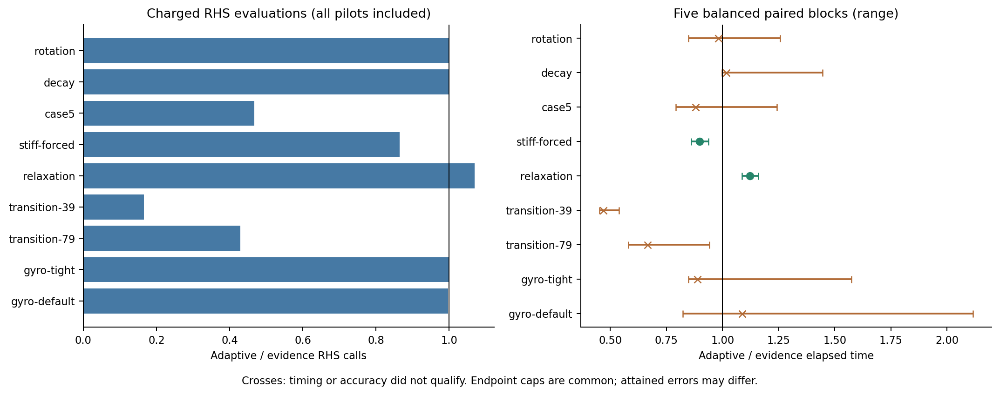
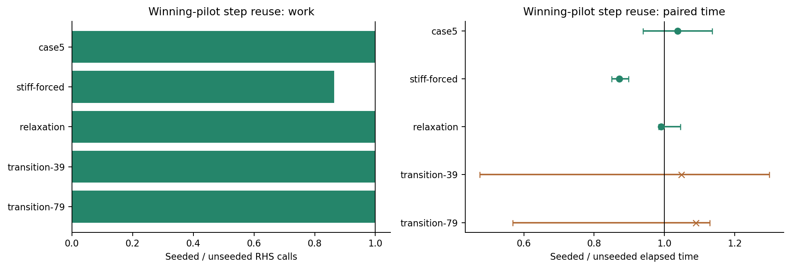
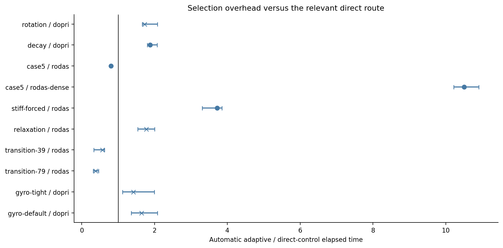
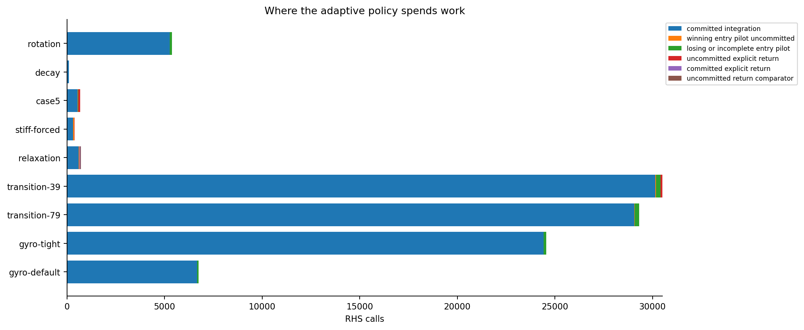
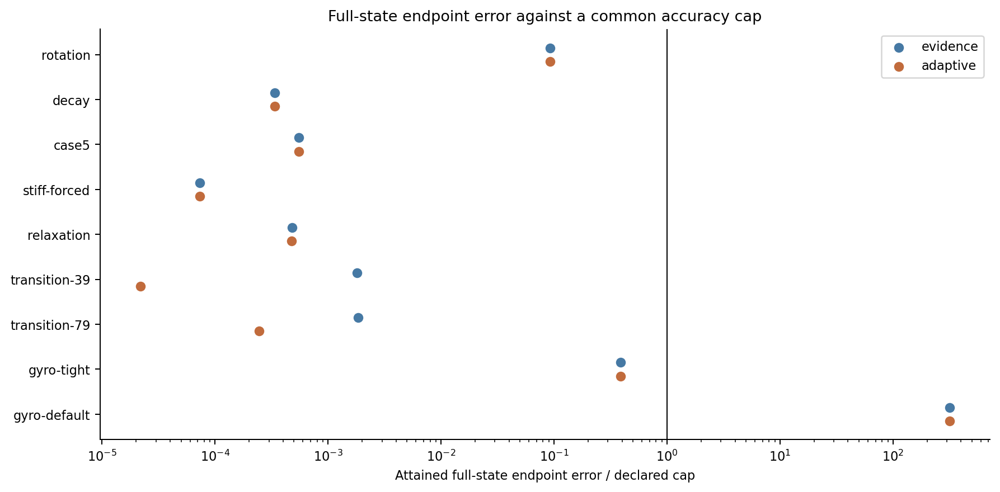

# VigilODE 자동 선택기의 비용과 신뢰성: 두 개발 계열의 통합 감사와 개선

2026년 10월 27일 · 일반 초기값 ODE에 대한 소스 검토, 수학적 분석 및 단일 스레드 실험

## 초록

VigilODE의 이번 개선은 적분 공식보다 방법을 비교하고 다시 시작하는 과정의 비용에 초점을 맞춘다. 최신 성능 개발 계열과 이전의 적응 제어 연구 계열을 통합하고, 선택적 미분 제공자가 없을 때의 불필요한 실행 거절, 아주 짧은 잔여 시간의 초기화 실패, 초기 비교의 실패를 너무 오래 유지하는 문제를 수정했다. 성공한 암시적 시험의 스텝 정보를 첫 실제 암시적 구간에 전달하는 기능도 추가했다. 두 차례의 구현·측정 루프를 거쳐 유효한 변경을 좁혔으며, 최종 계약 테스트 263개가 모두 통과했다.

강제 감쇠 시험에서는 최신 성능 계열의 정책을 같은 바이너리에서 실행한 비교군보다 RHS 호출이 456회에서 394회로 줄고, 반복 측정 시간은 중앙값 기준 10.2% 감소했다. 초기 과도응답이 있는 case5에서는 한 번의 제한된 재확인이 기존 적응 정책의 RHS 호출을 2,032회에서 680회로 줄였고, 해당 기능만 끈 대조군보다 20.4% 빨랐다. 반면 완화 시험에서는 동일 구간을 재비교하는 비용으로 12.2% 느려졌다. 따라서 모든 변경을 일반 기본값으로 올리는 대신, 적응 정책은 명시적으로 선택하는 기능으로 유지한다. **범용 production solver로서의 일괄 승격은 아직 보류한다.** 이번 결과는 실제 정확도 조건을 통과한 특정 개선과, 다음 단계에서 해결해야 할 선택 비용을 함께 제시한다.

## 1. 조사 범위와 기준

조사는 215개 원격 브랜치와 최근 PR 목록을 확인하는 데서 시작했다. 실제 통합 대상은 다음 두 계열이다.

| 계열 | 고정 게시 commit | 이번에 보존한 내용 |
|---|---|---|
| 최신 native 성능 개발 | `e8572eac8f6b1e019d8bf3dcb6d8b957fc1d1824` | 비교 callback 비용 제한, implicit 구간 병합, 다음 시작 스텝 전달, 통계 복사 비용 감소 |
| 이전 joint controller 연구 | `9b062e812b821a20dfcb40dfa0340a9df41e835e` | 변화에 따른 비교 근거 갱신, 같은 checkpoint·시간 구간 비교, 실행 identity와 원래 출력 오차 계약 |

최신 성능 보고서의 실제 측정 소스는 `596dcdfae8b95d24f27b57975d9f4626267b8149`다. 게시 commit과 측정 소스를 구분했다. 두 계열의 공통 조상은 `4fe67602502440d76aa9dd245c6b1d67558c14bf`이며, 통합에서는 두 부모의 이력을 모두 보존한다. 별도 응용 연구의 결과는 일반 ODE의 성능이나 정확도를 증명하는 자료로 전용하지 않았다.

기존 결과를 읽을 때에는 네 가지를 바로잡았다. 첫째, 실행시간의 큰 변동이 관측된 과거 측정을 확정적인 속도 개선으로 사용하지 않았다. 둘째, 작은 문제에서의 dense와 matrix-free 비용 차이를 전부 선택기 비용으로 돌리지 않았다. 셋째, 수락 상태로 저장하지 않은 성공적인 비교와 실패한 비교를 구분했다. 넷째, 기본 허용 오차의 gyromotion이 물리적 오차 상한을 넘는 사실을 결과표에 남겼다. 상세 대조는 [기존 근거의 비판적 감사](evidence_audit/CRITICAL_AUDIT_KO.md)에 있다.

## 2. 현재 구조와 고유 알고리즘의 위치

일반 자동 선택 표면은 RHS만 쓰는 DOPRI5에서 출발한다. 실제 작업량이 커지면 사용자가 허가한 RODAS5P 경로를 제한된 비용으로 시험한다. 여기서 판단하는 것은 관측된 방법의 경제성이다. 작은 스텝만으로 강성, 빠른 진동, 국소 변화 또는 출력 시점의 제약을 구별했다고 주장하지 않는다.

VigilODE의 고유한 연구 요소는 이 일반 표면과 별도로 남아 있다. 이를 표준 DOPRI/RODAS 설명으로 대체해서는 안 된다.

| 구성 | 실제 이득의 원천 | 현재 통합에서의 취급 |
|---|---|---|
| Involution·chirp·quotient flow | 선언된 빠른 carrier를 해석적으로 제거하고 느린 나머지를 적분 | RHS 전용 특수 경로 유지. 구조·재구성 오차를 제공하는 경우에만 자동 후보로 연결할 후속 대상 |
| 불변 ideal·cofactor | 강성 횡방향 성분과 초기 충격을 구조적으로 처리 | 해당 구조가 있는 문제의 특수 경로 유지. 일반 callback에서 자동 발견했다고 해석하지 않음 |
| 인과적 공유 단계 공간 | 단계별 현재 도함수·Newton 반복을 줄이고 작은 공통 풀이 재사용 | 기준점 JVP와 작은 LU를 쓰는 현재 구현의 계약을 유지 |
| 동시 Picard와 homotopy | 단계 의존 깊이를 줄이거나 이미 충분한 근에서 비싼 보정을 생략 | 원래 λ=1 목표와 실제 총비용을 함께 검사. 일반 보정의 JVP/Newton 사용 가능성을 명시 |
| 다항식 역원·Laguerre·Fourier–Volterra | 낮은 차수 관계, 부호 소거, convolution 구조를 이용한 연산 감소 | 기존 증명과 구현을 재사용. 원래 연산자 잔차와 물리 오차의 연결이 필요 |
| 실행 정책 | 독립 RHS·ensemble 작업의 직렬/병렬 비용 비교 | 작은 문제의 직렬 기본값 유지. 이전 calibration 포함 결과가 이기지 못한 경로는 강제 사용하지 않음 |

따라서 “Jacobian/matrix/Newton-free 우선, 필요한 곳에서만 선택적 JVP/AD”는 **경로별 권한과 경제성을 결합할 설계 목표**로 읽어야 한다. 모든 현재 경로가 동시에 완전 무미분·무행렬이라는 뜻은 아니다. 이번 변경은 이 목표와 충돌하는 숨은 미분 사용을 추가하지 않았으며, 자동 선택의 권한·비용·실패 처리를 먼저 정리했다. 이전 PR와 실제 소스 대응은 [기존 연구 재사용표](../joint_controller_20261025/history/REUSE_MATRIX.json)에 있다.

## 3. 적대적 분석에서 구현으로 이어진 변경

### 3.1 선택적 제공자의 부재와 문제 자체의 불가를 분리

기존 `AutomaticOde`는 미분 사용을 허용하면 암시적 경로의 가용성을 전체 요청의 전제처럼 검사했다. 그 결과 Jacobian/JVP가 없는 유효한 RHS 문제도 적분 전에 거절했다. 수정 후에는 전체 기능 요구를 먼저 확인하고, 알려진 선택적 제공자 제약에 대해서만 RHS 경로를 사용한다. 잘못된 band 선언, mass/event/연속 출력 요구와 수치 입력 오류는 계속 명시적으로 거절한다. 실제 경쟁 후보가 있을 때만 callback 재실행 계약을 요구한다.

이는 성공 판정을 느슨하게 만든 변경이 아니다. 강성 때문에 명시적 적분이 예산을 소진하면 실패와 마지막 수락 상태가 그대로 반환된다. 같은 아홉 관측 시점을 요청한 직접 DOPRI 실행과 자동 실행에서 상태·시간·전체 native 작업 counter가 정확히 일치함을 확인했다. 이 시험은 13시도, 79 RHS 호출, 최대 성분 오차 `3.3718e-9`를 기록했다. 이전에는 실행을 거절한 경우이므로 이전 대비 속도 배수를 만들지 않았다.

### 3.2 비교 비용과 수락 상태의 일관성

두 계열을 합칠 때 최신의 callback 제한, 구간 병합, warm start를 유지했다. 적응 정책에서는 명시적 방법으로 돌아가기 전 같은 수락 상태와 같은 시간 구간에서 암시적 비교를 수행한다. 암시적 방법이 더 유리한 것으로 확인되면 그 비교 결과를 실제 전진으로 사용하여 같은 구간을 다시 풀지 않는다. 모든 시험과 실패 callback은 전체 예산에 포함하며, fatal 오류가 나면 이미 수락한 checkpoint를 보존하고 중단한다.

독립 소스 검토에서 남긴 중요한 제한도 있다. 현재는 과거 암시적 작업률이 먼저 명시적 재시험을 선별한다. 과거 비용이 10, 현재 명시적 비용이 20, 현재 암시적 비용이 100이라면 현재 비교에서는 명시적 방법이 유리하지만 과거 기준은 이를 제외할 수 있다. 같은 구간 비교는 선별을 통과한 후보의 잘못된 복귀를 막지만, 유리한 후보를 놓치는 문제까지 없애지는 않는다. 다음 단계는 이 예비 선별을 가끔 우회하는 유한 예산 재확인이다.

### 3.3 짧은 잔여 구간과 비용 상한의 산술

유효한 초기 스텝을 아주 짧은 잔여 시간으로 먼저 잘라 native 최소값보다 작게 만들면 적분기 초기화가 실패했다. 명시·암시 경로와 비교 재실행에서 초기 제안값을 유효하게 유지하고 실제 끝점 착지는 native 적분기에 맡기도록 수정했다. `1e-15` 길이의 표현 가능한 구간에서 정확히 끝점에 도달하는 계약을 추가했다. 매우 큰 작업률을 정수 상한으로 바꿀 때의 한 단위 여유분도 포화 덧셈으로 처리했다.

callback 비용 상한은 엄밀한 wall-clock 제한이 아니다. RODAS는 callback 후, DOPRI 재시험은 시도 후에 비용을 확인한다. 따라서 순차 실행에서 마지막 callback 또는 시도 하나의 비용이 더해질 수 있다. 이 검사 순서를 문서와 이론 상계에 그대로 반영했다.

### 3.4 첫 번째 수정의 성과와 반례

성공한 암시적 진입 시험에서 얻은 평균 수락 스텝을 버리고 첫 실제 implicit 호출을 `h0`로 다시 시작하는 지점을 확인했다. 평균값 전달은 강제 감쇠 문제에서 비용을 줄였지만, case5에서는 평균이 `5.3005e-5`로 원래 `h0=1e-4`보다 작아져 한 시도와 8 RHS 호출을 추가했다. 최종 구현은 **성공하고 경제적인 시험의 평균이 원래 초기값보다 클 때만** 이를 전달한다. 실패한 시험은 스텝을 제공하지 않는다.

case5의 더 큰 문제는 진입 지연이었다. 첫 implicit 시험이 초기 과도응답에서 5번 거절되고 한 스텝도 수락하지 못했는데도, 적응 메모리는 이를 8개 명시 배치 동안 유지했다. 최초 적응 구현은 최신 성능 정책보다 명시적 시도 96회, RHS 576회를 더 썼다. 최종 구현에서는 이런 무전진·비치명적 비교에 한해 **다음 유효 구간에서 한 번만** 재확인을 허용한다. 첫 번째 시험의 시작 상태를 되풀이하지 않고 이미 전진한 명시적 checkpoint에서 비교한다. 반복된 무전진 실패가 이 예외를 계속 갱신하지 못하도록 사용 여부를 별도로 저장했다.

## 4. 수학적 근거와 보장 범위

### 4.1 스텝 전달이 줄일 수 있는 계산

오차가 0인 성장 구간에서 매 시도가 수락되고 성장 인자가 `g>1`, 시작 스텝이 `h>0`, 구간 길이가 `L>0`라 하자. 끝점에서만 스텝을 자르면 필요한 시도 수는

\[
n(L;h)=\left\lceil\log_g\left(1+\frac{(g-1)L}{h}\right)\right\rceil.
\]

이는 `n`개 스텝의 기하급수 합이 처음 `L` 이상이 되는 정수 조건에서 바로 따른다. 따라서 이 조건에서는 더 큰 유효한 시작값을 전달하면 시도 수가 증가하지 않는다. 최종 seed 규칙은 공통 구간 보정 전에 `h_start=max(h0, h̄_pilot)`을 선택하므로 초기값을 낮춰 이 성장 비용을 늘리는 반례를 제거한다. 이후에는 두 경로 모두 동일한 구간 상한·최소 제안값 보정과 native 끝점 착지를 적용한다. 일반 비선형 문제에서는 큰 초기값이 거절될 수 있으므로 이 단조성의 조건을 벗어난다. 실제 구현은 원래 오차 검사를 모두 유지하고, 절감량은 옵션을 끈 계산으로 확인한다.

### 4.2 한 번의 재확인에 대한 비용 제한

한 명시적 구간의 사용 플래그를 `u∈{0,1}`로 두고, 무전진 비교 후 재확인을 예약할 때 `u=1`로 바꾼다. 실제 비교가 지연되어도 pending 상태만 유지하고 `u`를 되돌리지 않는다. 그러면 같은 명시적 구간에서 이 특별한 조기 재확인은 최대 한 번이다. 이는 상태 전이에 대한 귀납으로 증명된다. 새로운 방법 구간이 시작될 때만 플래그가 초기화된다.

비교 callback의 사후 검사 상한이 `B`, 단일 callback의 최대 가중치가 `U`, 별도 구조 검증 비용이 `V`라면 그 한 번의 순차 callback 비용은 `B+U+V` 이하이다. 전체 시도 수 제한도 별도로 적용한다. 이 상계는 callback 작업 단위에 관한 것이며, 실행시간이나 변경 전후 전체 궤적의 비교 횟수 차이를 보장하지 않는다. 실제 방법 전환 시점이 달라지면 이후 궤적과 비교 일정도 달라질 수 있기 때문이다.

### 4.3 작업 공간·대수적 풀이 재사용의 다음 단계

완전한 적분 상태를 보존하면 동일한 callback 환경·산술 순서·강제 착지 시점에서 중단/재개와 연속 실행의 시도 열이 같다는 귀납적 동등성을 얻는다. 평균 스텝 한 개만 전달하는 현재 implicit warm start는 이 완전한 session 보존과 다르다.

구조적 역원 재사용에는 더 강한 조건이 필요하다. `W=I−γhJ`, `W′=I−γh′J′`에 대해

\[
Q=\gamma W^{-1}(h'J'-hJ),\qquad \|Q\|\le\eta<1
\]

이면 `W′=W(I−Q)`이고

\[
\left\|(W')^{-1}-\sum_{k=0}^{m}Q^kW^{-1}\right\|
\le\frac{\eta^{m+1}}{1-\eta}\|W^{-1}\|.
\]

가환성은 필요 없다. `W⁻¹`를 낮은 차수 다항식이나 구조적 작용으로 제공할 때도 적용할 수 있다. 다만 몇 개 벡터에서 결함이 작다는 관측을 전체 노름 상계로 바꾸면 안 되며, 작은 잔차로 전진 오차를 주장하려면 역원의 민감도와 근사 작용 오차가 필요하다. 이 결과는 후속 구현의 정확도 계약이며 이번에 모든 factorization을 재사용했다는 주장이 아니다.

전체 증명과 정확 유리수 검산 144개 성장 사례, 7개 역원 상계, 60개 사후 비용 사례는 [이론 문서](theory/CONTINUATION_AND_PROBE_COST_KO.md)와 [검산 결과](theory/THEORY_CHECKS.json)에 있다. SciSpace 문헌 검색, Wolfram 기호 확인과 독립 검토를 거쳤다. 검토 과정에서는 native 코드에 이미 존재하는 관측 절단 보정을 확인하여, 원시 PI 공식의 효과를 아직 해결하지 않은 버그로 잘못 서술하지 않도록 수정했다.

## 5. 시험 설계

최종 시험은 같은 바이너리 안에서 기존 성능 정책, 통합 적응 정책, 해당 변경을 끈 대조군과 유력한 직접 방법을 비교했다. 전체 method×thread 조합을 훑지 않았다. 회전, 감쇠, 초기 강성 과도응답, 강제 감쇠, 완화, 두 시점의 매끄러운 강성 전이, 빠른 gyromotion의 두 허용 오차 설정을 사용했다. 전이 시점 0.39와 0.79는 첫 실험 전에 정했으며 기존 함수족 안의 새 매개변수다. 두 번째 수정은 첫 결과를 본 뒤 이루어졌으므로 최종 결과를 완전히 독립적인 새 문제족 검증으로 해석하지 않는다.

환경은 공유 Xeon Platinum 8573C 실행 환경, 노출된 논리 CPU 9개, CPU quota 8개, 메모리 한도 8 GiB였다. 측정은 단일 스레드이며 NCP를 사용하지 않았다. Rust 1.94.1과 고정 `Cargo.lock`, `measurement` 프로파일을 사용했다. 컴파일과 시간 측정을 겹치지 않았다.

첫 실행은 25 ms 이상 묶음이었으나 시간 변동이 커, 최종 실행은 각 방법을 100 ms 이상 반복하도록 보정하고 ABBA/BAAB 순서의 5개 블록을 측정했다. 그림의 범위는 다섯 짝비율의 최솟값–최댓값이며 신뢰구간이 아니다. 실제 setup·할당·거절·시험·전환·통계 생성은 시간 안에 포함하고 JSON 직렬화는 밖에 두었다. 시간 비교의 요건은 최소 80 ms 묶음, 앞뒤 변동 15% 이하, 블록 최대/최소 1.30 이하, 결정적인 표본 결과와 공통 오차 상한이다. 개선 판정에는 모든 짝비율이 0.95보다 작아야 한다.

정확도는 모든 상태 성분의 종료점 절대오차 최댓값으로 확인했다. case5는 기존 외부 기준값과 경험적 불확실도 `1e-12`를 재사용했고, 나머지는 해석해를 사용했다. 이것은 전체 시간 구간의 최대 오차 측정과 구분한다. 자동 선택은 중간 관측 구간을 반환하고 직접 비교군은 끝점을 요구하므로, 이 비교에는 관측 계약의 추가 비용도 포함된다. 동일 관측 계약에서의 직접 native 동등성은 별도의 RHS 전용 시험으로 확인했다. [상세 실험 절차](benchmark/PROTOCOL.md)에는 모든 허용 오차와 비교 항목을 기록했다.

## 6. 최종 결과

아래의 기존 정책은 최신 native 정책을 **현재 통합 바이너리에서** 실행한 것이다. 다른 컴퓨터나 과거 commit의 시간 측정을 분모로 사용하지 않았다.

| 문제 | 기존 정책 → 통합 적응 정책 RHS | 작업량 변화 | 시간 비교와 해석 |
|---|---:|---:|---|
| 회전 | 5,371 → 5,371 | 동일 | 새 작업량 이득 없음. 시간 변동으로 우열 미판정 |
| 감쇠 | 103 → 103 | 동일 | 새 작업량 이득 없음. 직접 DOPRI가 더 저렴 |
| case5 | 1,456 → 680 | −53.3% | 이 두 정책 간 시간 변동은 기준 초과. 별도 재시도 기능 대조는 아래에서 통과 |
| 강제 감쇠 | 456 → 394 | −13.6% | 시간 비율 0.898, 범위 0.860–0.936. 개선 관측 |
| 완화 | 675 → 722 | +7.0% | 시간 비율 1.122, 범위 1.087–1.159. 재비교 비용으로 회귀 |
| 전이 0.39 | 184,724 → 30,515 | −83.5% | 작업량 개선. 시간 변동으로 속도 비율 승격 안 함 |
| 전이 0.79 | 68,323 → 29,327 | −57.1% | 작업량 개선. 시간 변동으로 속도 비율 승격 안 함 |
| gyromotion, 엄격 허용 오차 | 24,555 → 24,554 | 사실상 동일 | 종료점 오차 약 `3.90e-5`, 상한 `1e-4` 통과 |
| gyromotion, 기본 허용 오차 | 6,769 → 6,745 | 정확도 비교 부적격 | 오차 약 `3.16e-2`가 상한 `1e-4` 초과. 결과 보존 |

*그림 1. 통합 적응 정책을 기존 정책으로 나눈 비율. 오른쪽의 교차 표시는 시간 또는 정확도 기준을 통과하지 못한 비교다. 종료점 오차 조건과 실행시간 조건을 별도로 적용했다.*

변경의 원인을 분리한 대조 시험이 더 직접적인 근거다.

| 변경만 켠 대조 | RHS 변화 | 켠 경우/끈 경우 시간 | 판단 |
|---|---:|---:|---|
| 강제 감쇠의 진입 스텝 재사용 | 456 → 394 | 0.872 [0.850, 0.897] | 약 12.8% 감소. 첫 implicit 호출의 반복 초기화 감소 |
| case5의 무전진 비교 일회 재확인 | 2,032 → 680 | 0.796 [0.772, 0.909] | 약 20.4% 감소. 불필요한 명시적 안정성 제한 구간 축소 |
| case5의 growth-only seed | 680 → 680 | 1.038 [0.940, 1.136] | 조건이 맞지 않아 활성화되지 않음. 첫 수정의 down-seed 회귀 제거 |
| 완화의 seed | 723 → 722 | 0.991 [0.984, 1.046] | 뚜렷한 시간 이득 없음 |

*그림 2. 초기 제안 재사용만 분리한 대조. 효과가 없는 조건도 그대로 제시한다. 일회 재확인의 별도 대조는 위 표와 원자료에 있다.*

case5에서 통합 선택기는 같은 matrix-free 제공자의 직접 RODAS보다 빨랐다. 직접/선택기 시간 비율은 1.245 [1.207, 1.281]이었다. 그러나 작은 dense 직접 풀이의 시간은 선택기의 0.095 [0.092, 0.098]에 불과했다. dense와 matrix-free 직접 풀이 모두 RHS는 307회였지만 시간 비율은 dense/matrix-free 0.075 [0.071, 0.081]이었다. **RHS 횟수만으로 실제 속도를 판단할 수 없다는 가장 선명한 사례**다. 선택기에 JVP만 제공한 시험에서 더 빠른 dense 제공자를 자동으로 쓸 수 있었다고 가정하지도 않는다. 다음 구현에는 제공 가능한 후보와 권한을 함께 선언하는 인터페이스가 필요하다.

*그림 3. 통합 선택기의 전체 비용을 관련 직접 방법으로 나눈 값. 중간 관측 시점의 비용도 포함한다. 이 그림을 순수 적분 커널의 overhead로만 읽으면 안 된다.*

*그림 4. 실제 전진, 성공적인 진입 판단, 실패·미완료 비교, 생산적으로 사용한 implicit 재비교를 분리했다. `is_probe=true`라는 이유만으로 모든 작업을 낭비로 분류하지 않는다.*

*그림 5. 실제 달성한 종료점 오차/사전 상한. 기본 gyromotion의 부적격 결과를 속도 성과에서 제외하되 그림과 원자료에는 남겼다.*

## 7. 후보 탐색과 선택

이번 탐색은 실제 비용과 반례를 이용해 분기를 줄이는 유한 연구 탐색이다. 확률적 MCTS나 UCT를 구현·실행했다고 부르지 않는다. 첫 수정의 실패 사례를 보존하고 두 번째 수정에 반영했다.

| 후보 | 결정 | 근거 |
|---|---|---|
| 선택적 제공자 부재 시 RHS 경로 | 채택 | 실행 가능성 복구, native 출력·전체 counter 동등성 |
| 짧은 구간·정수 상한 수정 | 채택 | 재현 가능한 실패 수정과 경계 계약 통과 |
| 완료·경제성 확인 후 growth-only seed | 조건부 채택 | 작은 `h0`의 강제 감쇠에서 실제 시간 개선, down-seed 제외 |
| 무전진 진입 비교의 일회 재확인 | 조건부 채택 | case5 개선 및 반복 재시도 방지 계약 |
| 적응 메모리·유한 재탐색 | 변화하는 문제에 유지 | 전이 문제의 큰 작업량 감소. 정상 회전에서 추가 이득 없음 |
| 같은 구간 복귀 비교 | 강건성 기능으로 유지 | 과거 비용만 보고 잘못 복귀하는 문제 방지. 완화에서 추가 비용 명시 |
| 모든 문제에 경쟁적 자동 선택 강제 | 기본값에서 제외 | 감쇠·안정 회전의 직접 경로가 저렴하고 일부 문제에서 비교 비용 회귀 |
| 모든 성공 pilot 평균을 무조건 전달 | 제외 | 첫 수정의 case5 반례로 교정 |
| 전체 implicit session·구조적 역원 재사용 | 다음 최적화 | 현재 warm start와 구별되는 추가 상태·정확도 계약 필요 |
| 작은 작업의 병렬 실행 강제 | 제외 | 기존 총비용 근거가 부족하며 이번에 새 병렬 속도 측정을 하지 않음 |

`AutomaticOde::solve`와 기본 미분 금지 정책은 유지했다. 새 경제성·재확인 기능은 `solve_adaptive` 또는 명시적인 `SwitchingConfig`로 선택한다. 알려진 안정 문제에서는 불필요한 경쟁을 생략한 직접 방법을 사용할 수 있고, 구조가 알려진 진동 문제에는 별도의 구조적 경로가 더 적합할 수 있다.

## 8. 생산용 적합성과 구체적인 다음 단계

이번 검증으로 채택할 수 있는 것은 개별 결함 수정과 명시된 조건의 성능 개선이다. 범용 자동 선택기의 생산용 승격에는 세 가지 문제가 남는다. **실제 비용 모델**은 제공자와 차원에 따라 달라지며 고정 작업량 가중치만으로 설명되지 않는다. **비교 근거의 갱신**은 초기 무전진 문제를 개선했지만 과거 작업률에 의한 복귀 누락을 남긴다. **정확도 범위**는 현재의 종료점 검사보다 넓어야 하며, gyromotion의 기본 허용 오차는 이미 반례를 제공한다.

우선 순서는 다음과 같다. 동일 checkpoint 복귀 재확인의 유한 예산 정책을 추가하여 잘못된 선별을 줄인다. 이어서 RODAS의 완전한 session 보존을 구현하여 다음 제안·제어 이력·작업 공간의 반복 생성을 줄인다. 그다음 복수의 허가된 제공자와 구조적 방법을 공통 비용·오차 계약에 연결한다. 이때 직접 dense, JVP, quotient/회전 변환은 같은 원래 상태와 출력 요구에서 비교해야 한다. 마지막으로 실제 사용자 문제의 중간 시간·위상·모든 성분 오차를 포함한 work–precision 측정을 확대한다.

[NEXT_STEPS.json](NEXT_STEPS.json)은 각 작업의 파일, 구현 내용, 수학적 조건, 완료 기준과 기본값 적용 조건을 구체적으로 담는다. [로컬 인계서](LOCAL_CODEX_HANDOFF_KO.md)는 사용자의 기존 작업 트리를 보존하면서 재현하고, 원자료를 이용해 실제 선택이 잘못된 지점을 조사하는 절차를 제공한다. 반복적인 전체 방법 비교보다 선택된 방법과 유력 대안 하나의 같은 구간 대조를 우선한다.

## 9. 검증 기록과 재현성

최종 `cargo test --locked --offline -p vigilode --lib --tests`는 32개 시험 묶음, 263개 테스트를 통과했다. 최종 소스 변경 없이 measurement 바이너리를 빌드하고 26개 짝 비교를 실행했다. 앞선 25개 비교와 실패한 초기 테스트도 보존했다. 과거 “회전에서 엄격한 추가 감소” 테스트는 최신 기준선도 이미 개선되어 3회 대 3회가 된 사실을 확인한 뒤, 기준선과의 비열등 작업량·동일 상태·정확한 과금 계약으로 갱신했다. 이를 새 속도 개선으로 세지 않았다.

이론과 코드 작성자와 다른 검토자가 가정, 상태 commit, fatal 처리, 일회 제한 및 전체 counter 합을 검토했다. 독립 검토는 실제 Cargo 실행과 구분하여 기록했다. Academic Writing Toolkit의 문단 검토와 사용자의 한국어 연구 문체 지침을 적용했으며, 한국어 문단을 짧다고 표시한 단순 길이 경고 때문에 문장을 불필요하게 늘리지 않았다.

각 실행의 `SOURCE_INPUTS.json`과 `RECEIPT.json`, 실패 출력, 바이너리 해시, 원자료와 그림 생성 코드는 이 폴더에 있다. 첫 수정의 변경 전 소스는 `revisions/r1/`에 보관했다. 마지막 성공 실행은 소스가 실행 중 바뀌지 않았음을 확인한다. [VALIDATION.json](VALIDATION.json)과 [ARTIFACT_MANIFEST.json](ARTIFACT_MANIFEST.json)이 검증 요약과 파일별 SHA256을 제공한다. 새로운 성능 결론은 이 패키지의 실행에 한정하며, 이전에 완료한 구조적 연구의 증명·벤치마크는 출처를 유지해 재사용한다.
