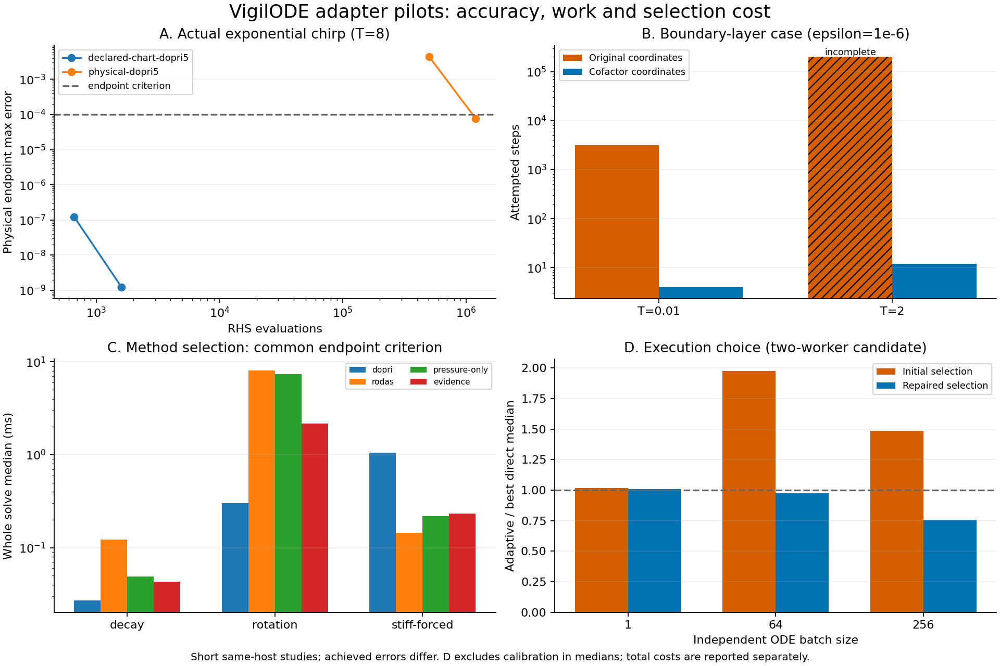

# 구조와 선택 비용을 함께 줄이는 VigilODE 연구

## 목적과 기준 자료

이번 연구의 목적은 빠른 진동·강성 문제를 위한 고유한 구조적 아이디어를 실제 solver 경로로 연결하고, 어떤 방법을 언제 사용할지 판단하는 비용을 줄이는 것이다. 최신 local 중지 패킷 d79326648a7273c0decd641eaf94d94f5bea7c63과 그 부모755885522e7e487e5f0d89085cfa15d972df0ea7을 기준으로 했다. 별도 BASS/REI branch72836e0290b66d33f4ca1771284b1c8070669a74의 물리 norm·callback·수락된 효과 계약도 읽었다.

중지 패킷은 local 원시자료의 현재 보존 위치를 `/tmp/vigilode-local-run-20261024.geLVCp9Q`로 기록한다. 이 host에서는 그 자료 전체에 접근하지 않았으며 게시된 작은 원자료와 코드로 조사했다. 추가 Julia 비교48회는 해당 endpoint 기준 통과, 새 정확도V3는0/72회, timeout 진단은0/9회다. 이전1539작업의 실패와 참조 미확보 상태를 변경하지 않았다. 상세 identity는 `sources/LATEST_EVIDENCE.json`에 있다.

결론은 구성요소별로 다르다. 선언된 chirp·cofactor 구조를 사용하는 경로는 실제 native 계산량과 정확도에서 유망한 결과를 냈다. 스텝 이력 전달과 자동 방법 선택은 개선됐지만 직접 알맞은 방법을 지정한 경우보다 여전히 비용이 크다. 병렬 정책은 측정과 선택을 연결했으며, 첫 실험의 잘못된 선택을 원인별로 수정했다. 범용 production solver라는 목표의 최종 검증은 남아 있다.

## 1. 빠른 진동: 대수적 sector와 시간 의존 좌표

과거 Loop11의 involution·local quotient algebra, PP05/PP06의 Fourier–Volterra 및 noncyclic FFT, scalar causal moment packet은 코드와 archive에 보존되어 있다. `fourier_path_certificate.rs`는 원방정식 residual을 다시 평가하고, `fourier_path_candidate.rs`는 harmonic와 formal degree 양쪽의 aliasing을 피하는 full-product padding을 구현한다. 이 근거를 다시 처음부터 실행하지 않았다. 보존을 연결하는 PR#78은 확인했지만 Fourier 원 연구의 유일한 PR 번호는 확인되지 않았다. 정확한 파일·archive·SHA를 사용했다.

실수 몫대수 \(\mathbb R[\xi]/(\xi^2+1)\)에서 회전은 두 실수 계수로 환원된다. \(\xi\mapsto-\xi\) involution을 이용하면 독립된 두 amplitude를 유지하면서 \(\exp(\pm\theta J)\)의 sin/cos를 공유할 수 있다. 새 helper는 두 sector를 한 번의 `sin_cos`로 계산한다. 이는 초월함수 호출 감소라는 정확한 연산 수 결과이며 전체 적분 시간이2배 빨라진다는 명제는 아니다.

\(z'=-\gamma z-i\omega(t)z+N(t,z)\), \(\phi'=\omega\)에서 \(w=e^{i\phi}z\)라 두면

\[
w'=-\gamma w+e^{i\phi}N(t,e^{-i\phi}w).
\]

\(N(t,e^{i\theta}z)=e^{i\theta}N(t,z)\)이면 우변의 빠른 위상이 정확히 제거된다. 같은 transformed 초기값·mesh·오차 제어에서 stage와 embedded error는 \(\omega\)에 의존하지 않는다. 필요한 도함수의 균일 유계 조건 아래 기존 RK 수렴 정리의 상수도 carrier 주파수와 독립이다. \(N=\sum c_{pq}z^p\bar z^q\)라면 남는 factor가 \(e^{i(1-p+q)\phi}\)이므로 \(p-q=1\) sector만 이 성질을 가진다. 비등변 residual에 같은 결론을 붙이지 않는다.

실제 catalog15는 단순한 회전벡터가 아니라 \((x,v)\)의 2차 계다. \(\omega=\omega_0e^{\beta t}\), \(q=x\), \(p=(v+\gamma x)/\omega\)를 사용하면

\[
q'=-\gamma q+\omega p,\qquad p'=-\omega q-\gamma p.
\]

여기에는 시간 의존 chart 미분항 \(-\beta p\)가 반드시 포함된다. `ExponentialChirpChart`는 이 mapping과 추가 physical residual의 변환을 구현한다. 큰 full RHS에서 빠른 항을 다시 빼는 방식을 사용하지 않아 cancellation을 줄인다.

같은 시각·정확한 phase에서 \(\|\delta w\|_2\le\eta\)이면

\[
\|\delta(x,v)\|_\infty\le\max(1,\gamma+\omega(t))\eta.
\]

따라서 빠른 위상을 제거해도 물리 속도 성분의 오차 증폭을 빠뜨리면 안 된다. pilot은 전체 구간의 보수적 lift를 사용하며 chart 쪽 국소 조건이 더 엄격하다. binary64 phase와 복원의 rounding은 이 정확 산술 부등식과 별도로 평가했다. 작고 큰 인자의 중간 underflow/overflow를 안정화하고 독립 회귀검사를 추가했다.

구현·증명·80자리 endpoint 대조와 native 결과는 `oscillation/`에 있다. 실제 chirp와 nonlinear radial residual 확장 두 계를 사용했다. FFT 자체를 새 일반 solver로 승격하지 않았으며, Fourier charge 구조가 주어진 residual에서만 후보 생성 비용을 줄이는 다음 연결을 제안한다.

## 2. 작은 스텝의 누적: 안정영역과 cofactor 수송

Case5와 KS의 실패는 약97.56%의 시도가 수락된 상태였다. clipping도0이다. 실제 DOPRI tableau의 안정다항식은

\[
R(z)=1+z+z^2/2+z^3/6+z^4/24+z^5/120+z^6/600.
\]

음의 실축 경계 \(R(-r)=1\)의 양의 근은 \(r\simeq3.3065678926\)이다. Case5의 율 \(-10^6\)과 KS1024 선형부 Nyquist율 \(-171819.59017\)에서 예측한 최대 스텝에 대한 관측 평균의 비는 각각1.000535와1.000679다. 이는 지속적인 explicit 안정성 제약과 매우 잘 맞는다. 각 비선형 단계의 원인까지 증명한 것은 아니지만, 거절 비율만 낮추거나 h를 강제로 늘리는 개선이 적절하지 않음을 구체적으로 보여준다.

기존 독립 참조 계산에 있던 \(z=x-\cos y,\;z'=-z/\varepsilon\)를 재사용했다. 이번 구현은 여기에 적분 carrier

\[
C(t)=b\varepsilon z_0(1-e^{-(t-t_0)/\varepsilon}),\qquad v=y-C(t)
\]

를 도입한다. \(y'=g(t,y)+bz\), \(g=-y/(1+t)+b\cos y\)이면

\[
v'=g(t,v+C),\quad y=v+C,\quad x=\cos(y)+z_0e^{-(t-t_0)/\varepsilon}.
\]

\(C'=bz\)이므로 이식은 정확하며, \(t\ge0,b=0.2\)에서 \(|g_v|\le1.2\)로 빠른 율이 상태 방향 안정성 조건에서 사라진다. 급격한 시간 의존성은 초기 국소 오차에 남을 수 있으므로 임의 입력에서 epsilon 독립 스텝 수를 보장한다고 하지 않는다. 복원 오차는 같은 carrier를 쓸 때 원 변수 최대 norm에서 scalar 오차 이하이며 carrier rounding을 별도 더한다.

\(t\le2\)에서는 \(g_y\le-1/(1+t)+0.2\)이므로 잔차 \(r\)를 갖는 근사에 대해

\[
|e(T)|\le\frac{1+t_0}{1+T}e^{0.2(T-t_0)}|e(t_0)|+
\int_{t_0}^{T}\frac{1+s}{1+T}e^{0.2(T-s)}|r(s)|\,ds.
\]

이 직접 유도에서도 빠른 감쇠율은 오차 증폭 상수로 되돌아오지 않는다. Native embedded error를 연속 잔차의 엄밀한 상한으로 동일시하지 않는다. `ExponentialCofactor`는 이 선언된 구조의 안정적 carrier·primitive 평가를 제공한다.

별도의 실제 구현 결함으로 fused exponential 경로의 PI 이력 갱신 순서도 수정했다. 기존에는 \(e_{n-1}\)을 \(e_n\)으로 덮은 뒤 제안해 PI가 \(s e_n^{-0.3/5}\)처럼 동작했다. 공통 제어기를 연결하여 이전 오차, predictive 설정, clipping과 거절 이력을 유지한다. 이 경로는 이전 DOPRI 대규모 결과에 사용되지 않았으므로 두 원인을 혼동하지 않는다.

## 3. automatic selection과 controller 연속성

기존 `GeneralOde::Unknown`은 DOPRI를 고정 선택한다. 별도의 switcher는 work pressure를 사용하며, 이것도 물리적 stiffness·진동·cofactor를 모두 분류하는 시스템은 아니다. 이번에는 실제 관측된 method fitness를 기록하는 `SwitchingEvidence`, 간격과 횟수를 제한한 pilot, DOPRI 스텝 제안 전달을 구현했다. 새로운 `AutomaticOde`는 기존 resource preflight, derivative 권한, replay-safe callback 조건을 확인한 뒤 이 경로를 호출한다.

선택 시 다음 세 종류의 정보를 구분한다. 첫째, exact cofactor·commuting carrier처럼 구조 공급자가 검증하여 선언하는 성질. 둘째, 스텝 수·거절·동일 구간 pilot에서 관찰한 계산 적합성. 셋째, host와 workload에 따라 변하는 실제 비용이다. 첫째를 몇 번의 RHS 샘플만으로 인증했다고 하지 않으며, 둘째를 곧바로 물리적 강성으로 명명하지 않는다.

직접 적합한 방법을 호출하는 것에 비하면 새 switcher에도 비용이 남는다. 반복 probe와 workspace 재생성, 아직 보존하지 않는 PI/FSAL/implicit history, work proxy와 wall time의 차이가 다음 측정 대상이다. 작은 h 자체는 판정이 아니라 후보 비교를 시작하는 신호다. 모델이 바뀌면 과거 저비용 관측을 고정하지 않도록 epoch·재평가를 연결해야 한다.

## 4. 병렬 실행 선택과 비용 회수

`AdaptiveBatchExecutor`는 같은 작업의 직렬과 한 bounded pool 후보를 실제 실행하여 출력 일치와 비용을 확인한다. workload key는 method/model/environment epoch, dimension, batch 길이와 layer를 포함한다. nested 실행은 직렬화하고, 오래되거나 다른 key의 비용을 재사용하지 않는다. 실제 연결 대상은 독립 ODE ensemble이며 큰 PDE RHS나 coupled stage의 성능은 다음 실험이다.

실행당 비용 S,P와 준비·측정 비용 H가 정해져 있다면 처음부터 병렬 정책을 선택하는 순이득 조건은 \(m(S-P)>H\)다. 하지만 이미 calibration을 지출한 뒤에는 두 후속 경로 모두 H를 지불한 상태이므로, 미래 실행 선택은 S와 P를 비교해야 한다. 첫 pilot에서 이 sunk cost를 재차 회수하도록 요구한 부분이 좋은 병렬 경로를 놓쳤고, 그 계산을 수정했다. 전체 경제성 보고에는 H를 계속 포함한다. 이 구분은 비용을 숨기는 수정이 아니다.

몇 개의 관측 최소·최대값은 미래 비용의 수학적 확률 경계가 아니다. cold start나 outlier가 held-out workload와 다를 수 있다. raw calibration pair를 보존하고 유한 warmup을 청구하며, 단일 작업에서는 불필요한 pool/calibration을 생략하도록 개선했다. 초기 선택 실패와 수정 후 결과를 모두 남긴다.

## 5. BASS/REI에서 가져온 조건

고정 affine lift의 intertwining 정리는 시간 의존·비선형 chart에 그대로 적용할 수 없다. 이번 chirp는 chain rule로 시간미분항을 유도했다. 물리 norm의 의미, 모든 RHS·차분 stencil 이전의 domain 확인, 반환된 dense curve 자체의 오차, accepted-only effects와 ACK, callback full-write와 epoch 계약은 다음 native 통합에 재사용한다. 연구 branch 전체를 merge하지 않았으며 해당 제약을 우회하는 shadow 실행도 허용하지 않는다.

## 6. 벤치마킹의 변경

앞으로의 기본 단위는 실제 선택 직전의 물리 checkpoint다. 선택된 방법을 기록하고 같은 interval·출력·오차 기준의 관련 대안1개를 비교한다. 더 나은 대안이 나타나면 원인 가설에 맞는 두 번째 비교만 추가한다. 실패나 부정확한 결과는 빠른 대안으로 집계하지 않는다.

선택 비용은 solver+준비+probe+전환의 겹치지 않는 합이다. 적격 후보 집합 A에서 관측 비용비는 \(C_{selected}/\min_{a\in A}C_a\)로 정의한다. 이는 시험한 후보 중 최소이며 범용 최적성 보장이 아니다. `selection_benchmark/analyze_selection.py`는 같은 checkpoint·source·host·metric·reference 결합을 확인하고, 비교 불능·불완료·정확도 실패를 분리한다. 현재 whole-trajectory pilot을 이미 paired-window 자료인 것처럼 바꾸지 않았다.

## 문헌과 근거 위치

- Petzold, *Automatic Selection of Methods for Solving Stiff and Nonstiff Systems of Ordinary Differential Equations*, SIAM J. Sci. Stat. Comput. (1983), DOI [10.1137/0904010](https://epubs.siam.org/doi/10.1137/0904010). 방법의 효율을 step 정보로 비교한다는 원칙을 재사용했다. 초록을 확인했으며 미확인 full-text 공식을 가져오지 않았다.
- Söderlind, *Digital Filters in Adaptive Time-Stepping*, ACM TOMS29 (2003). [논문 사본](http://www.nacad.ufrj.br/~amit/oumar_papers/p1-soderlind.pdf)의 오차–스텝 점근 모델 및 controller 이력 개념을 참조한다.
- Hochbruck, Leibold, Ostermann, *On the convergence of Lawson methods for semilinear stiff problems*, Numer. Math.145 (2020), DOI [10.1007/s00211-020-01120-4](https://doi.org/10.1007/s00211-020-01120-4), [저자 원고](https://www.waves.kit.edu/downloads/CRC1173_Preprint_2017-9.pdf). Lawson의 높은 차수에는 문제별 정칙성 조건이 필요하다.
- SciSpace 탐색·Exa 원전 탐색·Wolfram 회전/cofactor 정확 검산 결과는 `sources/`에 보존했다. 이론 유도와 native 실행, 예측 비용, 경험적 참조 불확실도를 구분한다.

측정표와 최종 판정은 다음 절 및 `FINDINGS.json`, 후속 구현은 `NEXT_STEPS.json`을 따른다.

## 7. 실제 pilot 결과와 판정

그림 A는 실제 chirp의 RHS 작업과 물리 endpoint 오차, B는 boundary-layer의 시도 수, C는 선택 정책의 전체 solve 시간, D는 실행 backend 선택을 보여준다. D의 1 미만 값은 같은 backend를 서로 다른 시점에 측정한 변동을 포함한다. 이를 adaptive wrapper가 동일 병렬 연산보다 본질적으로 빠르다는 주장으로 읽지 않는다. D 중앙값에는 calibration이 빠져 있으며 아래 표와 JSON의 총비용에는 포함되어 있다.

| 실제 실험 | 관측 결과 | 적용 판정 |
|---|---|---|
| Chirp physical-dopri5, 요청 atol1e-8 | RHS 1,197,457, endpoint 오차 7.65e-05, 시간 78.17 ms | 공통 endpoint1e-4 기준 통과; 국소 norm 조건·달성 오차는 다름 |
| Chirp declared-chart-dopri5, 요청 atol1e-8 | RHS 1,603, endpoint 오차 1.24e-09, 시간 0.2894 ms | 공통 endpoint1e-4 기준 통과; 국소 norm 조건·달성 오차는 다름 |
| Case5 cofactor, epsilon1e-6,T2 | 12시도, 오류 7.305e-08, 시간 5.298 μs | 선언된 구조의 전문 경로; 원 좌표20만회 미완료와 속도비를 만들지 않음 |

방법 선택 비교는 h0=1e-4에서 다음과 같다. 모두 endpoint1e-5 기준을 통과했으며 워밍업1회 후3회 중앙값이다.

| 문제 | 직접 DOPRI(ms) | 직접 RODAS(ms) | 기존 pressure(ms) | 새 evidence(ms) |
|---|---:|---:|---:|---:|
| decay | 0.02691 | 0.1228 | 0.04906 | 0.04296 |
| rotation | 0.3011 | 8.056 | 7.406 | 2.158 |
| stiff-forced | 1.055 | 0.1446 | 0.2183 | 0.2329 |

회전에서는 불필요한 implicit 상주를 피했지만 직접 DOPRI보다 여전히 비싸다. 강제 강성 문제에서는 RODAS로 전환했지만 직접 RODAS보다 비싸다. 따라서 다음 최적화는 더 많은 후보를 추가하기 전에 세션 재시작과 반복 pilot 비용을 줄이는 것이다. 3문제×2초기h×5경로의 작은 비교는 이력 전달·선택 정책의 ablation이며 전범위 method×thread campaign을 재개한 것이 아니다.

| Ensemble 길이 | 선택 | Held-out 최선 | 선택 불일치율 | 준비·보정 포함 adaptive 총시간(ms) | 직렬 총시간(ms) |
|---:|---|---|---:|---:|---:|
| 1 | serial | serial | 0% | 0.1339 | 0.2776 |
| 64 | parallel | parallel | 0% | 12.79 | 13.07 |
| 256 | parallel | parallel | 0% | 47.24 | 51.42 |

각 batch의20회 held-out 관측에서 선택과 관측된 빠른 backend가 일치했다. 이 한 host 실험으로 미래 비용을 보장하지 않는다. 초기에는64·256 batch 모두 좋은 병렬 경로를 놓쳤으며 그 원본도 보존했다.

## 8. 검증과 다음 구현

최종 source의 scoped Rust 검사59개와 선택 분석기 Python22개가 통과했다. 별도의 대수 검산5개, 독립 chart 회귀13개 및 선택 회귀17개도 통과했으며 일부는 같은 계약의 독립 재실행이므로 이를 모두 독립 시험 수로 합산하지 않는다. 전체 workspace suite나 전체 production benchmark의 통과를 주장하지 않는다.

독립 검토에서 극단값 cofactor 산술, 작은 beta의 phase, 중간 window의 다음 h 갱신, 정확한 endpoint에 마지막 예산으로 도달한 상태를 수정했다. 초기 환경·타입·공유 artifact 오류와 초기 잘못된 선택은 보존했다. 최종 multi-example build와 겹친 `results_r1` 시간은 분석에서 제외하고, build exit0 이후의 `results_r2`를 본 표에 사용했다.

다음 개발은 `NEXT_STEPS.json`의 원자료 보존→구간 계측→지속 세션→동적 물리 norm/구조 provider→실제 비용 선택→큰 격자 실행→선택 중심 검증 순서다. 정밀 이론 문제에만 Astra ultra와 연구 도구를 배정하고, 나머지는 저비용 실행·수정 경로로 분리하는 인계문서를 제공한다.
