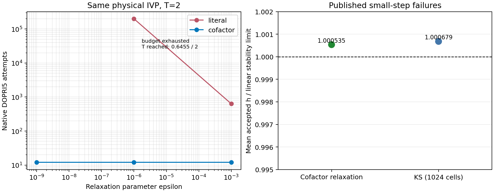

# 스텝 적응의 실제 실패 원인과 cofactor 수송

## 조사 범위와 근거

기준은 `d79326648a7273c0decd641eaf94d94f5bea7c63`의 정지 감사 패킷과 실제 Rust 소스다. `OBSERVED_STEP_BUDGET.json`은 원본 receipt를 읽어 생성하였다. case5는 200,000회 중 195,112회(97.556%) 수락, 4,888회 거절이며 목표 t=2 중 t=0.645495998875149까지 진행했다. KS case12도 195,117회(97.5585%) 수락했다. 두 자료의 output_clipped_steps는 0이다. 따라서 이 두 실패를 출력 강제착지나 거절 폭증으로 설명할 수 없다. 전체 스텝 이력은 게시되지 않아 local 원자료에서 h, embedded error, RHS 비용을 확인해야 한다.

`crates/rodas5p-integrators/src/adaptive.rs`의 공통 갱신은 PI 제안 후 이전 수락 오차를 갱신하며, 강제착지의 작은 조각에서는 이전 요청 h와 오차 이력을 보존한다. DOPRI5가 이 공통 갱신을 호출하는 것도 확인했다. 일반 DOPRI 경로에서 이 순서의 결함을 발견하지 않았다.

두 실패의 평균 수락 h를 실제 DOPRI tableau의 안정영역과 비교하면 기작을 더 구체적으로 좁힐 수 있다. 정확 유리수 tableau로부터

\[
R(z)=1+z+\tfrac12z^2+\tfrac16z^3+\tfrac1{24}z^4+\tfrac1{120}z^5+\tfrac1{600}z^6
\]

를 재구성했다. 음의 실축 경계는 R(-r)=1의 r≈3.3065678926이다. case5의 횡방향 율 -10^6에 대한 한계 h=3.3065679e-6과 관측 평균 h=3.3083357e-6의 비는 1.000535이다. KS1024, L=32π의 중심차분 선형부 -D2-D2²는 Nyquist 모드에서 λ=4/Δx²-16/Δx⁴=-171819.59017이므로 한계 h=1.9244417e-5이며 관측 평균 h=1.9257479e-5의 비는 1.000679다. 두 결과 모두 0.07% 이내다. 이는 명시적 안정성 제약과 매우 잘 맞는 수치 관측이며, 비선형 단계별 기작의 완전한 증명은 아니다. 특히 controller가 더 큰 h를 무조건 주도록 고치면 횡방향 안정성을 잃을 수 있다. 재현은 `analyze.py`, 결과는 `STABILITY_MATCH.json`과 `STABILITY_POLYNOMIAL.json`에 있다.

반면 opt-in fused exponential 적분기는 `record_acceptance(e_n)` 다음에 `propose_factor(e_n)`를 호출했다. PI의 의도된 계수는

\[
f_n=s e_n^{-0.7/p}e_{n-1}^{0.4/p},\quad p=5,
\]

이지만 기존 경로는 이전 오차를 덮어서 \(s e_n^{-0.3/p}\)가 됐다. 이 경로는 predictive 설정, 착지 후 요청 복원, represented-clock 거절 이력도 우회했다. 이번 수정은 기존 공통 갱신을 연결한다. 이 결함은 소스로 확인했지만, DOPRI/RODAS/switching만 실행한 기존 대규모 캠페인의 원인으로 주장하지 않는다.

## 실제 case5의 exact cofactor

원 방정식은 무차원 변수 \((x,y,t)\), \(t\ge0\), \(\varepsilon>0\)에 대해

\[
y'=g(t,y)+b z,\quad g(t,y)=-\frac{y}{1+t}+b\cos y,
\quad z=x-\cos y,\quad z'=-\varepsilon^{-1}z,
\]

이며 b=0.2, (x0,y0)=(0,1), z0=-cos(1)이다. `stop_audit_20261025/evidence/case_references/case05/REFERENCE_EVIDENCE.json`에 이미 이 exact reduction이 존재한다. 원자료의 WP40 StiffnessSwitching와 WP50 BDF가 만든 전체 endpoint [0.8535165094995294, 0.5480991918322129] 및 경험적 불확실성 1e-12를 재사용하며 참조 계산을 반복하지 않는다.

원래 좌표에서 경계층 뒤 z가 작아져도 횡방향 고유율 -1/epsilon은 사라지지 않는다. 따라서 '해가 느리다'는 신호로 원 좌표를 explicit로 전환하는 것은 안정성 제약을 제거하지 못한다.

### 구성적 정리: 적분 carrier로 가산 강성 제거

\(z(t)=z_0e^{-(t-t_0)/\varepsilon}\),
\(C(t)=b\varepsilon z_0[1-e^{-(t-t_0)/\varepsilon}]\),
\(v=y-C\)라 두면

\[
v'=g(t,v+C(t)),\qquad y=v+C(t),\qquad x=\cos(y)+z(t).
\]

**증명.** C'=bz이므로 v'=y'-C'=g(t,y). 역변환을 미분하면 x'=-sin(y)y'-z/epsilon이며 원 방정식과 정확히 일치한다. t=t0에서 C=0이므로 초기조건도 보존한다. epsilon→0일 때 t>t0의 z는 0으로 수렴하고 C=O(epsilon)이며 축약된 느린 방정식으로 수렴한다. 구현은 초기에 `-expm1(-rate*dt)`를 사용하여 C의 상쇄를 피한다. carrier가 underflow하면 z=0, C는 유한 극한으로 평가한다.

또한

\[
\left|\partial_v g(t,v+C)\right|\le\frac1{1+t}+|b|\le1.2
\]

이므로 빠른 율 1/epsilon에 의한 상태 방향 explicit 안정성 제약이 제거된다. 이 결과는 임의의 오차제어기가 epsilon과 무관한 스텝 수를 보장한다는 명제가 아니다. 시간 의존 carrier의 급격한 초기 변화는 국소 절단오차에 남으므로 초기조건과 정확도 요구를 시험해야 한다.

### 전체 변수의 오차 수송

같은 정확 carrier를 쓴 두 축약해의 오차가 e이면 |delta y|=|e|이고 |delta x|≤|e|이므로 원래 두 성분의 최대절대오차는 |e| 이하이다. 추가 carrier 반올림 오차 eta_z, eta_C가 있으면 상계는 |e|+|eta_C|+|eta_z|이다. 따라서 축약 좌표에서 작은 오차를 얻고 복원 후 원 norm으로 비교할 수 있다. 축약 scalar WRMS와 원래 2차원 WRMS의 동일 rtol은 같은 달성오차를 뜻하지 않는다.

더 나아가 t∈[0,2]에서 g_y≤-1/(1+t)+0.2<0이다. 잔차 r을 가진 축약 근사에 대해 scalar one-sided Lipschitz 부등식을 적분하면

\[
|e(T)|\le\frac{1+t_0}{1+T}e^{0.2(T-t_0)}|e(t_0)|+
\int_{t_0}^{T}\frac{1+s}{1+T}e^{0.2(T-s)}|r(s)|\,ds.
\]

이는 상태오차 전파 계수에도 1/epsilon이 나타나지 않는다는 직접 유도다. native embedded estimate를 이 연속 잔차의 보증 상계로 간주하지 않는다.

## 구현과 적용 조건

`ExponentialCofactor`는 z'=-rate*z, y'=g(t,y)+coupling*z라는 선언된 구조의 carrier와 primitive를 공급한다. 구조를 자동 탐지하는 기능은 아니다. `adaptation_geometry_pilot`은 공개 DOPRI5 API로 원 2차원 방정식과 축약 1차원 방정식을 각각 실제 적분하고 원 두 변수로 복원한다. JVP, Jacobian, Newton 호출은 필요하지 않다. 독립 참조가 있는 eps=1e-6,t=2만 해당 참조와 직접 비교한다. 나머지는 더 엄격한 동일 native 방법으로 교차 확인하므로 독립 검증으로 부르지 않는다.

cofactor 구조를 가진 polynomial/rational chart에 대한 이전 연구의 핵심은 작은 잔차가 아니라 *미분 항등식과 복원 가능한 정칙 chart*다. 이 사례의 cos는 대수함수가 아니므로 이를 polynomial ideal이라고 부르지 않는다. 원하는 경우 s=sin y,c=cos y를 추가한 s²+c²=1 위의 함수대수로 올릴 수 있지만, 현재 커널은 직접 삼각함수 평가가 더 작고 정확한 구현이다. 새 속도는 이 lift 자체가 아니라 알려진 cofactor를 정확히 수송한 데서 발생한다.

## 다음 local 조사

1. 각 수락/거절 시점의 requested_h, represented_h, error norm, accepted, clipped, method, elapsed cost와 cache epoch를 저장한다. 기존 실패 trace가 없으면 동일 초기조건으로 0.01 이하의 짧은 진단 실행을 별도 식별자로 만든다.
2. 같은 상태에서 크기 h와 h/2의 embedded error를 비교할 때만 관측 차수 log(e_h/e_h2)/log(2)를 계산한다. 서로 다른 accepted 상태를 비교해서 stiffness certificate라고 하지 않는다.
3. 원 좌표에 작은 가역 섭동을 추가한 방향별 RHS 응답 또는 이미 허용된 JVP와 carrier residual을 비교하여 slow trajectory와 transverse stability를 구분한다. 기본은 derivative-free이며 선택적 JVP 비용도 포함한다.
4. cofactor adapter는 구조 공급자가 항등식, epoch, norm 변환, 초기값을 제공할 때에만 후보로 등록한다. 입력식이 바뀐 negative control에서는 이를 선택하지 않아야 한다.
5. 기존 ALG05 PredictiveCapped2의 van der Pol 같은 rejection-heavy 구간 성과를 재사용하되 tiny-accepted-step 문제의 해결책으로 통째로 승격하지 않는다. `research/alg05_predictive_controller_v2_20261010/PREREGISTRATION.md`는 van der Pol pooled rejection 28.27%→6.84%, matched-error frontier 0.685–0.834를 보고했지만 전역 calibration criterion 한 셀은 실패했다. 두 상태를 함께 보존한다.

skill_context_used: physmath-research-loop 1.3.0; SKILL.md, POLICY_INTEGRATION.md, THEORY_LOOP.md, CODING_LOOP.md. 선택 범위 R2–R5/R7/R9 및 C2–C8; 실제 코드와 시험, 수학적 유도 및 역사 근거를 구분했다.

## 실제 native 검증 결과

Rust 1.94.1 measurement profile, single process에서 각 설정은 warmup 1회 제외 후 3회 측정했다. 고정된 정확도 ladder나 여러 host의 재현 실험은 이번 범위가 아니다.

| epsilon, 종료시간 | 원 좌표 DOPRI 시도 / 결과 | cofactor DOPRI 시도 / 결과 | cofactor 원 변수 endpoint 오차 |
|---|---|---|---|
| 1e-3, T=2 | 635 / 완료 | 12 / 완료 | 7.2648e-8 (더 엄격한 동일 native 기준) |
| 1e-6, T=0.01 | 3128 / 완료 | 4 / 완료 | 1.0117e-12 (더 엄격한 동일 native 기준) |
| 1e-6, T=2 | 200000 / t≈0.645496에서 중단 | 12 / 완료 | 7.3051e-8 (기존 독립 Wolfram 기준) |
| 1e-9, T=2 | 중복 긴 실패 실행 생략 | 12 / 완료 | 7.3051e-8 (더 엄격한 동일 native 기준) |

1e-6,T=2에서 cofactor 중앙시간은 약 5.298μs이며 원 좌표 실패 실행의 중앙시간은85.259ms이다. 완료 여부가 다르므로 이 둘의 나눗셈을 speedup이라고 부르지 않는다. 같은 종료시간에 모두 완료한 T=.01에서는 원 좌표1.257ms, cofactor2.494μs지만 두 달성오차가 다르며 극소시간 값은 host 스케줄링 영향도 받는다. 표의 시도 수 및 독립 기준 오차가 이번 pilot의 주된 근거다. 모든 cofactor 실행에서 Jacobian/JVP/Newton 카운터는0이다.

4 cofactor 계약검사, 2 exponential controller 회귀검사, 3 기존 exponential 검사 모두 통과했다. 첫 번째 controller 검사는 실제 실행된 시도들의 h를 공통 제어기의 이전 수락 이력과 대조하고, 두 번째는 1e-6 출력 sliver 뒤 원래0.05 요청이 복구되는 것을 검사한다. cofactor 검사에는 초기값, 빠른 감쇠, 원 방정식의 미분 항등식, native 완료, 비유한 입력, 중간 underflow와 큰 시각 차이의 overflow 회귀가 포함된다.
