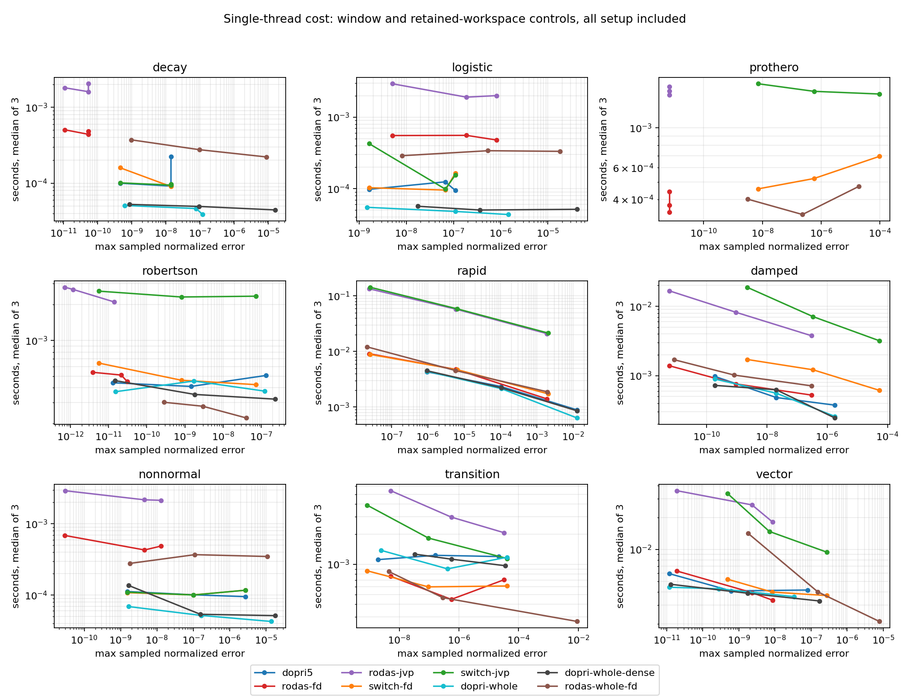
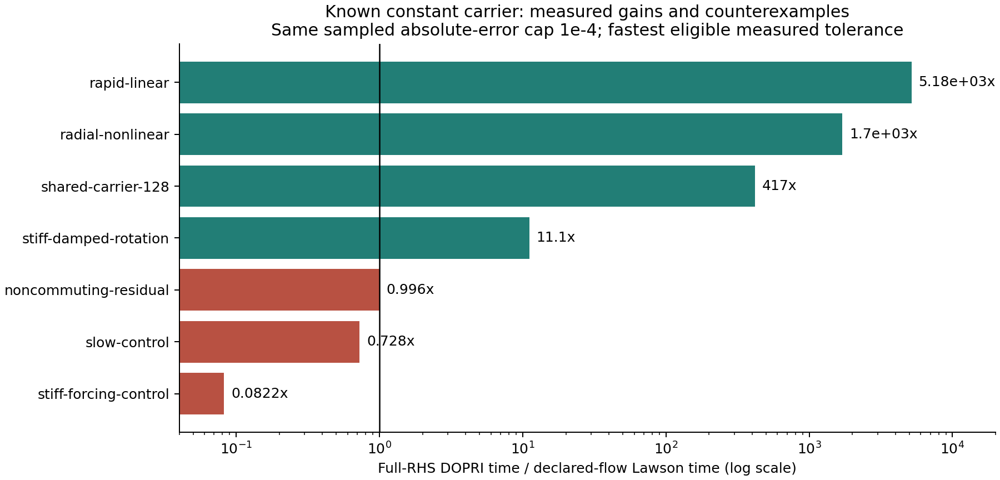
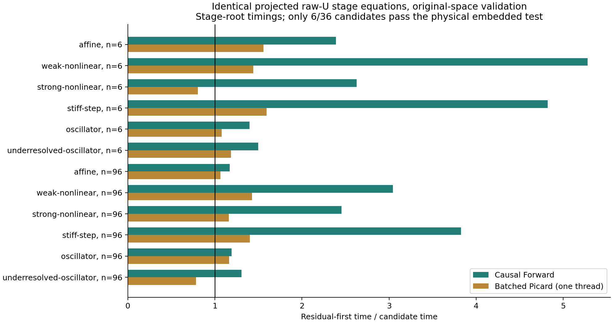

# 작은 계산환경을 위한 VigilODE: 인과적 단계 제거와 대수적 구조를 이용한 적응형 적분

2026년 10월 23일. 수치해석·구현·독립 검토 통합 보고서.

## 초록

VigilODE의 목표는 강성 및 빠른 진동 문제에서 경쟁력을 가지면서 일반적인 초기값 문제에도 사용할 수 있는 ODE 적분기다. 이번 연구는 단일 스레드 비용을 줄이는 네 경로를 실제 Rust 코드에 추가했다. 첫째, RHS-only DOPRI5를 기본으로 하고 명시적으로 허용된 경우에만 RODAS5P로 전환하는 adapter를 구현했다. 둘째, 알려진 상수 감쇠·회전 연산자를 유한 몫대수에서 계산하는 Lawson-DOPRI5 경로를 구현했다. 셋째, 기존 augmented causal Rosenbrock의 원래 raw-U 단계 방정식을 인과적 순서로 풀어 현재-stage Newton/JVP를 제거했다. 넷째, 정확한 이차 다항식 homotopy의 정칙 해 가지를 직접 계산하는 kernel을 추가했다.

최종 코드에 해당하는 205개 native 시험이 통과했다. 일반 전환 정책의 864회 실행, RHS-only 수정 후 324회 실행, 선언된 구조의 112회 실행 및 36개 인과적 stage 비교를 별도로 보존했다. 알려진 빠른 회전 구조에서는 큰 속도 개선이 있었으며 인과적 forward 제거의 stage 계산 시간비는 1.17–5.28이었다. 동시에 일반 작업량 기반 전환은 빠른 진동 사례에서 JVP 경로를 잘못 선택하여 약 32.5배 느려졌다. 따라서 이번 결과는 제한된 구조별 경로를 사용할 근거를 제공하지만, VODE 수준의 범용 production 대체 자격을 확립하지는 않는다. 기본 RHS 경로의 재시작 비용은 측정 후 수정했으며, 실패한 자동 전환 정책은 opt-in 상태로 남긴다.

## 1. 조사 범위와 코드의 현재 위치

출발점은 `14c74978b93339a79d7228a324fa77552dae548e`다. 이번의 첫 native 구현은 `548526add83a38a996875b3bd2f3cd3357465ed6`, 기본 explicit 경로의 지속 세션 수정은 `d4e8623bf8add9f505ec018532c4602e5a838a41`이다. 각 측정에는 실제 사용한 source commit과 executable SHA256이 있다. 뒤의 수정은 기존 864회 결과를 덮어쓰지 않는다.

현재 원격 refs와 관련 PR을 확인하고 실제 구현 및 이전 연구를 읽었다. PR 68–70의 polynomial/homotopy/RVJ 아이디어, PR 74–77의 coupled·residual-first·hybrid 개발을 추적한 기록은 [PR_SURVEY.json](evidence/PR_SURVEY.json), 재사용 범위는 [LATEST_EVIDENCE_KO.md](analysis/LATEST_EVIDENCE_KO.md)에 있다. 사용자가 최근 local 실행을 마쳤다는 점은 반영하되, 이번 환경에 전달되지 않은 local 결과를 새 성능 근거로 간주하지 않았다.

첨부된 대수기하·curved-mirror 문서 여섯 개의 파일 해시 및 식 위치는 [SOURCE_MAP.json](analysis/SOURCE_MAP.json), RVJ 보고서의 실제 읽기 위치와 구현 연결은 [RVJ_MAP.json](evidence/RVJ_MAP.json)에 기록했다. 원고에서 계산 원리를 옮겼으며, 곡면 교점 개수나 기하학적 중복도를 ODE 속도 배수로 해석하지 않았다. v13에서 철회된 compactification 수치도 채택하지 않았다.

앞선 구면 정보기하 연구는 [별도 디렉터리](../spherical_information_20261023/README.md)에 함께 수록했다. 원래 입력의 해시, 과학적 산출물 및 검증 기록은 유지했다. 해당 연구의 결과를 이번 ODE 구현의 새 벤치마크로 합산하지 않았다. NCP는 사용하지 않았다.

## 2. 동기와 설계 원리

작은 RHS를 가진 소규모 문제에서는 Jacobian 구성, workspace 재할당, 과도한 thread scheduling이 실제 물리 계산보다 비쌀 수 있다. 반대로 큰 진동수 때문에 explicit 적분기가 작은 step을 반복하는 문제에서는 RHS 자체가 싸더라도 전체 비용이 커진다. 이 두 상황을 단순한 RHS 호출량으로 구별하기는 어렵다. 강성, 진동에 의한 위상 정확도 요구, 비정규 증폭, 진짜 비선형 수렴 난이도를 별도로 관측해야 한다.

이번 설계는 사용 가능한 구조 정보를 계산량 감소로 직접 바꾼다. 알려진 연산자의 낮은 차수 관계식은 반복적인 행렬 역산을 짧은 polynomial 계산으로 바꾼다. 엄밀한 인과적 의존성은 전체 단계 벡터에 대한 Newton 반복을 순차 대입으로 바꾼다. 구조를 모르는 문제는 기본 RHS-only 경로를 유지하고, derivative provider를 사용하는 경로는 사용자 허용과 실제 비용 측정을 함께 요구하도록 다음 단계를 설정한다.

이 방식에서 “Jacobian/matrix/Newton-free”는 API별 계약이다. 전체 프로젝트의 모든 계산에 한꺼번에 붙는 수식어가 아니다.

| 실제 API | 입력과 적용 범위 | 미분·행렬 작업 |
|---|---|---|
| `SwitchingSolver`, `Forbidden` | 일반 RHS, nonstiff 기본 경로 | DOPRI5 한 세션; Jacobian/JVP/Newton 없음 |
| `SwitchingSolver`, `ProvidedOnly` | 제공된 Jacobian 또는 JVP, autonomous 또는 제공된 시간미분 | 허용된 implicit provider 사용; 자동 차분 금지 |
| `SwitchingSolver`, `AllowFiniteDifference` | 명시적으로 FD를 허용한 일반 문제 | FD/JVP/linear solve 작업을 telemetry에 포함 |
| `LawsonDopri5` | 정확히 선언한 상수 `A`와 나머지 RHS `N` | 구조식의 O(n) flow; Jacobian/JVP/AD/Newton 없음 |
| `coupled_step_causal`, `integrate_causal_observed` | 기존 raw-U tableau, autonomous·identity-mass·supplied-JVP 조건, frozen projected operator | 현재-stage JVP/Newton 없음; basis/validation JVP와 작은 행렬은 남음 |
| `quadratic_homotopy_root` | 정확한 scalar quadratic와 정칙 가지 | 직접 대수 계산; 반복·수치미분 없음 |

일반 adapter가 선택하는 것은 DOPRI5와 보호된 RODAS5P다. 선언된 Lawson 경로와 causal companion은 별도 API이며, 이 셋을 자동으로 묶는 통합 dispatcher는 아직 구현하지 않았다.

## 3. 대수적 구조에서 계산 절감으로

### 3.1. 유한 몫대수 resolvent

유한차원 연산자 \(A\)와 monic polynomial \(q\)의 차수가 \(d\)이고, \(s\ne0\), \(q(1/s)\ne0\)라 하자. 다음 polynomial은 차수가 \(d-1\) 이하이다.

\[
p_s(z)=\frac{q(z)-q(1/s)}{s q(1/s)(z-1/s)}.
\]

\(1-sz=-s(z-1/s)\)를 곱하면

\[
(I-sA)p_s(A)=I-\frac{q(A)}{q(1/s)}.
\]

따라서 \(q(A)=0\)이면 \((I-sA)^{-1}=p_s(A)\)다. 이는 고유값 분해나 서로 다른 roots를 요구하지 않으며 Jordan multiplicity도 허용한다. Synthetic division의 scalar 준비 비용은 \(O(d)\), Horner action에는 \(d-1\)회의 operator action이 필요하다. 알려진 관계식의 차수가 고정되어 있으면 길어지는 Krylov basis나 차수 \(m\) polynomial 반복에 비해 action 수를 직접 줄인다. 일반 RHS에서 관계식 \(q\)를 발견하는 비용까지 사라지는 것은 아니다.

정확한 관계식 대신 \(\epsilon=\|q(A)\|/|q(1/s)|<1\)인 full-space bound가 있으면 Neumann 보조정리에 의해

\[
\|(I-sA)^{-1}-p_s(A)\|\le
\frac{\|p_s(A)\|\epsilon}{1-\epsilon}.
\]

몇 개 probe에서 관측한 작은 residual은 이 연산자 norm bound를 대신하지 않는다. 기존 Laguerre/Chebyshev recurrence의 quotient compilation 및 finite-jet 연구는 이 조건을 유지하여 재사용했다. 상세 증명과 정확 유리수 검산은 [ALGEBRAIC_TRANSFER_KO.md](analysis/ALGEBRAIC_TRANSFER_KO.md)에 있다.

### 3.2. 감쇠·회전의 정확한 action과 Lawson 적분

\(R=\begin{pmatrix}0&-1\\1&0\end{pmatrix}\), \(A=-\kappa I+\omega R\), \(\kappa\ge0\)이면 \((A+\kappa I)^2+\omega^2I=0\)이다. 따라서

\[
e^{tA}=e^{-\kappa t}(\cos(\omega t)I+\sin(\omega t)R),\qquad
(I-sA)^{-1}=\frac{(1+s\kappa)I+s\omega R}{(1+s\kappa)^2+(s\omega)^2}.
\]

\(t,s\ge0\)에서 두 action의 Euclidean norm은 각각 \(e^{-\kappa t}\le1\), \(((1+s\kappa)^2+(s\omega)^2)^{-1/2}\le1\)이다. 회전의 직교성과 \(R^2=-I\)가 증명을 완결한다. \(\omega=0\)에서도 singular eigenvector chart가 생기지 않는다. 독립 block의 집합에는 O(n) 계산을 사용한다.

\(y'=Ay+N(t,y)\)의 Lawson-DOPRI stage는

\[
Y_i=e^{c_i hA}y_n+h\sum_{j<i}a_{ij}e^{(c_i-c_j)hA}N(t_n+c_jh,Y_j)
\]

로 구현한다. DOPRI의 nondecreasing stage times 덕분에 실제 구현은 양의 시간 간격의 감쇠 action만 사용한다. 역방향 감쇠 exponential을 크게 만들어 상쇄시키는 구현을 피한다. 상수 \(A\)와 매끄러운 변환 문제에서는 classical order 5를 유지한다. \(N=0\)이면 선형 carrier의 안정성 제한은 사라진다. 비선형 remainder에 대한 강성 균일 오차상수는 별도 조건이 필요하다.

특히 순수 회전 \(A=\omega R\)에서 \(N(t,e^{\theta R}y)=e^{\theta R}N(t,y)\)이고 오차 norm도 회전에 불변이면, 변환된 방정식은 \(v'=N(t,v)\)다. 정확 산술에서 stage 난이도가 \(\omega\)에 의존하지 않는다. 이것이 진동수 증가에 따라 step 수가 증가하는 full-RHS explicit 경로의 비용을 제거하는 구성적 조건이다. 일반 noncommuting forcing에는 이 결론을 적용하지 않는다.

### 3.3. 원래 단계 방정식의 인과적 제거

실제 raw-U tableau의 \(A,C\)가 엄밀한 strict lower triangular이고 frozen projected operator \(W_m\)가 가역이면 단계 \(i\)는

\[
W_m U_i=G_i(U_0,\ldots,U_{i-1})
\]

형태다. \(W_m\)을 한 번 분해하고 \(i=0,\ldots,7\) 순서로 대입하면 원래 projected 단계 root를 얻는다. 단계 \(i\)의 우변에는 \(U_i\)가 없으므로 현재-stage Newton/JVP가 필요하지 않다. 단계 수 \(s=8\), projection 차원 \(m\), 물리 차원 \(n\)일 때 작은 선형대수 비용은 \(O(m^3+s m^2)\)이며, lifting/projection과 coupling 비용을 합쳐 \(O(snm+s^2m)\)가 추가된다. 이는 이미 제공된 frozen operator를 전제로 한 계산량이다.

실제 BatchedPicard 구현은 affine lower coupling까지 묶는다. \(J_m=Q^TJ_0Q\), 대각 block이 \(W_m\), 하삼각 block이 \(-\gamma c_{ij}I-h\gamma a_{ij}J_m\)인 \(M\), \(b_i=h\gamma Q^Tf_0\)를 정의한다. \(x_i=Q\sum_{j<i}a_{ij}U_j\), \(r_i(U)=Q^T[f(y+x_i)-f_0-J_0x_i]\)이면 구현한 갱신은

\[
U^{k+1}=M^{-1}\{b+h\gamma r(U^k)\}
\]

이다. \(M^{-1}\)가 lower triangular이고 \(r_i\)가 이전 단계에만 의존하므로 갱신의 i번째 성분도 \(U_{<i}^k\)에만 의존한다. 첫 단계가 정확해지고 다음 반복마다 정확한 인과적 prefix가 한 단계씩 늘어난다는 귀납법으로, 일반 초기값에서는 최대 \(s\)번 갱신 후 exact-arithmetic root에 도달한다. 실제 초기값 \(M^{-1}b\)는 첫 단계가 정확하므로 최대 \(s-1\)번이면 된다. 이 결과는 contraction factor가 1보다 작다는 조건에 의존하지 않는다. 그러나 모든 stage를 반복 계산하는 추가 work와 병렬 실행 overhead는 남는다. 따라서 작은 머신의 기본 후보는 Forward이고 BatchedPicard는 별도 측정이 필요한 선택지다.

실제 구현은 upper/diagonal coefficient가 하나라도 nonzero이면 이 경로를 거절한다. 변환된 represented-K tableau의 작은 상삼각 값을 임의로 0으로 만드는 방식은 사용하지 않았다. 모든 후보는 기존 full-space stage residual과 embedded 시간 오차 검사를 통과해야 한다. 상세 방정식 대응은 [CAUSAL_IMPLEMENTATION_KO.md](analysis/CAUSAL_IMPLEMENTATION_KO.md)에 있다.

### 3.4. 예외 chart를 구별하는 quadratic homotopy

\(F(u,\lambda)=\lambda c u^2+a u-b\), \(a>0\), \(0\le\lambda\le1\)에서 \(\Delta=a^2+4\lambda cb>0\)이면 \(\lambda=0\)의 \(b/a\)에서 연결되는 정칙 가지는

\[
u_* = \frac{2b}{a+\sqrt\Delta}.
\]

후보 \(\hat u\)의 \(\hat d=a+2\lambda c\hat u\ge0\)이면 다항식의 차를 인수분해하여

\[
|\hat u-u_*|=\frac{2|F(\hat u,\lambda)|}{\hat d+\sqrt\Delta}
\]

를 얻는다. 코드는 coefficient scaling, exact-zero/linear chart, discriminant margin, 원래 scaled equation의 residual을 처리한다. 반환하는 floating-point error indicator는 반올림 오차를 감싼 interval certificate가 아니다.

실제 client 예시는 \(y'=-\alpha y-\beta y^2\)의 backward-Euler step이다. \(a=1+h\alpha\), \(c=h\beta\), \(b=y_n\ge0\)로 두면 양의 가지를 Newton 없이 계산하며 \(0\le y_{n+1}\le y_n\)이다. \(du/db=1/\sqrt\Delta\le1/(1+h\alpha)\)이므로 \(\alpha,\beta\ge0\)에서 수축성이 있다. 시간 적분 정확도는 여전히 1차다. 이 root kernel을 기존 5차 solver 전체의 차수 향상으로 표현하지 않는다.

## 4. 구현과 강건성 감사

전환 adapter는 수락된 상태에서만 method를 바꾸고, 버린 probe의 RHS/JVP/linear solve 비용도 합산한다. fatal callback은 다른 solver로 숨겨 재시도하지 않는다. 전역 attempt budget, dense fallback dimension 제한 및 부분 상태를 유지한다. `ProvidedOnly`는 비자율계에서 제공된 시간미분도 요구하여 숨어 있는 time finite difference를 막는다.

첫 측정은 구간별 driver 재시작이 싼 explicit 문제에서 비용을 키운다는 점을 확인했다. 후속 수정은 기본 `Forbidden` 경로에서 `Dopri5::solve_observed`를 한 번 호출하여 workspace, FSAL 및 step controller를 유지한다. 14개 switching 계약 시험에는 native observed 경로와의 출력·상태·카운터 일치 및 fatal 중단의 부분 결과 보존이 포함된다. FD/JVP 허용 경로의 선택 정책은 이 수정에서 바꾸지 않았다.

독립 검토에서는 지수함수 coefficient가 먼저 underflow하여 큰 입력과의 곱이 표현 가능한 결과를 잃는 경우, shifted inverse의 중간 덧셈 overflow, 시간미분 정책 누출, solve counter 의미 혼동, 이차식 차수 하강의 잘못된 거절을 찾아 수정했다. 예를 들어 \(e^{-1000}\times10^{308}\)은 약 \(5.076\times10^{-127}\)인데, `exp(-1000)==0`을 먼저 적용하면 잘못된 0이 된다. 반분 exponent scaling과 극단 입력 회귀 시험을 추가했다. [독립 검토](analysis/INDEPENDENT_REVIEW_KO.md), [machine-readable 기록](REVIEW.json)에 반례와 수정 근거가 있다.

## 5. 단일 스레드 성능 평가

모든 새 시간 측정은 한 CPU affinity와 thread 수 1에서 수행했다. 서로 다른 source snapshot의 시간을 하나의 모집단으로 합치지 않았다. warmup과 반복, executable hash 및 원시 실패 기록을 보존했다. 지정 tolerance 자체가 아니라 동일한 관측점 오차 상한을 충족한 측정 중 가장 빠른 median을 비교한다. 이 관측 오차는 시간 연속 구간 전체의 엄밀한 오차 상한이 아니다. 측정값이 매우 작은 경우 shared host 잡음과 timer 해상도의 영향도 고려해야 한다.

### 5.1. 일반 문제와 자동 전환

첫 캠페인은 decay, logistic, Prothero, Robertson, rapid rotation, damping, nonnormal, smooth stiffness transition, 256차원 vector 문제를 사용했다. 8개 method 구성, 3개 tolerance, warmup 1회와 timed 3회로 864회 실행했다. 모든 기록의 독립 replay 검사가 통과했고 solver 성공은 828회다. 나머지 36회는 Prothero에서 explicit 세 경로의 attempt budget 소진이다. Robertson reference는 analytic Jacobian을 제공한 VODE-BDF를 더 엄격한 tolerance로 반복하여 차이 \(4.437\times10^{-12}\)를 확인했다.

일반 캠페인의 오차는 관측점에서 성분별 \(|y-y_{ref}|/\max(1,|y_0|,|y_{ref}|)\)의 최댓값이다. 동일한 이 정규화 오차 상한 \(10^{-6}\)에서 빠른 진동 문제의 retained DOPRI는 약 4.407 ms, FD switching은 8.849 ms, JVP switching은 143.180 ms였다. 이 rapid 사례는 정규화 오차와 절대오차가 일치한다. 따라서 작업량 압력만으로 강성을 추정하는 현재 정책은 기본 자동 경로로 채택하기 어렵다. transition 사례에서 FD switching은 DOPRI 대비 약 1.51배 빨랐지만 retained RODAS 대비 약 1.28배 느렸다. “switching이 모든 상황에서 이긴다”는 결론은 자료와 맞지 않는다.

후속 324회 캠페인은 `switch-rhs`, retained DOPRI 및 구간 재시작 DOPRI만 비교한다. 324개 기록의 replay 검사는 모두 통과했고, 288회 완주와 36회 Prothero attempt-budget 종료를 보존했다. 108쌍에서 persistent adapter와 retained DOPRI의 관측 시각·상태·work·성공/부분 실패 결과가 정확히 일치했다. 모든 derivative/linear-solve counter는 0이었다. 같은 nominal `rtol=1e-6`에서 구간 재시작 제거로 decay의 RHS는 592→217, logistic은 688→205로 줄었으나, 두 경로의 실제 오차도 다르므로 이를 동일 오차의 속도비로 취급하지 않는다. 동일 상태를 계산한 retained DOPRI/persistent adapter의 24개 성공 구성 시간비는 min/median/max 0.412/1.015/2.071이었다. 공유 호스트 산포가 커 고정 wall-time 이득을 보장하지 않는다.

세부 결과는 [RHS_PERSISTENCE_KO.md](analysis/RHS_PERSISTENCE_KO.md), [RHS_PARITY.json](results/rhs_persistent_campaign/RHS_PARITY.json)에 있다. 이 후속 측정은 기본 RHS 경로 수정의 효과를 다루며, 앞의 잘못된 JVP 경로 선택을 해결했다는 근거가 아니다.

### 5.2. 알려진 carrier를 사용하는 진동계

7개 사례, 2개 tolerance, 2개 method 및 warmup+timed 3회로 112개 기록을 얻었고 모두 solver가 성공했다. 동일한 관측 절대오차 상한 \(10^{-4}\)에서 비교한 결과는 다음과 같다. 시간비는 full-RHS DOPRI 시간 / 선언된 Lawson 시간이다.

| 사례 | 시간비 | 해석 |
|---|---:|---|
| rapid linear rotation | 5179.5 | 정확한 carrier가 진동 step 제한 제거 |
| rotation-equivariant nonlinear remainder | 1703.4 | 변환된 느린 동역학의 이점 |
| 128차원 shared carrier | 417.1 | 동일 coefficient 공유 및 O(n) action |
| stiff damped rotation | 11.14 | 정확한 감쇠·회전 action |
| noncommuting residual | 0.996 | 사실상 차이 없음 |
| slow control | 0.728 | Lawson 약 1.37배 느림 |
| stiff forcing control | 0.0822 | Lawson 약 12.16배 느림 |

rapid linear 사례의 실제 시간은 65.0703 ms에서 0.012563 ms, RHS 횟수는 798265에서 79로 줄었다. 두 method 모두 위의 오차 기준을 충족한다. 더 엄격한 \(10^{-6}\), \(10^{-8}\) 상한에서는 측정한 baseline tolerance가 기준을 충족하지 않는 사례가 있어 해당 시간비를 만들지 않았다. 후보는 full-RHS solver에 없는 정확한 구조 정보를 받는다. 따라서 이 큰 배수를 일반적인 black-box ODE에 대한 배수로 사용해서는 안 된다.

### 5.3. 인과적 단계 root

6개 물리 사례를 차원 6, 96에서 비교하고 세 corrector를 실행하여 36개 행을 얻었다. 각 행은 warmup 후 5회×30반복으로 측정했다. 원래 full-space raw-U oracle과의 최대 차이는 \(4.530\times10^{-14}\)다. Forward의 시간비는 1.1717–5.2803, 중앙값 2.4211이다. BatchedPicard의 시간비는 0.7821–1.5947로 일부 사례에서 손해를 보았다.

96차원 weak nonlinear 사례에서 현재-stage JVP는 48에서 0, 전체 JVP는 59에서 11, RHS는 33에서 16, 작은 factorization은 3에서 1로 줄었다. 남은 JVP는 frozen basis 및 원래 공간 검증에 해당한다. 이 사례의 시간비는 약 3.04이다.

이 측정은 **같은 고정 h의 단계 방정식을 푸는 비용**이다. embedded 물리 시간오차 기준을 통과한 것은 36개 행 중 6개다. 따라서 이를 36개 전체 궤적의 유효한 적분 속도비로 확대하지 않았다. adaptive Riccati 궤적 시험은 따로 통과했지만, 폭넓은 장시간 accepted-trajectory 비교는 다음 필수 작업이다.

## 6. 앞선 구면 격자 연구와의 결합

이전 연구의 실제 결과는 비용을 줄일 다음 위치를 알려 준다. entropy compression은 설정한 오차 예산에서 8192개 fine cell의 표현을 uniform 4096개 대신 106개로 줄였고, Fisher scaling은 특정 문제의 조건수를 약 356678에서 1.59, CG 반복을 124에서 9로 줄였다. 정확한 Thomson low-rank subflow는 dense reference와 약 \(8.11\times10^{-15}\) 수준에서 일치했다. 이들은 각자의 경량 실험 결과이며 전체 구면 PDE 실행 시간 개선을 측정한 값은 아니다.

연결 순서는 다음이 합리적이다. 먼저 고정 구면 격자의 collision/carrier를 정확한 낮은 차수 action으로 분리하고, 나머지 FVM flux를 현재 explicit 또는 protected stiff 경로에 전달한다. 다음으로 full physical residual과 보존량을 유지하는 Fisher norm/preconditioner를 연결한다. 마지막으로 accepted step 사이에서만 보존형 remap을 수행하고 누적 Hellinger 오차 예산을 합산한다. 에너지 하나만 보존하는 remap이 photon number까지 보존하지 않는 반례가 이미 있으므로, joint number/energy와 occupation 보존 계약을 함께 사용한다.

단일-step Rosenbrock라는 사실만으로 remap 후 5차 전역 정확도나 기존 큰 step 유지가 자동으로 보장되지는 않는다. remap 오차, limiter 비매끄러움 및 geometry 변경에 따른 norm 갱신을 전체 오차 예산에 포함해야 한다. 앞선 이론을 다시 검증하지 않고 실제 이식에서 바뀌는 계약을 검증한다.

## 7. 다음 개발 단계와 수용 조건

실행 가능한 작업 단위와 파일 위치는 [NEXT_STEPS.json](NEXT_STEPS.json)에 있다. 우선순위는 다음과 같다.

1. **상황 전환의 비용 모델을 바로잡는다.** FD/JVP 허용 driver도 persistent session으로 만들고 동일 checkpoint에서 제한된 implicit pilot을 실행한다. 실제 elapsed/callback cost와 수락된 시간 진전을 함께 비교하며, probe의 비용도 포함한다. 진동의 정확도 압력을 stiffness로 해석하지 않도록 phase/amplitude 변화와 거절 원인을 분리한다. 원자료의 rapid JVP 손해를 반드시 회귀 사례로 유지한다.
2. **강한 forcing의 affine 구조를 확장한다.** 상수 forcing은 \(e^{hA}y+h\varphi_1(hA)b\)로 정확히 처리한다. \(A\to0\) 근처의 안정적 series/expm1 계산 및 singular block을 포함한다. 현재 stiff-forcing의 약 12배 손해를 실제 같은 오차 기준에서 줄이는지가 수용 기준이다.
3. **causal Forward를 전체 적분에서 비교한다.** 같은 norm, full-space residual과 적응 step 조건으로 accepted trajectory의 work–precision을 측정한다. stage root 속도비가 전체 이득으로 이어지는지, projection 차원 증가가 상쇄하는지를 확인한다. 작은 머신에서는 Forward를 먼저 비교하고, RHS가 충분히 비싼 경우에만 stage batching/parallel schedule을 검토한다.
4. **일반 polynomial 구조 API를 추가한다.** 알려진 annihilator와 action을 provider가 선언하도록 하고 near-annihilator의 full-space bound가 없으면 근사 exact solve로 취급하지 않는다. Laguerre/Chebyshev recurrence와 confluent/Jordan 회귀 사례를 포함한다. polynomial 차수와 action 수의 절감을 실제로 기록한다.
5. **선택적 JVP/AD 정책을 완성한다.** 사용 허용은 필요조건이다. derivative-free 후보의 실제 성능 저하 및 derivative 후보의 성과를 관측한 뒤에만 해당 문제 구간에 provider를 사용한다. 현재 `ProvidedOnly`는 provider 권한을 통제하지만, 이런 성능 우월성을 보장하지는 않는다.
6. **구면 물리 client와 production 범위를 확장한다.** 앞선 보존 remap·정확 collision·Fisher 구조를 fixed-grid부터 적용한다. 다음 캠페인에는 반복 event/restart, 복수 tolerance/norm, nonnormal transient, 긴 시간의 phase drift 및 callback 오류를 포함한다. 비교군은 VODE/DVODE, diffsol, Julia로 제한하고, 동일 관측·오차·thread 조건을 맞춘다.

새 기본값을 정하는 기준은 단일 fixture의 최대 속도비가 아니라, 성공 범위·오차·전체 비용·최악의 손해다. 적응형 method가 이긴 구간과 진 구간을 함께 보여야 한다. 다음 검증 절차와 복사 가능한 실행 지시는 [HANDOFF_KO.md](HANDOFF_KO.md), [REPRODUCE.md](REPRODUCE.md)에 제공한다.

## 8. 결론과 사용 판정

이번 개발은 구체적인 수학적 조건 아래 계산량을 줄이는 구현을 제공했다. 대수적 carrier는 exact action을 O(n)에 계산하고, 인과적 제거는 현재-stage nonlinear solve를 없애며, quadratic chart는 정확한 scalar branch를 직접 계산한다. 기본 RHS-only adapter의 불필요한 재시작도 측정 결과에 따라 수정했다.

그러나 범용 자동 전환 정책은 rapid oscillation에서 큰 성능 손해를 보였고, causal 전체 궤적 및 구조적 Lawson의 stiff forcing 검증에는 확장 작업이 남아 있다. 따라서 **범용 production solver 판정은 보류**한다. 구조가 명시된 적합한 문제에는 이번 경로를 opt-in으로 사용하고, 실제 모델의 오차·안정성·비용 기준을 적용할 수 있다. 자세한 분류는 [DECISIONS.json](DECISIONS.json)에 있다.

## 참고 문헌과 근거

- J. D. Lawson, *Generalized Runge–Kutta Processes for Stable Systems with Large Lipschitz Constants*, SIAM J. Numer. Anal. 4 (1967), 372–380. DOI: [10.1137/0704033](https://doi.org/10.1137/0704033). 원저 메타데이터와 후속 원저를 구별하여 사용했다.
- M. Hochbruck, J. Leibold, A. Ostermann, *On the convergence of Lawson methods for semilinear stiff problems*, Numerische Mathematik (2020). DOI: [10.1007/s00211-020-01120-4](https://doi.org/10.1007/s00211-020-01120-4). [공개 저자 원고](https://www.waves.kit.edu/downloads/CRC1173_Preprint_2019-20.pdf). 구조별 stiff convergence 조건의 근거이며 일반적인 무조건 고차성 근거로 쓰지 않았다.
- L. Petzold, *Automatic Selection of Methods for Solving Stiff and Nonstiff Systems of Ordinary Differential Equations*, SIAM J. Sci. Stat. Comput. 4 (1983), 136–148. DOI: [10.1137/0904010](https://doi.org/10.1137/0904010). 자동 전환의 선행 연구 맥락; 이번 정책의 성능 검증을 대체하지 않는다.
- LLNL, [ODEPACK](https://computing.llnl.gov/projects/odepack). 비교군의 공식 설명.
- 실제 문헌 검색·열람 및 CAS 계산 기록: [PRIMARY_LITERATURE.json](evidence/PRIMARY_LITERATURE.json), [SCISPACE_DISCOVERY.json](evidence/SCISPACE_DISCOVERY.json), [Wolfram 계산](evidence/algebraic_wolfram.json). CAS와 정확 유리수 검산은 위의 증명을 보조하며 형식 검증기를 통한 기계 증명으로 표기하지 않는다.
