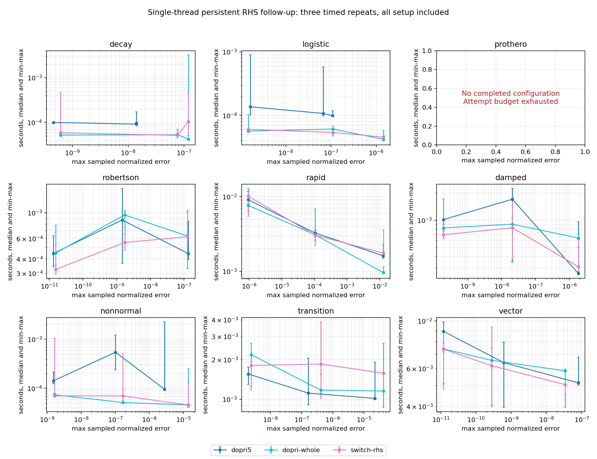

# 측정에 따른 RHS-only workspace 유지 교정

실행 소스 `d4e8623bf8add9f505ec018532c4602e5a838a41`. 최초 864회 campaign은 그대로 보존했다. 그 결과에서 드러난 cheap nonstiff 재시작 비용에만 의존하는 새 실험이다. `DerivativeFallback::Forbidden`일 때 17개 관측 시각을 한 DOPRI 호출에 전달해 workspace와 FSAL을 유지했다. FD/JVP 후보의 과학 결과는 재실행하지 않았다.

9개 문제·3개 tolerance·3개 방법·4회 반복으로 **324회** 실행했다. 324개 독립 재채점이 일치했고, 288회 완주했다. 나머지는 Prothero RHS-only 경로의 attempt budget 종료이며 그대로 보존한다.

**108개 대응 쌍에서 시간·상태·작업량·성공/부분 실패 상태가 whole-DOPRI와 정확히 일치했다.** Jacobian/JVP/time-derivative/linear-solve 작업은 모두0이다.

아래는 동일 rtol1e-6의 세 timed 반복 median이다. Persistent adapter와 whole DOPRI는 실제 상태도 같지만, window DOPRI는 더 작은 스텝을 쓰므로 실제 오차가 다르다. 마지막 열은 같은 명목 tolerance의 비용 비율이다. 동일 달성 오차 상한 비교는 SUMMARY.json의 comparisons를 사용한다. 실패한 완주 비교는 제외하며 전체 setup·출력 비용을 포함한다.

| 문제 | persistent adapter ms | whole DOPRI ms | window / adapter (같은 rtol) |
|---|---:|---:|---:|
| damped | 0.8280 | 0.9068 | 2.062 |
| decay | 0.0517 | 0.0531 | 1.869 |
| logistic | 0.0539 | 0.0609 | 1.991 |
| nonnormal | 0.0705 | 0.0518 | 7.721 |
| rapid | 3.0479 | 3.0877 | 1.069 |
| robertson | 0.5541 | 0.9585 | 1.565 |
| transition | 1.8488 | 1.1739 | 0.602 |
| vector | 6.1923 | 6.5582 | 1.033 |

동일한 상태를 반환한 whole-DOPRI/adapter 시간비의24개 성공 구성 min/median/max는 **0.412/1.015/2.071**다. 세 반복의 공유 호스트 시간 산포가 커서 이 수치를 일정한 가속률로 해석하지 않는다.

작업량 비교(rtol1e-6):

| 문제 | window RHS | persistent RHS | window accepted | persistent accepted |
|---|---:|---:|---:|---:|
| decay | 592 | 217 | 96 | 36 |
| logistic | 688 | 205 | 112 | 33 |
| nonnormal | 694 | 277 | 113 | 46 |
| rapid | 28492 | 28423 | 3920 | 3903 |
| transition | 7972 | 7807 | 1281 | 1251 |
| vector | 2476 | 2263 | 376 | 346 |

이번 교정은 RHS-only default의 불필요한 재시작을 제거한다. 강성이 큰 경우의 stability 제한과 derivative fallback의 선택 성능은 기존 결과에 따라 별도로 다룬다. 실제 사건·mass matrix·후속 nonlinear root routing의 지원 범위는 확장하지 않는다.

점은 세 반복의 median, 세로 막대는 min–max다. Prothero 패널은 모든 구성의 attempt budget 종료를 표시한다. 도표는 이미 계산한 SUMMARY를 읽어 그렸으며 solver/reference 계산을 반복하지 않았다.
