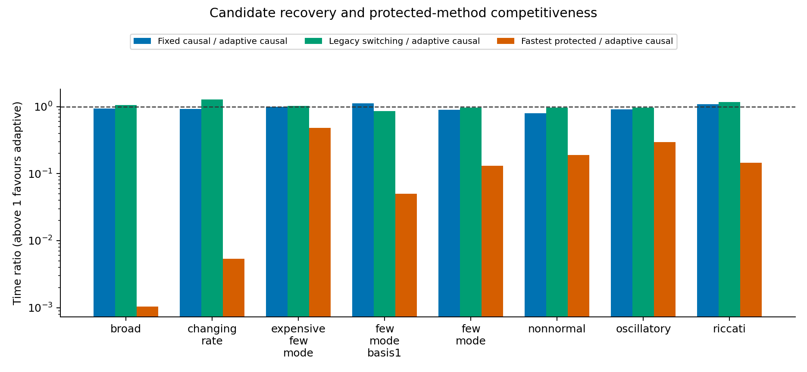
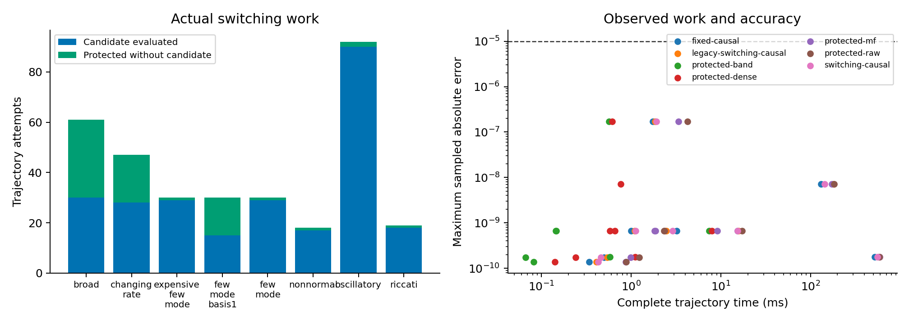

# VigilODE 후보 재검토와 조건부 복원

2026년 10월 24일. 기준 공개 코드: `14171ed0c4f7dc453f47870cf6c1399f41afc4f2`.
최종 구현과 측정 입력은 `SOURCE_FREEZE.json`, 수정 전 측정 입력은
`SOURCE_FREEZE_ROUND2.json`에 고정하였다.

## 1. 결론

VigilODE의 고유한 연구 경로에는 활용할 수 있는 구성들이 남아 있다. 이번에는 과거의
production 제외 결정을 출발점의 가설로 취급하고, 원래 방정식·연산 비용·수용 조건에서
다시 유도하였다. 그 결과 근사 소거다항식을 사용하는 잔차 보정과 causal 후보의 비용 기반
전환을 구현하였다. 비싼 RHS에 대한 병렬 Picard와 residual-first 경로도 재측정하여
적용 가능한 영역을 확인하였다.

새 기능은 명시적으로 선택하는 경로로 제공한다. 현재 측정은 범용 기본 솔버를 교체할
근거를 제공하지 않는다. 기존 `GeneralOde`의 기본 선택은 유지하였다. 이 결정은 고유한
알고리즘을 제거한다는 뜻이 아니라, 실제로 이득을 얻을 수 있는 조건과 호출 계약을 함께
제공한다는 뜻이다.

이번 완료 범위는 다음과 같다.

- 기존 25개 계열, 과거 16개 세부 후보, 별도로 복원한 16개 대수·구조 기법을 재검토하였다.
  세 목록은 서로 겹치므로 57개의 독립 알고리즘으로 합산하지 않는다.
- GitHub PR 81개의 메타데이터·본문을 조사하고 관련 PR 12개를 상세 조회하였다.
  모든 과거 파일을 줄 단위로 재검증했다는 의미는 아니다.
- 새 코드와 관련 회귀 검사 261개, 정확 유리수 검산 6개가 통과하였다.
- 최종 primary 측정 275개와 root 변형 측정 240개가 모두 공통 표본 오차 기준을 통과하였다.
  반복 표본은 독립적인 실행 환경의 표본이 아니다.
- 대수적 보정의 커널 비교와 실제 고정 스텝 궤적을 실행하였다. 기존 한 번의 근사에서
  거절된 사례와 새 보정에서 통과한 사례를 모두 남겼다.
- 두 개발 단위 모두 최대 3회 수정 루프 안에서 마쳤다. 빌드 캐시 복구는 소스 변경이
  없는 환경 복구로 별도 기록하였다.

## 2. 과거 결론을 다시 읽는 방법

일부 제외 사유는 수학적 장애였고, 일부는 제한된 시험의 비용 결과였으며, 일부는 당시의
미실행 상태였다. 이번 조사는 이 세 가지를 구별하였다. 예를 들어 HT02의 abstention을
병렬 homotopy의 실패 실험으로 읽을 수 없다. PY03의 단일 backend 계획과 A08의
`FirstAdmitted`는 이미 구현되어 있으므로 이번에 새로 만든 기능으로 세지 않았다.
기존 Leja의 `EstimateOnly` 설명도 현재 `EnclosedLeja` 경로 전체에 적용하지 않았다.

전체 대응은 [후보 재평가표](analysis/CANDIDATE_REASSESSMENT.md)와
[기계 판독 목록](analysis/CANDIDATE_REASSESSMENT.json)에 있다. 각 항목은 이전 판단,
새 활용 방식, 적용 조건, 전환 신호, 다음 판별 실험을 연결한다. 유효한 과거 증명과 실행은
그 출처와 범위를 유지해 재사용하였다.

이번에 다시 구체화한 대수적 구성은 다음과 같다.

| 구성 | 계산에 연결되는 대상 | 적용 조건 또는 남은 구현 |
|---|---|---|
| 몫대수와 Bézout 항등식 | 낮은 차수의 resolvent 및 잔차 보정 | 전체 공간의 소거 결함과 분모 분리 조건 |
| primary decomposition과 confluent jet | 중복근·Jordan 성분을 보존하는 함수 계산 | 단순 고유값 개수로 차수를 판단하지 않음; conditioned chart 필요 |
| CRT projector | 불변 부분공간별 연산 및 오차 전달 | projector 노름을 포함한 비정규 오차 분석 |
| shifted nilpotent 전개 | 유한 번 연산으로 끝나는 역연산 | 실제 nilpotence 관계 또는 그 결함의 상계 |
| 매개변수 구간별 역연산 재사용 | 매 스텝의 준비 비용 절감 | 현재 연산자 차이의 전체 공간 상계와 epoch 일치 |
| 고정 역연산자를 쓰는 homotopy | Newton 없이 국소 근을 추적 | 수축·구간 불변성·최종 목표식 잔차 검사 |
| 불변 ideal·moment closure | 실제 상태 차원 축소 | 생성 ideal 보존을 증명해야 하며 표본 적합으로 대체하지 않음 |
| affine prefix 오차 전달 | 순차적 오차 예산 계산의 병렬화 | 결합법칙과 전달 계수의 유효한 상계 |

정리와 구체적 코드 연결은 [이론 재검토](analysis/THEORY_REASSESSMENT.md)에 수록하였다.
세계 최초성을 주장하지 않는다. 이번 기여는 기존 결과와 새 유도를 현재 코드의 수용·실패·비용
계약에 연결하고, 작동하는 경로를 검증한 데 있다.

## 3. 근사 몫대수 보정의 구현

선형 목표를 \((I-B)x=b\)라 하고, 다항식 \(q\)에 대해 \(q(1)\ne0\)라 하자.
다항식 나눗셈으로

\[
q(1)-q(z)=(1-z)r(z),\qquad p(z)=r(z)/q(1)
\]

를 얻는다. 따라서 \(D=q(B)/q(1)\)라 두면

\[
(I-B)p(B)=I-D.
\]

\(q(B)=0\)이라는 정확한 관계가 성립하면 \(p(B)\)가 역연산자다. 이번 확장은
\(q(B)\)가 작지만 0이 아닌 경우를 실제로 활용한다. 다음 보정을 수행한다.

\[
x_0=p(B)b,\quad r_k=b-(I-B)x_k,\quad x_{k+1}=x_k+p(B)r_k.
\]

직접 대입하면 \(r_{k+1}=Dr_k\)이다. 전체 공간에서 \(\|D\|\le\eta<1\)이면
\(\|r_k\|\le\eta^{k+1}\|b\|\)이며,
\(\|(I-B)^{-1}\|\le\|p(B)\|/(1-\eta)\)이다. 이 결과는 \(\|B\|<1\)을
요구하지 않는다. 충분조건은 전처리 후 결함의 수축성이다.

차수 \(d\)의 관계를 사용하면 한 polynomial 적용에 \(d-1\)회의 연산자 적용,
원래 공간의 잔차 재계산에 1회가 필요하다. 초기 적용과 \(k\)회 보정의 합계는
\((k+1)d\)회이다. 네 개의 작업 벡터를 한 번 준비한 뒤 보정 루프에서는 추가 할당을
하지 않는다. 연산자 적용 비용과 관계의 준비·검증 비용은 이 횟수와 별도로 계산해야 한다.

새 API는 `DeclaredPolynomialResolvent::apply_refined_checked`와
`apply_refined_or_fallback`이다. 관계의 결함, 최대 연산 횟수, 보정 횟수, 잔차 정체를
검사한다. 수치적 거절 때는 caller가 제공한 보호 풀이를 사용할 수 있고, 그 결과도 동일한
원래 잔차 기준을 통과해야 한다. 입력·콜백 오류는 숨기지 않는다. 실패하면 caller의 출력은
변경하지 않는다.

실수 산술의 수렴 정리와 binary64 실행을 구별하였다. 구현은 매번 원래 잔차를 다시
계산하며, 조건부 오차 추정에는 caller가 제공한 전체 공간 witness와 잔차 평가 오차가
필요하다. 표본 몇 개의 성공을 전체 공간 witness로 승격하지 않는다.

상세 측정과 한계는 [대수적 복원 보고서](analysis/ALGEBRAIC_RESCUE.md)에 있다.
특히 factorization을 매번 준비하는 LU와 이미 준비된 LU를 구별하였다. 재사용 LU 또는
직접 2×2 공식이 더 빠른 경우도 보존하였다. 실제 궤적 비교는 동일한 고정 스텝 implicit Euler를
사용하여 선형 풀이 차이를 분리한 것이다. 이를 RODAS5P 전체 궤적의 속도 향상으로 바꾸어
서술하지 않았다.

최종 커널 측정에서 매번 factorization을 준비하는 LU 대비, 준비 비용을 포함한 새 보정의
시간 비율은 차원 2, 32, 128, 256에서 각각 1.45, 2.37, 3.33, 5.25였다. 비교 대상은
사전 구성된 동일 행렬과 RHS를 받으므로 이 수치에 행렬 생성 비용은 포함되지 않는다.
각 차원에서 이미 준비된 LU 또는 직접 2×2 공식을 허용하면 그 비교군이 더 빨랐다.

50단계의 실제 implicit-Euler 궤적에서는 새 보정이 연산자 적용 150회로 끝났고, 동일
시간 이산화의 LU 결과와 차이는 \(6.08\times10^{-13}\), 연속 정확해와 차이는
\(2.61\times10^{-7}\)이었다. 기존 한 번 계산 방식은 첫 단계에서 잔차 기준으로 거절되었다.
이 비교에서는 재사용 LU가 새 보정보다 약 1.37배 빨랐다. 따라서 입증된 성과는 근사
관계의 활용 범위와 실패 회복을 넓힌 것, 그리고 준비 비용이 반복되는 커널에서의 조건부
가속이다.

## 4. Causal 후보의 적응 전환과 세 번의 수정

새 `integrate_switching_causal_observed`는 caller가 지정한 Forward, Picard 또는
ResidualFirst 후보와 보호된 동일 raw-U 풀이 사이에서 선택한다. 세 후보 전체의 자동
경쟁기는 아니다. Forward와 Picard는 기준점 JVP와 작은 투영 행렬을 사용하며,
ResidualFirst는 기존 homotopy corrector에서 Newton과 현재 단계 JVP를 사용할 수 있다.

첫 구현은 실패 후 4, 8, …, 64개의 수락된 보호 스텝을 기다린 뒤 다시 후보를 시도하였다.
테스트는 통과했지만 실제 broad 및 changing-rate 실험에서 이후 유효해진 후보를 오래
건너뛰었다. 실패한 projection은 줄었으나 총 JVP와 실행 시간이 증가했다. 이 결과는
`analysis/baseline_policy/`와 원래 raw 출력에 남겼다.

최종 수정에서는 실패 후보의 실제 비용 점수 \(C\), 보호 풀이의 점수 \(P\), 탐색 예산
비율 \(\varepsilon\)로 대기 길이를 정한다.

\[
L=\operatorname{clamp}\!\left(
\left\lceil\frac{C}{\varepsilon P}\right\rceil-1,1,L_{\max}\right).
\]

기본 \(\varepsilon=0.25\)는 조절 가능한 engineering parameter다. 동일한 대표 비용,
실패한 후보 뒤의 보호 스텝 수락, 상한 미적용, 정확 실수 계산을 가정하면
\(C/((L+1)P)\le\varepsilon\)를 얻는다. 실제 receipt는 이 값을 비용 예측치로 기록한다.
거절된 보호 스텝에서 과거 \(P\)를 쓴 경우나 비용이 변하는 경우에 이 식을 실현된 진행
속도의 보장으로 쓰지 않는다. 상한 제한과 비유한 비용도 명시적으로 기록한다.

`exploration_overhead_fraction=None`은 이전 지수형 정책을 재현한다. 후보가 유효하지만
비용이 큰 경우에는 기존 hysteresis와 지수형 대기를 유지한다. 참값, 문제 이름, 정확해는
런타임 판단에 들어가지 않는다. 모든 route는 같은 원래 공간 잔차·embedded·선택적 조건부
오차 검사를 거친다. 수락한 상태만 commit하며, fatal callback은 종료한다.

최종 동일 프로세스 비교는 다음과 같다. 비율은 비교 대상 시간/새 전환 시간이다.

| 문제 | 이전 전환/새 전환 | 고정 causal/새 전환 | 해석 |
|---|---:|---:|---|
| 넓은 스펙트럼 | 1.054 | 0.932 | 오래 기다리던 손실은 줄였으나 고정 causal이 더 빠름 |
| 시간에 따라 변하는 rate | 1.271 | 0.921 | 재탐색이 회복되어 이전 전환보다 빨라짐 |
| basis를 1로 제한한 지속 실패 조건 | 0.852 | 1.115 | 새 전환은 무조건 후보 시도보다 빠르고 이전 장기 대기가 더 유리함 |

수정 전·후가 같은 호출 수를 보이는 control에서 나타나는 작은 시간 차이는 정책 효과로
해석하지 않는다. 최종 8개 조건 모두 가장 빠른 적용 가능한 dense 또는 band 풀이가 새
전환보다 빨랐다. 따라서 이번 전환은 후보의 적용 가능성을 관리하는 opt-in 기능이며,
범용 기본 경로의 속도 승격으로 판정하지 않았다.

## 5. 병렬 Picard와 homotopy 경로의 복원 범위

비싼 RHS를 모사한 조건에서 2스레드 고정 Picard는 같은 방법의 직렬 실행보다 약 1.24배,
직렬 forward보다 약 1.25배 빨랐다. 2스레드 고정 residual-first는 자신의 직렬 실행보다
약 1.44배, 직렬 forward보다 약 1.32배 빨랐다. 이때도 serial dense 풀이가 더 빨랐다.

이 결과는 단일 궤적의 stage 병렬화에서 실제 crossover가 존재한다는 근거다. 값싼 RHS와
다른 모델에 일반화하지 않는다. 측정은 재사용되는 caller worker pool을 사용하였고,
pool 생성 비용은 timed solve 밖이다. 별도의 일회성 호출 지연에는 그 비용을 더해야 한다.

유한 전파 명제는 유지된다. 엄격히 하삼각인 stage 의존성에서 첫 stage가 정확하다면
Picard 갱신마다 정확한 prefix가 한 stage씩 늘어난다. 8개 stage는 정확 산술에서 최대
7회 갱신 후 일치한다. 실제 구현의 \(k\)회 갱신에는 \(k+1\)회 RHS 묶음 평가가 필요하며,
각 묶음의 작업량·동기화·잔차 검사를 비용에 포함하였다. 유한 전파 횟수만으로 시간
가속을 결론내리지 않았다.

Homotopy 자체는 다른 역할도 갖는다. 매개변수 구간에서 유지되는 근방, 고정 inverse
preconditioner, 수축 상계가 있으면 Newton 없이 근을 추적할 수 있다. 스칼라 단조 문제에는
bracket을 운반하는 경로도 구성하였다. 이는 일반 callback에 이미 자동 배포된 기능으로
표시하지 않고, 증명된 조건과 다음 provider 계약으로 제시하였다.

전체 결과는 [root 변형 측정](analysis/ROOT_VARIANTS.md)에 있다.

## 6. 검증과 남아 있는 문제

최종 native 검사 261개는 coupled 81개, polynomial 26개, facade 154개로 구성된다.
실패한 콜백, 부분 쓰기, 잔차 거절, 예산 초과, 재탐색, 최대 대기 길이, 비유한 비용,
중복근, 잘못된 witness, 보정 후 fallback을 검사하였다. 정확 유리수 검산과 독립적인
소스·증명 검토도 수행하였다. 전체 workspace를 모두 시험했다는 주장은 하지 않는다.

최종 515개의 시간 측정 궤적은 17개 공통 출력 시각에서 실제 오차를 계산하여
최대 절대오차 \(10^{-5}\) 기준을 통과하였다. 각 방법의 nominal tolerance만으로 비교하지
않았다. 표본 사이의 연속 궤적 정확도, 장시간 위상 누적, 모든 강성·비정규 문제의 안정성은
이 측정의 결론에 포함되지 않는다. 새로운 VODE/DVODE·diffsol·Julia 비교는 실행하지 않았다.

따라서 폭넓은 production 자격은 계속 보류한다. 다음 단계는 알고리즘 이름을 더 추가하는
일보다, 유효한 구조의 비용을 측정하고 현재 남은 정확도·적용 범위 의무를 연결하는 일이다.

1. **구조·비용 provider:** 불변 부분공간, 희소·band 구조, quotient 관계의 전체 공간 witness를
   epoch와 결합한다. 선언을 확인하는 비용도 최종 solve 비용에 포함한다.
2. **일관된 상태에서의 전환 가격:** 현재 비용 proxy는 다른 \(h\)와 상태의 값을 재사용할 수 있다.
   차원·허용오차·상태 변화가 큰 경우의 비교를 별도 검증한다. 잔차 및 수락 조건은 그대로 둔다.
3. **수치적으로 안정적인 대수 chart:** shifted-Horner와 confluent jet을 통해 큰 계수의 상쇄,
   근의 합류, degree 변화에 대응한다. 잘 조건화된 직접 풀이와 비교한다.
4. **기존 고유 경로의 전체 궤적 비교:** 원래 stage 목표와 같은 구조적 강점을 쓰는 비교 대상을
   포함하고, phase·강성 전이·비정규 성장 및 메모리 비용을 함께 측정한다.
5. **제한된 homotopy client 확장:** 국소 inverse와 근방 불변성을 제공할 수 있는 모델부터
   derivative-free continuation을 연결한다. 목표 \(F(x,1)\)의 잔차와 branch identity를 확인한다.

구체적 파일, 선행 조건, 완료 기준은 [NEXT_STEPS.json](NEXT_STEPS.json)에 있다.
전체 판정은 [DECISIONS.json](DECISIONS.json), 실제 명령과 환경은
[REPRODUCE.md](REPRODUCE.md), 실행 및 실패 구분은 [VALIDATION.json](VALIDATION.json)에 있다.

## 7. 외부 설계 문서의 교정

기존 문서는 보수적인 `GeneralOde` 인터페이스를 solver 전체의 연구 정체성처럼 설명한
문제가 있었다. 갱신한 외부 설계 문서는 그 인터페이스와 고유 알고리즘을 구별하며,
augmented causal Rosenbrock, 축소 행렬과 JVP의 역할, 병렬 finite propagation,
homotopy root client, quotient 보정과 적응 전환을 수식·증명·실제 사양으로 설명한다.

[통합 설계 문서](../../docs/general_ode_design_20261024/DESIGN_KO.md),
[PDF](../../docs/general_ode_design_20261024/DESIGN.pdf),
[고유 알고리즘 장](../../docs/general_ode_design_20261024/DISTINCTIVE_ALGORITHMS_KO.md)을 함께
갱신하였다. Academic Writing Toolkit의 검토와 사용자의 연구 문체 규약을 적용하되,
구현·실행·증명 여부를 문체를 위해 바꾸지 않았다.
