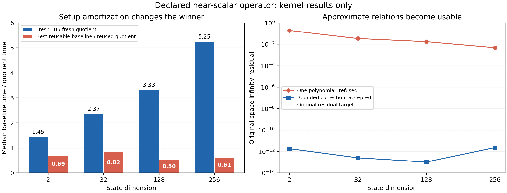

# Approximate quotient relations as a usable linear-solve route

We extend the existing polynomial resolvent into a bounded correction algorithm. The earlier implementation constructed one candidate and rejected it when its original-space residual exceeded the requested tolerance. An approximate low-degree relation therefore supplied a useful preconditioner without supplying a usable solver at tight tolerance. The new implementation uses that preconditioner repeatedly, and retains the original residual as its acceptance test.

The implementation is in `crates/rodas5p-integrators/src/polynomial_resolvent.rs`. It adds `PolynomialRefinementPolicy`, `PolynomialRefinementWorkspace`, `PolynomialRefinementWork`, `PolynomialRefinementReport`, and the methods `DeclaredPolynomialResolvent::apply_refined_checked` and `apply_refined_or_fallback`. Existing one-shot and typed collision-provider APIs are unchanged. The new interface is opt-in and supports arbitrary declared immutable linear operator actions. It does not infer a relation from samples or change the general ODE selector.

## Algebra, sufficient conditions and actual cost

Let \(B\in\mathbb R^{n\times n}\), \(M=I-B\), and let \(q\) have degree \(d\ge1\), with \(q(1)\ne0\). Define

\[
p(z)=\frac{q(1)-q(z)}{q(1)(1-z)},\qquad P=p(B),\qquad D=\frac{q(B)}{q(1)}.
\]

The numerator vanishes at \(z=1\), so \(p\) is a polynomial of degree at most \(d-1\). Polynomial substitution gives

\[
MP=PM=I-D. \tag{A1}
\]

Suppose a full-space witness provides \(\|D\|_\infty\le\eta<1\). Then \(I-D\) is invertible by the convergent geometric series, and (A1) makes \(P(I-D)^{-1}\) a right inverse of the square matrix \(M\). Thus \(M\) is invertible and

\[
M^{-1}=P(I-D)^{-1},\qquad
\|M^{-1}\|_\infty\le\frac{\|P\|_\infty}{1-\eta}. \tag{A2}
\]

Starting with \(x_0=Pb\), set

\[
r_k=b-Mx_k,\qquad x_{k+1}=x_k+Pr_k.
\]

Equation (A1) yields \(r_0=Db\) and

\[
r_{k+1}=(I-MP)r_k=Dr_k,\qquad
\|r_k\|_\infty\le\eta^{k+1}\|b\|_\infty. \tag{A3}
\]

For \(0<\eta<1\) and \(0<\tau<\|b\|\), at most
\(\max(0,\lceil\log(\tau/\|b\|)/\log\eta\rceil-1)\) corrections suffice in exact arithmetic. Each initial candidate or correction uses \(d-1\) operator actions in Horner evaluation and one original-space residual action. A successful result after \(k\) corrections therefore costs exactly \((k+1)d\) such actions. The vectors add \(O((k+1)dn)\) arithmetic, four reusable vectors occupy \(O(n)\) memory, and the kernel itself allocates no memory during the hot call. Allocations inside supplied operator or fallback callbacks are outside that statement. Polynomial preparation costs \(O(d)\). These counts do not include any caller-supplied fallback work.

This contraction depends on \(\|q(B)\|/|q(1)|\), not on \(\|B\|<1\). For example \(B=-100I+40N\), \(N^2=0\), has \(\|B\|_\infty=140\) for the tested two-dimensional Jordan block, but \(q(z)=z+100\) gives \(\eta=40/101<1\). One correction solves the system in exact arithmetic. Plain iteration \(x\leftarrow b+Bx\) has no such contraction. This gives a concrete revival of nearly annihilating and nearly nilpotent constructions.

For a dense family \(B=-\alpha I+E\), with \(\alpha\ge0\) and \(\|E\|_\infty\le c<1+\alpha\), choose \(q(z)=z+\alpha\). Then \(P=(1+\alpha)^{-1}I\) and \(\eta=c/(1+\alpha)\). For a fixed relative residual target and a dimension-independent upper bound \(\eta\le\eta_*<1\), the number of matrix-vector actions is bounded independently of dimension. Dense action cost therefore gives \(O(n^2\log(1/\varepsilon))\) work and \(O(n)\) additional storage, compared with cubic fresh dense factorization. Reused factors already have quadratic per-RHS cost, so this asymptotic statement does not decide that reuse comparison. The benchmark measures both circumstances.

The quotient-algebra interpretation is literal: for the exact relation \(q(B)=0\), the inverse of \(1-z\) is represented by \(p\) in \(\mathbb R[z]/(q)\). Approximate relations leave the defect \(D\), and the correction restores the original equation rather than replacing it by the quotient equation. Repeated roots are admissible; the required separation is \(q(1)\ne0\), not separation between the roots of \(q\). The existing constructor refuses cancellation-sensitive denominator charts. Polynomial coefficient scaling and conditional norm estimates are reused.

These are established polynomial-preconditioning and defect-correction identities specialized to the present implementation. Earlier repository work already considered near-nilpotent/inexact corrections: `docs/reviews/20261011_promotion_theory/POLYNOMIAL_KO.md` §P3 and `docs/reviews/20261011_promotion_theory/CERTIFICATE_ATLAS_KO.md` §A1. The independent exact rational checks are `analysis/THEORY_EXACT_CHECKS.json`; the Wolfram check is `evidence/external/wolfram_quotient_checks.json`. The contribution here is the concrete bounded, transactional implementation and its newly executed tests, not a claim of mathematical priority.

## Floating-point contract and adaptive choice

If the computed residual is \(\widehat r_k=r_k+\delta r_k\), and the computed update differs from \(P\widehat r_k\) by \(u_k\), then

\[
\widehat r_{k+1}=D\widehat r_k+\xi_k,\quad
\xi_k=\delta r_{k+1}-\delta r_k-Mu_k.
\]

Bounds \(\|\delta r_k\|\le\rho_k\), \(\|u_k\|\le\epsilon_k\) give

\[
\|\widehat r_k\|\le\eta^k\|\widehat r_0\|
+\sum_{j=0}^{k-1}\eta^{k-1-j}
(\rho_{j+1}+\rho_j+\|M\|\epsilon_j). \tag{A4}
\]

The runtime does not evaluate (A4) with intervals. It measures the original residual, adds the caller's residual-evaluation allowance, and reports the conditional state-error estimate from (A2). Polynomial-evaluation errors are controlled operationally by that final residual and stagnation detection; a certified bound additionally requires valid full-space relation/operator witnesses and a valid arithmetic allowance. A dishonest witness may be detected for a particular solve, but finite residual tests do not certify a global operator relation.

The selection algorithm has four concrete controls:

1. Decline the polynomial attempt before operator calls when the supplied relation ratio exceeds the policy limit (default 0.5).
2. Reserve an entire \(d\)-action candidate/correction before starting it. The default polynomial-attempt budget is 64 actions and eight corrections.
3. After each correction, accept only the original residual target; otherwise stop if residual decrease is insufficient (default ratio 0.95), or a budget expires.
4. If the caller requests fallback, invoke its protected solve into scratch and check the same original residual target before committing. The fallback's verification costs one additional operator action beyond the polynomial budget. Its internal work belongs to the caller's accounting.

Output is unchanged on refusal, callback failure, partial callback write, arithmetic failure, or rejected fallback. Operator callbacks poison their output buffers with NaNs before evaluation. Work counters are incremented before calls, so failed attempts remain paid. Input and operator failures propagate; fallback does not hide them. The configuration thresholds are engineering choices, not proved performance-optimal boundaries. Reuse requires the identical scaled operator and full-space witness. Changing a step scale, operator coefficients, dimension or model epoch requires rebuilding/rebinding the declaration; the generic callback interface cannot enforce external model identity. The existing typed exchange-provider binding remains available for its own exact model.

## Validation and correction history

The first source revision added the algorithm and nine contracts. The root runner executed the focused tests together with the existing polynomial/provider tests: 25 tests passed. The receipt is `../evidence/runs/algebraic-round1-tests`.

Independent theory review then requested two bounded corrections: clarify that fallback verification lies outside the polynomial-attempt action budget, and exercise partial/failing writes during degree-two Horner evaluation and during the fallback callback. Revision 2 makes those changes and adds one compound regression test. No mathematical acceptance tolerance was weakened. The final focused run passed all 26 tests (eight legacy polynomial, eight typed-provider, ten new refinement contracts), recorded in `evidence/runs/algebraic-round2-tests.receipt.json`. A benchmark JSON macro parsing failure was repaired within revision 2; its original compiler log remains in `evidence/runs/benchmark-final-build.stderr`.

The benchmark example is `crates/rodas5p-integrators/examples/algebraic_refinement_bench.rs`. It emits completed JSONL records, retaining one-shot failures. It measures four dense near-scalar dimensions (2, 32, 128, 256), both setup-included and reused-workspace polynomial solves, both fresh and reused LU, and a direct two-by-two formula on the smallest case. Each kernel row has 21 cyclic timing groups of at least 2 ms. All methods include the reporting/diagnostic overhead stated in the row. The process explicitly selects serial Faer execution.

A separate 50-step fixed-step implicit-Euler trajectory uses a smooth, nonconstant manufactured solution and identical source/discretization for all methods. Its exact continuous error and disagreement with the reused-LU discrete solution are both reported. This is a real time-stepping client of the new solve kernel; it does not qualify a RODAS trajectory or the general production driver. Its 11 serial samples per method are illustrative and not used for speed promotion.

The first completed benchmark exposed a harness accounting error: the legacy one-shot branch reported zero polynomial operator actions although its original-residual check performed one. Revision 3 corrects that counter, retains the refused candidate residual, and explicitly states that the counter concerns polynomial-solver calls; LU arithmetic and harness diagnostic checks are included in elapsed time. The solver kernel is unchanged. The initial run remains preserved as `evidence/runs/algebraic-benchmark.stdout`. Final measurements use the corrected run below.

## Next concrete integration

Use the new kernel for operator families with a symbolic or rigorously bounded approximate relation and sufficiently few corrections. A reusable LU can be faster for many right-hand sides with a fixed small matrix, so a production integration should select using the expected reuse count and measured action cost. A factorization that changes with each step has a different setup trade-off. The existing general selector remains unchanged until an actual RODAS stage integration establishes a winning full-trajectory domain.

A next extension can evaluate \(q(z)=(z-a)^d\) in the shifted chart directly, avoiding cancellation in expanded coefficients. Another can bind a generic immutable operator epoch and its relation witness in a typed provider, extending the existing exact-exchange binding without claiming that arbitrary callback probes establish algebraic structure.

For a known count \(R\) of right-hand sides sharing one operator, an explicit amortization rule can compare measured costs
\[
T_P(R)=P_{\rm cold}+(R-1)P_{\rm warm},\qquad
T_L(R)=L_{\rm cold}+(R-1)L_{\rm warm}.
\]
When \(P_{\rm warm}>L_{\rm warm}\), the polynomial route is cheaper under this cost model precisely when
\[
R<1+\frac{L_{\rm cold}-P_{\rm cold}}{P_{\rm warm}-L_{\rm warm}}.
\]
The costs must describe the same residual target and actual operator action, and the relation must remain valid across reuse. A production adapter can use this inequality with an uncertainty margin and a caller-declared reuse horizon, while retaining the existing residual-based fallback. The current implementation does not learn or hard-code those timing thresholds.

## Corrected measurements

The corrected runner exited successfully. `evidence/runs/algebraic-benchmark-corrected.stdout` contains 24 rows: 19 accepted rows and five retained legacy one-shot refusals. `src/analyze_algebraic_rescue.py` verifies row coverage, acceptance, failed-attempt accounting and timing sample counts; its output is `analysis/ALGEBRAIC_BENCHMARK.json`. The previous harness source has been reconstructed byte-for-byte under `evidence/round2_source/` and matches the original source-freeze hash.

| Dimension | Fresh LU / fresh quotient | Best reusable baseline / reused quotient | Quotient actions | Refined residual |
|---:|---:|---:|---:|---:|
| 2 | 1.447 | 0.688 | 5 | 1.862e-12 |
| 32 | 2.365 | 0.825 | 4 | 2.558e-13 |
| 128 | 3.330 | 0.501 | 4 | 1.030e-13 |
| 256 | 5.246 | 0.605 | 3 | 2.352e-12 |

Ratios exceed one when the quotient route is faster. Setup-inclusive quotient solves were 1.45–5.25 times faster than fresh LU in this manufactured dense family. For every dimension, the strongest reusable baseline was faster: direct two-by-two arithmetic at dimension 2 and reused LU at dimensions 32, 128 and 256. The latter result prevents a general preference for polynomial solves when a good factor is already available. The refined solution errors were at most 2.33e-14, and every refined kernel residual met the unchanged 1e-10 target. These are single-process grouped measurements including the diagnostic/JSON costs stated in the raw data; they are not independent-process confidence intervals.

The 50-step implicit-Euler client completed with 150 polynomial-solver operator actions. Its maximum original-space residual was 9.92e-11. It differed from the same-step reused-LU trajectory by 6.08e-13 and from the continuous manufactured solution by 2.61e-7. The latter error is the time-discretization error, which the linear residual tolerance does not control. The reused-LU trajectory was about 1.37 times faster in the 11 serial timing samples. Those trajectory timings are kept separate from the 21 cyclic kernel groups.

The supported decision is therefore a revived opt-in solve kernel for approximate algebraic relations, with a demonstrated fresh-factorization cost advantage and a demonstrated robustness improvement over the one-shot candidate. Automatic RODAS selection awaits a stage-level integration that accounts for operator reuse, competing band/direct actions and complete trajectory error.
