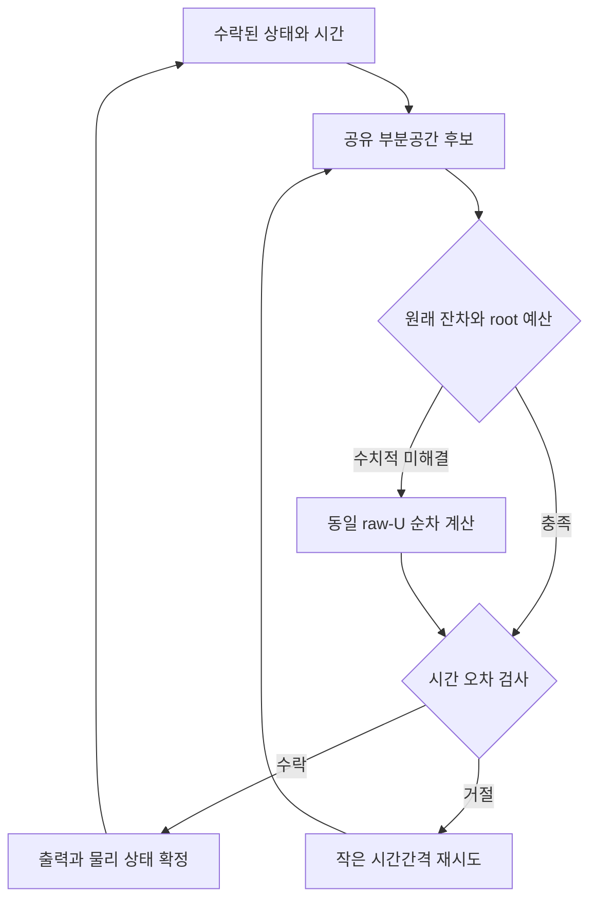
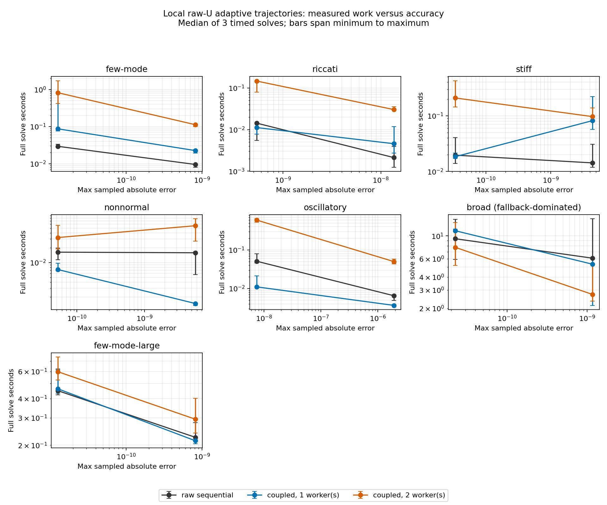

# 공유 부분공간 기반 RODAS5P 단계 계산의 적응 시간적분 이식

## 초록

본 연구는 기존 VigilODE의 공유 부분공간·단계 병렬 평가·homotopy 구현을 실제 적응형 시간적분 경로로 연결한다. 첨부된 선행 연구와 최신 소스를 대조한 결과, 핵심 후보 계산은 이미 구현되어 있었으나 물리 시간의 수락·거절과 동일한 단계 방정식을 푸는 대체 계산을 하나의 계약으로 제공하지 않았다. 이를 보완하기 위해 원래 raw-U 방정식을 유지하는 대체 경로, 조건부 대수 오차 전달, 관측 시각에 정확히 착지하는 적응 드라이버를 추가하였다. 또한 축약 시스템의 반복 대각 블록을 이용하여 전체 행렬 LU를 작은 공통 블록 LU와 전진 대입으로 바꾸었다. 이 문서는 구현·증명·실행 결과를 구분하며, 범용 생산 솔버 또는 일반적인 병렬 속도 향상을 전제하지 않는다.

## 1. 동기와 선행 연구의 재사용

큰 ODE를 풀 때 중요한 것은 한 번의 작은 행렬 계산을 빠르게 만드는 데 그치지 않는다. 후보 계산이 실패한 비용, 시간간격 거절, 오차 검사, 관측값 생성까지 포함한 전체 궤적 비용이 줄어야 한다. 선행 아이디어는 큰 상태공간의 반복 계산을 공통 부분공간으로 옮기고, 각 단계의 RHS와 JVP를 같은 반복 상태에서 동시에 평가하는 것이었다. 기존 PR74·PR75의 coupled 커널과 PR77의 구조화 hybrid 계산은 최신 기준 소스에 이미 포함되어 있다. 별도 개발·응용 브랜치에서 같은 파일을 다시 가져오거나 알고리즘을 중복 구현하지 않았다. 비교 근거는 [소스 통합 조사](SOURCE_INTEGRATION_KO.md)에 기록하였다.

첨부 문서의 Python 예제 수치와 과거 서버 실험은 해당 구현·환경에 대한 선행 관측으로 보존한다. 새 Rust 적분기의 결과로 옮겨 쓰지 않는다. 이번 실행은 가용 로컬 환경만 사용하며 NCP에 접속하거나 작업을 제출하지 않는다. 외부 비교 솔버에 대한 기존 결과도 재실행하지 않았다.

## 2. 보존한 방정식과 실제 알고리즘

자율 ODE \(y'=f(y)\), 항등 질량 형태(`mass_matrix=None`), 사용자 JVP를 지원한다. 한 시간간격에서 \(J_0=f'(y_n)\), \(W=I-h\gamma J_0\)를 고정한다. 여덟 단계의 목표는

\[
WU_i=h\gamma f\!\left(y_n+\sum_{j<i}A_{ij}U_j\right)
+\gamma\sum_{j<i}C_{ij}U_j,
\qquad
y_{n+1}=y_n+\sum_i b_i^{\mathrm{code}}U_i.
\]

내장 오차벡터는 마지막 raw-U 단계이다. 일반 native-K 표현과 정확산술 변환 관계는 있지만, 저장된 계수와 유한정밀도 계산 순서까지 동일하지는 않다. 따라서 새 대체 경로에는 같은 raw-U 식을 푸는 `Rodas5pMfFastWorkspace`를 연결하였다. 이전 native-K fallback API는 기존 용도로 보존한다.

공유 기저 \(V\)와 \(J_0V\)는 기존 residual-first 커널이 구성한다. 작은 좌표에서 affine 예측값을 구하고, homotopy의 최종점부터 시도한다. 각 반복의 모든 단계가 같은 이전 좌표를 사용하므로 RHS와 JVP 평가를 병렬로 배치할 수 있다. 작은 시스템의 해를 원래 공간으로 올린 뒤 원래 잔차를 검사하고, 필요한 경우 기저를 확장한다. 투영 잔차만으로 물리 시간을 전진시키지 않는다.

사용자 callback 오류와 모델 변경은 별도로 중단하며, 직전 수락 상태와 모든 시도 작업량을 반환한다. 선형해법 자체의 수치 실패는 원인을 보존한 채 시간간격을 줄일 수 있다. callback이 선형해법 오류와 같은 오류형을 반환해도 이를 수치 재시도로 숨기지 않는다. 관측 시각은 실제 시간간격을 잘라 착지하며, 새 경로의 출력은 보간값이 아니다.

## 3. 계산량 감소와 정확도 조건

### 3.1 공통 대각 블록을 이용한 축약 계산

단계 결합은 엄격 하삼각이고 모든 대각 블록은 \(W_m=I-h\gamma V^TJ_0V\)이다. 행렬의 이 구조를 실제로 검사한 뒤 \(W_m\)만 한 번 분해하고 여덟 개의 작은 시스템을 순서대로 푼다. 일반 단계 수 \(s\)에 대해 분해·대입 비용은 \(O(m^3+s^2m^2)\)이며 전체 \(sm\)차원 LU의 \(O((sm)^3)\)보다 작다. 현재 \(s=8\)은 고정이므로 \(m\)에 대한 차수가 바뀌었다는 주장은 하지 않는다. 전체 작은 행렬 저장과 그 행렬에 대한 잔차 검사는 유지하였다. 세션 전체에 걸친 factor 재사용은 후속 작업이다.

원래 시스템이 고정 차원의 불변부분공간을 보존하고 RHS/JVP가 상태 차원 \(n\)에 선형 비용이면, 고정 \(s,m\)과 차원에 독립인 기저 확장·Newton·homotopy 반복 예산 아래에서는 후보 계산도 \(n\)에 선형 비용을 갖는다. 작은 부분공간의 존재는 모든 문제의 성질이 아니다. 넓은 spectrum과 비정규 결합에서 공간이 커지거나 대체 계산이 필요할 수 있다.

### 3.2 원래 잔차에서 출력 오차로

\(\|W^{-1}\|_2\le\beta\)이고 필요한 모든 단계 상태를 잇는 선분에서 \(f\)의 Lipschitz 상계가 \(L\)이라고 하자. 계산된 원래 단계 잔차의 참 상계를 \(\rho_i\)로 두면

\[
E_i=\beta\left[\rho_i+\sum_{j<i}
\left(|\gamma C_{ij}|+|h\gamma|L|A_{ij}|\right)E_j\right]
\]

는 단계 오차의 상계이다. 따라서 종점 오차는 \(\sum_i|b_i^{\mathrm{code}}|E_i\), 내장 오차벡터의 교란은 \(E_7\)로 제한된다. 이 재귀는 유한 하삼각 경로합이므로 결합 행렬의 노름이 1보다 작다는 가정은 필요하지 않다. 다만 계수의 누적 증폭이 커져 실용적인 상계가 되지 않을 수 있다.

코드는 원래 공간 검사에서 얻은 **각 단계의 L2 잔차**를 추가 callback 없이 전달한다. `ConditionalL2` 정책은 종점 예산을 별도로 검사하고 내장 오차에 그 교란을 더한다. 역노름·Lipschitz 영역·잔차 반올림 allowance는 사용자가 정당화해야 하며, 일반 f64 계산은 outward-rounded interval 증명이 아니다. 현재 API를 검증된 정확도 인증서로 부르지 않는다.

안정적인 5차 단계 사상에 매번 \(O(h^6)\)의 root 출력오차만 추가된다면 고정 구간의 5차 정확도를 유지한다. 증명은 단계별 안정성 추정에 이 perturbation을 합하는 이산 Grönwall 추정이다. 반대로 고정된 WRMS 잔차 한계만으로 \(h\to0\)의 5차 수렴을 보장할 수 없다. 실제 \(h\)·상태·모델에 묶인 가정 공급자와 root 예산은 다음 정확도 개발의 우선순위이다. 가정, 증명 및 삼각 homotopy의 유일성과 유한 뉴턴 전파에 대한 자세한 유도는 [이론 보고서](THEORY_KO.md)에 수록하였다.

## 4. 검증과 국소 성능 관측

공개된 구현 기준에서 관련 Rust 테스트 **62개가 모두 통과**했다. 대상은 기존 coupled 회귀와 새 raw fallback·조건부 bound·적응 궤적·출력 시간 계약이다. 전체 저장소의 모든 시험을 실행했다는 의미는 아니다. 두 차례의 특이 연산자 fixture 구성 실패와 한 차례의 실패 callback 작업량 누락은 원래 로그를 보존하고 수정했다.

측정 캠페인은 **51개 설정**을 등록했고, process 종료 기준 51개를 완료했다. 분석 가능한 설정 51개 중 warm-up과 세 반복이 모두 성공한 설정은 51개, 그렇지 않은 설정은 0개이다. 총 실행 시간은 216.688초이며 워밍업 51회와 측정 153회가 포함된다. process 성공과 수치 적분 성공은 서로 다른 판정이다. 원본·실패·미실행 상태는 [실행 기록](evidence/local_bench/RECEIPTS.json)에 남겼다.

각 오차는 등록한 관측 시각에서 전체 상태 성분을 정확해와 비교한 최대 절대오차이다. 일반 캠페인은 다섯 시각, refinement는 종점 중심의 두 시각을 사용한다. 이는 연속 시간 구간 전체에 대한 상계가 아니다. 시간은 전체 적분과 workspace 구성을 포함하고 worker pool 구성, 기준해 평가, JSON 직렬화는 제외한다. 아래 막대는 세 반복의 최소–최대이며 신뢰구간이 아니다.

두 방법이 같은 표본 오차 요구를 만족하는 설정 중 각각 측정된 가장 빠른 설정을 비교하였다. 같은 requested tolerance를 같은 정확도라고 간주하지 않았으며, 단 두 허용오차 수준으로 각 방법의 전역 최적 설정을 찾았다는 의미도 아니다. 비교 대상은 기존 raw-U matrix-free 순차 경로이다. 새 fallback의 원래 잔차 재검사와 실패 비용은 포함되므로 bare 순차 드라이버보다 검사 비용이 많다.

| 문제 | 공통 최대오차 요구 | worker 수 | 순차/coupled 경로 시간비 | 해석 |
|---|---:|---:|---:|---|
| few-mode | 1e-08 | 1 | 0.422 | 이 표본에서 후보가 느림 |
| few-mode | 1e-08 | 2 | 0.0847 | 이 표본에서 후보가 느림 |
| riccati | 1e-08 | 1 | 1.28 | 이 표본에서 후보가 빠름 |
| riccati | 1e-08 | 2 | 0.0973 | 이 표본에서 후보가 느림 |
| stiff | 1e-08 | 1 | 0.774 | 이 표본에서 후보가 느림 |
| stiff | 1e-08 | 2 | 0.148 | 이 표본에서 후보가 느림 |
| nonnormal | 1e-08 | 1 | 10.8 | 이 표본에서 후보가 빠름 |
| nonnormal | 1e-08 | 2 | 0.49 | 이 표본에서 후보가 느림 |
| oscillatory | 1e-08 | 1 | 4.63 | 이 표본에서 후보가 빠름 |
| oscillatory | 1e-08 | 2 | 0.0855 | 이 표본에서 후보가 느림 |
| broad | 1e-08 | 1 | 1.14 | 순차 대체 계산이 대부분; 후보 가속으로 해석 불가 |
| broad | 1e-08 | 2 | 2.24 | 순차 대체 계산이 대부분; 후보 가속으로 해석 불가 |
| few-mode-large | 1e-08 | 1 | 1.05 | 이 표본에서 후보가 빠름 |
| few-mode-large | 1e-08 | 2 | 0.763 | 이 표본에서 후보가 느림 |

시간비가 1보다 크면 이 측정에서 후보와 대체 계산을 포함한 coupled 경로의 중앙값 시간이 작다. 호스트 부하와 세 반복의 변동을 넘어서는 일반적인 우위는 주장하지 않는다. 1→2 worker 변화도 모든 문제의 가속으로 해석하지 않는다. broad 문제에서는 허용오차별 전체 38·81회 시도 중 37·79회가 순차 대체 계산을 사용했다. 따라서 이 문제의 시간비는 공유 부분공간 후보의 성능을 입증하지 않는다. 같은 broad 1-worker 설정의 반복 시간도 약 2.13–6.05초로 변했으며, 작은 문제의 짧은 측정과 large 사례의 1.05배 차이를 안정적인 속도 우위로 승격하지 않는다.

| 경로 | h 변화 | 최대 표본오차 변화 | 관측 기울기 |
|---|---|---|---:|
| sequential | 0.2→0.1 | 1.02e-08→4.19e-10 | 4.6 |
| sequential | 0.1→0.05 | 4.19e-10→1.56e-11 | 4.75 |
| sequential | 0.05→0.025 | 1.56e-11→5.34e-13 | 4.87 |
| coupled | 0.2→0.1 | 1.02e-08→4.19e-10 | 4.6 |
| coupled | 0.1→0.05 | 4.19e-10→1.56e-11 | 4.75 |
| coupled | 0.05→0.025 | 1.56e-11→5.34e-13 | 4.87 |

모든 설정에서 반복 간 작업량은 같았으며, coupled 계열 33개 설정에서 RHS/JVP 총계가 후보·순차 대체·원래 공간 검증 작업량 합과 일치했다. callback 진단 계수는 이 합에 중복 가산하지 않았다. 동일 설정의 1-worker와 2-worker 비교 14개 중 12개에서 2-worker 경로가 더 느렸다. 병렬 작업을 제공하는 API와 병렬 속도 향상은 구별해야 한다.

refinement 표는 매끄러운 Riccati 제조 사례에 대한 관측이다. 대수 오차·반올림 바닥이나 controller 변화가 지배하는 구간에서는 이 기울기를 형식적 차수로 읽지 않는다. 전체 설정과 계수는 [상세 표](evidence/local_bench/RESULTS.md), [machine-readable 결과](evidence/local_bench/SUMMARY.json)에 있다.

## 5. 자기비판적 평가와 다음 개발

첫째, 이 변경은 opt-in 적응 경로를 완성하지만 지원 범위는 자율·단위 질량·사용자 JVP 문제이다. 비자율 항, 질량행렬, DAE, 연속 출력, 사건 위치 검출을 지원한다고 확대 해석하지 않는다. 범용 생산 solver로의 판정은 이전의 보류 상태를 유지한다. 사용 가능한 좁은 범위와 실험에서 드러난 손익을 명시하는 것이 이번 이식의 결과이다.

둘째, 후보가 실패한 후 순차 계산으로 돌아오면 후보의 모든 비용이 추가된다. 현재는 두 경로가 안전하게 연결되어 있으나 비용을 학습하는 선택기는 아니다. 같은 허용오차가 아니라 같은 실제 달성 오차에서, 작업량과 물리 시간 진척을 함께 사용하여 후보를 건너뛸 조건을 학습해야 한다. 작은 차원이나 싼 RHS에서는 병렬 배치·검증·allocation이 순차 풀이보다 비쌀 수 있다.

셋째, 후보 scratch는 매번 구성되고, 시도 기록은 최대 시도 수에 비례하여 증가한다. `max_storage_bytes`는 후보의 주요 배열 계획에 대한 제한이며 전체 프로세스 RSS, fallback workspace, 기록 메모리까지 포괄하지 않는다. 따라서 zero allocation 또는 고정 총메모리를 주장하지 않는다. 같은 세션의 작은 factor 재사용, residual-first의 불필요한 첫 단계 미분 제거, streaming 기록이 구체적인 다음 최적화이다.

넷째, Laguerre·Chebyshev·Leja는 이름만 바꾸어 끼우는 대체물이 아니다. shifted inverse의 다항식 전처리와 exponential/phi action을 구분해야 한다. 전자는 원래 raw-U 잔차를 기준으로 결합할 수 있고, 후자는 별도 exponential Rosenbrock 방법의 차수조건을 갖는다. 공통 부분공간의 기저만 바꾸는 경우에는 같은 공간인지, 기저 조건수와 저장·내적 비용이 어떻게 변하는지를 먼저 검증한다. 현재 polynomial 구현과 선행 증명은 재사용하며, 병렬 exponential 방법으로의 전환을 기존 RODAS5P와 동일한 방법이라고 서술하지 않는다.

기존 개발 항목을 보존하면서 이번 구현을 반영한 [NEXT_STEPS.json](NEXT_STEPS.json)에 목표 코드, 의존성, 정확도·속도 수용 조건을 통합하였다. 다음 작업은 자동 오차 가정과 root 예산, 비용 기반 선택, 세션 재사용의 순서로 수행하는 것이 타당하다. 실제 물리 FVM client의 공간·리매핑 오차와 이 시간적분 오차의 분리도 여전히 필요하다.

## 6. 재현성과 문서의 지위

입력 문서의 원본과 해시, 사전등록, 코드 식별자, 원 실행 로그, 실패, 측정값을 같은 연구 폴더에 보존한다. [REPRODUCE.md](REPRODUCE.md)는 실행 명령을, [SOURCE_REVIEW.json](SOURCE_REVIEW.json)은 독립 소스 검토를, [WORKFLOW.json](WORKFLOW.json)은 수치해석·코딩 두 연구 루프의 연결을 제공한다. SciSpace·Exa로 확인한 원전과 Wolfram 기호 검산은 [SOURCES.json](SOURCES.json)에 기록하였다. 문헌의 정리가 현행 구현 전체를 인증한다는 의미는 아니다.

Academic Writing Toolkit의 문단 검토는 한국어와 분리된 수식을 짧은 문단으로 표시하였다. 수식·가정·증명의 읽기 순서는 유지하고, 그 자동 결과를 수학 검증으로 취급하지 않았다. 실제 독립 증명 검토에서는 불변부분공간 정리의 유일성에 원래 \(W\)의 가역성도 필요함을 명시하여 수정하였다.

이번 폴더의 공개 Git 식별자 검사와 연구 기록 검사는 통과했다. 이전 리뷰에서 확인한 저장소 전체의 과거 식별자 14개 미해결 문제는 이 변경으로 해결된 것이 아니며, 관련 자료 복구는 다음 개발 항목에 보존했다.
