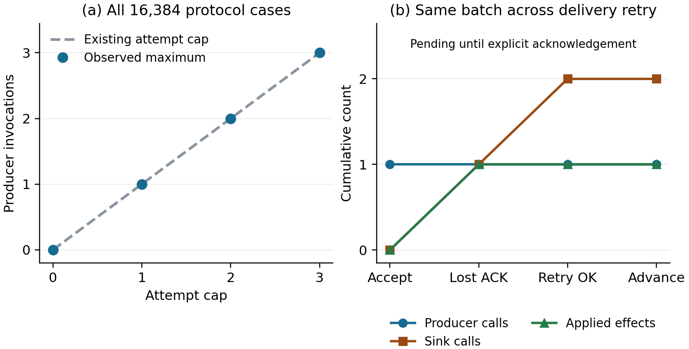

# VigilODE D4 — callback 효과 보존과 전달 ACK 경계

## 결과

D3 이후 실제로 남은 managed-effect 계약을 구현하고 검증했다. 기존 Session의 attempt cap·clock·수용 판정을 재사용하면서, trial에 소유된 journal과 수용 후 pending batch, 명시적인 ACK 경계를 추가했다. **새 계약22/22,16,384개 protocol case의65,536전이와 독립 oracle3,407,872개 필드 비교가 통과했다.** 일반 callback·실제 BASS·생산 FP provider 및 현재 native 담당 연결은 각각 별도 의무다.

이 결과는 [Draft PR87](https://github.com/cosmosapjw-quantum/vigilode/pull/87)에 게시한다. 단위의 과학·코딩 검증은 완료했으며 단계별 저장 완료 여부는 delivery/의 실제 receipt를 따른다. 전체 VigilODE 완성도는 null, production은 HOLD다.

## 1. 최신 자료를 종합한 연구 위치

접근 가능한 VigilODE branch205개(100+100+5+0), PR86개(86+0, open56), BASS PR187개, REI PR225개 metadata pagination을 끝까지 읽었다. PR87은 이 조사 뒤 새로 생성했다. Library VigilODE 제목225개(100+100+25, cursor=null), 알려진 Dropbox subtree154개(has_more=false, 그중VigilODE33개), Drive 전용 folder36개를 대조했다. 별도 대화 검색은 unavailable이었다. 모든 비공개 대화나 모든 branch의 모든 파일을 열람했다고 해석하지 않는다.

D2 HEAD1c829f206ab67585191231be7f5135fd0d4c804e, D3 HEAD02060cc9dc4551dc5cf6ec86ad9b53b697a2c3ce, native frontier aaf1f834d4c589e734ca7851a56c11bb44f7047a가 유지됐다. 중앙 REI PR222는407381b302d8b98f251b54d277823997bc4fca9f로 진행했으나 VigilODE 최신 수신 댓글은 기존6384170816이었다. BASS PR187의 initial-data bridge와 REI PR226의 frozen-history 관측은 native source 예약·dirty·완료 receipt를 대체하지 않는다.

관련 native source23개와 D4에서 실제 재사용한6개 source를 각각 Git blob/실제 bytes로 결속했다. root/research와 관련 native subtree의 AGENTS 조회는404였고, native crates795-entry tree에도 없었다. 중앙 repo의 AGENTS는 그 repo의 시점 있는 운영 자료이며 이 VigilODE subtree에 자동 이식하지 않았다.

첨부9개 outer archive의 member 목록과 필요한 README/과거 계약을 읽었다. 이들은 July/August의 Bianchi/BASS source·vendor·문헌이다. 현재 native owner의 unpublished 상태를 확정할 자료는 확보되지 않았다. 조사 범위와 정확한 역할은 SOURCE_SURVEY_KO.md, RELATED_REPOS_KO.md, BACKUP_SURVEY_KO.md에 있다. 개인 raw 검색 metadata는 공개 Git에 넣지 않았다.

## 2. 기존 구현과 이번 실제 추가분

| 기존 경로 | 확인한 기능 | D4 사용 |
|---|---|---|
| admission::Session | cap/clock/sticky fault, exact lease, finish/abort | 원본 bytes 그대로 연결 |
| native transaction.rs | Clone trial, commit/rollback/Drop, non-refunding work Budget | 구조·계약 근거 재사용; 별도 cap을 재발명하지 않음 |
| generic_verified/integrate | max attempts, minstep, clock, accepted-prefix 보호 | 현재 구현의 조건부 유한 생산 원리 재사용 |
| output.rs | output 준비 후 callback/allocation 없는 commit | journal도 accept 후에는 준비된 Vec 이동만 수행 |
| problem.rs | Arc callback과 호출 전 work 계수 | shared capture의 외부 효과 경계 확인 |
| 새 driver.rs | owned journal, poison, one pending batch, exact ACK | 실제 확인된 누락을 구현 |

수치 step을 거절할 때 x,t를 유지하는 기존 solver 계약과, callback의 공유 capture/I/O를 되돌리는 계약은 대상이 다르다. Rust Clone 공식문서도 Arc/Mutex 복제의 공유 storage를 명시한다. 관련 primary source인 CVODE, Boost.Odeint, SciML, Rust 문서를 읽었고 SciSpace2검색20records와 Exa4검색18slots/6fetch를 연결했다. 문헌의 기능을 새 알고리즘으로 주장하지 않는다. 상세 원전 대응은 LITERATURE_KO.md와 THEORY.md에 있다.

## 3. 이론 결과와 구현 대응

각 live driver에 대해 a를 성공한 Session.begin 수, M을 고정 attempt cap, p를 outer producer 호출 수로 둔다. Callback·내부 solve·필요한 destructor가 반환한다는 조건에서, 기존 begin은 a<M일 때만 a를1증가시키므로

    0 <= p <= a <= M.

이것은 producer 호출 수의 경계다. 하나의 producer 안에서 여러 번 실행되는 RHS/Jacobian/linear solve 수는 별도 작업량이다. 무한히 반환하지 않는 callback이나 client가 terminal에 advance를 무한 반복하는 프로그램 전체 종료를 이 부등식으로 판정하지 않는다.

trial은 J=[(kind,payload)]를 깊게 소유한다. payload는 Vec<u8>, kind는u32다. event 수·보관 payload byte 수의 덧셈을 checked_add로 검사하고 첫 emit 오류 뒤 poison을 유지한다. Callback이 emit 오류를 무시해도 Session.finish 전에 fatal abort가 이루어진다. 이 한계는 보관된 데이터의 한계이며, vector overhead나 callback이 사전에 임의로 할당한 전체 메모리를 뜻하지 않는다.

candidate와 error는 기존 Session.finish로 판단한다. Reject·recoverable/fatal callback·처리된 unwind·journal poison이면 수용 state를 보존하고 J를 버린다. Attempt와 진단 work는 환불하지 않는다. Accept이면 준비된 Vec를 pending batch B로 이동한다. 이 commit 분기에는 추가 callback·formatting·allocation이 없다.

B의 ID는 (run_id,attempt,accepted_epoch)다. 같은 live run에서 attempt가 엄격히 증가하므로 accepted batch ID가 겹치지 않는다. 독립 run 사이 ID namespace의 고유성은 caller/sink 계약이다. Pending이 존재하면

    Delta attempts = Delta producer = Delta accepted_state = 0.

이 검사는 final-time Finished보다 먼저 수행한다. 빈 journal도 pending/ACK를 거친다. deliver_once는 sink를 최대 한 번 호출하고 success/error/처리된 panic 모두에서 같은 B를 유지한다. 별도의 acknowledge(exact_id)만 pending을 지운다. 잘못된 ID는 지우지 못하며, 직전 ACK의 중복은 더 새로운 pending을 지우지 않는다.

### 외부 효과에 대한 조건부 결과

Sink가 (ID,payload identity,외부 effect)를 원자적으로 durable 기록하고, 같은 ID/내용의 재시도를 중복 적용하지 않으며 다른 내용 재사용을 거부하고, 성공 ACK가 실제 durable 완료를 뜻하면 각 batch는 최대 한 번 적용된다. 끝내 올바른 ACK를 받으면 정확히 한 번 적용된다. 이는 THEORY의 S1–S5 조건부 결과다.

현재 adapter는 in-memory journal/barrier를 구현한다. acknowledge()는 caller assertion이며 remote receipt 인증기가 아니다. 실제 corpus에는 관측된 sink effect 없이 exact-ID ACK가860개 중706개, delivery success 없이 ACK가780개 있었다. 이 입력도 API의 명시적 계약대로 처리된다. 따라서 ID 일치만으로 외부 전달 완료를 판정하지 않는다. 임의 capture/I/O, durable outbox/crash restoration, nonreturning callback 통제는 별도 gate다.

## 4. 실행 근거

| 검사 | 실제 결과 |
|---|---:|
| 새 Rust 계약 |22/22 PASS|
| 새 stage-safe event routing |2trial /10RHS /9solve /10stage check|
| 새 full trajectory campaign |0|
| 동결 protocol corpus |16,384cases /65,536rows|
| 독립 field comparisons |3,407,872, mismatch0|
| 수용 외 scientific-prefix 보존 |61,552rows|
| 수용 clock 엄격 전진 |3,984rows|
| pending 중 producer barrier |2,580rows|
| 전달 후 동일 batch 보존 |2,580rows|
| saved oracle |PASS_ALL_FROZEN_PROTOCOL_TRACES|

각 case는 cap0–3 중 하나와 alphabet ARFBLSKW의 길이4 word다. 모든8^4 word를 각 cap에서 실행했다. A/R/F는 accept/recoverable/fatal producer, B/L은 apply 전 오류/apply 후 ACK 손실, S는 전송 성공, K/W는 맞는/틀린 ACK다. Synthetic candidate와 controlled in-memory sink를 사용하며 protocol corpus의 ODE stage 호출은0이다. 별도22시험 안의 새 routing2trial만 실제 stage_safe를 호출했다. 기존 D2/D3 시험을 재실행한 것이 아니다.

최종 case 카운터 합은 attempts=producer11,952, accepted3,984, rejected3,984, fatal producer3,984다. Sink 호출2,580, error1,720, success860, 실제 controlled effect 적용1,412, dedup hit308이다. 이는 서로 다른 유한 case를 합한 작업량이며 trajectory 또는 wall-time 성능 비교가 아니다.

| 독립 의미 변형 | 실제 trace와 달라진 rows | 검출된 cases | 첫 witness |
|---|---:|---:|---|
| 전달 오류에서 pending 삭제 |2,692|1,412|cap1, AAAB|
| pending 중 다음 producer 허용 |3,751|1,914|cap1, AAAA|
| 비멱등 receiver |380|284|cap1, AALL|

이 세 변형은 Python 상태모델의 semantic mutants다. 변경된 Rust binary를 별도로 실행한 것으로 기록하지 않는다. 길이4 밖의 일반 명제는 source와 THEORY의 귀납증명에 의존한다.

Wolfram은 작은 abstract model23states/51edges에서 invariant와 pending barrier를 확인했고 atomic-set dedup도 확인했다. 최초 dedup conjunction은 list를 Boolean으로 줄이지 못해 불완전 출력이었고 flatten 수정 전후를 모두 보존했다. 증가 경계의 위반 집합 Reduce=False 및 no-solution 경고도 보존했다. 이 CAS 출력은 Rust 구현의 대체 증거가 아니며 실제 trace oracle과 별도로 연결된다.

## 5. unsafe 경계와 독립 검토

새 wrapper와 test/trace crates는 crate-level forbid(unsafe_code)를 유지하고 -F unsafe-code로 컴파일했다. 원본 admission의 read-only MXCSR assembly는 별도 d3_fixture 의존성에 있다. 해당 fixture 자체에 -F unsafe-code를 적용한 예상 실패는 source/reused/admission.rs의 바로 그 unsafe block에서 발생했다. 새 wrapper의 안전한 소스 경계와 연구 의존성의 assembly를 구분한 결과다. Production FP provider가 승인됐다는 의미는 없다.

별도 native agent가 source/수학 검토를 한 번 수행했고 같은 pass에 실행 로그 readback을 추가했다. F1전송/ACK 분리, F2empty/final batch, F3producer/retained-byte 한계, F4caller assertion/panic-destructor 경계를 문서에 교정했다. 코드 결함이나 추가 시험 의무는 남지 않았다. Independent personnel은 NOT_RUN이며 실제 native delegation은3개 task로 수행했다. D2의 과거 independent_personnel/native_subagent=NOT_RUN은 변경하지 않았다.

## 6. 저장된 그림의 해석

왼쪽은 cap0–3에서 관측된 최대 producer 수가 각 cap와 같음을 보인다. 오른쪽 cap1 ALSA에서는 accept 뒤 sink에 한 번 적용된 뒤 ACK가 손실되고, 같은 batch 재전달이 성공해도 별도 ACK 전 advance는 차단된다. producer는[1,1,1,1], sink 호출은[0,1,2,2], 적용 effect는[0,1,1,1]이다. 원시 trace의 해당 네 행과 직접 대조했다. PNG/PDF를 실제로 열어 검토했고 double-column183mm 배치를 기준으로 축·범례·내용을 확인했다. FIGURE_AUDIT_KO.md에 해석과 인쇄 범위를 적었다.

## 7. 예산·실패·복구

새 local subprocess 원장은11개 command,25.906088458010345초/120초로 닫았다. 공식 Rust archive 복원17.87925230100518초도 포함한다. Rust1.94.1(e408947bfd200af42db322daf0fadfe7e26d3bd1), LLVM21.1.8, Python3.12.14를 사용했다. 공식 archive192,287,020bytes의 SHA256294b3d81fa72e62581276290c60c81eb8b58498d333d422ca1dfc432877d0c40은 과거 제공된 첨부와 일치했다. PGP 서명 검증은 NOT_RUN이다.

| 보존한 원장 | 초 | 상태 |
|---|---:|---|
| 이전 known |83.29566578299983|기존 기록 보존|
| D2 |25.104395919000012|closed 유지|
| D3 |35.897308696992695|closed 유지|
| 별도 native boundary |14.951735806986107|closed 유지|
| 이번 D4 |25.906088458010345|새 단위 closed|

과거 S0 원문108.40006170199984, older_remaining=null, reset=false를 유지한다. 이 값을 임의로 합산해 알려지지 않은 전체 잔여 예산을 만들지 않았다.

실행 전 scratch 파일 부재가 관측됐다. 코드3개와 이론 문서를 보존된 exact literal/응답에서 이전 hash로 복구했고, 그때까지 새 scientific subprocess는0이었다. 이후 S0를 먼저 게시·백업했다. 첨부 scratch와 설치 compiler도 없어서 Library로 첨부를 읽지 않고 공식 동일 archive를 복원했다. 소실 원인은 확정하지 않았다. Library helper는 쓰기 전 tools/list network 단계에서 실패했으며 승인된 network 실행에서 같은 helper로 저장을 완료했다. 초기 Wolfram context 도구의 내부 오류, CAS conjunction 수정, 큰 게시 payload의 출력 truncation도 과학 실패와 구분해 기록한다. 거부된 Desktop Commander 경로는 호출하지 않았다.

## 8. 단계·게시·남은 목표

개별 R1–R10/C1–C10의 결과와 근거는 STAGE_LEDGER.json에 있다. 기존 프로젝트 형식에 맞춰 S0–S3 네 phase에 각 단계를 연결한다. 실제20개 별도 archive 업로드를 했다고 주장하지 않는다. S0계약 ae792351dd442d6d1a3518b19b2d89d138d4aa41, S1실행source555a93e5bffbed4b488ee0496e73d8095b08eab4, S2결과8dc905eb56682be5fd59ee50971704abd5a150f0이며 최종 S3와 provider receipt는 delivery/에 결속한다.

원본 raw trace68,074,488bytes SHA2563f9948f68c3da234859519788b34806145ee1f95dc69aa3302e74ba17fc9273b는 완전한 phase archive에 있다. Git에는 source·전체 REVIEW·실행로그·그림·결과·닫힌 예산을 게시한다. Archive의 CRC/각 payload hash와 provider ACK/size를 확인하고, 원격 전체 byte 재다운로드는 수행하지 않는다.

현재 native 담당 source/예약/live dirty/완료 receipt 연결이 생산 이식의 다음 첫 행동이다. 그 receipt를 받으면 기존 hook과 D4 경계의 실제 diff만 이식한다. 실제 BASS, 일반 RHS/Jacobian 일치, 일반 dense-domain, callback return 통제, durable external sink/crash recovery, production FP provider 및 기존 authority-reference 부채는 별도 gate다. Global completion=null, production=HOLD. 다음 연구 node를 자동 생성하지 않는다.

D2의15새시험+31회귀/12궤적/15,182stage/2,212trial/Bernstein과 D3의8run/15tests/1,188segments/1,484queries는 재사용했다. D2endpoint-only 금지RHS507, 두guard경로0, 반감1,032attempts/5,323RHS와cap602/4,816RHS는 그대로다. Scalar-linear[0,2] 인증과 nonlinear heuristic cap을 구분하며, 이 수치들을 wall-time speedup으로 해석하지 않는다.
