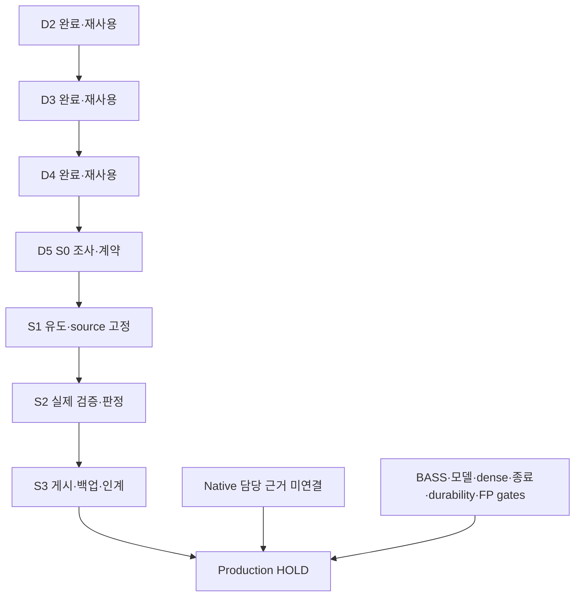

# VigilODE D5 — strict RHS/Jacobian callback 경계

작성일: 2026-10-25 KST. 연구 규약: physmath-research-loop 1.0.0.

## 1. 결과

**D5의 정의역·완전 쓰기·원자적 결과 반환 계약은 PASS_SCOPED다.** 새 Rust 시험
35/35가 통과했고, 729개 제조점의 6,561개 값은 독립 exact Fraction 기준과
모두 일치했다. 49개 시간차분의 관측 최대오차는 고정한 dyadic 입력에서 0이었다.
현재 scoped 검토의 열린 material finding은 0개다.

실제 구현한 것은 일반 in-process RHS/Jacobian을 위한 별도 opt-in 경계다.
정의역을 벗어난 입력을 호출 전에 거절하고, 모든 출력 항을 쓰는 callback에
NaN scratch를 제공하며, 성공한 유한 출력만 owned 값으로 반환한다. RHS와
Jacobian pair는 양쪽 모두 통과해야 반환한다. 시간차분은 두 represented time을
첫 RHS 호출 전에 검사한다.

**일반 Jacobian의 진실성·continuous dense 인증·native production 통합은 별도다.**
실제 J+I callback control은 유한한 full-write 출력이므로 interface를 통과했지만,
exact derivative oracle에서 틀린 행렬임이 확인됐다. 이 결과는 gate가 보장하는
범위를 정확하게 보여준다. Production은 HOLD, 전체 완료율은 null이다.

## 2. 최신 조사와 기존 성과의 재사용

Owner repository metadata51개와 종료 페이지를 확인했고, 직접 관련9개 repo의
branch1,643개·모든 상태 PR1,547개를 각 목록 끝까지 조사했다. 이는 metadata
전수 조회다. 모든 branch의 모든 source를 실행·감사했다고 해석하지 않는다.
선택한 현재 source, PR 본문, 중앙 댓글, 관련 구현은 실제로 읽었다.

| 조사 대상 | 확인한 현재 근거 |
|---|---|
| D4 PR87 | HEAD 3c8877ea0409495752dcfab42426e679e3ba92d3, 완료 상태 재사용 |
| Native frontier | aaf1f834d4c589e734ca7851a56c11bb44f7047a, 기존 주요4개blob 불변 |
| 중앙 PR222 | a28ba343bb85addf1a7e9e58e75816ed3b75cd3b, 앞선 D4 closeout에서4commits 전진; VigilODE handoff 변경 없음 |
| REC135/136 | thermodynamic block 완료와 stable-source K_s의 S0를 구분 |
| BASS188/189 | angular cohort 완료 결과와 positive-angular 준비 S0를 구분 |
| C21H/C21I | typed RPC/owned staging과 domain/provider/cache 패턴을 실제 source에서 확인해 재사용 |

현재 native 담당자·예약·live dirty·완료 receipt를 한 사슬로 연결한 새 근거는
확보되지 않았다. Commit author를 live 담당자로, preserve_prior_untracked를 clean
상태로 바꾸어 읽지 않았다. 다른 private 대화 도구는 실제 unavailable을 반환했다.
관련 중앙댓글9개+다음0 및 PR87댓글0+다음0을 확인했다.

백업 metadata는 VigilODE 제목230개, 지정 /BASS 폴더3,736항목, Dropbox 연구
subtree164항목 중 VigilODE38개, Drive 전용폴더41개를 확인했다. Private 목록
원자료는 공개 Git/과학 archive에 넣지 않았다. 이전 scratch 정리로 필요한 파일이
사라져 D4 S3와 final companion을 복구했고, 전체 archive bytes/SHA256 및
72+21 payload hash가 원기록과 일치했다. 복구를 위해 과학을 재실행하지 않았다.

조사는 SOURCE_SURVEY_KO.md, RELATED_REPOS_KO.md, RELATED_ADDITIONAL_KO.md,
BACKUP_SURVEY_KO.md에 근거와 범위가 있다. SciSpace1회, Exa2회와 원전3URL 조회를
사용했고, root는 Rust 공식 문서와 Neumaier 원전도 직접 읽었다.

## 3. 왜 이 구현을 선택했는가

기존 native `eval_rhs_into`는 caller의 buffer에 직접 쓰며, in-place
`dense_jacobian_into`는 callback 결과를 그대로 반환한다. 기존 API의 계약을
결함으로 재정의하지 않았다. 특히 `with_jacobian_into`는 이전 행렬과 고정
sparsity를 사용하므로, 미기록 항을 NaN으로 남기는 D5와 쓰기 계약이 다르다.

C21H에는 이미 완성된 RPC 응답을 검사한 뒤 RHS/행렬을 반환하는 경로가 있고,
C21I에는 model-specific domain/provider 검사와 cell-owned scratch가 있다.
D5가 staging이나 domain 검사 자체를 처음 도입한다는 주장은 하지 않는다.
이번 추가는 direct generic full-write, 공통 witness 아래 pair 반환, 일반
caller box와 양측 시간 stencil을 같은 Rust API로 구성한 것이다.

기존 Session의 begin/abort/snapshot/attempt cap, Transaction, output 준비/커밋,
immutable continuous model provider는 재구현하지 않았다. D4의 journal/ACK도
보존했다. Durable solver restore는 cap·pending lease·accepted prefix·ACK·source
identity를 함께 복원해야 하므로 별도 과제로 남겼다.

## 4. 이론과 코드의 대응

유한한 닫힌 box에서 입력 q=(t,y)의 membership을 검사한다. 비교는 finite
binary64 bit key를 사용하며 음수는 bits를 반전하고 비음수는 sign bit를 바꿔
정수 순서를 만든다. ±0은 비교에서 동등하고 실제 query bits는 바꾸지 않는다.
이 때문에 subnormal과 signed-zero의 정의역 판정은 FP control mode에 의존하지 않는다.

Callback 전후 witness는 expected epoch와 요구된 FP 환경을 관측한다. Witness는
관측 전용이어야 하고, 모델/FP 환경에 관측되지 않은 변경이나 ABA가 없다는 가정이
필요하다. Equality 검사만으로 임의의 mutable capture를 immutable하게 만들지는 않는다.

Callback은 caller의 이전 게시 값이 아닌 독립 scratch만 수정한다. 실패하면 그
scratch를 버리므로 이전 owned 결과가 유지된다. 모든 항을 NaN으로 시작해
미기록 항과 비유한 결과를 검출한다. Callback 진입 전에 작업량을 계수하므로
실패한 호출도 남으며, 외부 capture·파일·메시지 등의 부작용은 되돌린다고 주장하지 않는다.
Pair counter는 성공한 Prepared 반환 수다. Caller assignment나 solver accepted step
수는 아니다.

별도의 반환 보장은 callback/probe가 정상 반환하거나 명시적으로 잡힌 unwind로
끝나고, 필요한 destructor와 panic-payload drop이 정상 반환할 때 성립한다.
Nonreturning callback, process abort와 일반 crash recovery는 이 조건에 포함되지 않는다.

제조 모델은 무차원 두 species transfer/loss 식이다.

\[
k(t)=2+\frac12t^2,\qquad
f(t,x,y)=\begin{pmatrix}-3x+k(t)y^2\\3x-y-k(t)y^2\end{pmatrix}.
\]

\[
J=\begin{pmatrix}-3&2k(t)y\\3&-1-2k(t)y\end{pmatrix},\qquad
\partial_t f=\begin{pmatrix}ty^2\\-ty^2\end{pmatrix}.
\]

Transfer 항은 상쇄되어 `f1+f2=-y`다. 성분 합이 일정하다는 주장은 아니다.
비음수 경계의 안쪽 방향과 합의 감소는 exact solution의 단순체 성질을 준다.
이번 point corpus는 ODE 궤적을 적분하지 않았으므로 이 사실을 numerical positivity
또는 실제 BASS 검증으로 바꾸어 쓰지 않는다.

직접 유도한 state Taylor remainder는 `(k(t)*dy^2,-k(t)*dy^2)`다. 일반 계수의
`det J=lambda*mu`와 `det(I-hJ)=1+h(lambda+mu+2ky)+h^2lambda*mu`는 부호·비특이성
확인에 사용했다. Determinant만으로 conditioning bound를 주장하지 않는다.

대표점 `(t,x,y)=(1/2,1/4,3/4)`에서

\[
f=(57/128,-153/128),\quad
J=\begin{pmatrix}-3&51/16\\3&-67/16\end{pmatrix},\quad
\partial_t f=(9/32,-9/32).
\]

독립 손대수와 Wolfram15.0.1의 실제12개 exact residual group이 모두 일치했다.
기호 출력은 zero-check와 exact sample이며 임의 입력의 interval certificate는 아니다.

## 5. 실제 구현·검증 결과

실행한 source는 S1 commit
`0c73202734a52f30e4214d455be0fa9c47d37e0f`다. 변경된 plot source와 뒤에 추가한
saved-schema validator는 SOURCE_EXECUTION_IDENTITY.json에서 별도로 결속한다.

| 검증 | 실제 결과 | 의미 |
|---|---:|---|
| Gateway 계약시험 |30/30 PASS| partial write, 상태·환경·epoch·panic·counter·FD·sparse 호환 경계 |
| 기존 Session 조합시험 |5/5 PASS| accepted prefix, fatal/recoverable abort, 같은 attempt cap |
| 제조점 |729| t,x,y=i/8의9×9×9 grid |
| Point 값 |6,561/6,561 일치| RHS1,458 + J2,916 + Jv1,458 + 합잔차729 |
| 시간 stencil |49, 최대오차0| 고정된7×7 대칭 dyadic stencil, 값98개 |
| 사전 FD gate |1.4210854715202004e-14|64 epsilon scaled 기준, 사후 완화 없음 |
| Input/FD refusal |7+7| 해당 요청에서 RHS/J 진입0 |
| Wrong finite J control |1개 승인| J+I가 finite contract를 통과하지만 derivative 검산에서 틀림 |
| 저장 corpus |794행 /170,379bytes| SHA256 cb64d9455289f183363749289038d6f250bf63e0ab95ea94cd51defa88d2ba21 |

**828 RHS·730 Jacobian·3,168 witness와 금지 입력 진입0은 이 point/stencil corpus의
작업량이다.** 별도35개 계약시험의 callback 호출을 합산한 전체량이라고 쓰지 않는다.
성능 benchmark나 wall-time speedup도 아니다.

저장된 true-J를 transpose하면720/729행에서, off-diagonal 부호를 바꾸거나 J+I로
해석하면 각각729/729행에서 오류가 검출됐다. Transpose의 나머지9행은
`t=0,y=3/4`의 대칭 행렬이다. 이 세 결과는 저장된 값의 semantic mutation이며
compiled Rust mutant 실행은 아니다. 별도의 actual J+I callback pair는1개다.

원 exact oracle의 `zip()`은 malformed short array를 조용히 단축할 위험이 있었다.
같은 C9 pass에서 이를 찾아, 원 oracle·결과·로그를 보존한 채 독립 saved-schema
validator로 모든 shape, grid/stencil key coverage, refusal identity와 실제 값 개수를
검증했다. Short RHS/short FD/wrong grid index의3개 metadata control도 거절됐다.
**최종 근거는 REVIEW.json + SCHEMA_REVIEW.json을 결합한 REVIEW_BUNDLE.json이다.**
이를 위해 callback, Rust 시험 또는 원 수치 oracle를 재실행하지 않았다.

## 6. 실제 교정·실패와 자원

실행 전에 FD 산술보다 앞선 witness를 추가하고, domain 비교를 정수 bit order로
강화했다. 초기 source 바이트는 보존했다. 수학 검토에서 determinant의 귀결,
destructor 조건과 pair counter의 의미를 정확히 좁혔다.

Compiler 복구의 첫 시도는 official archive 두 component의 `manifest.in` 경로가
겹쳐 exclusive-write가 중단됐다. 이어 불완전 runtime의 loader도 시작하지 못했다.
두 로그와 부분 추출물을 보존하고, 동일 archive에서 기존 runtime73개를 byte
검증한 뒤 빠진11개만 보충했다. 실제 Rust1.94.1 version probe와 새 build는 성공했다.

첫 그림의 주석 접촉과 invalid stencil 라벨을 실제 PNG에서 확인해 두 표현만
고쳤다. 원 그림4개와 plot source를 보존했고 저장 결과 plot만 추가1회 실행했다.
과학 데이터와 tolerance는 바뀌지 않았다. 최종 두 PNG는 root와 C9가 실제로 읽었다.

새 D5 budget은 닫혔다. **총35.626779343961594초 /120초**, 그중 local computational
children16개가35.590950343961595초, Wolfram kernel이0.035829초다. 총17개 entry에
준비 실패·복구·build·시험·corpus·검산·두 plot·schema 확인을 모두 남겼다.
이는 계산 child/kernel 시간 합계다. 대화 전체 경과시간, API·백업 응답 대기는 별도다.

| 이전 닫힌 기록 | 그대로 보존한 초 |
|---|---:|
| D4 |25.906088458010345|
| D3 |35.897308696992695|
| D2 |25.104395919000012|
| Prior known |83.29566578299983|
| 별도 native boundary |14.951735806986107|

Older remaining=null, reset=false다. D2의15개 새 시험+31개 회귀,12개 제조 궤적,
15,182stage/2,212trial/Bernstein과 D3/D4의 완료 실행을 재사용했다. D2 endpoint-only
금지 RHS507회, guard 두 경로0회, 반감1,032attempts/5,323RHS와 rate cap602/4,816은
그대로다. 이들은 작업량 비교이며 wall-time speedup이 아니다. Scalar-linear[0,2]
인증과 비선형 cap의 heuristic 역할도 구분했다.

## 7. 안전 경계·검토·전체 목표

Production 두 crate의 forbid(unsafe_code)는 실제 source에서 확인했고 바꾸지 않았다.
새 gateway·시험·probe는 `-F unsafe-code`로 build했다. 원 MXCSR reader는 별도
research fixture에 있어, safe caller와 unsafe dependency의 경계를 분리했다.
전체 dependency tree가 unsafe-free이거나 production FP provider가 완료됐다는 뜻은 아니다.

수학 R6와 코드 C9는 서로 보완하는 한 검토 pass로 수행했다. 각 reviewer는 실제
source와 저장된 원자료를 읽었고 별도 과학 실행은0이었다. Independent personnel은
NOT_RUN이다. 현재 도구에서 실제 수행한 subagent 작업과 과거 D2의
native_subagent=NOT_RUN을 혼동하지 않는다.

S0는R1–R4/C1–C4, S1은R5/C5, S2는R6–R9/C6–C9, S3는R10/C10에 대응한다.
단계별 실제 Git/provider receipt는 delivery/와 STAGE_LEDGER.json에서 확인한다.
Scientific validity, execution, source identity, backup preservation과 production
승인은 각각 판정한다. 전체 목표의 분모가 닫히지 않았으므로 완료율은 null이다.

## 8. 전달·다음 행동

Draft PR은 [VigilODE88](https://github.com/cosmosapjw-quantum/vigilode/pull/88)이다.
S0/S1/S2 게시와 각 phase의 immutable archive는 실제 receipt로 결속한다. S2 commit은
3107693de084341129c47c592204225c9045aa2e이며95개 Git blob/size를 확인했다.
S3에서 append-only ledger L-0172를 더해168행을169행으로 늘렸다. 기존453,263바이트는
그대로 prefix로 보존한다. Ledger의 재현 source는 schema 보완을 포함한 S2이고,
실제 수치 실행 source S1과는 SOURCE_EXECUTION_IDENTITY.json에서 분명히 구별한다.
S0 Drive upload는920.8초 응답 대기 뒤 제어 대기를 중단했고 ACK/operationID가
없다. Exact filename/parent 조회1회는0건이었다. 이를 원격 실패나 사용자 취소로
단정하지 않으며 UNKNOWN_NO_ACK와 중복 재시도0을 유지한다. Library/Dropbox 등의
확인된 ACK와 구분하고 삼중 백업 완료를 추정하지 않는다.

실제 S3 CI run40156477518/job121058848743는 FAIL이다. Metadata checker 시험은
16+8=24개 PASS이고, 새 node와 append-only ledger169행도 PASS다. Authority는
8,261citations/896distinct 중 missing56distinct, 실제FAIL199occurrences다.
파일별로 D4 이전32/143, D4경로7/25, D5경로17/31이다. 이전 D4 CI snapshot38/152와
현재 D4경로는 다르다. D4 final delivery의 추가중앙HEAD/인용이 +1/+16을,
D5가 +17/+31을 더했다. D5 실패는 다른repo source pin 문맥이며 checker는 해당repo를
조회하지 않는다. 이 설명이 inherited 실패를 무효화하지는 않는다.
원 로그/실제 receipt는 CI_RESULT_KO.md와 evidence/CI_S3_RESULT.json에 있다.
Checker/allowlist를 수정하거나 CI를 재실행하지 않았다. Scoped science PASS와 CI green은 다르다.

다음 대화의 첫 행동은 현재 native 담당 source·예약·live dirty·완료 receipt의
실제 연결이다. 그 뒤 이번 strict adapter의 opt-in native 연결 위치와 진짜
미구현분을 확인해야 한다. 일반 callback의 derivative binding/continuous provider,
actual BASS, 유한 종료, durable restore와 production FP는 각 gate대로 남긴다.
또 다른 norm-only 노드나 다음 연구 루프를 자동 생성하지 않는다.

## 근거

- THEORY.md, CONTRACT.md, PREREGISTRATION.md 및 exact source/실행 identity.
- S2_RESULT.json, REVIEW_BUNDLE.json, 두 독립 검토와 원 로그.
- [Native problem](https://github.com/cosmosapjw-quantum/vigilode/blob/aaf1f834d4c589e734ca7851a56c11bb44f7047a/crates/rodas5p-integrators/src/problem.rs).
- [C21H bridge](https://github.com/cosmosapjw-quantum/bass_cr/blob/0ec4c55102766c40c554ffc6141eb08fba741c79/research/cr_c21h_vigilode_bridge_20261019/rust_bridge/src/main.rs).
- [C21I adapter](https://github.com/cosmosapjw-quantum/bass_cr/blob/26ab505dac2bfcb0cfd3d049f22bc408f4c86241/research/cr_c21i_callback_optimization_20261020/optimized_adapter.py).
- [Neumaier 원전](https://arnold-neumaier.at/ms/ode.pdf), [Rust catch_unwind](https://doc.rust-lang.org/std/panic/fn.catch_unwind.html).

## 9. S3 최종 전달 상태

**D5 local S0–S3=4/4, R1–R10+C1–C10=20/20을 scoped 완료로 닫았다.**
이 수치는 이번 연구 단위의 단계·전달 완료다. Global completion=null,
production=HOLD, independent personnel=NOT_RUN 및 native dependency 미해결은 유지한다.

| Phase | 실제 Git commit | Archive payload/bytes | 확인된 보존 | Drive |
|---|---|---:|---|---|
| S0 | 8b53c60c51bc3a0fdec7402ef3657236b11e3205 | 17/51,312 | Library+Dropbox ACK·filename·size PASS | UNKNOWN_NO_ACK |
| S1 | 0c73202734a52f30e4214d455be0fa9c47d37e0f | 60/132,856 | Library+Dropbox ACK·filename·size PASS | UNKNOWN_NO_ACK |
| S2 | 3107693de084341129c47c592204225c9045aa2e | 96/543,085 | Library+Dropbox ACK·filename·size PASS | NOT_ATTEMPTED_AFTER_TWO_UNACKNOWLEDGED_CALLS |
| S3 | 8c2a18c2c4706056e9bf9c7132aae419b787e5b3 | 105/565,668 | Library+Dropbox ACK·filename·size PASS | NOT_ATTEMPTED_AFTER_TWO_UNACKNOWLEDGED_CALLS |

각 ZIP CRC와 모든 manifest payload의 SHA256/size는 로컬에서 확인했다.
새 D5 archive의 원격 전체 bytes GET/SHA256 복원은 NOT_RUN이며 ACK/metadata와 구별한다.
S0와 S1 Drive는 각각 정확한 filename+parent 조회1회에서0건이었고 중복 업로드0이다.
두 요청의 ACK/opID 없는 대기 중단을 원격 실패·사용자 취소로 바꾸어 기록하지 않았다.
S2/S3 및 최종 companion의 Drive 전송은 더 시도하지 않는다.

새 전달 댓글은 중앙 PR222의6392739094와 부모 PR87의6392740056이다.
두 댓글의 실제 body를 게시 후 다시 읽어 정확히 일치함을 확인했다.
기존 D2/D3/D4 댓글은 중복하지 않았다. PR88은 Draft/open을 유지했다.

S3 과학 결과 commit은8c2a18c2c4706056e9bf9c7132aae419b787e5b3이다.
그 뒤의 최종 metadata commit은 source/원자료/closed budget/ledger를 바꾸지 않고
실제 CI·provider·댓글 receipt와 이 완료 기록을 연결한다. 자신의 commit ID는
해당 commit에 미리 넣을 수 없으므로 외부 delivery/FINAL_PUBLICATION.json과
최종 archive의 receipt에 기록한다. 최종 metadata CI는 skip 표시로 재실행하지 않는다.
