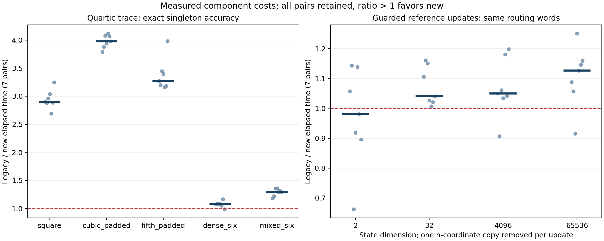

# VigilODE: dynamics·symbolic execution 독립 누적 검증

이번 연구는 PR97까지의 실제 소스를 비판적으로 검토한 뒤, **필요한 trace moment만 계산하는 경로**와 **guarded reference snapshot의 ownership transfer**를 구현·검증했다. 동일한 exact singleton 정확도에서 희소 trace 질의의 paired 중앙값은 기존 eager 평가보다 **2.90–3.98배** 빨랐다. Controller는 성공한 guarded reference 갱신당 n개 좌표의 두 번째 복사를 제거했으며, 시간 결과에는 개선과 회귀가 섞였다. **전체 production은 HOLD**다.

실제 과학 실행 source는 `58ec9b053163da6b6f0906010e0422c104db72fd`, 추가 integration/독립 saved-data audit source는 `c06b1ce5f04c86cb374071dcac7e83b7a100493c`다. 두 source 사이의 crates/Cargo.lock은 동일하다. 원격 게시·readback 뒤 실행했고 모든 recorder의 실행 중 source identity 검사가 통과했다. 최종 문서·원자료 게시 commit과 실제 실행 source를 구별한다.

## 최신 PR와 첨부를 어떻게 이어받았는가

사용자가 전달한 PR94 이후에 PR96 누적 검증과 PR97 RVJ 통합이 존재했다. 전달 commit에서 새 worktree를 만든 뒤 PR97 tip까지 fast-forward했다. 당시 main `8d0c79184e09efb5bdadc24a6315c60a71a44264`는 ancestor였다. PR90–94·96·97이 포함된 실제 tree를 검증했고 PR95는 별도 조건부 chemical derivative 이론으로 읽었다. 중첩 PR을 다시 cherry-pick하지 않았다.

`PRESERVATION.json`은 원래 **23 nodes /34 edges /8 suites /73 paths /10 interactions**와 frozen hash를 보존한다. 73개 경로 중66개는 원래 coverage pin과 byte identity가 같고7개는 이후 변경이 있다. 이는 inclusion bookkeeping이며 실제 test를 대체하지 않는다. 기존 negative evidence와 correction budget도 유지했다.

첨부 RVJ/NAG의 all-complex multiplicity trace, small-real cyclic branch, F5 global-count 의무를 구별했다. PR97의 39/64 및 cyclic contraction, 기존 two-envelope radius는 유효 범위에서 재사용했다. 새로 검토한 더 약한 rational bound를 중복 구현하지 않았다. PR95의
`F=b+Pz+(eᵀz)Qz`, `J=P+(eᵀz)Q+(Qz)eᵀ`와 quadratic remainder는 실제 source-rate/clock enclosure 및 full-model provider를 추가로 요구한다.

## 이론10단계 → 코딩10단계

이론과 코드의 실제 단계별 근거는 `WORKFLOW.json`, `THEORY_ADMISSION.md`에 있다. 독립 agent들이 최신 source/첨부, SciSpace·Exa의 1차 문헌, Wolfram 검산을 맡았다. 구현을 결정하는 lemma와 code contract를 부모가 승인한 뒤 코딩 agent에 전달했다. Dynamics R1–R10 문서는 그 시점에 완료되어 있었고, 보조 attachment/literature 문서는 코딩 중 최종 정리되었다. 순서를 문서 작성 시각과 혼동하지 않는다.

ODE dynamics 연결은 signed logarithmic norm이다. 고정 norm과 convex tube에서 `μ(Df)≤−λ`, residual `δ`이면 `E(s)≤δ/λ+(E0−δ/λ)e^(−λs)`이며 whole slab은 incoming/end envelope의 최대를 써야 한다. 이 조건과 부호가 현재 PR97 recurrence에 정확히 대응하는지 독립 검토했다.

Symbolic dynamics 연결은 실제 controller의 guarded labeled transition system이다. `prepare`가 pending snapshot을 덮어쓰고 `observe`가 동일 bits를 baseline으로 승격한다. Pending scratch만 관측 관계에서 제외한 R_pre/R_post induction으로 모든 합법적인 전환 이력의 guard·decision·baseline 동등성을 증명했다. 이 증명을 사용해 두 번째 vector copy를 swap으로 대체했다. 물리적 ODE phase-space의 Markov partition/approximate bisimulation은 incremental stability와 quantization 조건이 필요한 별도 과제다.

Trace에서는 `Tr(Σ c_k z^k)=Σ c_k Tr(z^k)`를 사용한다. 모든 coefficient interval을 먼저 검증하고, 정확히 영인 coefficient와 identically-zero S1만 제거한다. S0/S3는 상수, S2/S5는 선형이고 S4/S6만 a² 등의 중간값이 필요하다. 이전 코드가 쓰지 않는 S6 계산 때문에 거절하던 유한한 저차 출력4개를 회복했다. 필요한 S6 overflow는 여전히 거절한다. 모든 복소근과 대수적 중복도라는 target은 유지된다.

## 실제 검증

| 실행 범위 | 결과 |
|---|---|
| measurement coupled library |39 pass, benchmark1 ignored|
| measurement facade library |31 pass|
| 변경 package의 모든 integration target |53 binaries,375 pass,0 failed,0 ignored|
| coupled fat-LTO release library |동일39 methods pass, benchmark1 ignored|
| opt-in controller benchmark |ignored benchmark를 명시적으로1회 실행해 pass|
| Givens targeted contract |2 pass; 반환된3해 exact residual pass, 나머지3개 NO_RETURNED_SOLUTION|
| scoped all-targets check /rustdoc warnings |둘 다 exit0|
| 외부 Fraction companion audit |84 queries,164 returned exact singleton,4 old refusals 보존|
| archive byte verification |52개 원본 payload hash 전부 일치|

새 unit-test method는6개다. Controller test의15,552개는 encoded enumeration이며 terminal prefix가 반복되므로15,552개의 서로 다른 legal word라고 부르지 않는다. Release의39개는 measurement에 이미 포함된 method를 다른 profile에서 검증한 결과다. Full workspace/모든 optional feature/실제 client qualification은 이 표와 별도다.

Givens는 현재 measurement 환경에서 과거 기대 flag를 수정하지 않고 통과했다. Export한 A,b,x의 정확 유리수 residual은 요청된 threshold와 represented threshold를 모두 만족하며 오염시킨 해는 거절됐다. 이전 CI의 scale1e14 candidate Ok(3640) 차이는 profile/fixture 문제로 열린 상태다. 이번 결과로 이전 CI를 소급 PASS 처리하지 않는다.

## 정확도가 일치하는 비용 비교

Trace의80개 timed 입력은 양쪽 결과가 독립 exact companion 값과 같은 singleton이다. 총286,720 measured calls,20,480 warmup calls의 요청·완료 수가 일치하고 failure가0이다. 7회 ABBA/BAAB의 각 repeat 안에서 두 arm block 시간을 합친 뒤 old/new 비를 계산했다. 다음 표의 multiplication은 query당 interval 연산 수이며 hardware FLOP이 아니다.

| Query | paired 중앙값 old/new |7개 비의 범위|new가 빠른 pair|interval multiply/query|
|---|---:|---:|---:|---:|
| square | 2.900 | 2.694–3.250 | 7/7 | 11→2 |
| cubic_padded | 3.977 | 3.790–4.118 | 7/7 | 15→1 |
| fifth_padded | 3.274 | 3.160–3.983 | 7/7 | 15→2 |
| dense_six | 1.075 | 0.990–1.165 | 6/7 | 15→14 |
| mixed_six | 1.295 | 1.183–1.361 | 7/7 | 15→10 |

네 huge-parameter recovery case는 old arm이 거절하므로 시간비에서 제외했다. 전체 query-call에는 parameter/coefficient 생성, 검증, 연산, counter, 출력 소비가 포함된다. 공통 workload 구성4.727µs와 JSON 직렬화는 분리했다. 두 wrapper는 inline(never)이지만 실제 public cross-crate 호출 경계의 비용도 비교에 포함된다. 이 수치는 trace query 경로의 결과다.

Controller는 동일 routing word와 baseline bits를 유지한다. Guarded protected update에서 복사량은2n→n이다. 전체 prepare+observe와 두 buffer의 할당을 포함하여84개 paired block,24개 비측정 warmup을 수행했다. Synthetic receipt를 사용했으며 실제 RHS/ODE solve를 timing 안에 넣지 않았다.

| n | scenario |paired 중앙값 old/new|범위|new가 빠른 pair|
|---:|---|---:|---:|---:|
| 2 | candidate_only | 0.978 | 0.769–2.155 | 3/7 |
| 2 | guarded_protected | 0.981 | 0.663–1.143 | 3/7 |
| 2 | unguarded_protected | 1.016 | 0.822–1.108 | 4/7 |
| 32 | candidate_only | 0.999 | 0.924–1.062 | 3/7 |
| 32 | guarded_protected | 1.041 | 1.007–1.161 | 7/7 |
| 32 | unguarded_protected | 0.993 | 0.939–1.051 | 3/7 |
| 4096 | candidate_only | 1.018 | 0.837–1.066 | 4/7 |
| 4096 | guarded_protected | 1.050 | 0.907–1.198 | 6/7 |
| 4096 | unguarded_protected | 0.989 | 0.985–0.997 | 0/7 |
| 65536 | candidate_only | 1.046 | 0.953–1.098 | 5/7 |
| 65536 | guarded_protected | 1.127 | 0.916–1.251 | 6/7 |
| 65536 | unguarded_protected | 0.912 | 0.824–1.046 | 1/7 |

n=2 guarded case는 중앙값 회귀이고, n=4096/65536의 범위도1을 가로지른다. 복사 절감이 없는 unguarded65536 control도0.912배 중앙값을 보여, 이 호스트의 미세 timing을 일반적인 solver 가속으로 해석할 근거가 없다. 정확한 작업량 감소와 측정된 시간 분포를 함께 보존한다.

점은7개 paired 비, 짧은 선은 중앙값, 붉은 점선은동일시간이다. 오른쪽은 guarded protected case만 표시하며 나머지 control은 위 표와 raw data에 전부 남겼다. 서로 다른 패널의 y 범위를 같은 효과 크기로 읽지 않는다. 이 그림은 화면/큰 폭 보고용이며90mm 단일 열 인쇄에는 패널을 분리해야 한다.

## 실패, gate와 다음 실행

초기 toolchain 중복 추출의 disk exhaustion, sparse fixture 누락, example의 접근 불가능한 `Interval::constant` 호출 compile 실패를 보존했다. 부분 설치만 제거하고 현재 존재하는 Rust1.94.1을 실제 실행해 확인했다. 정확한 committed fixture를 복원했고 compile 오류는 source 게시 전에 교정했다. 새 native 결과의 실행환경은 독립된 새 target이며 기존 binary를 재사용하지 않았다. Registry cache build는 standalone vendor 검증을 의미하지 않는다.

전체 authority checker는 full materialized c06 tree에서57 missing으로 실패했다. 그중 이번 node의1개는 원문 검색 응답에 있던 TU Wien URL query token을 Git SHA로 읽은 것이다. 원문 bytes는 gzip+hash로 보존하고 typed binding으로 연결했다. checker/allowlist와 genuine inherited failures는 바꾸지 않았다. 최종 metadata 관측은 `METADATA_VALIDATION.json`을 기준으로 읽는다. Q-LEDGER는 미완료다.

최신 correction: R-STRUCT/R-ADAPT3/3, R-HOMO/I-PROD1/3,Q-LEDGER1/3,N03=2/3,N04=1/3,N05=2/3. N04의 owned-workspace 의무에 coupled snapshot reuse를 연결했으며 exhausted facade R-ADAPT를 다른 이름으로 다시 시작하지 않았다. N04 전체 session/FSAL/homotopy와 N05 전체 causal budget은 완료 처리하지 않는다.

다음 핵심 구현은 native trace whole-path certificate다. 이미 확보된 contraction 식에 original-field residual, domain tube와 rounding을 연결해야 한다. Q-API, prior Givens CI/profile, negative-cost evidence,10 interaction, full release/features/vendor, SUNDIALS/MPI와 실제 physical client gate도 남아 있다. F5 global count와 selected singular branch는 이 trace 최적화로 해결되지 않는다.

복사 가능한 다음 지시는 [LOCAL_CODEX_HANDOFF_KO.md](LOCAL_CODEX_HANDOFF_KO.md)에 있다. 실행/원자료/분석/검토 provenance는 RESULTS.json, SOURCE_BINDING.json, evidence/RAW_MANIFEST.json, reviews/와 MANIFEST.json에 연결했다.
