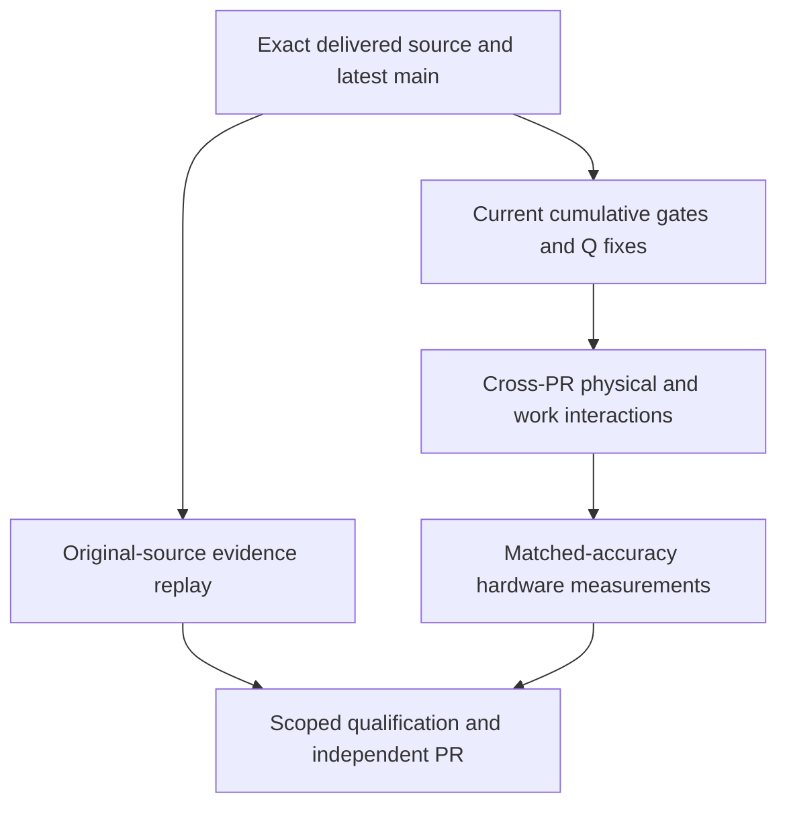
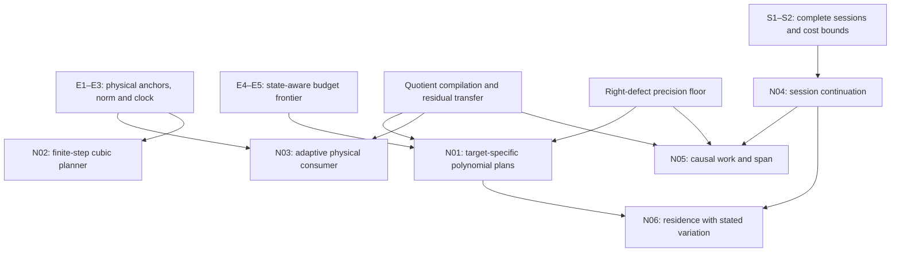

# Integrated research and independent cumulative validation

The executable source of the inherited development schedule remains
`../polyalgorithm_alternatives_20261028/LOCAL_DEVELOPMENT_PLAN.json`:
23 nodes, 34 edges, eight native suites and all existing correction budgets.
`INDEPENDENT_VALIDATION.json` adds explicit source/coverage/interaction contracts;
it does not replace the inherited graph or activate an unimplemented candidate.

## Independent validation layers

The later PR targets `main` and starts from the final delivered integrated
commit. PR90–93 are already in its ancestry. No merge of the old PRs and no
duplicate cherry-picks are needed. If current main has advanced, reconcile it
in the new worktree and qualify the actual final source. Source inclusion and
semantic preservation are different checks.

## Theory-to-implementation dependencies

This diagram expresses mathematical connections, not permission to skip the
inherited L-RELEASE/L-HARDWARE dependencies. Q-GIVENS, Q-FAIR-AB, Q-LINT and
Q-NEGATIVE precede L-RELEASE; Q-LEDGER, Q-BENCH and Q-API remain release-decision
obligations. Native builds, tests, benchmarks and profiles share the existing
lock; theorem development and disjoint edits may proceed in parallel.

## Purpose and decisive validation of each development PR

| Task | Purpose after integration | Decisive independent check |
|---|---|---|
| N01 | Reduce vector actions/reductions with target-specific fused polynomial, resolvent and eligible quotient plans | Original target, full residual, nonnormal negative case, complete setup/certificate cost versus strongest eligible comparator |
| N02 | Reduce admitted step count with the correct decay/discrete-map anchor and derived algebraic budget | Old/new planner crossed with identical root backend; all physical observations, grid minimality, rounding/clock floor |
| N03 | Compose structural endpoint error into a valid adaptive physical trajectory | Original full-space stage and flow oracle; named norm/clock/representation edges; valid exact/virtual stage tube |
| N04 | Keep winning probes and homotopy workspace alive with full state | Uninterrupted versus continued trace with same complete observation schedule, rejection history, epochs and global budget |
| N05 | Eliminate affine stage-vector recurrences and quantify generic causal work/span | Quotient exact/near relation, stored coefficient and evaluation defects, signed and absolute transfer, all worker results charged |
| N06 | Bound exploration and residence under explicit temporal variation assumptions | State-aware choice and retained negative switching/product examples; no claim beyond proved variation class |

Structural and adapter correction budgets remain 3/3; homotopy and the separate
integration-accounting task remain 1/3. N01–N06 and Q-* start at their existing
0/3. These extension contracts share the parent task budgets. A failed fourth
attempt is not authorized by giving a candidate a new name.

Current status: theory and registered finite supporting checks are complete;
native implementation of these extensions and cumulative local qualification
are pending. The 73-path, 18-gate and 10-interaction mapping is a plan, not a
passing test report.
