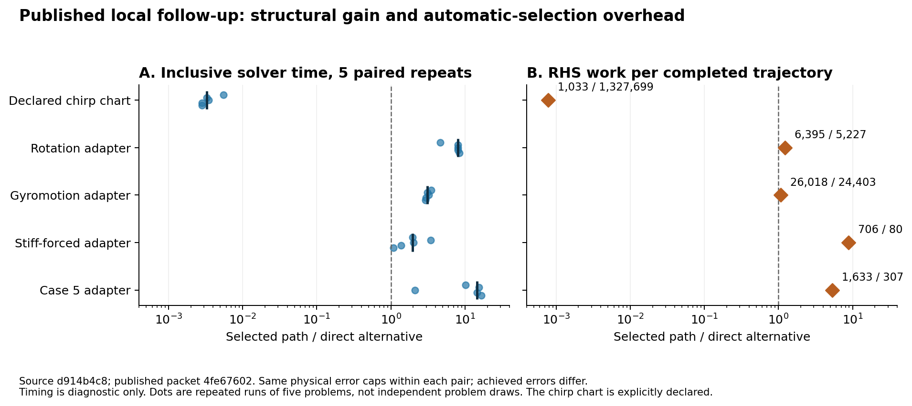
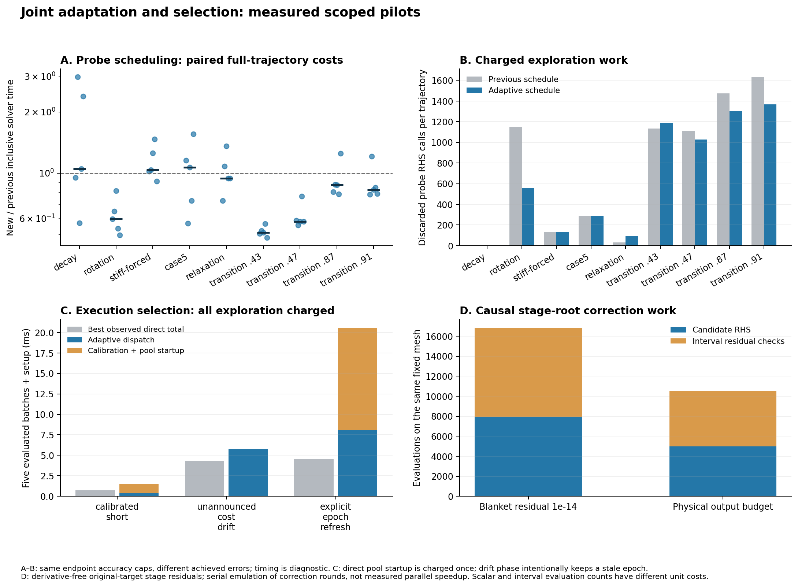

# VigilODE: 적응 제어와 구조 기반 선택의 통합 연구·재감사

2026년 10월 25일. 기준 브랜치 `research/adapter-local-followup-20261025`, 기준 commit `4fe67602502440d76aa9dd245c6b1d67558c14bf`.

## 판단과 연구의 초점

VigilODE에는 고유한 인과적 단계 풀이, 다항식 몫대수, Fourier 경로, 구조적 chart, homotopy 구현과 연구가 남아 있다. 현재의 병목은 이들을 한 이름으로 묶는 데 있지 않다. **어떤 구조가 현재 유효한지, 그 구조의 오차가 원래 상태에 얼마나 증폭되는지, 그 구조를 쓰는 총비용이 얼마인지**를 적응 제어기와 선택기가 같은 기준으로 판단해야 한다.

이번 연구는 최신 로컬 변경을 그대로 이어받아 세 연결을 구현했다. 불리한 방법에 대한 반복 시험을 줄이되 문제의 변화에 따라 재평가하는 선택 정책, 물리적 비교 조건과 실행 비용을 결속하는 공통 비교 계층, 원래 단계 방정식의 잔차를 출력 오차 예산으로 변환하는 causal API다. 기존 기본 동작은 유지하고 새 경로를 명시적으로 선택하도록 했다.

범용 production 사용에 대한 판단은 여전히 **HOLD**다. 자동 선택의 관측 비용은 아직 실제 시간의 완전한 모형이 아니며, 모든 구조 제공자를 연결한 일반 registry와 지속 implicit 세션이 남아 있다. 이번에 확인한 기능은 개별 검증 범위에 따라 채택한다. 이는 고유한 알고리즘의 폐기가 아니라, 검증된 구조가 효과적인 위치에서 실제로 선택되도록 만드는 개발 단계다.

## 1. 최신 소스와 기존 근거의 감사

원격의 후속 변경 3개를 반영했고, 가져온 51개 파일의 Git blob SHA와 전체 tree `8bab954cffcf7abd9cdd0ca528567ece47e43bc7`를 확인했다. 이전 작업의 checkout·결과는 보존했다. 별도 BASS/REI 연구 계열 `72836e0…`는 이미 감사한 동일 버전의 단계 전 domain 검사, 물리 norm lift, 수락 후 효과 반영 및 replay-safe callback 계약을 재사용했다. 해당 응용의 성과를 일반 ODE 성능 수치로 합산하지 않았다.

최신 로컬 측정 소스는 보고서 commit과 구별되는 `d914b4c8a53405ea846f710e07f77fff5f45b16f`다. 공개된 50개 행·25개 비교쌍의 오차 상한, identity, 비용 합계와 원자료 manifest 연결을 다시 계산했다. 이 검사는 게시한 자료의 일관성을 확인한 것이며, 사용자 컴퓨터에 있는 대용량 원자료 바이트의 재열람은 아니다.

자동 wrapper를 사용한 네 문제의 20개 반복 비교에서는 모두 직접 지정한 대안보다 비용이 컸다. 선언된 chirp chart의 5개 비교는 별도 특화 결과다. rotation에서는 총 RHS 증가 1,168회 중 1,150회가 버린 RODAS pilot에 해당했다. 따라서 해당 결과의 주원인은 잘못된 implicit 경로에 머무르는 현상보다 **유용하지 않은 탐색을 반복한 비용**이다. 작업량 비율만으로 전체 시간 차이를 설명할 수는 없다.

오탐은 다음 네 종류로 구분해야 한다.

| 종류 | 관측 단위 | 필요한 근거 |
|---|---|---|
| 구조·정확도 부적격 후보의 승인 | 한 수치 후보 | 원래 방정식·오차·domain·epoch 검사 |
| 경제성이 없는 실제 방법 전환 | 같은 checkpoint의 결정 | 같은 물리 출력 조건에서 후보와 대안의 비용 |
| 이득 없는 탐색 호출 | discarded pilot | 탐색 총비용, 이후의 재사용 이득 |
| 전체 실행의 초과 비용 | 완성된 trajectory | 공통 오차 상한, 준비·탐색·전환을 포함한 비용 |

20/20이라는 전체 실행 결과를 개별 전환의 오탐률로 바꾸지 않았다. 로컬 보고서의 `selected_route_counts`에는 버린 pilot도 들어 있으므로 실제로 채택한 방법의 점유율과도 구별했다. 상세 재계산은 [게시 근거 감사](evidence/PUBLISHED_SELECTION_AUDIT.json)에 있다.

## 2. 고유한 알고리즘의 현재 위치

| 구조 | 실제 남아 있는 구현 | 이번 연결과 후속 적용 |
|---|---|---|
| Augmented causal Rosenbrock | 공유 투영 공간, 엄격한 단계 인과성, 작은 공통 연산자 풀이 | 단계별 Newton 비용을 줄인다. 현재 기저 구성의 JVP와 작은 LU는 유지된다. |
| 완전 무미분 구조 경로 | chirp/cofactor chart, Lawson, quotient flow, 명시 RK | 원래 상태의 오차와 구조 identity를 먼저 확인한 뒤 경제성을 판단한다. |
| Homotopy·동시 Picard | 원래 목표 잔차 검사, 잔차 우선 보정, stage 병렬 실행 | λ<1의 작은 잔차 대신 λ=1의 출력 교란 예산으로 종료한다. |
| 다항식·대수적 축약 | 최소 다항식 역원, conditioned polynomial, Laguerre adjoint | 실제 h에 따른 유효 영역과 필요한 보정 횟수를 선택기에 전달한다. |
| Involution·Fourier·convolution | ±sector 표현, harmonic 후보, padding·원래 목표 인증 | carrier를 없애는 charge와 남아 있는 빠른 항을 구별한다. |
| 병렬 실행 | 독립 IVP·data·stage 실행 계층 및 실제 ensemble adapter | method·chart·norm·provider·작업량 변화 뒤에는 오래된 시간 자료를 폐기한다. |

현재 모든 경로가 완전 Jacobian/matrix/Newton-free인 것은 아니다. `AutomaticOde`의 기본 도함수 권한은 금지이며, 제공된 JVP 또는 유한차분의 사용은 별도 허용이 필요하다. 완전 무미분 후보가 불리한 위치에서 선택적으로 JVP를 사용하는 목표를 달성하려면, 이 권한과 **실제 후보의 성능 비교**를 함께 유지해야 한다. 일반 비선형 문제에서 자동으로 정확한 chart나 최소 다항식을 찾아주는 기능은 아직 없다.

과거 아이디어 14개와 소스 25개의 대응은 [재사용 지도](history/REUSE_KO.md), [기계 판독 지도](history/REUSE_MATRIX.json)에 정리했다. 과거 Fourier 실험의 제한된 실패를 전체 방식의 실패로 확대하지 않았고, 다항식 후보의 비교군에는 이미 있는 LU 재사용 경로를 포함하도록 했다.

## 3. 수학적 연결

### 3.1 인과성을 이용한 유한 오차 전파

원래 단계식을 $W_i u_i=b_i(u_{<i})$로 놓고, 유효 영역에서 $\|W_i^{-1}\|\le M_i$, 이전 단계별 Lipschitz 계수를 $L_{ij}$라고 하자. 원래 목표에서의 잔차 상한 $\rho_i$로부터

$$
d_i=M_i\rho_i,\qquad B_{ij}=M_iL_{ij}\;(j<i),\qquad
E_i=d_i+\sum_{j<i}B_{ij}E_j
$$

를 계산하면 $\|\widehat u_i-u_i\|\le E_i$다. 단계식을 빼고 이전 단계의 상계를 대입하는 귀납법으로 증명된다. 엄격한 하삼각성 때문에 $B^s=0$이며

$$E=(I-B)^{-1}d=\sum_{k=0}^{s-1}B^k d.$$

따라서 전체 수축률이 1보다 작다는 조건 없이 유한한 상계를 계산할 수 있다. 출력 가중치 $w\ge0$에 대해 $w^TE$를 계산하는 비용은 단계 수 $s$에 대해 $O(s^2)$, 추가 workspace는 $O(s)$다. 새 `causal_budget` 구현은 caller buffer와 outward 연산을 사용하며, 실제 잔차·역연산자·Lipschitz 상한의 타당성은 구조 제공자가 맡는다.

### 3.2 불필요한 근 정밀도를 줄이는 adjoint 예산

$$\sigma=(I-B^T)^{-1}w,\qquad w^TE=\sigma^Td.$$

이는 전진 오차 전파를 뒤로 전달한 출력 민감도다. 양의 영향도가 있는 단계 수를 $m$이라 하면 $d_i\le\tau/(m\sigma_i)$는 출력 교란을 $\tau$ 이하로 유지하는 충분조건이다. 모든 단계의 잔차를 같은 작은 수로 만들 필요가 없다.

추가로 정밀도 비용 모형이 $a_i\log(D_i/d_i)$이고 내부 최적해가 존재하면, 제약 $\sum\sigma_i d_i\le\tau$ 아래의 최적 배분은

$$d_i^*=\frac{\tau a_i}{\sigma_i\sum_j a_j}$$

다. 라그랑주 승수 조건 $a_i/d_i=\lambda\sigma_i$와 예산 등식에서 직접 얻는다. 현재 코드는 보수적인 영향도 기반 허용량을 제공하며 비용 가중 배분은 다음 개발 대상으로 둔다.

시간 적응에는 주해 출력의 교란과 embedded 차분의 교란을 함께 포함해야 한다. 이번 pilot은 $|b_i|+|b_i-\widehat b_i|$ 및 두 재구성 오차의 합을 사용한다. 정확한 단계법의 국소 오차가 $O(h^{p+1})$이고 이 추가 교란도 $O(h^{p+1})$이면, 안정한 전진 사상에서 누적 오차는 $O(h_{\max}^p)$를 유지한다. 이 연결의 증명과 전제는 [전체 유도](theory/DERIVATIONS_KO.md)에 있다.

### 3.3 대수적 구조와 step size의 직접 결합

선언된 연산자 $A$의 최소 다항식 $p$에 대해 $\gcd(1-h\gamma x,p(x))=1$이면, 다항식 Euclid 알고리즘으로 $(1-h\gamma x)q(x)\equiv1\pmod p$를 구할 수 있다. 따라서 $(I-h\gamma A)^{-1}=q(A)$다. 차수 $d$가 작고 구조 연산자 작용의 비용이 $O(n)$이면 한 RHS에 대한 적용 비용은 $O(dn)$이다. 이는 구조가 주어진 경로의 계산량 감소이며, 임의의 Jacobian을 만드는 비용을 없앴다는 뜻은 아니다.

감쇠 지배 구조 $A=-\alpha I+E$, $\|E\|\le e$에서는 간단한 전처리 후 결함 상한이

$$\eta(h)=\frac{h\gamma e}{1+h\gamma\alpha}$$

가 된다. 목표 $\eta_*<1$에 대해 $e\le\eta_*\alpha$이면 모든 양의 h가 내부 풀이 조건을 만족하고, 그 외에는

$$h\le\frac{\eta_*}{\gamma(e-\eta_*\alpha)}$$

가 충분하다. 제어기가 h를 바꿀 때 구조 상한을 그대로 사용해 재사용 가능 여부와 필요한 보정 횟수를 갱신할 수 있다. 시간 이산화의 정확도 조건과 내부 풀이의 적격 조건을 각각 계산한 뒤 함께 만족시킨다.

### 3.4 비용 근거가 뒷받침하는 선택

같은 물리적 비교 조건에서 기존 경로의 비용이 $[L_i,U_i]$, 후보가 $[L_c,U_c]$에 있고, 앞으로 드는 전환 비용이 $T$, 비교 기간이 $N$회라 하자. 다음 조건이면 그 기간에서 요구한 이득 $\zeta$를 보장한다.

$$U_c+T/N\le(1-\zeta)L_i.$$

양변에 $N$을 곱하고 실제 비용을 각 구간으로 감싸면 증명된다. `compare_qualified_costs`는 identity·단위·출력 자격을 먼저 확인하고 경계 계산을 보수적으로 수행한다. 이미 지출한 calibration 비용은 미래 경로 선택에서 다시 차감하지 않으며, 전체 실행 비용에는 한 번 포함한다.

이 정리의 보장은 비용 구간이 실제 미래 비용을 포함한다는 전제에 따른다. 실제 timing의 min/max는 `EmpiricalTiming`, 실제 작업량은 `ObservedWork`로 유지한다. 현재 측정 표본만으로 확률적 오탐 상한을 부여하지 않았다. 이전 근거를 버리는 규칙과 같은 checkpoint 재비교가 현재 구현에서 가능한 오판 감소 장치다.

## 4. 구현과 검증 범위

`SwitchingConfig::adaptive_evidence`와 `AutomaticOde::solve_adaptive`는 정상적인 구간에서 불리한 implicit 시험의 간격을 늘린다. 작업량/진전 시간의 증가와 다음 h의 감소가 함께 나타나거나, 거절 양상이 악화되면 비교를 갱신한다. 반대 방향의 변화도 초기 과도구간의 종료를 뜻할 수 있다. 이때는 새 endpoint에서 시작하는 다음 수락 prefix의 비교를 예약하여, 이미 지난 과도구간의 비용으로 현재 후보를 다시 배제하지 않도록 했다. 유한한 batch 수 이후에도 재평가 기회를 유지하여 초기의 불리한 시험이 전체 실행의 영구적인 배제가 되지 않도록 했다. 이는 물리적 강성의 증명 대신 후보의 관측 적합도를 다룬다.

새 정책의 explicit→implicit 진입은 같은 checkpoint와 이미 수락된 prefix에서 비교한다. implicit→explicit 복귀에서는 이전 창의 비용을 시험의 계기로만 쓰고, 현재 같은 창의 RODAS 비교가 성공해야 전환을 승인한다. RODAS 비교가 더 유리하면 그 수락된 결과를 실제 진전으로 사용한다. 버린 시험·실패·비교 비용은 모두 전역 attempt 한도에 포함한다.

`AdaptiveBatchExecutor`의 새 context API는 chart, mesh, 물리 norm, tolerance, provider, window와 실행 환경을 결속한다. 선택한 실제 경로의 비용이 기존 관측 범위에서 연속적으로 벗어나면 근거를 만료시키고 다음 결정에서 보수적인 경로로 돌아간다. 재보정은 replay-safe 호출을 통해 명시적으로 수행한다. 정상 호출의 내부에서 사용자 callback을 몰래 반복하지 않는다.

`assess_causal_budget`는 λ=1, 동일한 상태·t·h·operator·chart·norm identity를 요구한다. 이 API는 계산된 잔차를 원래 출력 교란으로 바꾸며 ODE 전체의 embedded 추정치를 엄밀한 전역 오차 상한으로 바꾸지는 않는다. stage 병렬 보정 pilot은 실제 DOPRI tableau와 비선형 RHS를 사용하지만, 병렬 round의 실행은 순차 에뮬레이션이다.

기본 동작을 유지한다는 것은 외부 Rust 코드의 완전한 소스 호환성을 뜻하지 않는다. 공개 설정의 새 필드와 enum 분기 때문에, 모든 필드를 직접 나열한 외부 struct literal이나 exhaustive match는 갱신이 필요하다. 저장소 내부의 설정 생성부는 `..Default` 또는 factory 갱신 문법을 사용하며, 관련 미빌드 예제도 읽기 전용으로 검사했다. 외부 의존 프로젝트의 실제 컴파일은 후속 출시 검증에 포함한다.

## 5. 새 실행 결과

최종 측정과 검사 수치는 [검증 기록](VALIDATION.json), [통합 실행 요약](evidence/NATIVE_PILOT_SUMMARY_FINAL.json)에 수록한다. 이전 로컬 호스트와 이번 실행 호스트의 시간을 직접 연결하지 않는다. 각 pilot 내부의 비교는 동일 바이너리·같은 호스트·공통 물리 오차 상한에서 수행하며, 방법 전체와 스레드 전체의 조합 탐색 대신 새 선택 정책, 이전 정책, 유력한 직접 대안을 비교한다.

234개 facade 시험(29개 suite), 정확한 유리수에 의한 이론 검산 5,365개, 독립 native 산술 검산 994개가 통과했다. 최종 선택 pilot은 9개 문제·3개 경로의 162개 process를 실행했다. 각 경로의 warmup을 제외한 135개 측정 모두 목표 시각에 도달하고 선언된 원래 상태 endpoint 오차 상한을 만족했다. 작은 실행시간에는 공유 호스트의 변동이 있으므로 작업량과 시간을 함께 제시한다.

| 문제 | 이전 정책 RHS | 새 정책 RHS | 직접 대안 RHS | 새/이전 시간 비율¹ |
|---|---:|---:|---:|---:|
| case5 | 1,887 | 1,311 | 427 | 1.069 |
| decay | 79 | 79 | 73 | 1.052 |
| relaxation | 749 | 813 | 462 | 0.943 |
| rotation | 6,395 | 5,804 | 5,227 | 0.594 |
| stiff-forced | 706 | 706 | 80 | 1.035 |
| transition-43 | 173,988 | 30,480 | 8,802 | 0.510 |
| transition-47 | 162,308 | 31,122 | 8,758 | 0.578 |
| transition-87 | 46,270 | 30,694 | 8,351 | 0.873 |
| transition-91 | 34,749 | 30,215 | 8,301 | 0.829 |

¹ 같은 반복 번호의 총 solver 시간 비율을 구한 뒤 5쌍의 중앙값을 취했다. 1보다 작으면 이번 관측에서 새 정책이 저렴하다. 직접 대안은 rotation·decay의 DOPRI와 나머지 문제의 RODAS다. 적분 이외의 프로세스 시작·JSON 출력 시간은 solver 시간에서 제외하고 별도 영수증에 남겼다. 선언한 허용오차와 공통 endpoint 상한을 사용한 비교이며, 달성 오차를 완전히 맞춘 연속 오차곡선은 아니다.

**회전과 늦은 전이.** 회전에서 버린 RODAS 비교는 6회에서 3회, 해당 RHS는 1,150에서 559로 줄었다. 새 정책의 전체 시간 비율 중앙값은 이전의 0.594다. 그러나 직접 DOPRI와 비교하면 여전히 5.21배가 소요된다. 탐색 감소는 확인했지만 wrapper의 전체 비용을 충분히 해소하지는 못했다. 초기 불리한 비교가 lifetime 한도를 소진한 뒤에도 후반의 강성 전이를 다시 감지하여 implicit 경로로 진입했다. 수정 후 처음 사용한 전이 위치 0.43·0.87에서도 그 효과가 유지됐다. 이는 같은 매끄러운 전이 계열의 추가 검사이며 별개의 넓은 문제군 검증은 아니다.

**과도구간의 비교 위치.** case5의 첫 구현은 2,463 RHS로 이전 1,887보다 비쌌고, 완화 감지 직후 같은 prefix를 재비교한 수정도 2,763으로 실패했다. endpoint의 새 상태를 다음 비교 시작점으로 사용한 최종 수정은 1,311 RHS로 줄였다. 임계값을 재조정하지 않고 관측의 시간 위치를 바로잡은 결과다. 다만 총시간 중앙값은 이전 0.369166 ms, 새 0.369637 ms로 거의 같으며, 이 문제의 벽시계 가속을 주장하지 않는다. 첫 실패와 두 수정의 자료는 각각 보존했다.

**복귀 비교의 비용.** relaxation에서는 같은 checkpoint의 실제 RODAS 비교를 추가하면서 64 RHS가 늘어 총 813이 됐다. 이 비용은 서로 다른 구간의 오래된 작업률만으로 방법을 바꾸는 오류를 줄이기 위해 지불했다. 전환 2회와 endpoint 결과는 유지됐다. 보다 저렴한 자격 확인과 탐색 비용 상한이 후속 과제다.

**출력 영향도에 따른 단계 보정.** 비선형 `y′=-y³`의 고정 256스텝에서, 원래 목표 interval 검증을 포함한 평가 횟수가 16,818에서 10,513으로 37.49% 줄었다. 보정 round는 1,018에서 533으로 줄었다. 새 방법의 최대 단계 출력 교란 상한은 9.8455×10⁻¹⁰으로 예산 10⁻⁹ 이내이고, endpoint 오차는 2.0316×10⁻⁹였다. 일률적인 10⁻¹⁴ 잔차를 요구한 대조군은 훨씬 작은 endpoint 오차를 얻었다. 필요한 정밀도 이상을 계산하는 비용을 줄인 관측이며 같은 달성 오차에서의 우위는 아니다. 순차 RK는 1,792 RHS로 더 저렴하므로 작은 scalar에서는 그대로 선택한다. round 병렬성은 순차 에뮬레이션이며 실제 병렬 가속 수치가 아니다.

**실행 선택.** 64개 logistic ODE의 세 단계 시험에서 출력 순서·수치 parity·endpoint 상한은 모두 유지됐다. 비용 변화가 명시적으로 통지되지 않은 경우도 관측을 만료시켰다. 그러나 calibration과 pool 생성까지 포함한 adapter 총시간은 각각 1.520·5.759·20.545 ms로, 해당 직접 병렬 경로의 0.702·4.302·4.539 ms보다 컸다. 명시적으로 요청한 calibration이 짧은 실행에서 회수되지 않는 점, 근거를 폐기한 뒤 보수적으로 직렬에 머무르는 점이 비용 원인이다. 따라서 drift 감지의 성공과 경제적 선택의 성공을 구별하고, 기본 경로 승격은 보류한다.

세 pilot을 합쳐 통계적 오탐률을 만들지 않았다. 이번에 직접 확인한 것은 stale identity 거절, 동일 구간 비교, 실패 비용의 보존, 반복 탐색 감소 및 특정 전이에서의 선택 회복이다. 확률적 오탐 상한은 유효한 미래 비용 모형과 별도의 평가 집합이 마련된 뒤 논할 수 있다.

## 6. 남은 병목과 구체적인 다음 개발

1. **지속 implicit 세션.** 현재 RODAS는 창마다 시작 비용을 다시 지불한다. 수락된 상태·동일 callback/operator epoch에서 controller·workspace·허용된 분해 재사용을 유지하고, 사건·chart·provider 변경 시 폐기한다. 단일 연속 실행과 창 분할의 출력·회계 계약을 먼저 비교한다.
2. **causal prefix의 재평가 생략.** 엄격한 인과성에서 앞 단계가 고정되면 그 뒤 갱신에서도 값이 바뀌지 않는다. `causal.rs::picard`의 이미 고정된 단계 RHS와 검증용 목표를 재사용하되, 후보 값이 바뀌면 잔차의 차 연산은 갱신한다. 기존 전체 round와 단계근·원래 잔차의 비트 일치, callback 순수성·epoch, 실제 작업량을 검증한다.
3. **구조 제공자 registry.** chart·Fourier·Laguerre·quotient·causal 후보를 하나의 실제 물리 오차와 capability 계약으로 등록한다. 구조 조건이 충족되지 않는 후보는 비용 시험 전에 제외하고, 무미분 후보의 관측 성능이 불리한 경우에만 허용된 JVP 경로를 시험한다. 현재 front door는 허용된 implicit 제공자를 선행 검사하므로, 그 후보가 없어도 명시법으로 풀 수 있는 문제를 거절할 수 있다. 후보의 가용성 검사와 전체 실행의 입력 검사를 분리해야 한다.
4. **비용과 탐색 예산.** RHS 횟수와 JVP/선형 풀이의 단순 가중합을 실제 구간 비용으로 보정한다. 미래 probe 비용의 상한을 선예약하는 credit 정책을 구현하면 매 접두 구간에서 $C_{probe}\le B_0+\epsilon C_{productive}$를 유지할 수 있다. 현재 구현된 backoff와 이 후속 비용 비율 보장은 구별한다.
5. **일반 물리 norm과 연속 출력.** 현재 특화 chart의 물리 재구성과 phase 오차를 같은 비교 계약으로 일반화한다. 사건·비가환 carrier·겉보기로 작은 embedded error·강한 비정규성에 대한 별도 대조군을 유지한다.
6. **실제 큰 RHS의 실행 선택.** ensemble의 효과를 stage/data 병렬화로 이전하지 않는다. 같은 실제 callback에서 순차 경로와 유력한 병렬 분할 하나를 비교하며, stale 근거·변화하는 비용·중첩 실행이 만드는 손실을 계측한다.

각 과제의 코드 위치, 선행 의존성, 실패 조건과 수용 기준은 [NEXT_STEPS.json](NEXT_STEPS.json)에 있다. 후속 벤치마킹은 실제 선택과 같은 checkpoint 대안의 차이를 조사하고, 더 좋은 대안이 발견되면 **부적격 판정·변화 감지·비용 추정·탐색비용·전환비용 중 어디서 손실이 생겼는지**를 기록한다.

## 참고와 재현

이전 연구의 유효한 과학 실행은 재사용했다. SciSpace·Exa로 확인한 원전과 실제 열람 범위는 [출처 목록](theory/SOURCE_LEDGER.json), Wolfram 대수 검산과 첫 평가의 복구 기록은 [기호 계산](sources/WOLFRAM_CHECK.json)에 있다. 잔차 기반 제어와 PI/PID 안정성은 [Ranocha–Giesselmann](https://arxiv.org/html/2307.12677v3), 연속 defect의 효율적 검사는 [Enright–Hayes](https://www.cs.toronto.edu/~wayne/research/papers/enright.pdf)와 연결했다. 여기서 제시한 새 연결의 유도와 구현은 해당 원전의 주장과 구별했다.

실제 명령·compiler·출력·종료 상태는 `validation/`에 보존했다. 초기 시험의 타입 추론 오류와 디스크 부족의 linker/기록 실패도 남겼다. 재생성 가능한 빌드 캐시를 정리하고 디버그 심볼을 줄여 복구했으며 Cargo.lock은 변경하지 않았다. NCP나 사용자 로컬 실행에는 접속하지 않았다. 로컬 후속 실행은 [LOCAL_CODEX_HANDOFF_KO.md](LOCAL_CODEX_HANDOFF_KO.md)를 따른다.
