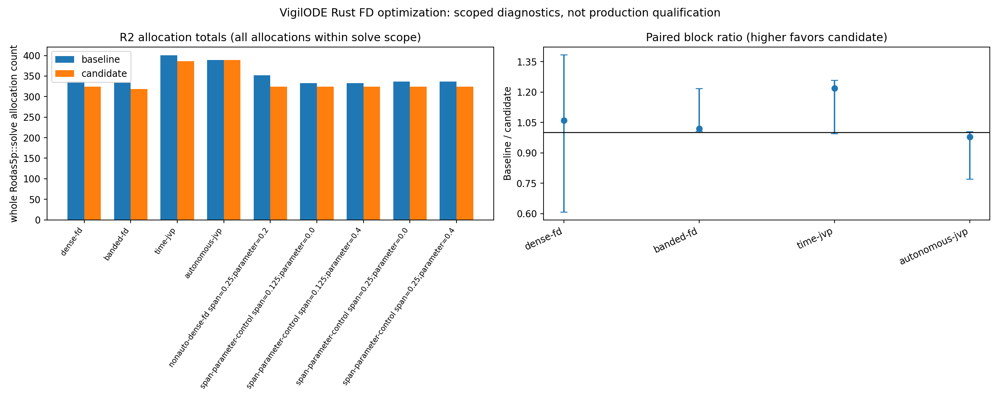

# VigilODE Rust FD 최적화 R2 결과

## 범위와 판정

R2는 dense/banded finite-difference scratch 재사용과 비자율 time-FD 경로를 같은 release 바이너리 프로토콜로 비교한 제한된 진단이다. 판정은 **SCOPED_DIAGNOSTIC_COMPLETE / broad production HOLD**다. timing은 `diagnostic_only`이며, 이 자료만으로 범용 solver 성능·production 승격을 주장하지 않는다.

Baseline source `80bd038a13a3623e6220b9725d5c1ad4f7611fcf`; candidate source `a682f609a1f2db1da714bea6da671b362f56baf4`, tree `6ea3f7ee53338f59fb2ecdda04b357ea6f4640c9`. Probe binary SHA256 `336afdc12200e0eee6d738c10b1cba7350bb079f4afda3a70911267de301d5fa` → `f38378460b2c72f09e4bb07812ba4a979ed19082f013d4c560ac40b76d536dce`; Rust `1.94.1`, CPU `AMD Ryzen 9 5900X 12-Core Processor`, CPU affinity `0`, one solver thread. Full identity and raw input hashes are in `SUMMARY.json`.

## Source 및 test bytes

아래 해시는 Git에서 고정 candidate commit으로 읽은 구현 및 contract test 파일 byte identity다. Test 실행 source identity와 stdout/stderr/receipt SHA는 `SUMMARY.json`에서 연결한다.

| 경로 | SHA256 (candidate source a682f609...) |
|---|---|
| `crates/vigilode/src/fd.rs` | `a216adc2377da6821fd34b4f23a01a3534197d85f6973af7caec6f3e0b5fec9a` |
| `crates/vigilode/src/solve.rs` | `05156e2ced9df3ffa4846f39c39e7f59576e884fd442a0eb12d894a8176c2007` |
| `crates/rodas5p-integrators/src/problem.rs` | `f8da89e24e532c208b84711b5bbaa4c0c3a213ff5cdc90c8b9d7c53e6583365d` |
| `crates/rodas5p-integrators/src/rodas5p_fast.rs` | `93cd4ac3b3a7e27dafae58d9188050b8eb75fdf93b1e4320427cff52ce774da7` |
| `crates/rodas5p-integrators/src/rodas5p_matrix_free_fast.rs` | `53f5a15e02e32b291962200d8bf75c457c719badcda6149ad6c856e64abc8794` |
| `crates/vigilode/tests/fd_allocation_contracts.rs` | `32a04795e93436e0e794cb5c3de306bef5d3a4776273d4b6e76dc69476c23b10` |
| `crates/rodas5p-integrators/tests/time_fd_workspace_contracts.rs` | `812891189d290169a3ca532c55dd280a8f7546bdc9ab00606388f8efa0b103b2` |

## 정확도와 반환 상태 동치

Light runner는 `COMPLETE` / 0 failures, reentrant runner는 `COMPLETE` / 0 failures였다. 9개 입력 설정 각각의 probe와 allocation pair, 총 18 쌍에서 반환된 output bits, 시간 bits, 상태, 전체 serialized Stats, callback 수가 exact parity였다. 최대 analytic endpoint max-absolute error는 `4.46171e-09`로 `1e-5` cap 아래다.

관측 출력은 시작과 최종 반환 checkpoint 두 개다. 내부 accepted states 전체나 dense-output interior 오차를 export하지 않았으므로 이를 full-trajectory qualification으로 해석하지 않는다.

## Allocation 결과

아래 수는 allocation flag가 `Rodas5p::solve` 전체를 감싼 **전체 solve allocations**다. Setup/workspace/result 반환 등도 포함하므로 hot-loop 전용 계수나 전 solver zero-allocation을 뜻하지 않는다.

| 입력 | Baseline | Candidate | 감소 |
|---|---:|---:|---:|
| dense-fd default | 337 | 324 | 3.9% |
| banded-fd default | 334 | 318 | 4.8% |
| time-jvp default | 401 | 386 | 3.7% |
| autonomous-jvp default | 389 | 389 | 0.0% |
| nonautonomous-dense-fd span=0.25;parameter=0.2 | 352 | 324 | 8.0% |
| span-parameter-control span=0.125;parameter=0.0 | 333 | 324 | 2.7% |
| span-parameter-control span=0.125;parameter=0.4 | 333 | 324 | 2.7% |
| span-parameter-control span=0.25;parameter=0.0 | 337 | 324 | 3.9% |
| span-parameter-control span=0.25;parameter=0.4 | 337 | 324 | 3.9% |

dense FD, banded FD, time-JVP와 nonautonomous dense control에서 감소가 관찰됐다. autonomous JVP control은 389→389로 변화가 없었다. Heaptrack candidate sample에는 `Workspace::with_dense_size`와 facade/model setup, solve-entry 및 result/export 경로의 추가 allocation sites가 남아 있다. R2 heaptrack 샘플은 dense-FD와 time-JVP 두 경우뿐이며 모든 입력으로 일반화하지 않는다.

## Timing

각 timed child는 64회 반복 solve를 실행했고, 한 arm당 warmup 1회 후 5개 ABBA/BAAB block을 기록했다. 아래 ratio는 **각 child의 64개 `solve_plus_drop_ns` 중앙값을 만든 다음 block 안의 arm별 2개 child 중앙값 평균을 계산하고, baseline 평균을 candidate 평균으로 나눈 뒤 5개 block의 중앙값/최솟값/최댓값**이다. 이 정의는 `analyze_results.py`에 구현되어 있다.

| Case | Baseline/Candidate 중앙값 | Block min–max | 최악 candidate 손실 |
|---|---:|---:|---:|
| dense-fd | 1.060 | 0.609–1.384 | 64.3% |
| banded-fd | 1.019 | 1.005–1.217 | 0.0% |
| time-jvp | 1.219 | 0.995–1.259 | 0.5% |
| autonomous-jvp | 0.979 | 0.770–1.004 | 29.9% |

Dense-FD timing 산포가 커서 중앙값으로 속도 개선을 확정하지 않는다. 관측 최악 블록 손실을 함께 보존했다. Baseline/candidate ratio가 1보다 크면 해당 정의에서 candidate가 빠르다. 측정에는 같은 CPU 0 affinity와 single-thread environment가 적용됐다.



## Callgrind, heaptrack, RSS

Callgrind 4/12 반복 수준의 `Ir` 차분 기울기는 whole-process guest instruction 관측이다. 프로세스 startup과 JSON/output work가 포함되어 solver-only 비용이나 wall-time으로 바꾸지 않는다. Function `self`와 `inclusive` 표는 `annotations-corrected-r2/`에서 threshold 99.9%, auto-annotation off로 다시 만들었다. Self와 inclusive는 별도 시야이며 inclusive 행을 합산하지 않는다. `SUMMARY.json`은 case·arm별 상위 함수를 보존한다.

R2 r12 candidate self (`inclusive=no`)에서 time-JVP의 전체 Ir 분모는 83,671,741이다. `two_pass_mgs_into` 20,266,272 (24.22%), `arnoldi_column` 6,154,200 (7.36%), QR `factor::qr_in_place` 4,682,484 (5.60%), PULP vectorize 8,964,497 (10.71%)였다. Dense-FD 전체 3,147,112 Ir 중 `Workspace::attempt`는 545,916 (17.35%), `lu_solve_in_place` 470,400 (14.95%)였다. Banded-FD의 `BandState::solve`는 3,397,920 (32.75%), `Workspace::attempt` 2,412,540 (23.25%), RHS closure 1,206,000 (11.62%)였다. Self% 분모는 해당 case의 r12 전체 Ir이다.

candidate self의 실제 관측 4→12 차분 기울기 `(Ir12-Ir4)/8`: time-JVP MGS 1,688,856 Ir/repeat, dense Workspace::attempt 45,480.5, dense LU 39,200, banded BandState::solve 283,160. SHA256은 0 Ir/repeat 차이가 관측됐다. annotation threshold 99.9% 때문에 한 시점에서 행이 누락된 함수 기울기는 NOT_OBSERVED이지 0이 아니다. Function self 차분과 whole-process Ir 차분은 분모/범위가 다르며 서로 분리했다. Inclusive rows는 합산하지 않는다. 이 workload profile은 solver wall-cost나 수학적 하한이 아니다.

Candidate heaptrack는 `rodas5p_krylov::workspace::ensure_pool` 396 allocator calls / 12 time-JVP solves = 33/solve, dense `Workspace::with_dense_size` 192 / 12 = 16/solve를 관측했다. 이는 Arnoldi vector pool 및 dense workspace site이며 startup으로 단정하지 않는다. facade/model/serialization/output setup도 남아 있다. 자료는 모든 allocation을 제거 가능 또는 불가로 판정하지 않는다. 다음 소프트웨어 후보는 epoch/ownership 계약을 지키는 workspace session 재사용과 output snapshot/setup의 분리 계측이다. MGS/Arnoldi/QR 반복은 관측 계산 작업량이지 할당이나 증명된 하한이 아니다. Candidate-only RSS: dense 4592 KiB, banded 4756, time-JVP 5108, autonomous-JVP 4628. R2 heaptrack wall 0.113989s + 0.164125s, 네 RSS 명령 합 0.030922s. R1 보조 wall은 UNKNOWN이다.

## Reentrant negative control

`production_return_bench_20261027`는 FD scratch 변경이 직접 겨냥하지 않는 autonomous ProvidedOnly JVP control로 별도 실행됐다. 68개 process attempt가 모두 exit 0이며, 마지막 반복 row의 exact state/time/status/work/callback parity 비교 22개가 통과했다. 32-repeat 각 process에서 관측한 마지막 반복의 RHS-only work 17113, error 4.084e-8; observed strict sentinel work 24440 (1.428x), error 6.136e-8. 두 오차는 1e-5 cap 아래지만 rigorous reference uncertainty는 별도 산정되지 않았다. strict/RHS median solve time ratio는 baseline 2.598x, candidate 2.575x이며 측정은 최종 반환 결과의 drop을 제외한다. 4/12 whole-process `Ir` slope 비는 2.420x다. 차분에서 고정 startup은 invariant인 범위에서 상쇄되지만 repeated harness/JSON/output work와 startup residual 차이는 남으므로 solver-only 비용이 아니다. 반복당 상태·work·error는 **마지막 반복만** 반환되므로 이전 31회는 individually observed가 아니다. 이것은 negative control이지 FD 개선 결과가 아니다.

## 실패와 총 실행 비용

초기 TDD red 시도는 raw receipt/stdout/stderr hash로 보존했다. FD red에는 allocator test unsafe/lint, exhaustive error arm 누락, dense scratch 재할당(4 대 1)이 있었다. Time-FD red에는 type mismatch, reference solve 실패, fallback allocation 차이(61 대 46; matrix-free 583 대 568), closure lifetime 오류가 있었다. Strict Clippy 최초 두 실패는 인자 수와 unused helper였다. 최종 `a682f609a1f2db1da714bea6da671b362f56baf4` source에서 facade 20 + FD 14 + frontier fatal 3 + production RHS 3 integration tests 및 `fd::tests` 13개가 모두 통과했다. source-unchanged receipt wall은 5.570s와 2.935s다. 이는 focused qualification이지 full workspace/all-target qualification은 아니다.

Q-API consumer fixture의 별도 이전 lane은 `qapi-final`에서 baseline fixture setup 오류 4×exit101로 inconclusive, `qapi-final2`에서 lock/dependency graph setup incomplete, `qapi-final3`에서 baseline pass와 current API break 증거를 분리했다. 이 Q-API 결과는 R2 native 성능 측정에 포함하지 않았다.

외부 compact evidence packet `evidence/`는 원 raw bytes를 덮지 않고 별도 저장되었다 (PACKET_MANIFEST SHA256 `fe9e5ef88c8f0f05c22f0d06cccf30b7e3aebf46a3605ead62e1afd28310d34e`, RAW_INDEX SHA256 `7de6f7af02234f25ea364f66dfff43b8f330da599446b5bc45c74b97c25aee62`; 3,541 indexed raw rows, 630 packet files (627 packaged source files + 2 indexes + manifest)). 최초 packet-only 시도는 reentrant stdout 누락 52개 때문에 exit 1 / INPUT_DEPENDENCY로 실패했다. 이 첫 실패 유형은 `SUMMARY.json`의 `packet_first_failure_without_supplement`에 기록했다. 별도 `evidence_reentrant_rows/SUPPLEMENT_MANIFEST.json`(272 stdout/stderr rows, SHA256 `75e3cc36a42531c08c29ce044b56d59ed4c60141d903bad84ee7c994a02b481c`)를 검증해 합친 후 packet 재집계는 PASS_REAGGREGATED / exit 0로 완료됐다. packet 집계는 18개 R2 pair, 22개 reentrant parity pair, 최대 오차 `4.4617096683907675e-09`를 재계산했다. 재현 명령과 stdout/stderr SHA는 `SUMMARY.json`의 `packet_reaggregation_replay`에 있다.

Recorded process-group 비용은 build 318.350s, Cargo test/Clippy 368.094s, runner/기타 94.252s다. Campaign cap 1200s와 비교 가능한 known runner cost는 R1 main wrappers 47.164s + R2 wrappers 및 기록 supplemental 47.397s = 94.561s다. R1 supplemental heaptrack/RSS elapsed 미기록분은 UNKNOWN이므로 전체가 cap 이하였다고 단정하지 않는다. R2 annotation 사후처리 2.172s는 별도다. Build/test 비용도 cap과 별도로 집계한다. wrapper와 내부 child receipt를 중복 합산하지 않았다.

정확도 cap은 f64 analytic manufactured endpoint 비교다. 새 reference uncertainty 엄밀 상한은 계산하지 않았다. 기존 proof/convergence는 identity에 묶어 REUSED_WITH_IDENTITY이며 새 convergence-order campaign은 NOT_RUN이다. 파일 hash와 test/receipt 대응은 `SUMMARY.json`의 `implementation_file_sha256`, `r2_scoped_build_and_tests`, `later_source_qualification`에 있다.

## 재현

```bash
python3 -B research/local_dynamics_qualification_20261029/rust_optimization/analyze_results.py --root /home/cosmosapjw/vigilode-rust-opt-20261028T212815Z-t14sx5sh --worktree /home/cosmosapjw/vigilode-local-20261028T170155Z --out-dir research/local_dynamics_qualification_20261029/rust_optimization
```

모든 raw 원본은 외부 `/home/cosmosapjw/vigilode-rust-opt-20261028T212815Z-t14sx5sh/` 아래에 불변 보존되어 있고, 입력 파일 hash는 `SUMMARY.json`에 연결했다. R1 측정은 같은 root의 `light-final/`, `reentrant-control/`, `MEASUREMENT_IDENTITY_FINAL.json`에 별도 보존됐으며 R2와 섞지 않았다.

최종 판정은 scoped FD path 정확성/작업량 parity와 allocation reduction에 한정한다. 관측 timing의 변동과 전체 solve allocation 잔여 때문에 broad production은 계속 **HOLD**다.
