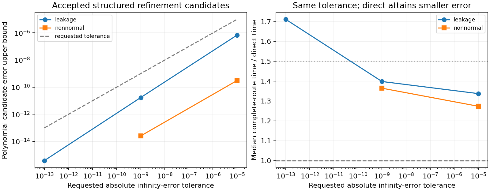

# Conditional polynomial correction: accuracy, uncertainty and limited work

The added executable tests whether a small, bounded correction budget can make
an approximate polynomial inverse useful at a requested physical error while
retaining a stronger protected solve. It leaves the solver kernel unchanged.
The study finds substantial improvements in the polynomial candidate, including
nonnormal Jordan blocks, but the known triangular direct formula remains both
faster and more accurate for these fixtures. Consequently the direct formula
is selected when that structure is available. The correction option remains a
conditional structural method; no whole-ODE or production promotion follows.

## Error allocation in finite precision

Write A=I-B, P=p(C), D=I-AP. The existing prepared plan supplies conditional
full-space bounds ||D||∞<=eta<1 and ||A^-1||∞<=K. These include the rounding of
the stored polynomial coefficients, under the provider's declared affine
operator relation and norm witness. If the computed original residual is
r_hat and its complete evaluation error obeys ||r_hat-(b-Ax)||∞<=mu, then

    ||x-A^-1 b||∞ <= K (||r_hat||∞ + mu).

For a requested absolute infinity-error tolerance tau, the executable passes
`div_down(tau,K)` to the existing residual acceptance API. Directed division
prevents a rounded-up residual threshold from spending more than tau. It
refuses the chart before action when this threshold is <=mu; strict positive
residual headroom is required. This is a **certificate uncertainty floor**,
not a theorem that the computed answer itself has error >=K*mu. An exact
answer can be refused under a conservative allowance; the zero-operator case
and dyadic nilpotent solution demonstrate this explicitly.

The executable bounds every original-action candidate by ||x||∞<=X=32 before
writing an output. Its dyadic block matrices have exactly represented original
entries, so a standard forward-error estimate gives

    mu = gamma_m (||b||∞ + (1+||B||∞)X) + (m+16)*MIN_POSITIVE,
    gamma_m = m*u/(1-m*u),  u=2^-53.

The arithmetic is evaluated outward. It uses m=10 for the structured action,
and m=2n+6 for a materialized dense multiply. The last term conservatively
covers gradual underflow; overflow or a violation of X refuses the callback.
The estimate covers both the original matrix action and `(b-x)+Bx`, rather
than pricing the matrix action alone. It applies to the bounded binary64
fixture callbacks; an opaque user callback needs its own error model.

A second, independent outward original-space residual check is applied to
**every final route**, including the direct comparator and protected fallback.
For each 2x2 block A=[[a,-kappa],[0,a]], a>0,

    ||A^-1||∞ = 1/a + |kappa|/a^2.

An outward upper bound multiplies the outward residual norm. Separately, an
interval triangular solve encloses the exact solution of the **actual binary
B and RHS**. The interval subtraction from the submitted candidate supplies
both a lower and an upper bound on the true error. The reference is never
used to route a solve. An upper bound above tau is retained as unresolved;
only a lower bound above tau would establish a genuine accuracy violation.

## Constructive correction statement and preserved multiplicity

For the nondegenerate fixtures, C=delta I+rho N with N^2=0, center=-1, scale=1,
and q(z)=z^2. Therefore

    ||q(C)||∞ = delta^2 + 2 delta rho,
    P = (1/2)I + (1/4)C,
    D = C^2/4 = a0 I + b0 N,
    a0=delta^2/4, b0=delta*rho/2.

The exact residual after m polynomial passes is D^m b. Since N^2=0,

    D^m = a0^m I + m*a0^(m-1)*b0 N,
    ||D^m b||∞ <= (a0^m + m*a0^(m-1)*|b0|)||b||∞.

For delta=0 the first pass is exact in real arithmetic. For positive delta,
the finite scalar expression gives a constructive pass budget and can be
much sharper than eta^m. The factor m is the nilpotent/Jordan contribution;
replacing a repeated root by its distinct eigenvalue would erase it and
underestimate the error. This is the concrete multiplicity-preserving transfer
from the earlier geometric work. The executable keeps every original-space
residual check and stops upon actual tolerance, stagnation or budget; it does
not use the exact-arithmetic expression as a floating-point certificate.

More generally, let residual-evaluation error be <=mu, the computed polynomial
application error plus vector-update error be <=nu, and let ||P||<=P0,
||A||<=A0. One finite-precision correction obeys

    ||r_next|| <= eta*||r|| + A0*(P0*mu + nu).

Indeed x_next=x+P(r+e_r)+e_p+e_add; multiplication by A and subtraction from b
produces D*r-A(P*e_r+e_p+e_add). Iterating gives

    ||r_m|| <= eta^m ||r_0||
                 + A0*(P0*mu+nu)*(1-eta^m)/(1-eta).

This theorem identifies a residual-noise plateau and shows why unlimited
correction cannot be justified. The current experiment does not invent an
opaque-callback nu: acceptance uses the fresh original residual and the
explicit mu, and the existing hard correction/action caps remain mandatory.

## Limited-work routing

A degree-d polynomial pass costs d-1 chart actions and one original residual
action. With k corrections, callback attempts are bounded by d*(k+1), including
refused work. The direct fallback is then charged separately. Suppose verified
cost bounds supply a per-pass upper cost U, protected-route upper cost F_upper,
and positive protected-route lower cost F_lower. A sufficient conditional
relative-cost bound is

    m*U + F_upper <= rho*F_lower.

Thus at most floor((rho*F_lower-F_upper)/U) passes may be attempted; a value
below one routes directly to the protected solve. Setup or calibration cost S
amortized over M solves must be added as S/M before making this claim. On a
successful chart, the common final certificate costs no more than the complete
protected route, so the same conservative bound applies. This supplies a
constructive way to spend a controlled amount of extra work for robustness.

The executable implements an **empirical counterpart**, with measured means
for F and a conservative-looking but unverified proxy U=2 times the measured
first polynomial pass. The first-pass measurement excludes the common final
certificate, which is charged once through F. The factor two is not a timing
proof. These timing means can select a pass budget, but do not establish a
hard elapsed-time bound; only the resulting callback count limit is hard.
It reports the calibration cost, setup cost and every complete-route time so
that the local campaign can reject an unstable or unprofitable policy.

## Actual bounded study

The final run uses n=32, three cyclic timing groups of at least 2 ms per route,
four physical tolerances (1e-5, 1e-9, 1e-13, 1e-17), four block families and two
implementations of the same actions. Structured callbacks cost O(n); dense
callbacks multiply the materialized matrix at O(n^2), with no artificial burn
loop. Every method uses the same supplied binary RHS and physical norm.
Matrices, plan and workspace are reused; one-time setup/calibration costs are
reported separately. Full candidate work, protected fallback and the final
outward residual certificate are timed. Diagnostic copying of a refused
candidate and comparison to the independent interval reference occur outside
timing. Per-route timer overhead is included uniformly; these are small kernel
measurements, not application timings.

The 384 final samples contain 336 scoped passes and 48 unresolved error-bound
holds. Every hold is retained at tau=1e-17 for leakage/nonnormal blocks; the
binary64 interval reference is insufficient to certify that target. No false
acceptance or proven accuracy violation was observed. Three contract tests
pass: independent direct/reference agreement, useful leakage refinement plus
pre-action uncertainty/cost refusal, and chart degeneration with an invertible
original operator. The same original chart kernel was not modified.

| Structured case | Requested tau | Corrections | Polynomial error upper | Complete refinement / direct median |
|---|---:|---:|---:|---:|
| leakage | 1e-5 | 2 | 6.85e-7 | 1.34 |
| leakage | 1e-9 | 4 | 1.72e-11 | 1.40 |
| leakage | 1e-13 | 6 | 3.89e-16 | 1.71 |
| nonnormal Jordan | 1e-5 | 2 | 3.08e-10 | 1.27 |
| nonnormal Jordan | 1e-9 | 3 | 2.55e-14 | 1.37 |

Before correction, leakage and nonnormal polynomial candidates have errors
about 1.57e-2 and 2.77e-2 respectively. Refinement therefore recovers requested
accuracy at a modest measured complete-route slowdown in several structured
cases. Dense-action refinement costs approximately 2.58–3.58 times direct for
the admitted 1e-5/1e-9 cases and is not retained under the default 1.5 empirical
budget. The protected direct method reaches about 1e-16 error in both families,
so these comparisons use the **same requested tolerance**, not identical
attained errors. No benefit over the strongest direct formula is established.
The default capped controller allows zero to two passes in this run, preserves
all refusals, and falls back rather than exceeding its callback budget. Its
success is bounded routing and preservation of the protected result, not a
new speed record.



The degenerate chart has C=I, center=-2^60 and scale=2^60, hence B=0. Its chart
coordinate rounds to the polynomial root and setup declines before callbacks.
The independent direct solve remains x=b and certifies zero residual. A chart
failure must therefore select another representation or the protected route,
not label the underlying system singular.

## Decisions and next implementation steps

1. Use the triangular direct formula when the exact block structure is supplied;
   keep its original-space residual check. The study does not justify replacing
   this formula by a generic polynomial loop.
2. Retain bounded refinement as an opt-in structural option for providers that
   have a valid low-degree relation but no cheaper direct solve. Expose physical
   error allocation, uncertainty-floor refusal and total failed work to the
   caller; do not treat a small computed residual alone as sufficient.
3. Before routing a nonlinear ODE through this option, derive the applicable
   operator scale/epoch and callback-error bound at the current accepted state.
   A time-integrator error budget must separately account for its local error
   and accumulation. Infinity-norm linear-system tolerance is not automatically
   a WRMS local-error or global-ODE guarantee.
4. Test measured cost stability over independent local processes and problem
   dimensions. Calibrate pass/fallback cost once per stable provider regime and
   include amortization. A verified timing promise needs upper/lower cost bounds,
   not a fit to these 384 samples.
5. Where an uncertainty floor blocks a useful regime, first tighten the provider
   action bound or evaluate the residual with compensated/higher-precision
   arithmetic. Additional polynomial corrections cannot repair an overly loose
   residual certificate. Such a change requires its own benchmark and proof.

## Reproduction and machine-readable outputs

Build and run locally, with no NCP dependency:

```bash
cargo test --locked --offline -p rodas5p-integrators --example conditional_chart_sweep
cargo build --locked --offline --profile measurement -p rodas5p-integrators --example conditional_chart_sweep
./target/measurement/examples/conditional_chart_sweep --dimension 32 --repeats 3 --min-ms 2 > conditional-chart.jsonl
python3 research/local_frontier_20261024/src/analyze_conditional_chart.py conditional-chart.jsonl --output conditional-chart-analysis
```

If CARGO_TARGET_DIR is set, substitute its `measurement/examples` path. CLI
limits: even dimensions 2–1024, repeats 1–20, timing groups 1–50 ms, corrections
0–32, cost ratios 1–10 and at most 12 positive tolerances. `--case` accepts
nilpotent/leakage/nonnormal/degenerate/all and `--action` accepts
structured/dense/all. The wrapper must preserve process errors and all HOLD
rows; it must not rank non-passing combinations by speed.

JSONL starts with `kind=header`, followed by `kind=result` rows. Each row records
case, action, method, tolerance, true-error lower/upper bounds, original-residual
upper bound, certificate upper bound, final status, primary-chart acceptance,
refusal reason, last polynomial candidate error, counted attempts, corrections,
fallback use, setup/calibration costs and matched complete-route timings.
`CONDITIONAL_CHART.json` is the reproducible grouped summary. Raw evidence is
under `evidence/runs/conditional-chart-round3-*`.

The study used three bounded source cycles: initial JSON macro expansion failed
at compile time; the second compiled and executed, retaining its evidence;
the third corrected diagnostic naming (upper-bound failure is not proven
inaccuracy) and avoided charging the common certificate once per polynomial
pass. The final tests and sweep passed the stated scoped checks. This completes
the bounded study without silently adding further tuning cycles.
