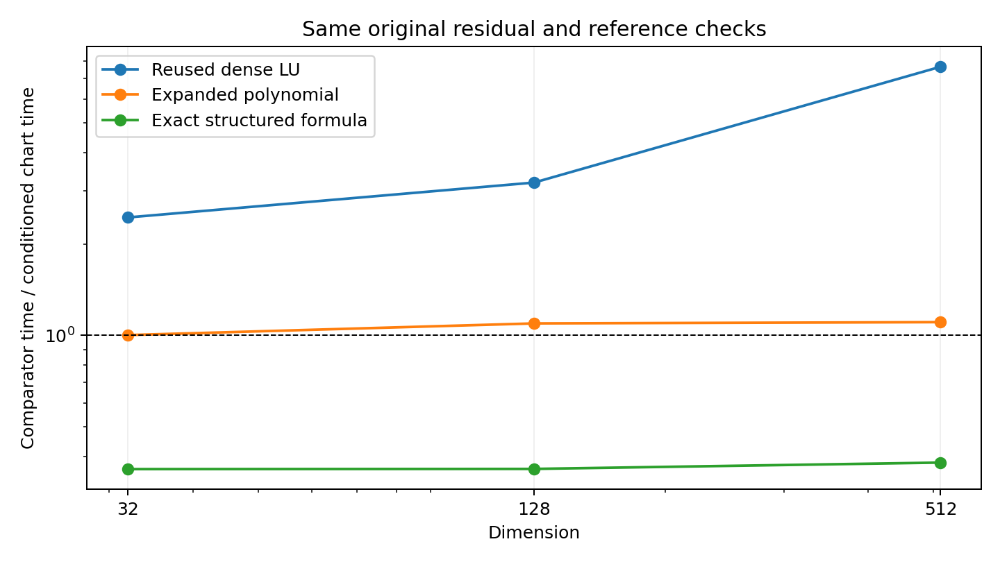

# N1–N2: 조건을 평가하는 affine chart와 구조 공급자

## 구현 결과와 입력 계약

`crates/rodas5p-integrators/src/conditioned_polynomial.rs`에 `ChartDeclaration`,
`DeclaredChartOperator`, `ConditionedPolynomialPlan`을 추가하였다. 목표는
\((I-B)x=b\)이고, 공급자는 유한차원 실수 선형 연산자에 대해

\[
B=cI+sC,\qquad s>0,\qquad \|C\|_\infty\le M,
\qquad \|q(C)\|_\infty\le\delta
\]

를 선언한다. `apply_chart`는 \(C\), `apply_original`은 \(B\)의 작용이다.
\(C\)를 구조에서 직접 계산하면 매 작용마다 큰 \(Bx-cx\)의 뺄셈을 피할 수 있다.
코드는 \(q(C)\)의 차수와 계수를 그대로 보관하며 \(B\)의 단항식 계수로 전개하지 않는다.
따라서 중복근의 중복도를 소거하지 않고 Jordan 성분을 보존한다.

선언에는 연산자 key, 차원, model/provider epoch, 원래 연산자 scale의 binary64 bits,
물리적 infinity norm, chart의 center/scale, 관계 계수의 모든 bits, 두 전체 공간 상계와
외부 근거 reference가 들어간다. 준비된 plan과 현재 공급자의 선언이 하나라도 달라지면
callback 전에 `WitnessMismatch`로 거절한다. 수락 직전에도 비교한다. 계수·근거의
사후 역직렬화로 인증을 만드는 API는 없다. key를 그대로 둔 채 callback의 의미를 바꾸는
행위는 공급자 계약 위반이며, metadata 검사는 불투명한 함수의 수학적 동일성을 증명하지 않는다.

## 계산식과 실제 저장 계수의 결함 상계

정확 실수 산술에서 \(\alpha=(1-c)/s\)로 두면

\[
q(\alpha)-q(z)=(\alpha-z)r(z),\qquad
p(z)=\frac{r(z)}{s q(\alpha)}
\]

이고 \((I-B)p(C)=I-q(C)/q(\alpha)\)이다. 합성나눗셈은
\(r_{d-1}=q_d\), \(r_{j-1}=q_j+\alpha r_j\)로 진행한다.
이 식은 근을 나누거나 고유벡터를 만들지 않는다. 근이 합류하여 판별식이 0이 되는 것 자체는
거절 이유가 아니다. \(q(\alpha)\)의 0 또는 심한 상쇄는 해당 chart의 거절 이유다.

실제 구현은 이 정확식에 binary64 결과를 그대로 대입하여 정리의 전제를 유지한다고
가정하지 않는다. 먼저 계수를 2의 거듭제곱 \(\sigma\)로 정규화한다. 역 scaling의 bits
일치 검사로 subnormal 영역에서 정밀도가 사라진 입력은 거절한다. 정규화 후 계수를
\(\widetilde q_j\), 저장된 quotient 계수를 \(\widehat p_j\), 저장된 분모 역수를
\(\widehat\kappa\)라 하자. \(a=1-c\)의 정확 실수 값에 대해

\[
E(z)=1-(a-sz)\widehat p(z)-\widehat\kappa\widetilde q(z)
\]

의 각 계수는

\[
E_j=\mathbf1_{j=0}-a\widehat p_j+s\widehat p_{j-1}
-\widehat\kappa\widetilde q_j,
\]

이며 범위 밖 \(\widehat p_{-1}=\widehat p_d=0\)이다. 코드의 directed interval 산술은
이 식을 **실제 저장된 binary64 입력의 정확 실수 해석**에 대해 둘러싼다. 따라서 둥글림된
\(\alpha\), 합성나눗셈, 계수 나눗셈의 오차가 모두 \(E\)에 포함된다.

**명제.** 공급자의 전체 공간 선언이 참이고 outward 연산이 유한하게 끝나며

\[
\eta=|\widehat\kappa|\frac{\delta}{\sigma}
+\sum_{j=0}^{d}|E_j|M^j<1
\]

이면 \(A=I-B\)는 가역이고

\[
\|A^{-1}\|_\infty\le
\frac{\sum_{j=0}^{d-1}|\widehat p_j|M^j}{1-\eta}.
\]

**증명.** \(D=I-A\widehat p(C)=\widehat\kappa\widetilde q(C)+E(C)\)이므로
삼각부등식과 submultiplicativity에 의해 \(\|D\|\le\eta<1\)이다. Neumann 급수로
\((I-D)^{-1}\)가 존재한다. 유한차원 정방 연산자 \(A\widehat p(C)=I-D\)가 가역이므로
\(A\)도 가역이며 \(A^{-1}=\widehat p(C)(I-D)^{-1}\)이다. 노름을 취하면 위 결과를 얻는다.
이 증명은 \(\|B\|<1\), 단순 고유값 또는 normality를 요구하지 않는다.

후보는 \(x_0=\widehat p(C)b\), 보정은
\(x_{k+1}=x_k+\widehat p(C)[b-Ax_k]\)이다. 정확 산술에서
\(r_{k+1}=D r_k\)이므로 \(\|r_{k+1}\|\le\eta\|r_k\|\)이다. binary64 실행은 매번
원래 \(B\) callback으로 원래 잔차를 재평가한다. `residual_evaluation_error`는
callback의 오차뿐 아니라 `(rhs-candidate)+action` 전체 평가의 부동소수점 오차를 포함해야 한다.
이 상계가 참이면 `conditional_error_upper`는 위 역연산자 상계에 잔차 상계를 곱한 값이다.
외부 callback·전체 공간 witness까지 interval로 검증했다고 주장하지 않는다.

## 비용, 실패와 재사용

차수 \(d\)에서 1회 후보/보정은 \(d-1\)회의 \(C\) 작용과 1회의 \(B\) 잔차 작용을 쓴다.
\(k\)회 보정까지 합계는 \((k+1)d\)회다. 준비는 \(O(d)\) 계수·상계 연산이며,
\(C\) 작용 비용을 \(T_C(n)\), \(B\) 작용을 \(T_B(n)\)이라 하면 회당 비용은
\(O(dn)+(d-1)T_C(n)+T_B(n)\)이다. 작업공간은 4개 \(n\)-벡터와 \(O(d)\) 계획 계수다.
재사용 적용 경로에는 내부 heap allocation이 없다. 공급자 callback의 할당은 그 공급자의 의무다.

callback 오류·부분 쓰기·비유한 산술은 typed error를 반환한다. 관계 결함, 최대 연산 횟수,
최대 보정 횟수, 잔차 정체는 수치적 거절로 반환한다. 어떤 실패에서도 caller의 출력은 바뀌지
않는다. 시도한 callback은 완료 전에도 work counter에 남는다. setup의 정규화·합성 연산·상계
계산 수도 기록한다. identity와 witness가 유지되는 동안 plan과 네 벡터를 재사용할 수 있다.

## 계산기하 자료에서 이전한 요소

`two_step_normal_reflection_walls_minor_revision_v0_1.pdf`의 denominator가 0이 아닌
영역과 원래 기하 방정식으로의 역대입 원칙, `curved_mirror_integrated_research_report_v13.pdf`
및 `algebraic_geometry_stage5_release/manuscript/sections/07_smooth_cubic.tex`의
projection atlas가 직접적인 설계 대응이다. 후자는 \(aL_H\ne0\)에서 \(H=-K/L_H\)로
축약하되 \(a=0\), \(L_H=0\) chart를 따로 다룬다. 이 kernel의 대응은
\(q(\alpha)\)의 분리 검사, 실패 chart의 국소 거절, 원래 공간 잔차 검사다.
`04_residual.tex`의 비축약 quotient 사례는 중복도를 임의로 지워서는 안 된다는 점을 뒷받침한다.

이를 검증하기 위해, affine chart에서 \(\alpha\)가 1로 둥글려 분모가 사라지지만 원래
연산자는 가역인 projector 사례도 포함했다. 이 경우 새 chart는 callback 전에 거절하고,
기존 원래 좌표의 다항식 경로는 통과한다. 따라서 affine chart 하나를 모든 경우의
기본값으로 승격하지 않는다. 현재 API는 거절을 caller에게 전달하며 여러 chart의 자동 atlas
선택은 별도 미구현 사항이다. 기하 논문에서 계산한 유한해 개수는 solver 성능 근거로 사용하지 않는다.

## 검증 범위와 판정

초기 9개 계약 테스트를 실행하여 통과했다. 이후 내부 무할당 및 chart 국소 실패/원래 좌표
복귀 검사를 추가했고, 기존 polynomial 계약도 함께 재실행하여 통과하였다. 실행 상태와 실제 최종 수치는
`N1_N2.json` 및 `evidence/n1n2-*.receipt.json`에 기록한다.

새 benchmark `conditioned_chart_bench`는 \(C=uv^T\), \(u=\boldsymbol1\),
\(v_i=(-1)^i/n\), \(v^Tu=0\)인 정확 nilpotent 구조를 사용한다. \(B=-100I+100C\)이며,
동일한 원래 잔차·참조해 오차를 시간에 포함한다. prepared chart, fresh declaration/plan,
기존 expanded polynomial, 재사용/새 LU, 구조를 아는 직접 nilpotent 공식을 비교한다.
공급자의 native \(C\) 작용은 \(O(n)\)이므로 matrix-free benefit과 chart 자체 비용을
구별하기 위해 강한 직접 공식을 반드시 함께 둔다. 실행은 경량 커널 판별이며
전체 RODAS 궤적·일반적인 multi-thread 성능 주장은 로컬 campaign의 별도 측정 대상이다.

## 실제 실행 결과

최종 새 계약 11개와 관련 기존 계약 26개, 합계 37개가 통과하였다.
18개 커널 행은 모두 원래 잔차 기준을 통과하였다. 아래 비율은 비교군 시간/새 chart 시간이며
11개 cyclic group 중앙값이다. 1보다 크면 새 chart가 빠르다.

| 차원 | 재사용 LU / 재사용 chart | 직접 공식 / 재사용 chart | 기존 expanded / 재사용 chart | 새 LU / 새 declaration·plan·workspace |
|---:|---:|---:|---:|---:|
| 32 | 2.446 | 0.363 | 1.003 | 4.378 |
| 128 | 3.187 | 0.364 | 1.096 | 50.509 |
| 512 | 7.666 | 0.382 | 1.106 | 616.360 |

이 입력에서 재사용 LU 대비 이득은 native rank-one 작용의 선형 비용을 활용한 결과다.
동일 구조를 직접 사용하는 공식과 비교하면 chart의 일반성·검사 비용을 별도로 볼 수 있다.
chart가 직접 공식보다 느린 결과도 유지한다. 따라서 기본 선택을 바꾸지 않고 조건부 선택 API로 제공한다.

재집계: `python3 research/local_frontier_20261024/src/analyze_conditioned_chart.py research/local_frontier_20261024/evidence/n1n2-chart-benchmark.stdout --output /tmp/conditioned-chart-analysis`.
