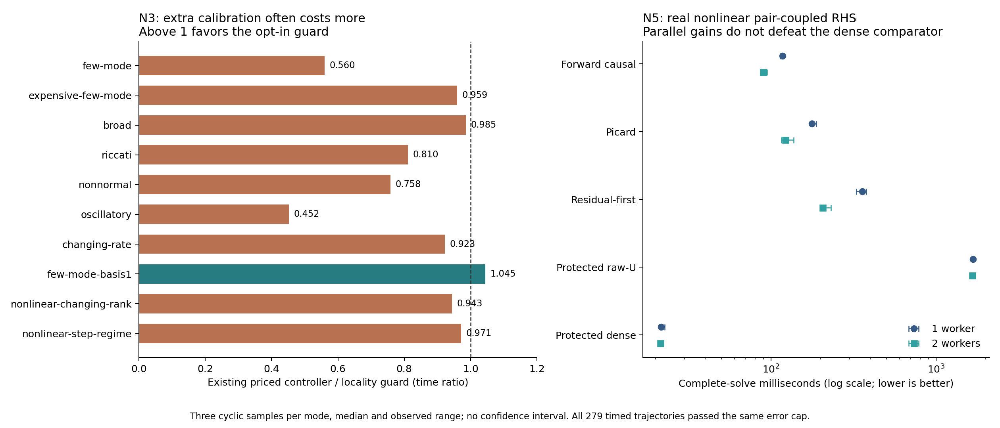

# N3: local validity of measured causal cost references

The existing coupled adapter already selects one caller-chosen Forward, Picard,
or ResidualFirst candidate against the protected same-target raw-U solve. The
facade separately already provides `SwitchingOde`/`SwitchingConfig`, including
bounded explicit/RODAS windows, explicit derivative permission and optional
same-checkpoint implicit pilots. This development extends the coupled cost
reference; it does not reimplement either solver or replace the default route.

## Definition and implemented decision

A protected reference comprises the last accepted protected score P, actual
attempted h, accepted starting vector y, model epoch and accepted-step clock.
An optional `CausalReferenceGuard` admits reuse only if the model epoch agrees,
the symmetric step ratio is at most rho, accepted age is less than A, and

    max_i |y_i-y_ref_i| / (a + r max(|y_i|,|y_ref_i|)) <= 1.

Here a>0 is in the client's state units and r>=0 is dimensionless. Every
intermediate scale and ratio must be finite. These quantities describe a local
routing region; they do not bound the Jacobian, stiffness or actual cost change.
If an admission fails, the old score/cooldown is discarded and the next attempt
uses the protected route. Only a physically accepted protected attempt creates
a new score. Rejected or fatal attempts cannot manufacture a successful cost
reference. The guarded score is fresh rather than an exponential mixture of
previous contexts.

`reference_guard=None` preserves historical h/state transfer; epoch changes
always invalidate a cost reference. The default remains None: the completed local campaign does not support a
general speed advantage. The optional guard makes O(n) state comparisons and
copies, reusing vector capacity. Receipts count the inspected and copied
coordinates and record the precise invalidation reason, reference age, h ratio,
state distance and epochs. Whole-solve timing includes these costs.

`CausalWorkWeights::from_measured_serial_means([rhs,jvp,dot,factor,solve])`
accepts finite caller-measured seconds per event. RHS and JVP means must be
positive; zero optional means explicitly leave those events unpriced. The
caller must measure the actual providers and relevant dimensions. This changes
units of a deterministic routing score; it does not infer parallel wall time
or turn empirical means into cost enclosures.

## Conditional cost statements

For a failed candidate with representative cost C and a protected accepted step
with representative cost P>0, an unclipped cadence

    L = max(1, ceil(C/(epsilon P))-1)

satisfies C/((L+1)P)<=epsilon in exact arithmetic. The denominator includes the
accepted protected fallback after the failed probe and L subsequent accepted
protected steps. Rejected fallbacks, changing cost, finite maximum L, and extra
recalibration work require separate accounting. For example C/P=100 and
L_max=64 gives a ratio 100/65>0.25. The attached text's unconditional 25%
claim therefore does not hold for the existing bounded implementation.

If measured proxies C_hat and P_hat have **verified**, uniform multiplicative
cost bounds (1-delta) times proxy <= actual <= (1+delta) times proxy with
0<=delta<1, then

    C/((L+1)P) <= ((1+delta)/(1-delta)) C_hat/((L+1)P_hat).

This follows by using the upper numerator and lower denominator bounds. Hence
setting the proxy target to epsilon*(1-delta)/(1+delta) is sufficient under the
same cadence/acceptance assumptions. Empirical means alone do not provide
such a delta. The current API can express the adjusted proxy target; it does
not assert a verified timing enclosure.

## Why midpoint defect is not a nonstiffness certificate

For any lambda>0 and a polynomial g represented exactly by the dense extension,
consider y'=-lambda(y-g(t))+g'(t), y(0)=g(0). The exact solution is y=g(t), so the
trajectory defect is zero at every time, including the midpoint. Perturbations
satisfy delta_y'=-lambda delta_y; lambda can be arbitrarily large. Thus even
zero defect supplies no upper bound on stiffness or explicit stability
restrictions. Defect remains an output-consistency diagnostic, while explicit
reentry must retain bounded attempts and the ordinary acceptance tests.

## Model and validation evidence

The benchmark retains every previous registered workload and adds
`--reference-guard` as a separate measured route. Two nonlinear manufactured
holdouts change spectral diversity and the relevant step regime; their exact
trajectories, analytical JVPs and dense Jacobians are checked independently.
`meanfield-manufactured` evaluates a nonseparable, weighted all-pair phase
interaction and a manufactured forcing, with both terms included in RHS cost.
It contains no synthetic burn loop. Its serial and stage-parallel routes share
the same callback and output error semantics. Worker-pool creation is reported
separately; stage worker counts 1/2/4/8/12 are explicit.

Numerical results and source identities are preserved in the companion JSON
and raw command receipts. A local-reference admission establishes the stated
locality contract. Production selection additionally requires a measured
advantage against fixed causal and the strongest applicable protected path.

## Nonlinear changing-regime holdouts

Both new 33-state systems augment a scalar clock, y_0'=1. For physical
coordinates i>=1 define a_i=1+(i mod 3), b_i=200i/32 and
q_i(t)=0.1 exp(-a_i t), with delta_i=y_i-q_i(y_0). The vector field is

    f_i=-(a_i+b_i s(y_0)) delta_i-a_i q_i(y_0)+5 delta_i^2.

The smooth compact transition uses x=(t-0.1)/0.2, s=0 for x<=0, s=1 for
x>=1, and s=A/(A+B) inside, where A=exp(-1/x), B=exp(-1/(1-x)). Its derivative
is s(1-s)(x^-2+(1-x)^-2)/0.2. The step-regime holdout reverses s to 1-s.
The exact solution is q because delta=0 makes f_i=q_i'. Its linearization
moves between three physical decay rates and a broad spectrum; the case name
`nonlinear-changing-rank` refers to changing effective mode diversity, not a
claim that the full Jacobian's algebraic rank changes.

Differentiation gives J_ii=-(a_i+b_i s)+10 delta_i and
J_i0=-b_i s' delta_i+(b_i s-10 delta_i)(-a_i q_i). The example test compares
these analytical derivatives against centered finite differences off the
exact trajectory, and checks dense-Jacobian times vector against the JVP.
It samples before, during and after the transition. Clock and physical state
coordinates all enter the opt-in distance guard; an application can require a
more appropriate scaled state policy before enabling this option.

## Measured result and selection

All 231 timed trajectories across the eight retained cases and two nonlinear
holdouts passed the same 17 physical output-time checks (absolute cap 1e-5,
rtol 1e-6, atol 1e-8). The largest observed absolute error was
1.7046152684e-7. Each mode had one warmup and three cyclic timed repetitions;
all attempts, rejections, fallback and receipts enter complete-solve timings.
The raw streams retain every outcome. Three repetitions in one process do not
establish cross-machine or independent-process confidence intervals.

The locality guard generally costs time. Relative to the existing priced
transfer controller, median comparator/guard ratios range from 0.452
(oscillatory) to 1.045 (insufficient-basis few-mode). The latter avoids three
candidate failures (15 to 12) and reduces RHS/JVP counts from 720/1785 to
672/1758, but its small timing gain is preliminary. On the ordinary few-mode
case, frequent reference resets replace inexpensive successful candidates with
protected work: JVP calls rise from 374 to 1034 and the guard is about 1.79
times slower. On the oscillatory case JVP calls rise from 994 to 3621 and it
is about 2.21 times slower. This is calibration work, not only the O(n) check.

The nonlinear step-regime case improves over the old unpriced cooldown
(132.228 to 98.664 ms), but the already-existing priced route takes 95.831 ms
and fixed causal takes 81.139 ms. It therefore does not justify promoting the
new guard as a runtime improvement. Dense or available band solves beat the
guard on every small registered case. The complete table is
[N3_N5_TIMING_TABLES.md](N3_N5_TIMING_TABLES.md); the machine-readable
[N3_REGIME_COST.json](N3_REGIME_COST.json) includes all repeat durations,
callback counts, invalidation reasons, state-copy costs and source hashes.

**Decision:** retain the guard as an explicit, observable locality policy and
keep `reference_guard=None` by default. Epoch invalidation remains unconditional
because an old model identity cannot justify a reusable cost reference.
Tuning a wider state radius or age must be based on the client's cost regime,
including recalibration cost, and cannot be advertised as a mathematical cost
bound. Callback calibration should use the actual JVP/RHS providers; the present
native fixture uses analytical JVPs and does not establish fully derivative-free
performance. No second competing DOPRI/RODAS adapter was introduced.

## Validation and bounded correction record

The full coupled library, integration targets and then-current example tests
passed 88 tests in `evidence/runs/n3-round2-tests.*`. After the final meanfield
trajectory was made curved, its example test passed separately in
`n3-final-model-tests.*`; controller/adaptive/test sources were unchanged.
The independent review reused matching source hashes and found no blocker.
The final binary SHA256 is
`549583201854c7db78c7fb12a85bcbefb7438412b7cd6be8b0eac8f6d1bb8710`.

Three bounded development rounds were used: (1) implement locality/weight
contracts and initial nonlinear fixtures; (2) replace a logistic transition
with a compact smooth transition to make both endpoint regimes exact;
(3) replace the affine manufactured phase path with a curved path so the
parallel fixture exercises nontrivial temporal accuracy. Previous example
source snapshots and test/build receipts are retained. No production threshold
was tuned to the resulting timings.

The implementation validates policy, snapshots the trial context, invalidates
stale references, preserves the original physical acceptance path, records
actual costs, calibrates only after accepted protected steps, applies existing
bounded reentry, exposes the full decision receipt, checks adversarial cases,
and compares against stronger fixed/protected routes. These steps connect the
locality proof to a directly testable routing change rather than treating the
mathematical inequality as a runtime benchmark.

The public optional field is a Rust source-compatibility consideration:
external exhaustive `CausalSwitchPolicy` literals must add `reference_guard`
or use `..Default::default()`. The reference clock is captured after an
accepted calibration step, while the reference vector is that step's starting
state. A provider returning no epoch cannot signal an unannounced model
mutation; the immutable-model contract still applies.

