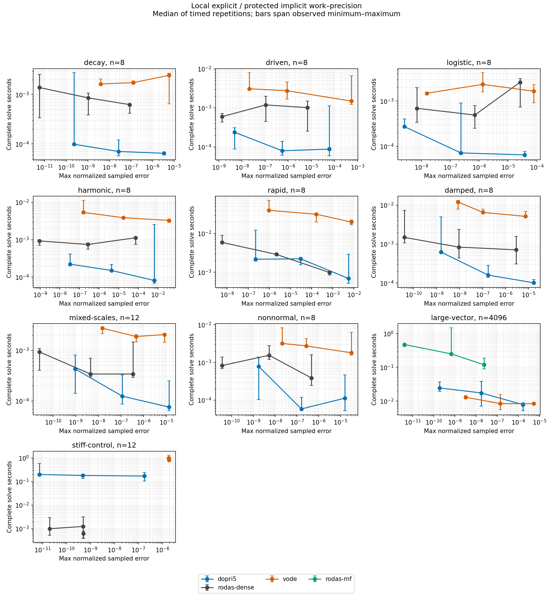
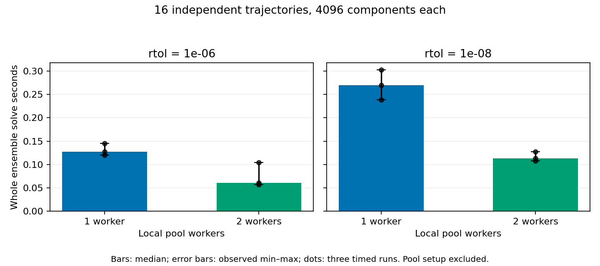

# 비강성 명시적 적분 경로의 로컬 성능·정확도 검토

이번 측정은 매끄러운 비강성 ODE에 명시적 DOPRI5를 제공할 실용적 근거를 확보했다. 그러나 일반적인 ODE 전체에 대한 성능 우위나 요구 허용오차와 같은 수준의 전역 오차를 입증한 것은 아니다. 특히 강성 문제, 엄격한 진동 위상 정확도, 큰 벡터에서의 VODE 비교는 별도의 한계를 드러냈다.

## 측정 대상과 재현성

실행 소스는 `45037fc24e8f8101605f309e1fdb3a9a4e3df56d`로 고정했다. 10개 해석해 문제군, 상대 허용오차 `1e-4`, `1e-6`, `1e-8`, 세 방법으로 이루어진 90개 설정을 각각 예열 1회와 측정 3회 실행했다. 총 360개 프로세스가 259.665초 안에 완료되었고, 90개 설정 모두 적분 성공과 독립적인 저장 상태 재계산을 통과했다. 저장된 모든 출력의 해석해를 Python 식으로 다시 계산했으며 최대 참조값 차이는 `1.388e-17`이었다. 작업 순서는 문제·허용오차 조합과 솔버 순서를 반복마다 섞었다.

사용한 내부 비교 경로는 작은 계에서 dense-fast RODAS5P, 4096차원에서 JVP·GMRES 기반 RODAS5P다. 큰 계에 조밀 행렬 분해를 강제로 적용하지 않았다. 새 방법은 공개 `Dopri5::solve_observed`를 사용했다. 타이머에는 문제·초기값·작업공간 구성과 적분 전체를 넣고 참조해 계산, JSON 출력, 컴파일과 프로세스 시작은 제외했다. VODE는 이미 설치된 SciPy의 Fortran VODE 래퍼이며 Python/NumPy 콜백 비용은 포함된다. 따라서 언어·콜백·출력 정책을 분리한 순수 알고리즘 비용 비교는 아니다.

각 방법이 실제 달성한 오차를

\[
E=\max_{t\in\mathcal T,i}\frac{|y_i(t)-y_i^*(t)|}{\max(1,|y_i(0)|,|y_i^*(t)|)}
\]

로 평가했다. `T`는 시작·끝을 포함하는 5개 관측 시점이다. 아래 비교는 주어진 문턱을 만족한 설정 중 각 방법의 가장 작은 측정 중앙값을 선택한다. 이 오차는 유한한 관측점에서의 오차이며, 관측점 사이의 최대 오차를 엄밀하게 감싸는 보증은 아니다. 내부 두 방법은 각 관측 시각에 착지하고 VODE는 내부 보간을 사용할 수 있다.

## 같은 달성 오차에서의 관측 결과

비율은 `비교 방법 시간 / DOPRI5 시간`이다. 1보다 크면 이 측정의 중앙값에서 DOPRI5가 빠르다. 아래의 범위는 관측한 최소·최대 시간으로 만든 비율 범위이며 신뢰구간이 아니다.

| 문제군 | 차원 | 오차 문턱 | 내부 RODAS5P / DOPRI5 | 관측 비율 범위 |
|---|---:|---:|---:|---:|
| 지수 감쇠 | 8 | 1e-6 | 8.93 | 3.49–11.02 |
| 시간 의존 구동 | 8 | 1e-6 | 7.51 | 3.14–11.68 |
| Logistic | 8 | 1e-6 | 6.89 | 0.28–11.10 |
| 조화 진동 | 8 | 1e-6 | 3.36 | 1.36–3.85 |
| 빠른 진동 | 8 | 1e-6 | 2.73 | 0.46–4.61 |
| 감쇠 진동 | 8 | 1e-6 | 5.22 | 1.54–16.93 |
| 혼합 상태 크기 | 12 | 1e-6 | 2.74 | 0.91–8.06 |
| 비정규 과도 증폭 | 8 | 1e-6 | 6.63 | 2.06–27.49 |
| 큰 독립 벡터 | 4096 | 1e-6 | 6.83 | 2.35–26.29 |
| 강성 음성 대조군 | 12 | 1e-6 | 0.00361 | 0.00171–0.00741 |

비강성 9개 문제군의 중앙값은 모두 새 경로를 지지했다. 하지만 logistic, 빠른 진동, 혼합 상태 크기의 관측 비율 범위는 1을 가로지른다. 작은 문제의 측정은 수십 마이크로초 수준이고 실행 간 변동이 크므로 이 결과를 안정적인 보편적 속도 배수로 해석할 수 없다. 전체 40개 방법·문제·오차 문턱 조합 중 30개가 비교 가능했다. 나머지 10개는 등록된 허용오차 격자에서 양쪽 모두 문턱을 충족하는 설정이 없었다. 실패한 솔버 실행을 삭제해 얻은 표가 아니다.

## 반례와 제한

**강성 문제에서는 기존 음해 경로를 유지해야 한다.** 가장 빠른 적격 DOPRI5 설정은 31,014회 시도와 186,085회 RHS 호출을 요구했고, RODAS5P가 중앙값 기준 약 277배 빨랐다. 상대 허용오차를 완화해도 명시적 안정성 제약 때문에 작업량이 거의 줄지 않았다. 새 방법을 기본값으로 무조건 대체하는 근거가 될 수 없다.

**요청 허용오차와 관측 전역 오차를 구별해야 한다.** `rtol=1e-8`에서 조화 진동은 `3.284e-8`, 빠른 진동은 `2.171e-7`의 관측 오차를 보였다. 둘 다 적분 성공이지만 `E<=1e-8` 비교에는 들어가지 못했다. 또한 엄격한 `1e-8` 문턱에서는 혼합 상태 크기 문제에서 RODAS5P가 약 1.26배 빨랐고, 비정규 문제는 두 중앙값이 거의 같았다.

**큰 벡터에서는 VODE가 유리했다.** 4096차원 문제에서 VODE는 같은 `E<=1e-6` 문턱에 약 2.07배, `E<=1e-8` 문턱에 약 1.89배 빠른 중앙값을 보였다. 선택된 설정의 RHS 호출은 각각 VODE 55회 대 DOPRI5 115회, VODE 111회 대 DOPRI5 211회였다. 이는 단계 수와 메모리 이동을 줄일 개발 여지를 제시하지만 원인을 확정한 프로파일링 결과는 아니다. 시간 범위도 겹치므로 엄격한 순위 확정에는 더 안정된 반복 측정이 필요하다. 작은 문제의 VODE 비교에는 Python 콜백 비용이 상대적으로 크게 작용한다.

VODE의 강성 대조군은 `with_jacobian=False`의 BDF 함수 반복이다. 이는 최적화된 분석적 자코비안 BDF와 동등한 대조군이 아니며, 그 결과로 VODE 계열 전체의 강성 성능을 판단해서는 안 된다.

**Diffsol과 Julia는 이번 새 문제군에서 실행하지 않았다.** 저장소에는 Diffsol 0.16.1의 BDF, TR-BDF2, ESDIRK34, TSIT45 어댑터와 Julia 어댑터·고정 환경 파일이 실제로 존재한다. 현재 실행기는 새 벡터 문제군과 stdin JSON 형식을 사용하지만 기존 어댑터는 파일 기반 요청과 다른 문제 명세를 사용한다. 일부 대각 문제는 겹치나 가변 계수 logistic·구동·여러 진동 쌍은 추가 이식과 수식 일치 검사가 필요하다. Julia 실행파일도 현재 PATH에 없다. `NOT_RUN`은 비교 인터페이스 통합의 미완료를 뜻하며 패키지 소스가 없다는 뜻이 아니다. 관련 소스와 해시는 `evidence/COMPARATOR_INVENTORY.json`에 기록했다.

## 독립 궤적 병렬화

4096차원 감쇠 문제 16개를 각각 독립적으로 적분하고 지역 스레드 풀의 작업자 수만 1에서 2로 바꾸었다. 두 허용오차·두 작업자 수의 4개 설정에서 예열 1회와 측정 3회를 수행했다. 16개 실행 모두 성공했고, 모든 저장 상태와 작업 계수는 작업자 수와 반복 사이에 동일했다.

| rtol | 1작업자 중앙값(s) | 2작업자 중앙값(s) | 관측 시간 비율 | 최대 관측 오차 |
|---:|---:|---:|---:|---:|
| 1e-6 | 0.127390 | 0.060652 | 2.100 | 6.235e-8 |
| 1e-8 | 0.269582 | 0.112821 | 2.389 | 5.292e-10 |

스레드 풀 생성 시간은 별도로 기록했고, 각 문제와 초기값·작업공간 구성 및 적분은 타이머에 포함했다. 2를 넘는 비율은 캐시·스케줄러·측정 변동을 포함한 로컬 관측값이다. 초선형 병렬 성능을 증명하지 않는다. 이 실험은 서로 독립인 궤적의 처리량을 측정했으며 단일 궤적의 Runge–Kutta 단계나 시간 방향 homotopy 병렬화의 가속을 검증한 것이 아니다.

## 후속 개발의 구체적인 순서

1. **명시적 경로를 사용자가 선택할 수 있는 비강성 ODE 경로로 제공한다.** 강성 대조군을 회귀 검사에 유지하고, 자동 방법 전환은 전환 조건·히스테리시스·최종 상태 보존을 별도로 설계한 뒤 도입한다. 적분 성공을 전역 정확도 인증으로 표시하지 않는다.
2. **큰 벡터의 연산·메모리 비용을 먼저 분리 측정한다.** 현재 단계 조합은 단위 간격의 AXPY 반복이므로 SIMD가 가능한 구조다. 정해진 단계별 비영 계수를 이용한 루프 결합과 중간 배열 통과 횟수 감소를 후보로 만들고, 안전 검사 및 성분별 덧셈 순서를 유지한 버전부터 비교한다. 실제 생성 코드와 벡터화 보고서, RHS·단계 조합·오차 norm의 분리 시간으로 병목을 확인한다. 속도 개선은 아직 미측정이다.
3. **진동 정확도 실험을 독립적으로 사전 등록한다.** `1e-9`보다 더 엄격한 허용오차와 긴 적분 구간, 최소 101개 관측 시각, 위상·진폭·보존량 오차를 추가한다. 명시적 연속 출력의 차수 검증도 포함한다. 이번 표의 문턱을 사후에 완화하지 않는다.
4. **기존 외부 어댑터를 재사용한다.** Diffsol TSIT45와 Julia Tsit5를 포함한 기존 코드의 문제 명세를 확장하고, 공통 초기값·우변·JVP·관측 시각을 검증하는 브리지를 작성한다. 어댑터·컴파일·Julia JIT의 경계를 기록한 뒤 같은 달성 오차 기준으로 다시 비교한다.
5. **독립 궤적 처리량을 실제 대상 모델에서 검증한다.** 작업자 수 1/2/4/8, 문제별 비용 불균형, 메모리 사용량, 전체 초기화 비용 포함 여부를 분리한다. 현재 16개의 독립 감쇠 계에서 보인 결과를 결합된 물리 시스템이나 시간 방향 병렬화에 바로 적용하지 않는다.
6. **확장 캠페인을 로컬에서 실행한다.** 고정 소스에서 `--full --budget-seconds 6900`으로 본 실험을, `--budget-seconds 180`으로 독립 궤적 실험을 실행하면 두 적분 캠페인을 합쳐 7080초로 제한할 수 있다. 후처리 시간은 별도다. 더 촘촘한 반복과 CPU 배치 실험은 새 계획에 명시하고 기존 원자료를 보존한다. NCP는 사용하지 않는다.

현재 호스트는 논리 CPU 9개와 cgroup CPU 할당 8개를 관측했다. CPU 친화도와 스레드 환경을 바꾸지 않았으며 전용 머신에서의 측정이라고 주장하지 않는다. 전체 상태·해석해·오류·작업 계수·실행 영수증은 `evidence/local_bench`와 `evidence/ensemble_bench`에 남겼다. 원본 stdout/stderr는 해시 검증된 압축 파일에 보존했고, 요약 JSON과 PNG/PDF/SVG 그림을 함께 제공한다.
