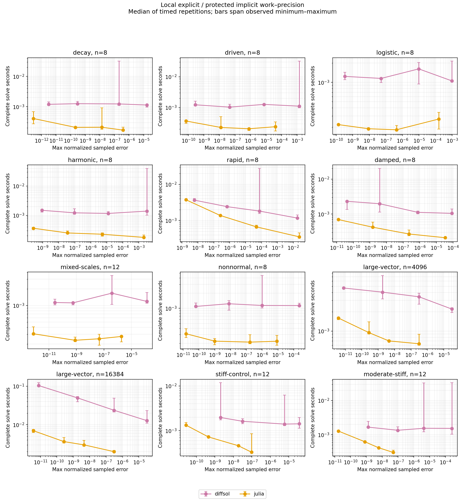

# Local nonstiff campaign results

Each error is re-scored from every saved state against an independent analytic expression. All output rows and failures remain in the raw archive. Native methods land on five observation times; VODE may interpolate its internal steps to the same requested observations.

| Case | n | Method | rtol | All runs pass | Max normalized error | Median seconds | RHS attempts |
|---|---:|---|---:|---|---:|---:|---:|
| decay | 8 | diffsol | 1e-03 | True | 1.6340764470462732e-05 | 0.001135509 | 68 |
| decay | 8 | julia | 1e-03 | True | 3.8212315193325574e-07 | 0.000168557 | 109 |
| decay | 8 | diffsol | 1e-05 | True | 2.044611556416276e-07 | 0.00123205 | 140 |
| decay | 8 | julia | 1e-05 | True | 1.3305882503450439e-08 | 0.000209775 | 199 |
| decay | 8 | diffsol | 1e-07 | True | 2.901801646193469e-10 | 0.001257337 | 302 |
| decay | 8 | julia | 1e-07 | True | 2.0745750256567774e-10 | 0.000208071 | 415 |
| decay | 8 | diffsol | 1e-09 | True | 3.088692496211465e-12 | 0.001196383 | 722 |
| decay | 8 | julia | 1e-09 | True | 2.772475174786515e-13 | 0.000406585 | 949 |
| driven | 8 | diffsol | 1e-03 | True | 0.0013583906559578862 | 0.001112214 | 56 |
| driven | 8 | julia | 1e-03 | True | 3.922178345838745e-05 | 0.000239521 | 91 |
| driven | 8 | diffsol | 1e-05 | True | 7.341959731954617e-06 | 0.001270101 | 110 |
| driven | 8 | julia | 1e-05 | True | 7.803394377337014e-07 | 0.000206419 | 163 |
| driven | 8 | diffsol | 1e-07 | True | 4.4466337612014684e-08 | 0.001036661 | 260 |
| driven | 8 | julia | 1e-07 | True | 1.2314197772589353e-08 | 0.000226707 | 331 |
| driven | 8 | diffsol | 1e-09 | True | 2.780830010706836e-10 | 0.001232551 | 596 |
| driven | 8 | julia | 1e-09 | True | 6.938349894625162e-11 | 0.000367852 | 757 |
| logistic | 8 | diffsol | 1e-03 | True | 0.0009528297377011663 | 0.001055147 | 62 |
| logistic | 8 | julia | 1e-03 | True | 0.0001537134020944686 | 0.000267543 | 79 |
| logistic | 8 | diffsol | 1e-05 | True | 9.67430518450385e-06 | 0.001621873 | 104 |
| logistic | 8 | julia | 1e-05 | True | 4.3489870538149233e-07 | 0.000182163 | 127 |
| logistic | 8 | diffsol | 1e-07 | True | 5.187627871716671e-08 | 0.001151898 | 176 |
| logistic | 8 | julia | 1e-07 | True | 8.744914903324741e-09 | 0.000189176 | 241 |
| logistic | 8 | diffsol | 1e-09 | True | 3.307073503933111e-10 | 0.001239103 | 392 |
| logistic | 8 | julia | 1e-09 | True | 1.3613188354355543e-10 | 0.000219373 | 523 |
| harmonic | 8 | diffsol | 1e-03 | True | 0.00311963197031917 | 0.001392661 | 242 |
| harmonic | 8 | julia | 1e-03 | True | 0.002014740454488795 | 0.000176222 | 181 |
| harmonic | 8 | diffsol | 1e-05 | True | 1.2421095255177317e-05 | 0.001161276 | 524 |
| harmonic | 8 | julia | 1e-05 | True | 5.287232232475958e-06 | 0.000225995 | 421 |
| harmonic | 8 | diffsol | 1e-07 | True | 9.4546848128374e-08 | 0.001217482 | 1184 |
| harmonic | 8 | julia | 1e-07 | True | 3.460972097801829e-08 | 0.000250021 | 1045 |
| harmonic | 8 | diffsol | 1e-09 | True | 8.948153329413344e-10 | 0.001485227 | 2606 |
| harmonic | 8 | julia | 1e-09 | True | 2.6322366508679806e-10 | 0.000361661 | 2677 |
| rapid | 8 | diffsol | 1e-03 | True | 0.018045337655858917 | 0.001169592 | 2456 |
| rapid | 8 | julia | 1e-03 | True | 0.023989712064128366 | 0.000352974 | 1585 |
| rapid | 8 | diffsol | 1e-05 | True | 7.354022660344128e-05 | 0.001828774 | 5750 |
| rapid | 8 | julia | 1e-05 | True | 4.797422382607497e-05 | 0.000667236 | 4381 |
| rapid | 8 | diffsol | 1e-07 | True | 6.696075991463601e-07 | 0.002425447 | 13940 |
| rapid | 8 | julia | 1e-07 | True | 2.546558607319227e-07 | 0.001379697 | 11893 |
| rapid | 8 | diffsol | 1e-09 | True | 5.872603625611816e-09 | 0.003672094 | 31976 |
| rapid | 8 | julia | 1e-09 | True | 1.7535067842189278e-09 | 0.003760179 | 31579 |
| damped | 8 | diffsol | 1e-03 | True | 8.487801097425973e-05 | 0.001053354 | 380 |
| damped | 8 | julia | 1e-03 | True | 3.398027184632613e-05 | 0.000212089 | 349 |
| damped | 8 | diffsol | 1e-05 | True | 7.624197855826687e-07 | 0.001125078 | 722 |
| damped | 8 | julia | 1e-05 | True | 2.2056268423470415e-07 | 0.00027117 | 793 |
| damped | 8 | diffsol | 1e-07 | True | 3.861769178742369e-09 | 0.001977223 | 1670 |
| damped | 8 | julia | 1e-07 | True | 1.4529147017439126e-09 | 0.000423487 | 1903 |
| damped | 8 | diffsol | 1e-09 | True | 4.178275433974754e-11 | 0.002321201 | 3896 |
| damped | 8 | julia | 1e-09 | True | 1.2547601846435441e-11 | 0.000699257 | 4723 |
| mixed-scales | 12 | diffsol | 1e-03 | True | 0.0001302249975973524 | 0.001187275 | 74 |
| mixed-scales | 12 | julia | 1e-03 | True | 1.8543256428493748e-06 | 0.000274296 | 115 |
| mixed-scales | 12 | diffsol | 1e-05 | True | 3.737006530002418e-07 | 0.001674242 | 152 |
| mixed-scales | 12 | julia | 1e-05 | True | 4.4504404375089736e-08 | 0.000249169 | 217 |
| mixed-scales | 12 | diffsol | 1e-07 | True | 5.632114419285017e-10 | 0.001117053 | 350 |
| mixed-scales | 12 | julia | 1e-07 | True | 8.013888219693399e-10 | 0.00023388 | 469 |
| mixed-scales | 12 | diffsol | 1e-09 | True | 2.757781558671013e-11 | 0.001132862 | 848 |
| mixed-scales | 12 | julia | 1e-09 | True | 7.510347899142289e-13 | 0.000306718 | 1105 |
| nonnormal | 8 | diffsol | 1e-03 | True | 0.00022564644831477314 | 0.001133123 | 128 |
| nonnormal | 8 | julia | 1e-03 | True | 8.473361623435264e-06 | 0.000220886 | 109 |
| nonnormal | 8 | diffsol | 1e-05 | True | 9.884121239691994e-07 | 0.001137261 | 188 |
| nonnormal | 8 | julia | 1e-05 | True | 1.708532604636963e-07 | 0.00021237 | 199 |
| nonnormal | 8 | diffsol | 1e-07 | True | 7.84457334045272e-09 | 0.001230477 | 344 |
| nonnormal | 8 | julia | 1e-07 | True | 9.966003074357835e-10 | 0.000221998 | 409 |
| nonnormal | 8 | diffsol | 1e-09 | True | 6.20846774147454e-11 | 0.001087979 | 740 |
| nonnormal | 8 | julia | 1e-09 | True | 1.4901376733064036e-11 | 0.000312008 | 925 |
| large-vector | 4096 | diffsol | 1e-03 | True | 3.0578670136349045e-05 | 0.002201846 | 38 |
| large-vector | 4096 | julia | 1e-03 | True | 3.0117267420942673e-07 | 0.000634494 | 61 |
| large-vector | 4096 | diffsol | 1e-05 | True | 3.068084183377451e-07 | 0.003418343 | 68 |
| large-vector | 4096 | julia | 1e-05 | True | 4.536663092066795e-09 | 0.00070086 | 97 |
| large-vector | 4096 | diffsol | 1e-07 | True | 1.8266603923899893e-09 | 0.004035949 | 128 |
| large-vector | 4096 | julia | 1e-07 | True | 2.6903473893113983e-10 | 0.0009455 | 175 |
| large-vector | 4096 | diffsol | 1e-09 | True | 7.736783436129713e-12 | 0.004684188 | 284 |
| large-vector | 4096 | julia | 1e-09 | True | 3.722494534841303e-12 | 0.001595213 | 379 |
| large-vector | 16384 | diffsol | 1e-03 | True | 3.057867013649823e-05 | 0.012781739 | 38 |
| large-vector | 16384 | julia | 1e-03 | True | 3.0117267420942673e-07 | 0.002001018 | 61 |
| large-vector | 16384 | diffsol | 1e-05 | True | 3.068084183030506e-07 | 0.023718517 | 68 |
| large-vector | 16384 | julia | 1e-05 | True | 4.536663092066795e-09 | 0.002994687 | 97 |
| large-vector | 16384 | diffsol | 1e-07 | True | 1.8266604340233528e-09 | 0.04966739 | 128 |
| large-vector | 16384 | julia | 1e-07 | True | 2.6903473893113983e-10 | 0.003644321 | 175 |
| large-vector | 16384 | diffsol | 1e-09 | True | 7.736811191705328e-12 | 0.103874078 | 284 |
| large-vector | 16384 | julia | 1e-09 | True | 3.722494534841303e-12 | 0.006976045 | 379 |
| stiff-control | 12 | diffsol | 1e-03 | True | 3.683982709346001e-05 | 0.001422879 | 156 |
| stiff-control | 12 | julia | 1e-03 | True | 9.516284749100379e-08 | 0.000330292 | 362 |
| stiff-control | 12 | diffsol | 1e-05 | True | 5.7392140562217975e-06 | 0.001403523 | 249 |
| stiff-control | 12 | julia | 1e-05 | True | 1.8630896769789018e-08 | 0.000459585 | 669 |
| stiff-control | 12 | diffsol | 1e-07 | True | 3.1076795803386403e-08 | 0.001623437 | 545 |
| stiff-control | 12 | julia | 1e-07 | True | 4.43086900503431e-10 | 0.000724925 | 1345 |
| stiff-control | 12 | diffsol | 1e-09 | True | 2.036070756439301e-09 | 0.001970661 | 925 |
| stiff-control | 12 | julia | 1e-09 | True | 2.7058688623071703e-11 | 0.001332489 | 2982 |
| moderate-stiff | 12 | diffsol | 1e-03 | True | 0.0002518851924399046 | 0.001532896 | 117 |
| moderate-stiff | 12 | julia | 1e-03 | True | 4.9247823930009815e-08 | 0.000303582 | 288 |
| moderate-stiff | 12 | diffsol | 1e-05 | True | 4.258221209918478e-06 | 0.001541512 | 217 |
| moderate-stiff | 12 | julia | 1e-05 | True | 5.921558715593633e-09 | 0.000414931 | 540 |
| moderate-stiff | 12 | diffsol | 1e-07 | True | 9.750892382420773e-08 | 0.001348578 | 392 |
| moderate-stiff | 12 | julia | 1e-07 | True | 7.997005557758285e-10 | 0.00062164 | 1133 |
| moderate-stiff | 12 | diffsol | 1e-09 | True | 1.3005291288337162e-09 | 0.001665415 | 823 |
| moderate-stiff | 12 | julia | 1e-09 | True | 1.6964485372028548e-11 | 0.001278097 | 2626 |

Common-error comparisons are in SUMMARY.json. A ratio larger than one means the comparator took longer than DOPRI5 on these samples. The comparison includes setup and callbacks; it does not isolate mathematical-stage cost or compiler/language overhead. VODE callbacks run in Python/NumPy and its imports are excluded. Three repetitions with randomized order provide a local observation, not a universal speed guarantee or confidence interval. Stiff controls identify the explicit stability penalty and are retained regardless of performance.
