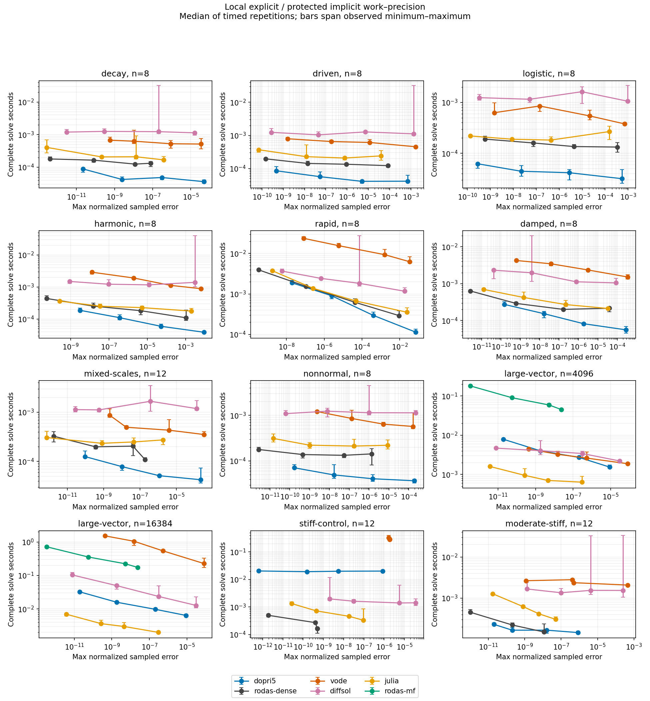

# Local nonstiff campaign results

Each error is re-scored from every saved state against an independent analytic expression. All output rows and failures remain in the raw archive. Native methods land on five observation times; VODE may interpolate its internal steps to the same requested observations.

| Case | n | Method | rtol | All runs pass | Max normalized error | Median seconds | RHS attempts |
|---|---:|---|---:|---|---:|---:|---:|
| decay | 8 | dopri5 | 1e-03 | True | 4.96238867978456e-05 | 3.6248e-05 | 91 |
| decay | 8 | rodas-dense | 1e-03 | True | 7.79204864520544e-08 | 0.00013269 | 96 |
| decay | 8 | vode | 1e-03 | True | 3.425267164942902e-05 | 0.0005155310500413179 | 68 |
| decay | 8 | dopri5 | 1e-05 | True | 3.0881641890218026e-07 | 4.8451e-05 | 169 |
| decay | 8 | rodas-dense | 1e-05 | True | 1.2021608486456614e-08 | 0.000125065 | 160 |
| decay | 8 | vode | 1e-05 | True | 8.960429352909693e-07 | 0.000525779789313674 | 105 |
| decay | 8 | dopri5 | 1e-07 | True | 2.4714794169544696e-09 | 4.237e-05 | 355 |
| decay | 8 | rodas-dense | 1e-07 | True | 7.98186274020285e-11 | 0.000165331 | 336 |
| decay | 8 | vode | 1e-07 | True | 1.0359005365306873e-08 | 0.0006296159699559212 | 186 |
| decay | 8 | dopri5 | 1e-09 | True | 2.2268350358123357e-11 | 8.8777e-05 | 823 |
| decay | 8 | rodas-dense | 1e-09 | True | 4.0549161250957866e-13 | 0.000179668 | 768 |
| decay | 8 | vode | 1e-09 | True | 5.835142195820264e-10 | 0.0006750209722667933 | 329 |
| driven | 8 | dopri5 | 1e-03 | True | 0.0006995337930673085 | 4.1158e-05 | 85 |
| driven | 8 | rodas-dense | 1e-03 | True | 8.481213165767443e-05 | 0.000121439 | 88 |
| driven | 8 | vode | 1e-03 | True | 0.0017122142310052046 | 0.00045176083222031593 | 45 |
| driven | 8 | dopri5 | 1e-05 | True | 4.980716736047164e-06 | 4.0807e-05 | 157 |
| driven | 8 | rodas-dense | 1e-05 | True | 9.35387415967881e-07 | 0.000133903 | 151 |
| driven | 8 | vode | 1e-05 | True | 1.1504817322482985e-05 | 0.0006105990614742041 | 82 |
| driven | 8 | dopri5 | 1e-07 | True | 5.416694481841233e-08 | 5.6286e-05 | 307 |
| driven | 8 | rodas-dense | 1e-07 | True | 1.408061278684869e-08 | 0.000141778 | 302 |
| driven | 8 | vode | 1e-07 | True | 1.801363562481395e-07 | 0.0006513269618153572 | 121 |
| driven | 8 | dopri5 | 1e-09 | True | 4.672215947465475e-10 | 8.501e-05 | 703 |
| driven | 8 | rodas-dense | 1e-09 | True | 1.5037826539554544e-10 | 0.000194907 | 683 |
| driven | 8 | vode | 1e-09 | True | 1.5884086268513897e-09 | 0.0007895468734204769 | 167 |
| logistic | 8 | dopri5 | 1e-03 | True | 0.0005352030225692639 | 3.177e-05 | 79 |
| logistic | 8 | rodas-dense | 1e-03 | True | 0.00033890798708802183 | 0.000132771 | 104 |
| logistic | 8 | vode | 1e-03 | True | 0.0007135554356011431 | 0.00037743104621768 | 38 |
| logistic | 8 | dopri5 | 1e-05 | True | 2.7265219978422905e-06 | 4.1608e-05 | 109 |
| logistic | 8 | rodas-dense | 1e-05 | True | 4.405313818178769e-06 | 0.000135755 | 168 |
| logistic | 8 | vode | 1e-05 | True | 2.137584473260734e-05 | 0.0005419510416686535 | 83 |
| logistic | 8 | dopri5 | 1e-07 | True | 2.2058059157004095e-08 | 4.4464e-05 | 199 |
| logistic | 8 | rodas-dense | 1e-07 | True | 7.511032573681575e-08 | 0.000159661 | 336 |
| logistic | 8 | vode | 1e-07 | True | 1.4158491379312466e-07 | 0.0008496700320392847 | 135 |
| logistic | 8 | dopri5 | 1e-09 | True | 2.802149623448713e-10 | 6.2378e-05 | 427 |
| logistic | 8 | rodas-dense | 1e-09 | True | 5.815979919887582e-10 | 0.000190128 | 784 |
| logistic | 8 | vode | 1e-09 | True | 1.472032939986434e-09 | 0.000627115136012435 | 175 |
| harmonic | 8 | dopri5 | 1e-03 | True | 0.009087268008234783 | 3.8473e-05 | 145 |
| harmonic | 8 | rodas-dense | 1e-03 | True | 0.0010576704111410207 | 0.000108795 | 160 |
| harmonic | 8 | vode | 1e-03 | True | 0.0064784893366582885 | 0.000882140826433897 | 129 |
| harmonic | 8 | dopri5 | 1e-05 | True | 5.269704221777527e-05 | 5.8951e-05 | 397 |
| harmonic | 8 | rodas-dense | 1e-05 | True | 4.500804319351737e-06 | 0.000181382 | 415 |
| harmonic | 8 | vode | 1e-05 | True | 0.00016398217313540187 | 0.0011202599853277206 | 203 |
| harmonic | 8 | dopri5 | 1e-07 | True | 3.6132423597567964e-07 | 0.000109526 | 1069 |
| harmonic | 8 | rodas-dense | 1e-07 | True | 1.506046987120868e-08 | 0.000251986 | 968 |
| harmonic | 8 | vode | 1e-07 | True | 1.9573695106966937e-06 | 0.001903346972540021 | 395 |
| harmonic | 8 | dopri5 | 1e-09 | True | 3.025361183794928e-09 | 0.000186553 | 2605 |
| harmonic | 8 | rodas-dense | 1e-09 | True | 5.636596051017406e-11 | 0.000436312 | 2314 |
| harmonic | 8 | vode | 1e-09 | True | 1.2848429875589318e-08 | 0.002886194037273526 | 549 |
| rapid | 8 | dopri5 | 1e-03 | True | 0.07171226718920631 | 0.000113213 | 1375 |
| rapid | 8 | rodas-dense | 1e-03 | True | 0.009390044335794046 | 0.000290557 | 1448 |
| rapid | 8 | vode | 1e-03 | True | 0.03437146204217134 | 0.006253396859392524 | 1453 |
| rapid | 8 | dopri5 | 1e-05 | True | 0.0003991022592486626 | 0.000294836 | 4273 |
| rapid | 8 | rodas-dense | 1e-05 | True | 4.2385943748390886e-05 | 0.000621481 | 3778 |
| rapid | 8 | vode | 1e-05 | True | 0.0016069452168647747 | 0.009369004983454943 | 2095 |
| rapid | 8 | dopri5 | 1e-07 | True | 2.466783445065346e-06 | 0.000902215 | 12163 |
| rapid | 8 | rodas-dense | 1e-07 | True | 1.074790630939404e-07 | 0.001541723 | 10687 |
| rapid | 8 | vode | 1e-07 | True | 5.8827457122268e-06 | 0.0156427389010787 | 3838 |
| rapid | 8 | dopri5 | 1e-09 | True | 1.9715060695091324e-08 | 0.001880542 | 31321 |
| rapid | 8 | rodas-dense | 1e-09 | True | 3.318808006191887e-10 | 0.00394544 | 28444 |
| rapid | 8 | vode | 1e-09 | True | 8.231704085037705e-08 | 0.023743544006720185 | 5499 |
| damped | 8 | dopri5 | 1e-03 | True | 0.00028848702654432623 | 5.5865e-05 | 295 |
| damped | 8 | rodas-dense | 1e-03 | True | 3.854678263660524e-05 | 0.000216178 | 304 |
| damped | 8 | vode | 1e-03 | True | 0.00034620185148703797 | 0.0015193622093647718 | 260 |
| damped | 8 | dopri5 | 1e-05 | True | 1.8430386416919131e-06 | 8.1944e-05 | 685 |
| damped | 8 | rodas-dense | 1e-05 | True | 1.6660333957557727e-07 | 0.000200548 | 640 |
| damped | 8 | vode | 1e-05 | True | 3.093358961842041e-06 | 0.0023563478607684374 | 453 |
| damped | 8 | dopri5 | 1e-07 | True | 1.649970613956664e-08 | 0.000153519 | 1693 |
| damped | 8 | rodas-dense | 1e-07 | True | 5.913298739557149e-10 | 0.000291752 | 1567 |
| damped | 8 | vode | 1e-07 | True | 3.809053584352684e-08 | 0.003466782160103321 | 692 |
| damped | 8 | dopri5 | 1e-09 | True | 1.4965546163425714e-10 | 0.000273405 | 4243 |
| damped | 8 | rodas-dense | 1e-09 | True | 2.6205149161739882e-12 | 0.000633423 | 3889 |
| damped | 8 | vode | 1e-09 | True | 6.06918786061339e-10 | 0.004263800103217363 | 991 |
| mixed-scales | 12 | dopri5 | 1e-03 | True | 0.0002138874608853758 | 4.2531e-05 | 97 |
| mixed-scales | 12 | rodas-dense | 1e-03 | True | 1.907419898095064e-07 | 0.000108775 | 96 |
| mixed-scales | 12 | vode | 1e-03 | True | 0.0003281121534635023 | 0.0003529749810695648 | 61 |
| mixed-scales | 12 | dopri5 | 1e-05 | True | 1.1390138354361313e-06 | 5.1367e-05 | 187 |
| mixed-scales | 12 | rodas-dense | 1e-05 | True | 4.0915122578866206e-08 | 0.000204976 | 184 |
| mixed-scales | 12 | vode | 1e-05 | True | 3.851181453704555e-06 | 0.0004327849019318819 | 125 |
| mixed-scales | 12 | dopri5 | 1e-07 | True | 1.03807735118977e-08 | 7.8417e-05 | 415 |
| mixed-scales | 12 | rodas-dense | 1e-07 | True | 3.6016002624705835e-10 | 0.000198404 | 376 |
| mixed-scales | 12 | vode | 1e-07 | True | 1.75707144567383e-08 | 0.000495576998218894 | 175 |
| mixed-scales | 12 | dopri5 | 1e-09 | True | 9.441817994115809e-11 | 0.000125747 | 973 |
| mixed-scales | 12 | rodas-dense | 1e-09 | True | 1.7679457897656903e-12 | 0.000326915 | 904 |
| mixed-scales | 12 | vode | 1e-09 | True | 2.1425730167834443e-09 | 0.000872934004291892 | 432 |
| nonnormal | 8 | dopri5 | 1e-03 | True | 0.0001881251685446755 | 3.693e-05 | 97 |
| nonnormal | 8 | rodas-dense | 1e-03 | True | 1.35910849576523e-06 | 0.00014311 | 96 |
| nonnormal | 8 | vode | 1e-03 | True | 0.00016496376012966864 | 0.0005690050311386585 | 61 |
| nonnormal | 8 | dopri5 | 1e-05 | True | 1.5216569559048938e-06 | 4.0917e-05 | 163 |
| nonnormal | 8 | rodas-dense | 1e-05 | True | 5.3568633482416697e-08 | 0.00013321 | 160 |
| nonnormal | 8 | vode | 1e-05 | True | 5.2582579676010976e-06 | 0.0006411278154700994 | 101 |
| nonnormal | 8 | dopri5 | 1e-07 | True | 1.6929242957445952e-08 | 4.9594e-05 | 343 |
| nonnormal | 8 | rodas-dense | 1e-07 | True | 4.4328556177554794e-10 | 0.000138481 | 320 |
| nonnormal | 8 | vode | 1e-07 | True | 1.3386878751676666e-07 | 0.000852345023304224 | 145 |
| nonnormal | 8 | dopri5 | 1e-09 | True | 1.690286798532171e-10 | 7.1084e-05 | 799 |
| nonnormal | 8 | rodas-dense | 1e-09 | True | 2.7012047515521347e-12 | 0.000178718 | 744 |
| nonnormal | 8 | vode | 1e-09 | True | 2.353415441409098e-09 | 0.0012090171221643686 | 259 |
| large-vector | 4096 | dopri5 | 1e-03 | True | 8.995169227029448e-06 | 0.001537136 | 55 |
| large-vector | 4096 | rodas-mf | 1e-03 | True | 2.4220646641093246e-08 | 0.045031666 | 72 |
| large-vector | 4096 | vode | 1e-03 | True | 8.111260801230147e-05 | 0.0018766638822853565 | 33 |
| large-vector | 4096 | dopri5 | 1e-05 | True | 2.1095363589643257e-07 | 0.002710595 | 91 |
| large-vector | 4096 | rodas-mf | 1e-05 | True | 5.2834471415963424e-09 | 0.059107194 | 96 |
| large-vector | 4096 | vode | 1e-05 | True | 5.26739000292209e-07 | 0.002610265975818038 | 48 |
| large-vector | 4096 | dopri5 | 1e-07 | True | 1.827749201988027e-09 | 0.00399826 | 157 |
| large-vector | 4096 | rodas-mf | 1e-07 | True | 5.591084539791069e-11 | 0.090503562 | 152 |
| large-vector | 4096 | vode | 1e-07 | True | 1.5451929846754808e-08 | 0.0032542080152779818 | 95 |
| large-vector | 4096 | dopri5 | 1e-09 | True | 1.9002847906346432e-11 | 0.007907011 | 331 |
| large-vector | 4096 | rodas-mf | 1e-09 | True | 3.4094255196848167e-13 | 0.180852015 | 312 |
| large-vector | 4096 | vode | 1e-09 | True | 4.27532717561796e-10 | 0.004466912010684609 | 147 |
| large-vector | 16384 | dopri5 | 1e-03 | True | 8.995169227029448e-06 | 0.006402307 | 55 |
| large-vector | 16384 | rodas-mf | 1e-03 | True | 2.4220646696604398e-08 | 0.173571179 | 72 |
| large-vector | 16384 | vode | 1e-03 | True | 8.111260801235698e-05 | 0.22743354504927993 | 33 |
| large-vector | 16384 | dopri5 | 1e-05 | True | 2.1095363589990201e-07 | 0.009750183 | 91 |
| large-vector | 16384 | rodas-mf | 1e-05 | True | 5.283447769566241e-09 | 0.223506992 | 96 |
| large-vector | 16384 | vode | 1e-05 | True | 5.267390002783312e-07 | 0.5436556960921735 | 48 |
| large-vector | 16384 | dopri5 | 1e-07 | True | 1.8277491881102392e-09 | 0.015879406 | 157 |
| large-vector | 16384 | rodas-mf | 1e-07 | True | 5.591036661423132e-11 | 0.35630175 | 152 |
| large-vector | 16384 | vode | 1e-07 | True | 1.545192995777711e-08 | 1.0505247439723462 | 95 |
| large-vector | 16384 | dopri5 | 1e-09 | True | 1.9002875661922047e-11 | 0.032598008 | 331 |
| large-vector | 16384 | rodas-mf | 1e-09 | True | 3.41067452058752e-13 | 0.718697286 | 312 |
| large-vector | 16384 | vode | 1e-09 | True | 4.275326898062204e-10 | 1.5268099990207702 | 147 |
| stiff-control | 12 | dopri5 | 1e-03 | True | 8.473265821888881e-07 | 0.020143165 | 193375 |
| stiff-control | 12 | rodas-dense | 1e-03 | True | 5.014576531792159e-10 | 0.000163398 | 219 |
| stiff-control | 12 | vode | 1e-03 | True | 1.8981058980682697e-06 | 0.28818410402163863 | 240376 |
| stiff-control | 12 | dopri5 | 1e-05 | True | 5.382287614502922e-09 | 0.019921036 | 186163 |
| stiff-control | 12 | rodas-dense | 1e-05 | True | 5.052159801621769e-10 | 0.000163878 | 396 |
| stiff-control | 12 | vode | 1e-05 | True | 1.8810304454608406e-06 | 0.28771460009738803 | 241919 |
| stiff-control | 12 | dopri5 | 1e-07 | True | 1.5376189812019117e-10 | 0.019149744 | 186397 |
| stiff-control | 12 | rodas-dense | 1e-07 | True | 4.015373034071956e-10 | 0.00027093 | 860 |
| stiff-control | 12 | vode | 1e-07 | True | 1.865624170427349e-06 | 0.2849212398286909 | 241059 |
| stiff-control | 12 | dopri5 | 1e-09 | True | 6.278429190501159e-13 | 0.020337802 | 187003 |
| stiff-control | 12 | rodas-dense | 1e-09 | True | 1.930844373276841e-12 | 0.000498349 | 1971 |
| stiff-control | 12 | vode | 1e-09 | True | 1.6594376829326407e-06 | 0.32660428108647466 | 268666 |
| moderate-stiff | 12 | dopri5 | 1e-03 | True | 8.378392157225459e-07 | 0.000144732 | 1213 |
| moderate-stiff | 12 | rodas-dense | 1e-03 | True | 1.1392197768467227e-08 | 0.00015368 | 152 |
| moderate-stiff | 12 | vode | 1e-03 | True | 0.0004509564538136557 | 0.0020723859779536724 | 1485 |
| moderate-stiff | 12 | dopri5 | 1e-05 | True | 1.621054373595997e-08 | 0.000165532 | 1291 |
| moderate-stiff | 12 | rodas-dense | 1e-05 | True | 1.1309298997286277e-08 | 0.000149522 | 320 |
| moderate-stiff | 12 | vode | 1e-05 | True | 4.176486749496444e-07 | 0.0028013160917907953 | 2023 |
| moderate-stiff | 12 | dopri5 | 1e-07 | True | 2.0510404567743789e-10 | 0.000165342 | 1537 |
| moderate-stiff | 12 | rodas-dense | 1e-07 | True | 2.0822712998302961e-10 | 0.000220996 | 751 |
| moderate-stiff | 12 | vode | 1e-07 | True | 4.897989949459447e-07 | 0.002367669017985463 | 1769 |
| moderate-stiff | 12 | dopri5 | 1e-09 | True | 2.014038935627127e-11 | 0.000229201 | 2371 |
| moderate-stiff | 12 | rodas-dense | 1e-09 | True | 1.033007013262477e-12 | 0.000450999 | 1767 |
| moderate-stiff | 12 | vode | 1e-09 | True | 1.1542676536802077e-09 | 0.0026480569504201412 | 1926 |
| decay | 8 | diffsol | 1e-03 | True | 1.6340764470462732e-05 | 0.001135509 | 68 |
| decay | 8 | julia | 1e-03 | True | 3.8212315193325574e-07 | 0.000168557 | 109 |
| decay | 8 | diffsol | 1e-05 | True | 2.044611556416276e-07 | 0.00123205 | 140 |
| decay | 8 | julia | 1e-05 | True | 1.3305882503450439e-08 | 0.000209775 | 199 |
| decay | 8 | diffsol | 1e-07 | True | 2.901801646193469e-10 | 0.001257337 | 302 |
| decay | 8 | julia | 1e-07 | True | 2.0745750256567774e-10 | 0.000208071 | 415 |
| decay | 8 | diffsol | 1e-09 | True | 3.088692496211465e-12 | 0.001196383 | 722 |
| decay | 8 | julia | 1e-09 | True | 2.772475174786515e-13 | 0.000406585 | 949 |
| driven | 8 | diffsol | 1e-03 | True | 0.0013583906559578862 | 0.001112214 | 56 |
| driven | 8 | julia | 1e-03 | True | 3.922178345838745e-05 | 0.000239521 | 91 |
| driven | 8 | diffsol | 1e-05 | True | 7.341959731954617e-06 | 0.001270101 | 110 |
| driven | 8 | julia | 1e-05 | True | 7.803394377337014e-07 | 0.000206419 | 163 |
| driven | 8 | diffsol | 1e-07 | True | 4.4466337612014684e-08 | 0.001036661 | 260 |
| driven | 8 | julia | 1e-07 | True | 1.2314197772589353e-08 | 0.000226707 | 331 |
| driven | 8 | diffsol | 1e-09 | True | 2.780830010706836e-10 | 0.001232551 | 596 |
| driven | 8 | julia | 1e-09 | True | 6.938349894625162e-11 | 0.000367852 | 757 |
| logistic | 8 | diffsol | 1e-03 | True | 0.0009528297377011663 | 0.001055147 | 62 |
| logistic | 8 | julia | 1e-03 | True | 0.0001537134020944686 | 0.000267543 | 79 |
| logistic | 8 | diffsol | 1e-05 | True | 9.67430518450385e-06 | 0.001621873 | 104 |
| logistic | 8 | julia | 1e-05 | True | 4.3489870538149233e-07 | 0.000182163 | 127 |
| logistic | 8 | diffsol | 1e-07 | True | 5.187627871716671e-08 | 0.001151898 | 176 |
| logistic | 8 | julia | 1e-07 | True | 8.744914903324741e-09 | 0.000189176 | 241 |
| logistic | 8 | diffsol | 1e-09 | True | 3.307073503933111e-10 | 0.001239103 | 392 |
| logistic | 8 | julia | 1e-09 | True | 1.3613188354355543e-10 | 0.000219373 | 523 |
| harmonic | 8 | diffsol | 1e-03 | True | 0.00311963197031917 | 0.001392661 | 242 |
| harmonic | 8 | julia | 1e-03 | True | 0.002014740454488795 | 0.000176222 | 181 |
| harmonic | 8 | diffsol | 1e-05 | True | 1.2421095255177317e-05 | 0.001161276 | 524 |
| harmonic | 8 | julia | 1e-05 | True | 5.287232232475958e-06 | 0.000225995 | 421 |
| harmonic | 8 | diffsol | 1e-07 | True | 9.4546848128374e-08 | 0.001217482 | 1184 |
| harmonic | 8 | julia | 1e-07 | True | 3.460972097801829e-08 | 0.000250021 | 1045 |
| harmonic | 8 | diffsol | 1e-09 | True | 8.948153329413344e-10 | 0.001485227 | 2606 |
| harmonic | 8 | julia | 1e-09 | True | 2.6322366508679806e-10 | 0.000361661 | 2677 |
| rapid | 8 | diffsol | 1e-03 | True | 0.018045337655858917 | 0.001169592 | 2456 |
| rapid | 8 | julia | 1e-03 | True | 0.023989712064128366 | 0.000352974 | 1585 |
| rapid | 8 | diffsol | 1e-05 | True | 7.354022660344128e-05 | 0.001828774 | 5750 |
| rapid | 8 | julia | 1e-05 | True | 4.797422382607497e-05 | 0.000667236 | 4381 |
| rapid | 8 | diffsol | 1e-07 | True | 6.696075991463601e-07 | 0.002425447 | 13940 |
| rapid | 8 | julia | 1e-07 | True | 2.546558607319227e-07 | 0.001379697 | 11893 |
| rapid | 8 | diffsol | 1e-09 | True | 5.872603625611816e-09 | 0.003672094 | 31976 |
| rapid | 8 | julia | 1e-09 | True | 1.7535067842189278e-09 | 0.003760179 | 31579 |
| damped | 8 | diffsol | 1e-03 | True | 8.487801097425973e-05 | 0.001053354 | 380 |
| damped | 8 | julia | 1e-03 | True | 3.398027184632613e-05 | 0.000212089 | 349 |
| damped | 8 | diffsol | 1e-05 | True | 7.624197855826687e-07 | 0.001125078 | 722 |
| damped | 8 | julia | 1e-05 | True | 2.2056268423470415e-07 | 0.00027117 | 793 |
| damped | 8 | diffsol | 1e-07 | True | 3.861769178742369e-09 | 0.001977223 | 1670 |
| damped | 8 | julia | 1e-07 | True | 1.4529147017439126e-09 | 0.000423487 | 1903 |
| damped | 8 | diffsol | 1e-09 | True | 4.178275433974754e-11 | 0.002321201 | 3896 |
| damped | 8 | julia | 1e-09 | True | 1.2547601846435441e-11 | 0.000699257 | 4723 |
| mixed-scales | 12 | diffsol | 1e-03 | True | 0.0001302249975973524 | 0.001187275 | 74 |
| mixed-scales | 12 | julia | 1e-03 | True | 1.8543256428493748e-06 | 0.000274296 | 115 |
| mixed-scales | 12 | diffsol | 1e-05 | True | 3.737006530002418e-07 | 0.001674242 | 152 |
| mixed-scales | 12 | julia | 1e-05 | True | 4.4504404375089736e-08 | 0.000249169 | 217 |
| mixed-scales | 12 | diffsol | 1e-07 | True | 5.632114419285017e-10 | 0.001117053 | 350 |
| mixed-scales | 12 | julia | 1e-07 | True | 8.013888219693399e-10 | 0.00023388 | 469 |
| mixed-scales | 12 | diffsol | 1e-09 | True | 2.757781558671013e-11 | 0.001132862 | 848 |
| mixed-scales | 12 | julia | 1e-09 | True | 7.510347899142289e-13 | 0.000306718 | 1105 |
| nonnormal | 8 | diffsol | 1e-03 | True | 0.00022564644831477314 | 0.001133123 | 128 |
| nonnormal | 8 | julia | 1e-03 | True | 8.473361623435264e-06 | 0.000220886 | 109 |
| nonnormal | 8 | diffsol | 1e-05 | True | 9.884121239691994e-07 | 0.001137261 | 188 |
| nonnormal | 8 | julia | 1e-05 | True | 1.708532604636963e-07 | 0.00021237 | 199 |
| nonnormal | 8 | diffsol | 1e-07 | True | 7.84457334045272e-09 | 0.001230477 | 344 |
| nonnormal | 8 | julia | 1e-07 | True | 9.966003074357835e-10 | 0.000221998 | 409 |
| nonnormal | 8 | diffsol | 1e-09 | True | 6.20846774147454e-11 | 0.001087979 | 740 |
| nonnormal | 8 | julia | 1e-09 | True | 1.4901376733064036e-11 | 0.000312008 | 925 |
| large-vector | 4096 | diffsol | 1e-03 | True | 3.0578670136349045e-05 | 0.002201846 | 38 |
| large-vector | 4096 | julia | 1e-03 | True | 3.0117267420942673e-07 | 0.000634494 | 61 |
| large-vector | 4096 | diffsol | 1e-05 | True | 3.068084183377451e-07 | 0.003418343 | 68 |
| large-vector | 4096 | julia | 1e-05 | True | 4.536663092066795e-09 | 0.00070086 | 97 |
| large-vector | 4096 | diffsol | 1e-07 | True | 1.8266603923899893e-09 | 0.004035949 | 128 |
| large-vector | 4096 | julia | 1e-07 | True | 2.6903473893113983e-10 | 0.0009455 | 175 |
| large-vector | 4096 | diffsol | 1e-09 | True | 7.736783436129713e-12 | 0.004684188 | 284 |
| large-vector | 4096 | julia | 1e-09 | True | 3.722494534841303e-12 | 0.001595213 | 379 |
| large-vector | 16384 | diffsol | 1e-03 | True | 3.057867013649823e-05 | 0.012781739 | 38 |
| large-vector | 16384 | julia | 1e-03 | True | 3.0117267420942673e-07 | 0.002001018 | 61 |
| large-vector | 16384 | diffsol | 1e-05 | True | 3.068084183030506e-07 | 0.023718517 | 68 |
| large-vector | 16384 | julia | 1e-05 | True | 4.536663092066795e-09 | 0.002994687 | 97 |
| large-vector | 16384 | diffsol | 1e-07 | True | 1.8266604340233528e-09 | 0.04966739 | 128 |
| large-vector | 16384 | julia | 1e-07 | True | 2.6903473893113983e-10 | 0.003644321 | 175 |
| large-vector | 16384 | diffsol | 1e-09 | True | 7.736811191705328e-12 | 0.103874078 | 284 |
| large-vector | 16384 | julia | 1e-09 | True | 3.722494534841303e-12 | 0.006976045 | 379 |
| stiff-control | 12 | diffsol | 1e-03 | True | 3.683982709346001e-05 | 0.001422879 | 156 |
| stiff-control | 12 | julia | 1e-03 | True | 9.516284749100379e-08 | 0.000330292 | 362 |
| stiff-control | 12 | diffsol | 1e-05 | True | 5.7392140562217975e-06 | 0.001403523 | 249 |
| stiff-control | 12 | julia | 1e-05 | True | 1.8630896769789018e-08 | 0.000459585 | 669 |
| stiff-control | 12 | diffsol | 1e-07 | True | 3.1076795803386403e-08 | 0.001623437 | 545 |
| stiff-control | 12 | julia | 1e-07 | True | 4.43086900503431e-10 | 0.000724925 | 1345 |
| stiff-control | 12 | diffsol | 1e-09 | True | 2.036070756439301e-09 | 0.001970661 | 925 |
| stiff-control | 12 | julia | 1e-09 | True | 2.7058688623071703e-11 | 0.001332489 | 2982 |
| moderate-stiff | 12 | diffsol | 1e-03 | True | 0.0002518851924399046 | 0.001532896 | 117 |
| moderate-stiff | 12 | julia | 1e-03 | True | 4.9247823930009815e-08 | 0.000303582 | 288 |
| moderate-stiff | 12 | diffsol | 1e-05 | True | 4.258221209918478e-06 | 0.001541512 | 217 |
| moderate-stiff | 12 | julia | 1e-05 | True | 5.921558715593633e-09 | 0.000414931 | 540 |
| moderate-stiff | 12 | diffsol | 1e-07 | True | 9.750892382420773e-08 | 0.001348578 | 392 |
| moderate-stiff | 12 | julia | 1e-07 | True | 7.997005557758285e-10 | 0.00062164 | 1133 |
| moderate-stiff | 12 | diffsol | 1e-09 | True | 1.3005291288337162e-09 | 0.001665415 | 823 |
| moderate-stiff | 12 | julia | 1e-09 | True | 1.6964485372028548e-11 | 0.001278097 | 2626 |

Common-error comparisons are in SUMMARY.json. A ratio larger than one means the comparator took longer than DOPRI5 on these samples. The comparison includes setup and callbacks; it does not isolate mathematical-stage cost or compiler/language overhead. VODE callbacks run in Python/NumPy and its imports are excluded. Three repetitions with randomized order provide a local observation, not a universal speed guarantee or confidence interval. Stiff controls identify the explicit stability penalty and are retained regardless of performance.
