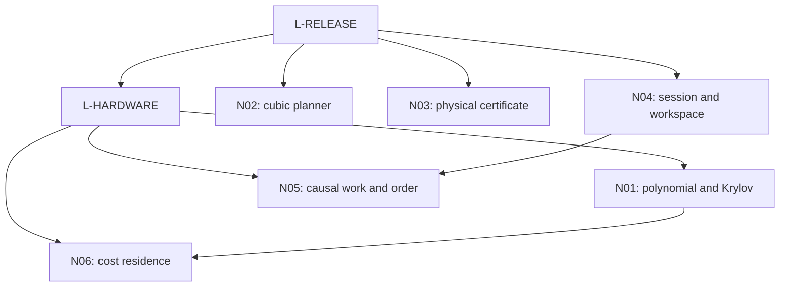
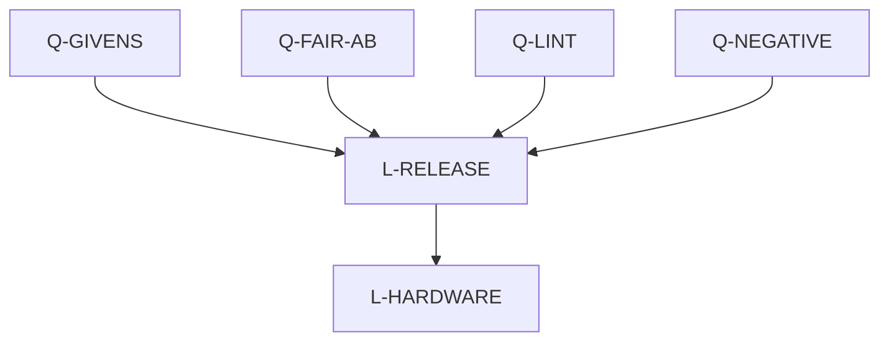
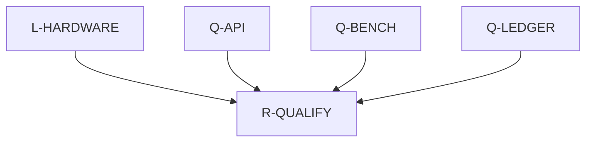

# Development DAG and PR purposes

The complete machine-readable graph in LOCAL_DEVELOPMENT_PLAN.json retains all 23 nodes and 34 inherited edges. The views below keep at most four parallel branches; the dependency table is exhaustive. Completed historical nodes refer to PR92 evidence. New R2/R4 findings do not close native work.

## Native and research scheduling

## Numerical qualification prerequisites

## Client qualification prerequisites

The actual JSON dependency lists below are authoritative. Views group the operational sequence for readability; verify every incoming edge from the table before scheduling.

## Complete node/dependency table

| Node | Purpose | Dependencies | Inherited status |
|---|---|---|---|
| S-PRS | Inspect PRs after PR91 | none | complete_scoped |
| R-STRUCT | Charged structural attempts and full residual enclosure | S-PRS | complete_scoped |
| R-HOMO | Scalar homotopy and rational cubic inverse | S-PRS | complete_scoped |
| R-ADAPT | Exact return evidence and causal proposal reuse | S-PRS | complete_scoped |
| I-PROD | Explicit production configuration and callback permissions | R-STRUCT, R-HOMO, R-ADAPT | complete_scoped |
| V-CLOUD | Native contracts, small paired benchmarks and profiles | I-PROD | complete_scoped |
| P-PUSH | Publish implementation, evidence and local handoff | V-CLOUD | complete_scoped |
| L-RELEASE | Pinned native release verification on the deployment machine | P-PUSH, Q-GIVENS, Q-FAIR-AB, Q-LINT, Q-NEGATIVE | pending_local |
| L-HARDWARE | Matched-accuracy measurements on target hardware | L-RELEASE | pending_local |
| PR-N01 | Fused polynomial actions, resolvent alternatives and small-Krylov cost | L-HARDWARE | pending_local |
| PR-N02 | Tighter finite-step cubic accuracy planning | L-RELEASE | pending_local |
| PR-N03 | Adaptive structural consumer with physical-error accounting | L-RELEASE | pending_local |
| PR-N04 | Owned session continuation and generic homotopy workspace | L-RELEASE | pending_local |
| PR-N05 | Generic causal closure and parallel work/span selection | L-HARDWARE, PR-N04 | pending_local |
| PR-N06 | Temporal residence and exploration-loss theory | L-HARDWARE, PR-N01 | pending_local |
| R-QUALIFY | Scoped release qualification for the actual client | L-RELEASE, L-HARDWARE, Q-LEDGER, Q-BENCH, Q-API | pending_local |
| Q-LEDGER | Research registration and published-reference qualification | P-PUSH | registration_repaired_full_authority_pending |
| Q-GIVENS | Portable Givens residual fixture | P-PUSH | pending_local |
| Q-FAIR-AB | Attempted, admitted and refused work | P-PUSH | pending_local |
| Q-BENCH | Qualified external comparator build | P-PUSH | pending_local |
| Q-LINT | Broader integrator Clippy | P-PUSH | pending_local |
| Q-API | Public SwitchingConfig compatibility | P-PUSH | pending_local |
| Q-NEGATIVE | Retained negative evidence and ignored suite | P-PUSH | pending_local |

## Candidate membership

| Task | Candidate IDs | Native status |
|---|---|---|
| PR-N01 | N01-P-FUSE, N01-P-RES, N01-P-HYB, N01-P-NONNORMAL, G-INVARIANT-SPLIT | pending_local |
| PR-N02 | N02-C12-DECAY, N02-CONTRACTIVE-PREFIX | pending_local |
| PR-N03 | G-TRANSPORT, G-EXACT-FLOW | pending_local |
| PR-N04 | N04-WINNING-SESSION, N04-MONOTONE-BRANCH, N04-CERTIFIED-STATIONS | pending_local |
| PR-N05 | G-CAUSAL-BUDGET, G-GEOMETRIC-RK, G-AFFINE-SCAN, G-DAE-PROVIDER, G-INVARIANT-SPLIT | pending_local |
| PR-N06 | N06-DISCRETE-RESIDENCE | pending_local |

These are alternatives within the six existing tasks, not seventeen new mandatory PRs or separate correction budgets. Candidate records supply equations, assumptions, reuse paths and experiment contracts.
