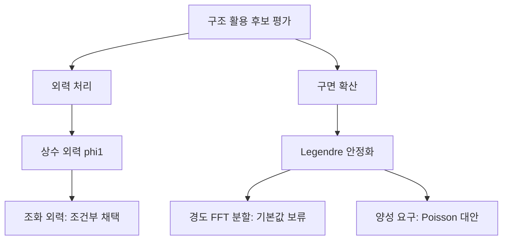
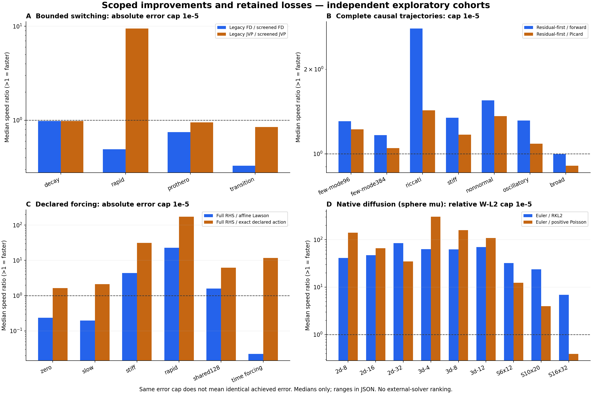
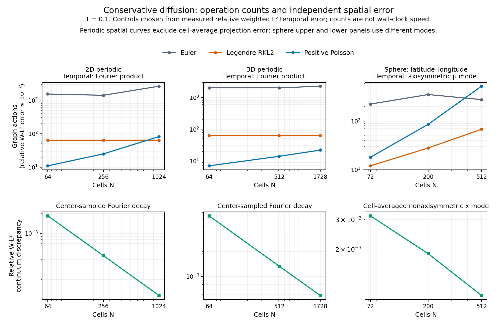

# VigilODE의 구조 활용 적분과 격자 확장성: 재감사 및 후속 개발 연구

2026-10-23 · 대상: stiff/rapidly oscillating 시스템에 강하면서 일반 ODE에도 사용할 수 있는 solver · 실행: 로컬 단일 코어 중심, NCP 미사용

## 초록

현재 VigilODE를 범용 production ODE solver로 승인하기에는 근거와 구현이 부족하다. 이번 연구에서는 기존 결과를 반복하는 대신, 실제 남아 있던 전환 비용, 외력 처리, causal 전체 궤적, 저차 다항식 연산자, 구면·2D·3D 확산을 각각 독립적으로 개발하고 비교했다. 결과는 **범용 사용 보류, 특정 구조를 가진 문제의 선택적 채택**이다.

새로운 구현에는 비용을 제한한 전환 시험, 상수 외력을 포함한 Lawson 적분, 공명에서도 정칙인 조화 외력 전파, 선언된 다항식 관계를 이용한 resolvent, 보존형 격자용 Rust 확산 커널이 포함된다. Causal 방식은 이번에 실제 수락된 전체 궤적에서 비교했다. 조건부 연산량 감소와 오차 경계를 증명했고, 반례와 성능 손실도 함께 보존했다. 자동 전환과 양성 보존, 온라인 사건 종료, 일반 비선형 PDE의 전역 오차가 다음 개발의 핵심이다.

## 1. 연구 동기와 현재 코드의 위치

강성 문제에서는 explicit 방법의 안정성 제약이 계산량을 지배한다. 그러나 이를 피하기 위해 모든 문제에서 Jacobian·행렬 조립·Newton 반복을 수행하면 작은 시스템과 비강성 문제의 비용이 커진다. 빠른 진동은 감쇠 강성과도 다르다. 진동 때문에 많은 스텝이 필요한 현상을 강성으로 판단하여 비싼 implicit 경로로 넘기는 전략은 실제로 큰 손실을 보였다.

유망한 방향은 물리적으로 주어진 구조를 정확히 계산하고, 남은 부분에만 일반 적분기를 적용하는 것이다. 감쇠 회전 블록, 낮은 차수의 연산자 관계, 보존형 면 플럭스는 큰 상태 차원과 무관하게 작은 표현을 가질 수 있다. 반면 이러한 구조를 선언할 수 없는 문제에서는 일반 RHS 경로와 검증된 fallback이 필요하다.

이번 시작점은 `research/adaptive-causal-20261023`의 `9b210c76…`이다. 원격193개 브랜치와 최근 PR을 조사했고, VigilODE 자체 개발 브랜치 `claude/nice-dijkstra-208xq0`의 `c03ca90f…`도 포함했다. 그 브랜치의 개발 결과를 참조한 기존 통합·감사 자료는 현재 checkout에 있다. 이는 모든 브랜치를 무조건 merge했다는 의미가 아니다. 변경되지 않은 근거는 재사용하고, 이번 변경과 연결되는 소스·전제·시험만 새로 검증했다. 원래40개 개발 항목과 이번 연구의 대응은 [BENCHMARK_PLAN.json](BENCHMARK_PLAN.json)에 있다.

| 현재 구성 | 역할 | 이번 변경 및 확인 |
|---|---|---|
| `vigilode` façade | 입력 계약, DOPRI5/RODAS/Lawson, 출력·오류 처리 | bounded implicit pilot, affine Lawson API |
| `rodas5p-integrators` | 실제 적분 및 구조 활용 커널 | exact affine/harmonic action, polynomial resolvent |
| `vigilode-coupled` | projected raw-U 단계 해법 | 기존 세 방법의 수락된 전체 궤적 비교 |
| 새 연구용 Rust 격자 모듈 | 고정 선형 보존 확산 | Euler/RKL2/positive Poisson, workspace·할당 계측 |

큰 행렬을 저장하지 않는 것과 미분 정보를 사용하지 않는 것은 다르다. 새 affine/harmonic 경로는 RHS/JVP/Newton 없이 선언된 흐름을 계산한다. 다항식 경로는 선언된 물리 연산자의 작용이 필요하다. 현재 causal 경로에는 frozen-base JVP가 남아 있다. 일반 비선형 solver 전체가 완전히 derivative-free라고 주장하지 않는다.

## 2. 탐색과 가지치기

첨부 파이프라인의 선택–확장–평가–결과 환류를 적용했다. 독립 병목마다 최대 세 후보를 비교하고, 하나의 변경 또는 전제를 바꾼 자식 후보를 추가했다. 다만 이것은 유한한 실험 예산의 **MCTS식 연구 탐색**이다. 확률적 UCT 수렴이나 전체 설계 공간의 전역 최적성을 증명한 것은 아니다.

판정은 오차, 실패, 작업량, 시간, 메모리, 적용 범위의 벡터로 수행했다. 서로 다른 정확도나 지원 범위를 단일 점수로 합산하지 않았다. 예컨대 빠른 회전의 screened FD는 더 느리지만 더 정확하므로 엄밀한 Pareto 열등이라고 쓰지 않았다. 이미 알려진 반례만으로 방법 전체의 불가능성을 주장하지도 않았다.

실제로 평가 후 추가한 두 확장은 다음과 같다. 전체 후보·결정·증거는 [RESEARCH_TREE.json](RESEARCH_TREE.json)에 보존했다.

첫 확장은 기존의 나쁜 forcing 사례가 상수가 아닌 sin/cos 외력이라는 소스 감사에서 나왔다. 두 번째는 구면 극점의 경도 확산률이 커지는 실제 격자 비용에서 나왔다. 둘 다 단순한 아이디어 목록에서 멈추지 않고 계산·구현·대조 결과를 남겼다.

## 3. 계산량 감소를 보장하는 수학적 결과

완전한 유도는 [수학적 종합](analysis/SYNTHESIS_KO.md)과 각 전문 보고서에 있다. 여기서는 구현과 직접 연결되는 결과를 요약한다.

### 3.1 몫대수에서의 resolvent

간격이 반영된 연산자 \(B=sA\)와 차수 \(d\)의 선언된 관계식 \(q\)에 대해

\[
p(z)=\frac{q(z)-q(1)}{q(1)(z-1)},\qquad
(I-B)p(B)=I-q(B)/q(1).
\]

계수 구성은 \(O(d)\), 후보 작용은 \(d-1\)회 연산자 호출이다. **필수 원래 잔차 검사까지 포함하면 총 \(d\)회**다. 저차 관계가 차원과 무관하게 유지되면 \(O(dN)\)의 비용으로 계산한다. \(\delta=\|q(B)\|/|q(1)|<1\)인 전 공간 근거가 있으면

\[
\|(I-B)^{-1}\|\le\frac{\|p(B)\|}{1-\delta}
\]

로 잔차를 해 오차에 연결한다. 중복근과 Jordan 블록을 허용하며, pole·상쇄·잘못된 관계는 별도로 거절한다. 구현의 경계는 부동소수점 조건부 추정이며 interval 인증은 아니다. 네 구조 사례에서 총1–2회 호출로 통과했다. Neumann 비교는 수축 사례20회, 나머지 세 사례65회 후 실패했다. 알려진2×2 직접 계산도 비교군에 남겨 약한 반복법만 이기는 결과로 포장하지 않았다. 이12행 연산량 자료는 소스 동결 전 개발 산출물로 별도 commit/binary 영수증이 없으며, 시간 비교 자료가 아니다. 최종 동결 소스에서는 관련8개 회귀시험을 통과했다.

### 3.2 외력까지 포함한 정확한 전파

\(A=-\kappa I+\omega R\), \(R^2=-I\)이면

\[
y(t+h)=e^{hA}y(t)+h\varphi_1(hA)b
\]

는 상수 외력의 정확한 해다. \(\varphi_1(0)=1\)로 연장하므로 역행렬 없이 \(A=0\)을 통과한다. 이 작용을 Lawson 단계의 기준 상태에도 넣었다. 단일 조화 외력은 \(A\mp i\nu I\)의 두 \(\varphi_1\) 작용으로 전파하며 공명점에서도 유한하다. 상태 차원에 대해 \(O(N)\)이다. 임의의 비선형 시간 외력까지 이 결과를 확대하지 않는다.

독립 감사에서는 매우 작은 외력 계수를 먼저 반으로 나누면 0이 되어, 큰 시간 간격을 곱하면 표현 가능한 결과마저 소실되는 오류를 발견했다. 가수·지수 분리 계산으로 고쳤고 native 회귀시험을 통과했다.

### 3.3 보존형 확산의 안정화와 정확도

양의 셀 부피와 대칭 비음 면 전도도로 만든 \(Q\)는 가중 질량을 보존하며 \(W\)-노름에서 자기수반·소산적이다. RKL2의 안정 구간은 단계 수 \(s\)의 제곱에 비례한다. 따라서 고정 정확도 간격 \(h\)에서 안정성에 필요한 플럭스 호출은 \(O(1+\sqrt{h\Lambda})\)다.

이번에는 안정성만 쓰지 않고 정확도 조건도 유도했다. 고정 가중 자기수반 확산 연산자와 안정한 단계에서

\[
\|y_n-e^{TQ}y_0\|_W
\le \frac5{18}T h_{\max}^2\|Q^3y_0\|_W.
\]

Legendre 도함수 경계와 Taylor 나머지, 가환하는 수축 전파의 망원합으로 얻는다. 매끄러운 자료에서 \(\|Q^3y_0\|_W\)가 격자 세분화에도 유계라면, 정확도를 유지하면서 비용을 \(O(ET/h+ET\sqrt{\Lambda/h})\)로 제한할 수 있다. 이는 가정이 명시된 복잡도 개선이며, 임의 비선형·비정규 PDE의 보편적 가속 정리가 아니다.

양성은 별개다. RKL2가 질량을 유지하면서 이웃 값을 \(-5/512\)로 만드는 정확한 반례가 있다. 양성이 필요한 경우 정규화 Poisson 다항식을 사용하면 질량·양성을 유지하고, 잘라낸 Poisson 꼬리 \(\tau\)에 대해 연산자 오차 \(2\tau\)를 얻는다. 원래 코드의 반올림까지 포함한 인증으로 해석해서는 안 된다.

## 4. 검증과 성능 측정

새 소스와 직접 영향을 받는 기존 계약의 native59개 검사가 통과했다. 별도 Rust PDE9개, Python 격자10개, 극점 분할3개도 통과했다. 정확 유리수 반례, remap/error-budget 검사는 별도로 기록했다. 이 숫자를 workspace 전체 테스트 수로 해석하면 안 된다.

공유 EPYC 환경에서 CPU affinity를1코어, 주요 수치 thread 수를1로 제한했다. Causal에는2코어 비교를 추가했다. Cargo 측정 빌드는 Rust1.94.1, opt3, LTO 없음, codegen-units1이다. 초기 빌드 실패와 복구 로그를 보존했다. PDE는 별도 `rustc -O` 실행 파일이므로 다른 cohort와 시간을 섞지 않았다.

| 실험 | 완료·정확도 결과 | 해석 |
|---|---|---|
| switching | 측정120회 중114완료,105회 공통 표본 오차 상한 통과 | RHS-only Prothero 6회 예산 소진; 완료한 9회도 오차 상한 초과로 속도 선택에서 제외 |
| causal1/2-thread | 210회 완료,195회 공통 오차 상한 통과 | 느슨한 진동 설정15회는 속도 선택에서 제외 |
| affine/harmonic | 192행 모두 완료·오차 통과 | warmup48행 제외, 직접 해법의 공차 중복 합침 |
| native PDE | 최종135행 모두 상대 오차 상한 통과 | 성공한 hot loop heap 할당0회 측정 |
| Python PDE | 정확도166행, 공간 오차9행 | 시간·공간 오차 구분 |
| 극점 분할 | 42행 | CFL 완화와 실제 정확도 비용을 별도 비교 |

ODE의 공통 기준은17개 관측점에서 최대 성분 절대 오차 \(10^{-5}\), PDE는 정확한 이산 모드에 대한 상대 가중 \(L^2\) 오차 \(10^{-5}\)다. 이 기준은 연속 시간 전체의 인증이 아니다. 같은 허용오차 입력을 같은 실제 오차로 취급하지 않았으며, 같은 오차 상한을 만족하는 설정 중 비교했다. 제한된 공차 후보에서 가장 빠른 중앙값을 고른 탐색적 결과이고, 미세 시간 측정의 변동이 커 통계적 보편 우위로 해석하지 않는다.

그림1. 비율1보다 크면 해당 비교에서 후보가 빠르다. A: 기존 전환/시험 전환. B: residual-first/causal. C: 전체 RHS 적분/선언된 외력 처리. D: Euler/확산 후보. 패널마다 지원 범위와 실행 파일이 다르다. 오차 상한은 같아도 달성 오차가 정확히 같지는 않다. 모든 min/max와 원시 기록을 JSON에 남겼다.

### 4.1 전환: 큰 손실 하나를 줄였지만 기본값 승격은 이르다

빠른 회전에서 JVP 경로는39.326ms에서4.158ms로 줄어 약9.46배 개선됐다. 그러나 FD 전환에서는3.016ms에서6.132ms로 느려졌고, 강성 전이에서는0.353ms에서1.076ms로 약3.05배 느려졌다. 한 번의 이른 시험이 나중 강성 구간을 놓친 결과다. 기본 RHS-only의 재시작 제거는 유지되지만, derivative 허용 경로의 지속 세션은 아직 구현되지 않았다.

시험 시도 횟수는 설정한 한도를 넘지 않는다. 비교 가능한 정확도와 일정한 구간 비용을 가정하면 implicit/explicit 비용비 \(r<1\)에서 이후 \(K>r/(1-r)\)개 구간이 지속될 때 시험 비용을 회수한다. 실제 문제는 이 가정이 깨지므로, 다음 구현은 지속 세션과 변화 시점에 한정한 재탐색이다. 현재 시험 정책은 opt-in이며 자동 기본값으로 올리지 않았다.

### 4.2 Causal: fixed-step 결과를 전체 궤적으로 확장

단일 스레드 forward의 중앙값 개선은 few-mode96에서1.31배,384에서1.17배, Riccati2.79배, stiff1.34배, nonnormal1.55배, 짧은 고주파 문제1.31배였다. 넓은 스펙트럼은0.999배로 사실상 중립이며, 선택 설정의35시도 중33회 fallback이 발생했다. 이 손실을 숨기지 않았다.

2-thread와1-thread의84쌍 출력·공통 작업량은 bitwise 일치했다. 하지만 동일42설정 중2-thread가1.2배 이상 빨라진 경우는 없었다. 작은 장비의 기본 경로는 serial forward가 적절하며, batching/병렬화는 RHS 비용과 상태 차원이 충분히 큰 실제 client에서 다시 선택해야 한다. 현재 고주파 시험은20radian 길이여서 장시간 위상 정확도를 검증한 것이 아니다.

### 4.3 외력: 상수·조화 구조는 효과적이고, 일반 forcing은 남는다

Affine Lawson은 기존 Lawson 대비 stiff constant22.63배, rapid constant18.43배,128차원 constant12.13배의 중앙값 개선을 보였다. 전체 RHS DOPRI5와 비교하면 각각4.36배,22.71배,1.58배다. 반대로 느린 문제에서는5.09배, 시간 외력 대조군에서는44.58배 느렸다. 구조에 맞지 않는 경로를 범용으로 사용하면 안 되는 이유다.

선언된 harmonic 함수는 같은 시간 외력 사례의17개 출력을8.578µs에 계산하여 전체 RHS DOPRI5보다11.64배 빨랐다. 이것은 조화 외력을 알고 있을 때의 정확한 작용이지, 일반 적응형 solver의 universal 개선이 아니다. 기존 forcing 사례와 방정식은 같지만 이전 실험과 출력점·초기 간격이 다르므로 과거 시간과 새 시간을 직접 나누지 않았다.

### 4.4 격자: 확산 커널은 가능하지만 전체 물리 PDE는 다음 단계다

Native RKL2는 이번 보정된9개 확산 설정에서 Euler보다6.86–84.49배 빠른 중앙값을 보였다. 이 비교는 기존 production implicit solver와의 우위가 아니라, 동일 오차 상한을 맞춘 Euler subcycling 대비다. Positive Poisson은 일부 주기 격자에서 더 빠르지만, 구면16×32에서는 Euler보다 약2.54배 느렸다. 양성과 빠른 실행의 선택 기준이 필요하다.

그림2. 위쪽은 \(T=0.1\), 상대 시간 오차 상한 \(10^{-5}\)에서의 연산량이다. 아래쪽은 공간 오차다. 주기 격자는 cell-center 표본 Fourier mode의 감쇠 오차를 사용하며 초기 cell-average projection 오차는 포함하지 않는다. 구면 위쪽은 \(\mu\) 모드, 아래쪽은 정확한 cell-average를 가진 \(x\) 모드다. 서로 다른 fixture를 하나의 수렴 주장으로 합치지 않았다.

구면 극점의 경도 확산을 FFT로 정확히 계산하는 추가 후보도 구현했다. 그러나 같은 시간 오차에서 위도 연산16/64/64회와 FFT 쌍16/64/64회가 필요했다. 전체 RKL2의12/48/104회와 비용 종류가 다르므로 속도 우위를 선언하지 않았다. 극점의 안정성 제약을 없애도 분할 교환자 오차가 남는다. 실제 BASS/rei_bianchi 이식에는 복사–물질 결합, 에너지·광자수 동시 보존, 경계 플럭스, 비선형 반응, remap 오차가 추가로 필요하다.

## 5. 생산용 판정과 남은 문제

| 구성 | 판정 | 현재 사용할 수 있는 범위 |
|---|---|---|
| 범용 production solver | **HOLD** | 일반 stiff/nonstiff/oscillatory 문제를 포괄하는 보증 부족 |
| bounded switching pilot | **OPTIMIZATION_POSSIBLE** | 회전 JVP 손실을 줄이나 다른 구간에서 손실; opt-in |
| affine/harmonic flow | **SPECIALIZED_ONLY** | 선언된 고정 감쇠 회전과 상수/단일 조화 외력 |
| causal forward | **SPECIALIZED_ONLY** | autonomous identity-mass, supplied base JVP, 현재 잔차·오차 검사 유지 |
| polynomial resolvent | **SPECIALIZED_ONLY** | 진실한 전 공간 관계식·norm 근거·원래 잔차 검사 |
| RKL2/Poisson PDE kernel | **OPTIMIZATION_POSSIBLE** | 고정 가중 자기수반 선형 확산 prototype; 아직 전체 PDE API 아님 |
| 무검사 양성 RKL2 기본값 | **PRUNE** | 보존된 정확 반례의 범위에서 제외 |
| 작은 문제의 무조건적 stage threading | **PRUNE** | 이번1/2-thread fixture 범위에서 이득 없음 |

가장 중요한 기능상의 간극은 terminal event가 현재 적분 후 처리된다는 점이다. 출력은 사건 위치에서 잘리더라도 그 이후의 callback 실행을 막지 못한다. RHS의 정의역이 사건 뒤에서 끝나는 모델에는 production 수준의 종료 보장이 없다. 이를 단순한 성능 문제로 취급하지 않았다.

또한 fatal callback은 실제 사용자 함수가 반복 호출되지 않도록 보호되지만, 내부 driver에는 추가 시도가 남을 수 있다. controller·FSAL·Jacobian/provider cache를 보존하는 세션, fatal 전용 종료 신호, 실제 수락 경계의 온라인 사건 검출을 함께 설계해야 한다. 국소 오차 제어와 단계 잔차만으로 전역 정확도가 자동 보장되지는 않는다.

## 6. 다음 개발 순서

1. **지속 세션과 즉시 종료 계약.** explicit/implicit engine에 수락 상태와 controller/cache를 재개하는 API를 추가한다. 모델 epoch·격자·provider 변경 시 무효화 규칙을 명시한다. 단일 방법에서는 기존 출력·작업 카운터가 그대로 유지되어야 하며, fatal 이후 추가 native 시도는 없어야 한다.
2. **변화에 반응하는 전환.** 현재 한 번의 pilot이 놓친 강성 전이를 회귀 사례로 사용한다. 물리적 진전, 잔차/거절 원인, 실제 provider 비용을 기록하고 제한된 예산으로 재탐색한다. 최악 손실과 실패 비용까지 계산한다.
3. **온라인 사건과 연속 출력.** 수락된 스텝마다 사건을 확인하고 bracket 안에서 localization한다. 이미 계산한 내부 stage가 사건을 지나갈 수 있다는 한계와, 사건 검출 뒤의 추가 스텝을 막는 계약을 구분한다. 사건 뒤 RHS 정의역 실패 fixture를 포함한다.
4. **구조 provider의 실제 client 연결.** 다항식 관계·norm 경계·외력 계수에 모델 epoch와 간격을 묶는다. 성공한 몇 probe로 전 공간 관계를 추정하지 않는다. 공명·Jordan·nonnormal·계수 상쇄 시험을 유지한다.
5. **PDE를 고정 격자부터 연결.** 보존형 graph API와 primitive workspace를 solver façade에 연결하고 positivity 실패 시 상태를 폐기한다. 상수/조화 carrier와 반응 잔여항을 먼저 분리한 뒤, 구면의 여러 각도 모드와2D/3D 제조해로 검증한다. 공간 오차, 시간 오차, splitting 오차를 별도 예산으로 관리한다.
6. **물리 결합과 remap.** BASS/rei_bianchi의 실제 변수·질량·에너지 정의에 맞추어 border coupling과 positivity를 검증한다. 보존만 하는 remap도 해를 바꿀 수 있으므로 consistency/Hellinger 오차를 따로 누적한다. accepted-step remap은 일반적인5차 정확도 유지의 자동 보증이 아니다.
7. **로컬 qualification.** [BENCHMARK_PLAN.json](BENCHMARK_PLAN.json)의18개 문제군과1/2-thread·메모리 예산을 실행한다. 외부 비교군은 VODE/DVODE, diffsol, Julia로 제한한다. 이번 패키지에서 이 새 외부 비교는 **NOT_RUN**이며 NCP를 사용하지 않는다.

각 단계의 파일, 선행 조건, 구현 방향, 완료 기준은 [NEXT_STEPS.json](NEXT_STEPS.json)에 있다. 이론·프로토타입·정확도 검증이 끝난 부분과 실제 물리 client/일반 사용 승격이 남은 부분을 구분했다.

## 7. 재현과 독립 검토

[REPRODUCE.md](REPRODUCE.md), [HANDOFF_PROMPT_KO.md](HANDOFF_PROMPT_KO.md), [PUBLISH_MAP.json](PUBLISH_MAP.json)에 실행과 소스 대응을 기록했다. 원시 기록은 각 cohort의 `RAW.tar.gz`와 개별 SHA256 목록에 보존하며, summary만으로 실패를 대체하지 않는다. [독립 감사](analysis/ADVERSARIAL_AUDIT.md)는 계산식·코드·반례·시험·그림을 분리해 검토했다. 이는 외부 인적 peer review를 이미 받았다는 주장이 아니다.

이번 결과의 가치는 모든 문제에서 하나의 방법이 이겼다는 데 있지 않다. 어떤 구조에서 연산량을 확실히 줄일 수 있는지, 그 구조를 코드가 어떻게 받아야 하는지, 그리고 빠른 커널을 전체 궤적의 정확도·종료 계약에 연결하기 위해 무엇을 더 구현해야 하는지를 실제 코드와 실패 사례로 구체화했다는 데 있다.
