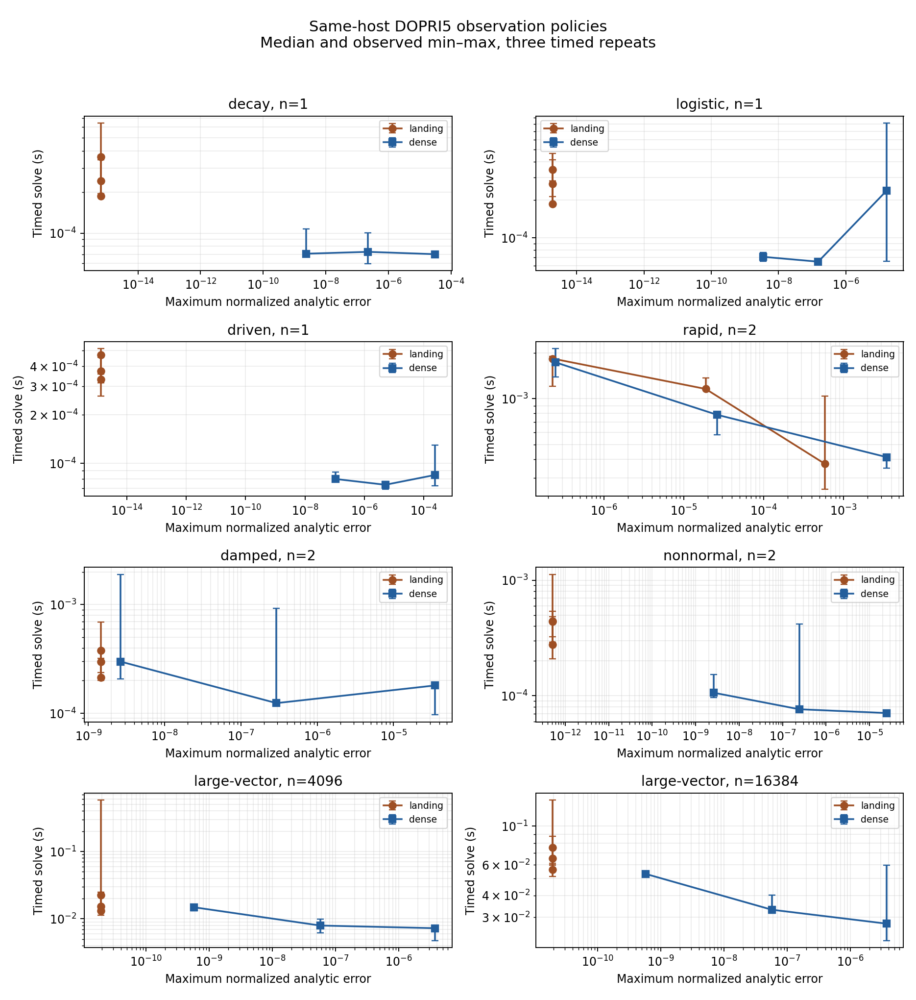
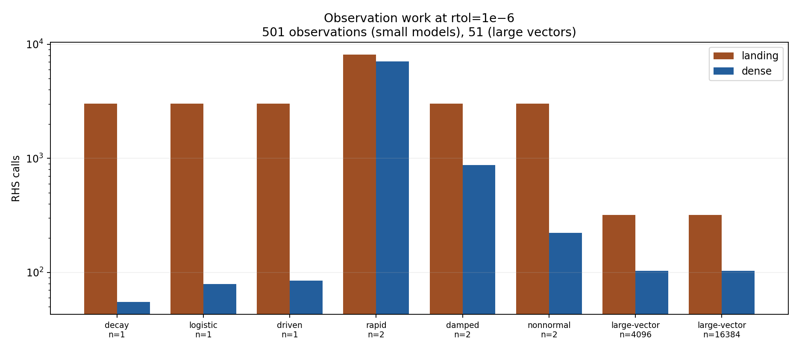

# VigilODE 생산 사용 준비도 재감사와 정확도·계산 비용 개선

작성일: 2026-10-23. 기준 소스: `fbc3c272fa06b443de148631ea78bfa6a34f1b2b`.
새 실행 소스: `5913fe062706c820e768b9e150e5cd1c274f7bf9`.
실행 tree: `7a70caf85569dbe6c77ecb9a53fe666cd40ae618`.
독립 연구·구현 브랜치: `research/production-hardening-20261023`.

## 초록과 판정

VigilODE를 임의의 문제에 자동 적용하는 범용 production solver로 승인할 근거는 아직 충분하지 않다. 특히 자동 명시적/음해법 전환, 장시간 위상 정확도, 실제 물리 client의 오차·보존량, 비매끄러운 우변의 처리, 여러 플랫폼의 재현성은 별도 검증이 필요하다. 반면 매끄러운 비강성 identity-mass 초기값 문제에 사용자가 명시적으로 선택하는 DOPRI5 경로는 기능 범위를 넓힐 수 있다. 이번 작업은 문서상의 기능 제안에 머무르지 않고, 관측 보간과 물리 공간 오차 제어를 native Rust 경로에 연결하고 실제 산술 오류 두 개를 고쳤다.

주요 성과는 다음과 같다.

1. 관측 시각마다 스텝을 줄이지 않는 DOPRI5 quartic 연속 확장을 구현했다. 새 RHS 평가 없이 수락한 구간의 표본을 계산하며, 잘못된 보간이 일부 관측값만 공개하지 않도록 상태 확정을 원자적으로 처리한다.
2. 축약 상태 \(u\)에서 물리 상태 \(v=d+Lu\)로 전달되는 오차를 직접 제어한다. sparse lift와 보상합으로 \(O(\mathrm{nnz}(L)+m+n)\)의 계산량을 갖고, 성공한 norm 평가에는 임시 heap 할당이 없다.
3. 극소 \(h\)에서 \(h a_{ij}\)가 먼저 반올림되어 증가량을 잃는 문제, 그리고 거절된 스텝이 관측 착지 보정으로 다시 같은 크기가 되는 문제를 수정했다.
4. callback 안전 검사를 유지하면서 RHS 평가마다 중복되던 \(n\)-성분 초기화 쓰기 한 번을 제거했다.

이 보고서의 성능 판정은 동일 명목 tolerance만 비교하지 않는다. 모든 저장 시각과 성분의 실제 오차를 독립적으로 계산하고, 같은 오차 상한을 충족하는 설정끼리 시간을 비교한다. 새 벤치마크의 구체적인 수치는 아래 측정 절에, 최종 기계 판독 판정은 [DECISIONS.json](DECISIONS.json)에 있다.

## 1. 최신 결과와 분기된 연구의 통합

최신 `research/nonstiff-explicit-20261023`에는 이전 보고서 이후 diffsol·Julia 비교 adapter와 실행 증거가 추가되어 있었다. 이 변경은 native solver 코드와 Cargo lock을 바꾸지 않았다. 따라서 기존 endpoint tableau의 5차 증명과 변경되지 않은 solver 실험을 다시 수행할 이유는 없다. 대신 새로 게시된 비교 결과를 한 번 독립 감사했다.

파일 213개와 raw 자료 2,688개의 크기·해시가 일치했다. 외부 384회 실행 결과를 별도의 해석해 식으로 재채점했고, 공통 오차 상한에 따른 설정 선택·시간비 96개를 다시 계산해 원래 분석과 일치함을 확인했다. 이 검사는 solver 재실행이 아니라 결과의 독립 감사다. 자세한 내용과 재현 코드는 [최신 비교 감사](LATEST_BENCHMARK_AUDIT_KO.md)에 있다.

그 결과는 VigilODE의 우위만 보여 주지 않는다. 4,096차원·rtol=1e-7 비교에서는 DOPRI가 RHS를 157회, Julia Tsit5가 175회 평가했지만, 각각 약 3.998 ms와 0.9455 ms였다. 더 적은 RHS 호출만으로 대규모 벡터의 전체 비용을 설명할 수 없다. 빠른 진동 문제에서는 DOPRI의 최소 측정 오차가 약 1.9715e-8이므로 1e-8 상한을 충족하지 못했다. 서로 다른 실행 cohort의 시간을 직접 합쳐 새 가속률로 주장하지 않는다.

별도 `research/orchestration-sandbox-20261022-vigilode` 연구의 물리 공간 norm 아이디어는 이번 native explicit 구현으로 연결했다. 이것은 해당 Python BDF client의 물리 모델 전체를 Rust로 옮겼다는 뜻이 아니다. core 개발 분기와 coupled-stage 분기의 기존 구현도 기준 소스의 조상 관계와 별도 차이를 확인했다. [BRANCH_SURVEY.json](BRANCH_SURVEY.json)은 확인한 tip·tree·공통 조상과 분기별 고유 변경을 기록한다. 첨부 BASS/HTT 자료는 역사적 입력으로 분류하고, CMB 전용 요구사항을 일반 ODE solver의 부적합 사유로 가져오지 않았다.

## 2. 알고리즘과 새 공개 API

기존 explicit 경로는 Dormand–Prince 5(4)의 일곱 단계와 FSAL을 사용한다. 정상적으로 완결된 trial이 \(A\)회이면 RHS 작업은 \(1+6A\)회이며, 부분 실패는 실제 진입한 호출만 기록한다. 명시적 단계에는 Jacobian 구성, Newton 반복, 선형계 풀이가 없다. 물리 norm의 고정 선형사상 \(L\)은 별도로 주어진 기하학적 오차 metric이며, 시스템 Jacobian을 근사하는 행렬이 아니다.

| 공개 함수 | 관측 정책 | 오차 수락 기준 |
|---|---|---|
| `Dopri5::solve_observed` | 각 시각에 착지 | 원래 상태 WRMS |
| `Dopri5::solve_dense_observed` | 수락 구간의 quartic 표본 | 원래 상태 WRMS |
| `Dopri5::solve_observed_with_norm` | 각 시각에 착지 | affine 물리 WRMS |
| `Dopri5::solve_dense_observed_with_norm` | 수락 구간의 quartic 표본 | affine 물리 WRMS |

새 함수는 기존 landing 함수의 의미를 바꾸지 않는다. 반환 상태는 언제나 원래 적분 좌표다. `options`, `adaptive`에는 요청된 설정을, 새 `error_control`에는 실제 수락에 쓰인 물리 차원·atol·rtol을 기록한다. `observation_mode`는 실행한 관측 방식을 식별한다.

이 sampled API는 이후 임의의 시각을 조회하는 보간 객체를 보관하지 않는다. 기존 `Options::dense_output=true`는 그런 retained-output 계약을 요청하므로 여전히 거절된다. 새 sampled API에서는 그 flag를 false로 둔다. events와 nonidentity mass도 현재 explicit 경로의 지원 범위 밖이다. 사용자-facing 사용법은 [EXPLICIT.md](../../crates/vigilode/EXPLICIT.md)에 정리했다.

한 시도의 구체적인 순서는 다음과 같다. 초기 입력·관측 schedule·물리 lift를 검사한 뒤, 변경되지 않은 base state의 FSAL 기울기를 재사용한다. 여섯 새 RHS 단계와 embedded difference를 계산하고, 선택한 상태/물리 WRMS로 수락 여부를 정한다. 거절하면 상태와 출력은 유지하고 더 작은 represented interval을 제안한다. 수락 후보에서는 해당 구간의 관측값을 먼저 계산·검사한다. 그것이 모두 성공한 뒤에만 출력, 물리 상태, FSAL을 함께 확정한다. 이 순서 때문에 보간이나 norm 실패가 이미 수락한 상태를 덮어쓰지 않는다.

## 3. 관측 보간의 정확도와 계산량 정리

기존 단계 기울기 \(k_i\)와 Shampine 계수 \(P\)를 사용해

\[
b_i(\theta)=\sum_{q=1}^4 P_{iq}\theta^q,
\qquad p_n(\theta)=y_n+h\sum_i b_i(\theta)k_i
\]

로 둔다. Wolfram의 정확 유리수 연산으로 연속 차수 4까지의 rooted-tree 조건 8개와 \(b(1)=b_5\), \(b'(0)=e_1\), \(b'(1)=e_7\)를 검증했다. 기존 endpoint 5차 조건은 재계산하지 않았다. [독립 수학 검토](DENSE_THEORY_REVIEW_KO.md)에 모든 식, 전개, 원시 계산과 계수 출처가 있다.

**정리 1 — 표본 정확도.** 충분히 매끄러운 RHS와 유계인 관련 도함수, stage가 머무는 공통 영역을 가정하면, 정확한 시작값에서 위 보간의 국소 상태 오차는 \(O(h^5)\)다. 별도로 endpoint의 고정 시간 구간 오차가 \(C_NH^5\)이고 stage map이 균일 Lipschitz이면, 보간을 다음 적분 상태로 되먹임하지 않는 구현에 대해

\[
\sup_{n,\theta}\|p_n(\theta)-y(t_n+\theta h_n)\|
\le [(1+C_LT)C_N+C_D]H^5
\]

이다. 증명은 정확한 시작값에서 만든 같은 다항식을 더하고 빼고, 초기값 의존성 \(1+C_Lh_n\)와 국소 보간 오차를 적용하면 된다. 관측 오차는 다음 step으로 전달되지 않으므로 관측 개수만큼 누적시키지 않는다.

이 정리는 embedded estimator가 모든 내부 시각에서 사용자 tolerance를 보장한다는 뜻이 아니다. 또한 differential residual \(p'-f(t,p)\)는 일반적으로 \(O(h^4)\)이므로 상태 보간 오차와 구분해야 한다. \(y'=t^4\)의 내부 오차 계수는 \(\theta=1/2\)에서 정확히 \(997731/2350433840\ne0\)이며, 이 quartic을 continuous order five라고 부르지 않는다.

**정리 2 — 관측 밀도와 RHS 작업의 분리.** deterministic 고정 모델에서 보간 계산이 유한하게 성공하면, 내부 관측 시각의 개수만 바꿔도 trial·수락·거절·FSAL·최종 상태·RHS 호출 수가 변하지 않는다. 실제 step controller는 양 끝 시각만 보기 때문이다. 관측을 포함하는 수락 구간이 \(S_o\), 표본 수가 \(Q\), 상태 차원이 \(n\)이면 추가 연산은 \(O(S_on+Qn)\)이며 RHS 호출은 0회다. 관측 착지 방식은 서로 다른 내부 시각 \(Q\)개에 대해 적어도 \(Q+1\)개의 수락 구간을 요구한다. 따라서 저비용 보간으로 표현 가능한 해에서는 관측 밀도에 비례하던 RHS 작업을 실제로 제거한다. 다만 상태 저장 자체의 \(\Omega(Qn)\) 비용과 출력 메모리는 남는다.

## 4. 물리 공간 오차 제어의 구성적 증명

보존 제약 등으로 \(v=d+Lu\in\mathbb R^m\)인 affine 축약을 사용한다고 하자. embedded difference가 \(e\in\mathbb R^n\)일 때 올바른 물리 WRMS는

\[
\mathcal E^2=\frac1m e^TL^TD^{-2}Le,\quad
D_{jj}=a_j+r\max(|d_j+(Lu_n)_j|,|d_j+(Lu_{n+1})_j|)
\]

다. offset은 old/new scale에는 들어가고 오차의 numerator에는 들어가지 않는다. 축약 좌표의 diagonal tolerance만 바꾸어 이 상관 오차 metric을 일반적으로 대체할 수 없다.

**정리 3 — affine 일관성과 좌표 불변성.** 축약 우변이 실제 물리 동역학을 정확히 나타내면 explicit RK의 각 stage와 endpoint는 affine lift와 교환한다. 단계별 귀납에서 \(L\sum a_{ij}k_j=\sum a_{ij}Lk_j\)를 쓰면 된다. 따라서 full-space embedded error는 정확히 \(Le\)다. 가역 affine 재매개화 후 lift·오차·초기값을 일관되게 변환하면 위 metric의 numerator와 old/new physical scale이 같으므로 수락 판정도 같다. 이 진술은 정확 연산에 대한 것으로, 부동소수점 roundoff에 의한 마지막 비트와 임계점 판정까지 동일함을 주장하지 않는다.

Wolfram의 실제 30→33 예에서는 축약 WRMS가 \(2/5\)로 수락하지만 물리 WRMS는 \(2\sqrt{2/5}\simeq1.264911\)로 거절한다. 이는 full physical scale과 correlated error를 적분 제어기에 넣어야 하는 구체적 이유다.

**정리 4 — 희소 평가 비용.** 입력 lift를 한 번 CSR로 바꾸면 old/new/error의 세 row product는 \(3\operatorname{nnz}(L)\)개의 곱셈과 \(O(m+n+\operatorname{nnz}(L))\) 부가 연산으로 계산된다. 예시 full33 lift는 990개의 dense entry 중 60개만 nonzero이므로 세 product의 곱셈 수가 2,970에서 180으로 감소한다. 이는 norm 연산의 정확한 비용 감소이며 전체 solver가 16.5배 빨라진다는 주장은 아니다. 보상합과 유한성 검사는 실제 구현에 포함되어 있다.

상세 증명과 조건부 전역 오차 부등식은 [THEORY_NORM_KO.md](THEORY_NORM_KO.md)에 있다. rank-deficient lift는 잠재 좌표 전체의 norm이 아니라 seminorm이며, 물리 모델·축약식의 타당성은 client가 입증해야 한다. 비선형 manifold \(v=\Phi(u)\)에는 curvature와 비선형 차분이 추가되므로 이번 affine API를 그대로 일반화할 수 없다.

## 5. 적대적 코드 감사와 수정

| 지적 | 실제 영향 | 수정·검증 |
|---|---|---|
| 극소 h에서 `h*coefficient` 선행 곱 | 상수 RHS인데 증가량 상대 오차 0.5, embedded error 0 | 작은 h에서 `coefficient*(h*k)`; 양 부호와 tiny final landing 회귀 시험 |
| 거절 스텝의 재착지 | 줄인 represented interval을 다시 늘려 동일 trial 반복 가능 | 최종 착지 후에도 이전 거절 step보다 엄격히 짧은지 검사; 최종·내부 관측 회귀 시험 |
| RHS 중복 poison | 매 호출 n개 쓰기 중복 | facade 초기화 제거, kernel poison과 유한성 검사 유지 |
| 정상 내부 query의 θ=1 반올림 | 큰 cross-zero 구간에서 정상 시각을 거절 | 물리 구간 검사를 먼저 하고 가까운 endpoint를 기준으로 평가 |
| 초기 physical lift overflow | 0 길이 span에서 잘못된 physical map을 성공으로 처리할 위험 | callback 전 initial lift·scale 평가 |

첫 지적의 원래 연산은 별도 Python binary64 전사로 재현했고, 수정된 실제 Rust 경로도 테스트했다. 원래 Rust binary를 실행한 것으로 표시하지 않는다. 새 보간과 norm은 수락 전 검사를 끝내고, 실패 시 이전 accepted state와 해당 시각까지의 관측만 유지한다. 극단적으로 나쁜 controller 설정의 실용적 수렴이나 모든 가능한 overflow의 회피를 보장하지는 않는다.

## 6. 검증과 벤치마크

고정 소스에서 Rust 계약 테스트 67개와 Python 검증기 오염 검출 테스트 7개가 통과했다. Rust 구성은 kernel/affine/dense/extreme 35개, public/ensemble 17개, 공유 clock 5개, dense transaction 1개, coupled adaptive trajectory 9개다. 성공 경로의 workspace·affine norm 무할당, 실제 호출 수, 실패의 부분 결과, nonlinear/nonautonomous 수렴, 표현 가능한 시각, 초기 입력 거절을 포함한다. 전체 workspace·모든 플랫폼의 테스트를 수행했다는 뜻은 아니다.

실행 자료: [validation_v1/SUMMARY.json](evidence/validation_v1/SUMMARY.json). Rust 1.94.1과 locked dependency 118개를 사용했고 repository lock/config는 바꾸지 않았다. 초기 runtime 추출 문제와 복구 검증도 [환경 기록](evidence/environment/)에 보존했다. NCP는 접속하거나 사용하지 않았다.

### 6.1 동일 호스트의 새 paired 실험

8개 문제·차원 조합, rtol 세 값(1e-4, 1e-6, 1e-8), 두 관측 정책과 sparse dense companion을 합쳐 **72개 구성·288회**를 실행했다. 각 구성은 warmup 1회와 timed 반복 3회다. 작은 문제는 501개, 큰 벡터는 51개, density 비교용 sparse 경로는 5개 시각을 저장했다. 원자료 576개 해시가 일치하며 288회 전체 상태 재채점, 72개 설정의 반복 상태·작업량 일치, 24개 관측 밀도 비교가 통과했다.

논리 CPU0에 affinity를 고정했다. 컨테이너 quota는 CPU8개 상당이며 전용 머신은 아니다. 문제/초기 상태/options/workspace 생성과 solve를 timed 구간에 포함하고, 관측 schedule 생성·해석해 계산·JSON 직렬화·프로세스 시작은 제외했다. 프로세스 시작부터 raw 압축까지 24.154초였고, 빌드 405.899초와 독립 재채점 시간은 solver 시간에 포함하지 않았다. 압축 archive의 임의 순서 탐색은 후처리를 느리게 했으며 향후 단일 순차 읽기로 개선할 수 있다. 원래 frozen 분석기가 성공적으로 완료했으므로 재실행하지 않았다.

다음은 같은 normalized error 상한 **1e-6**을 충족하는 각 정책의 가장 빠른 측정 설정이다. 비율은 landing 시간 / dense 시간이며 1보다 크면 dense의 median이 짧다. 이는 동일 오차값을 맞춘 보간이나 전체 성능 보장이 아니라, 같은 허용 상한 아래의 유한 설정 집합 비교다.

| 문제 | 차원 | 시간비 | 반복 min–max 비율 범위 | dense 실제 최대 오차 |
|---|---:|---:|---:|---:|
| decay | 1 | 2.659 | 1.747–9.459 | 2.396e-09 |
| logistic | 1 | 2.863 | 2.714–4.515 | 1.506e-07 |
| driven | 1 | 4.158 | 2.965–4.498 | 1.063e-07 |
| rapid | 2 | 1.059 | 0.566–1.363 | 2.480e-07 |
| damped | 2 | 1.716 | 0.216–1.968 | 2.918e-07 |
| nonnormal | 2 | 3.628 | 0.500–7.116 | 2.423e-07 |
| large-vector | 4096 | 1.662 | 1.153–2.247 | 5.725e-08 |
| large-vector | 16384 | 1.701 | 1.279–1.937 | 5.725e-08 |

이 기준에서 8개 median은 모두 dense에 유리하지만 rapid·damped·nonnormal의 범위는 1을 가로지른다. 세 반복의 min–max는 신뢰구간이 아니다. 전체 24개 문제/오차상한 중 22개가 비교 가능했고 그중 20개 median은 dense, 2개는 landing에 유리했다. **1e-8에서는 damped의 비율이 0.712, 4096-vector는 0.889로 dense가 더 느렸다.** driven은 dense의 최선 오차가 1.063e-7, rapid는 두 정책 모두 약2.3–2.5e-7이므로 이 격자의 1e-8 비교를 성립시키지 못했다. 이를 제거하거나 성공 결과로 바꾸지 않았다.

*그림 1.* 각 점은 한 설정의 세 timed 반복 median, 세로 막대는 실제 min–max다. 왼쪽으로 갈수록 정확하다. 고밀도 landing이 필요 이상으로 작은 step을 써서 roundoff 부근까지 정확해지는 경우와, dense가 그 추가 정확도를 포기하고 시간을 줄이는 관계가 보인다. 곡선은 측정점을 잇는 표시이며 연속적인 Pareto 최적 경계를 추정한 것은 아니다.

*그림 2.* 같은 명목 rtol=1e-6의 작업량. decay는 3013→55, logistic은3013→79, driven은3013→85, large-vector는319→103 RHS로 줄었다. rapid는8131→7093으로 감소폭이 작다. 이 그림은 작업량을 분리하며 실제 오차가 같다고 가정하지 않는다. 그림1과 공통 상한 표를 함께 읽어야 한다.

추가 상태 저장이 필요한 dense 관측을 zero-allocation solve로 표현하지 않는다. 기존 fixed-step workspace와 affine norm의 성공 경로 무할당은 별도 검증된 범위다. 위 시간비는 이번 두 출력 정책의 비교이며 이전 버전 대비 전체 개선률이나 Julia 대비 가속률이 아니다. [원시 결과와 모든 비교](evidence/local_bench/SUMMARY.json), [독립 최종 감사](FINAL_BENCHMARK_REVIEW_KO.md)를 함께 제공한다.

## 7. production 적용 범위와 다음 개발 순서

이번 기능은 사용자가 방법과 오차 공간을 명시적으로 선택하는 범위에서 채택할 수 있다. 임의의 입력에 대한 자동 방법 선택, 사건 탐지, mass matrix, 비매끄러운 FVM limiter, 장시간 oscillator, 고차원 실제 물리 client를 포괄하는 승인은 별도다. 양성·보존량·관측량의 물리 조건을 단순한 WRMS 수락으로 대체하지 않는다.

가장 먼저 실제 client에서 물리 norm을 연결해야 한다. full33 상태 복원, old/new scale, 보존식과 RHS 일관성을 하나의 시험에 넣고 native RODAS 경로에도 같은 오차 계약을 전달한다. 다음으로 큰 벡터에서 stage update·error reduction·RHS의 메모리 대역폭을 프로파일링한다. duplicate poison 한 번을 없앤 사실만으로 Julia 대비 차이가 해소됐다고 판단하지 않는다.

그다음은 명시적/음해법의 opt-in 전환이다. rejection·RHS 비용·stability-limited step의 관측을 사용하되 한 번의 secant 값이 stiffness의 증명이라고 해석하지 않는다. accepted state에서만 전환하고, 유한한 probe budget과 hysteresis, 모든 재시작 비용을 기록해야 한다. stiff control에서 DOPRI를 무조건 기본으로 쓰는 정책은 채택하지 않는다.

빠른 진동은 별도 정확도 문제다. 시간 범위를 늘린 phase/amplitude 오차, phase-sensitive observable, tolerance sweep을 수행하고 필요하면 고차 explicit 또는 구조 보존 방법을 비교한다. 새 dense 출력은 관측 비용을 줄이지만 stability 영역을 넓히지 않는다.

기존 homotopy/Picard 병렬 RK 및 Chebyshev/Laguerre 연구는 조건이 유지되므로 증명을 재검증하지 않았다. 명시적 방법의 시간 의존 순서를 무조건 병렬화해 빨라진다고 주장하지 않는다. 기존 16-stage 후보는 warmed RHS 작업 15회 대 6회와 이상적인 span 5 대 6을 함께 부담한다. 비싼 RHS의 제한된 사례에서 측정할 후보로 유지한다. 독립 trajectory ensemble은 별도의 확립된 병렬화 단위이며, 병렬 구간 보정은 coarse solve·교정 반복·최종 오차 검증 비용까지 비교해야 한다.

구체적인 파일, 우선순위, 의존성과 수락 기준은 [NEXT_STEPS.json](NEXT_STEPS.json)에 전체 30개 항목으로 남겼다. 기존 N01–N18의 미완료 사항을 이번 explicit 변경만으로 닫지 않았다. [HANDOFF_KO.md](HANDOFF_KO.md)는 후속 실행자가 소스 선택·컴파일·검증·벤치마크를 재개할 수 있는 복사 가능한 지시문이다.

## 8. 한계와 자기비판

해석해가 있는 작은 문제와 diagonal 대규모 벡터는 구현 오류를 찾고 작업량을 분리하는 데 유용하지만 실제 산란·이류·화학의 sparse coupling을 대표하지 않는다. 반환된 모든 성분을 검사해도 관측 사이의 최대 오차를 자동으로 알 수 없다. 세 번의 시간 반복과 공유 sandbox는 미세한 가속률의 강한 통계적 근거가 아니다. 보간은 출력 횟수에 따른 RHS를 줄이는 대신 상태 저장과 polynomial 평가 비용을 지불하며, 동일 rtol에서 landing보다 오차가 커질 수 있다.

이번 감사가 발견하지 못한 결함의 부재를 증명한 것도 아니다. 수학적 정리는 매끄러움·정확한 축약·유계 도함수·별도의 nodal bound를 요구한다. 실제 production 판정은 그러한 가정을 만족하는 문제 영역, 운영상의 실패 처리와 반복 실행 증거를 함께 요구한다. 따라서 범용 판정은 HOLD를 유지하면서, 검증된 opt-in 기능과 실제 수정은 개발 경로에 반영한다.

## 자료와 재현성

- [감사·채택 판정](DECISIONS.json), [전체 다음 개발 단계](NEXT_STEPS.json), [연구 루프 기록](WORKFLOW.json)
- [재현 절차](REPRODUCE.md), [인계 지시문](HANDOFF_KO.md), [파일 해시 목록](ARTIFACT_MANIFEST.json)
- [새 수학 원전](AFFINE_SOURCES.json), [dense 계수 원전과 접근 상태](evidence/DENSE_PRIMARY_SOURCES.json)
- 정확 계산은 Wolfram Language 실제 응답과 코드를 함께 보존했다. SciSpace 검색은 문헌 발견에, Exa와 공식 문서는 원전 확인에 사용했다. 접근하지 못한 논문 본문을 읽었다고 표시하지 않는다.
