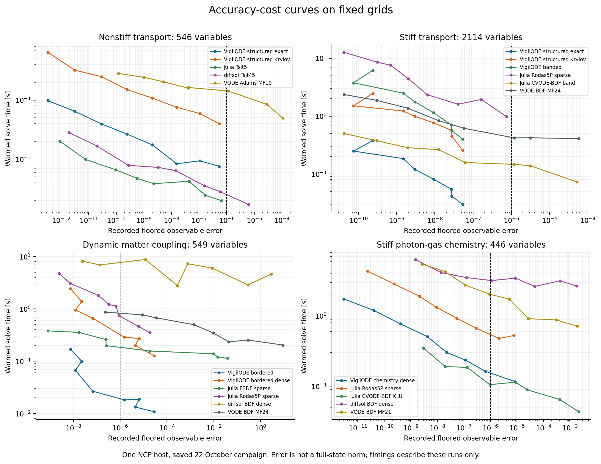
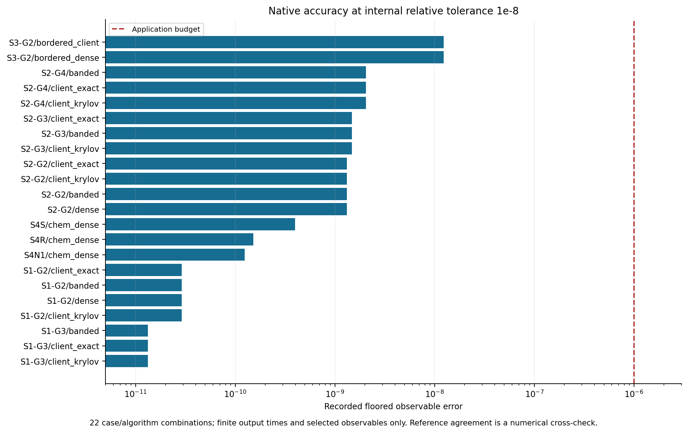
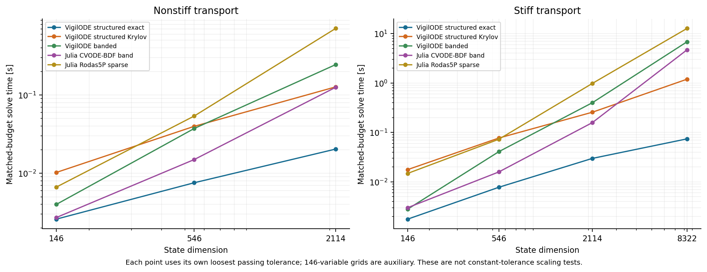
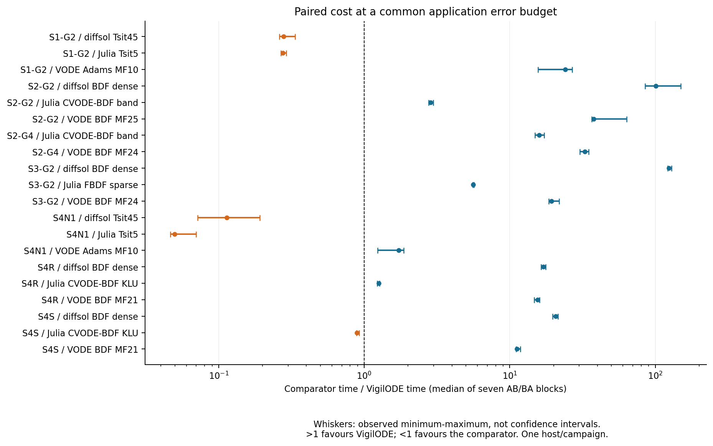
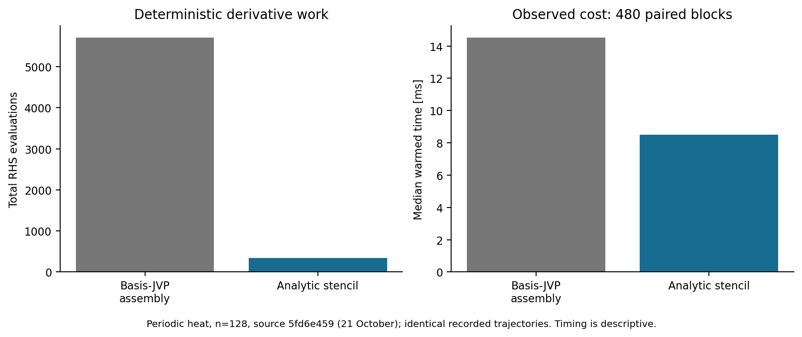

# 수치 실험: 정확도 예산과 계산 비용

## 실험 대상과 해석 범위

최신 실험은 2026년 10월 22일 NCP의 단일 가상 호스트에서 수행되었다. 게스트가 보고한 사양은 Intel Xeon Gold 5220, 논리 CPU 64개, 메모리 약 125 GiB이다. CPU 8–63에 독립 실행을 배치하고 각 실행의 BLAS 스레드 수를 1로 제한하였다. 따라서 이 결과는 여러 독립 문제를 병행한 실험이며, 한 ODE 문제의 64코어 강한 확장성을 측정한 결과가 아니다. 수치 코드의 실행 기준 커밋은 `2064366ea39ef35a9eae7966b4b5b2424a46124c`이고, 이 보고서가 검토한 소스의 기준은 `555e71e03fe31e6c9b21961c8e2d263b1794eb6f`이다.

주요 문제는 비강성 광자 수송 두 격자, 강성 광자 수송 세 격자, 동적 물질 결합 한 격자, 광자–기체 화학 세 조건이다. 보조 격자 세 개를 포함한 총 12개 경우의 차원은 146–8,322이다. 광자 수송에서 산란률은 비강성 조건 0.5, 강성 조건 10^4이다. 시간과 에너지의 물리적 단위는 각 모형의 정의를 따르며, 무차원 수송 실험의 산란률을 화학 반응률과 직접 비교하지 않는다.

| 문제 | 차원 | 조건 | 주된 비교 목적 |
|---|---:|---|---|
| S1-G2 / G3 | 546 / 2,114 | 비강성 수송 | 명시적 방법 대비 음적 단계의 비용 |
| S2-G2 / G3 / G4 | 546 / 2,114 / 8,322 | 강성 수송 | 구조적 직접해법과 반복해법의 차이 |
| S3-G2 | 549 | 동적 전단·물질 결합 | 작은 조밀 경계를 갖는 선형계의 해법 |
| S4N1 / S4S / S4R | 각 446 | 비강성·강성·재결합 화학 | 비선형 원천항과 보존량 |

## 정확도 척도와 기준해

성분 전체의 오차와 관측량의 오차는 서로 다른 양이다. 본 실험은 요청된 양의 출력 시각에서 광자수, 복사 에너지, 복사 비등방성, 이온화율, 내부 에너지 및 전단 비율의 일부를 평가하였다. 관측량 \(Q\)의 오차는

\[
E_Q=\max_j \frac{|Q(y_j)-Q(y_j^{\rm ref})|}{\max(|Q(y_j^{\rm ref})|,F_Q)}
\]

로 정의한다. 광자수와 복사 에너지의 바닥값은 초기값 절댓값의 \(10^{-3}\), 이온화율의 바닥값은 \(10^{-3}\)이다. 전단 비율은 초기값 절댓값의 \(10^{-3}\), 내부 에너지는 바닥값 없이 상대오차를 사용한다. 비등방 에너지 \(D\)는 초기값 절댓값의 \(10^{-3}\), \(D/\rho\)는 출력 시각의 기준해에서 얻은 최대 절댓값의 \(10^{-3}\)를 바닥값으로 사용한다. 추가로 \(D/\rho\)의 오차에는

\[
w_j=\min\{1,\rho_j^{\rm ref}/(10^{-3}|\rho_0^{\rm ref}|)\}
\]

를 곱한다. 이 가중은 복사장이 고갈된 이후 비등방성 비율의 영향을 줄인다. 전체 예산은 \(\max_Q E_Q\le10^{-6}\)이다. 이는 바닥값이 없는 상대오차, 모든 셀의 상태 오차, 출력 시각 사이의 연속 오차 또는 공간 이산화 오차를 의미하지 않는다. 특히 재결합 조건의 거의 소멸한 비등방 성분에서는 바닥값 없는 상대오차가 매우 커질 수 있으므로, 두 척도를 혼용해서는 안 된다.

기준해는 내부 상대 허용오차 \(10^{-12}\)의 VigilODE 조밀 또는 대역 직접해법과 Radau 계산을 대조하여 구성하였다. 동일한 격자 위의 두 적분기 간 일치는 시간 적분 오류에 관한 유용한 교차 점검이다. 정확한 연속체 해에 대한 엄밀한 상계는 아니며, 공통 공간 이산화와 물리 모형의 오류를 제거하지 않는다. 화학 모형에서는 추가로 수소 원자당 입자수 오차 \(5\times10^{-12}\), 에너지 오차 \(5\times10^{-11}\,\mathrm{eV}\)를 검사하였다.

최종 실행의 저장된 기록에는 정상 완료 1,144행, 시간 초과 2행, 계획상 미적용 66행이 있다. 두 시간 초과는 재결합 조건의 DOP853 비교 실행이다. 이전 시도에서는 Julia 의존성이 없어 424행이 실행되지 않았으며, 승인된 환경 복원 후 전체 계획을 다시 실행하였다. 본 보고서의 비교 그림은 VODE/DVODE, diffsol 및 Julia 구현으로 한정한다. Julia를 통해 호출한 CVODE-BDF는 SUNDIALS의 방법이라는 사실을 범례에 명시하였다.

**그림 1.** 각 점은 하나의 내부 허용오차에서 저장된 관측량 오차와 두 번째 프로세스 내부 적분의 측정 시간을 나타낸다. 수직 점선은 응용 오차 예산이다. 측정 시간에는 구현별로 문제 구성·출력 처리 범위의 차이가 남아 있으며, 서로 다른 내부 허용오차를 같은 정확도로 간주하지 않는다.

## 확인된 범위와 구조별 성능

VigilODE의 주요 22개 문제–알고리즘 조합은 내부 상대 허용오차 \(10^{-8}\)에서 저장된 관측량 기준을 모두 만족하였다. 가장 큰 기록 오차는 약 \(1.23\times10^{-8}\)로, 예산 대비 약 81배의 여유이다. 이는 해당 고정 격자와 관측량에 한정된 결과다. 서로 다른 코어 세 개에서 비교한 8개 그룹의 상태·계수 통계 해시는 일치하였다. 두 허용오차 및 강제 거절 조건에서 비교한 16개 그룹의 할당 수 또한 같았다. 유한한 두 실행의 할당 수 일치만으로 임의의 단계 수와 모든 코드 경로에서 무할당을 증명할 수는 없다.

**그림 2.** 주요 22개 조합의 기록 오차. 측정 대상은 선택된 관측량과 출력 시각이다. 기준해를 계산한 적분기 간 일치는 수치적 교차 점검이며 외향 반올림을 사용한 전역 오차 인증은 아니다.

강성 수송 문제에서는 구조를 직접 사용하는 해법의 이점이 뚜렷하다. 8,322변수 조건에서 기록된 예산 충족 시간은 구조적 직접해법 약 0.0741초, 구조적 Krylov 약 1.19초, 일반 대역 해법 약 6.82초였다. 이 차이는 단순한 언어 구현의 차이보다 선형계 구조를 얼마나 제거했는가에 민감하다. 다만 이 문제의 구조를 사용할 수 없는 일반 반응망이나 다른 충돌 연산자에 같은 비율을 적용할 근거는 없다. 또한 각 격자에서 선택된 내부 허용오차와 단계 수가 다르므로, 아래 그림의 기울기를 그대로 점근 계산복잡도의 실험 증명으로 읽어서는 안 된다.

**그림 3.** 각 격자의 가장 느슨한 예산 충족 허용오차에서의 시간. 146변수 격자는 보조 실험이다. 가장 느슨한 시험값인 \(10^{-3}\)에서도 통과한 방법은 그보다 느슨한 허용오차를 시험하지 않았으므로 실제 최소 비용이 더 작을 수 있다.

비강성 수송에서는 Julia Tsit5와 diffsol Tsit45가 VigilODE의 구조적 음적 방법보다 빠른 경우가 관찰되었다. 이는 비강성 문제에서 선형계 풀이의 비용이 명시적 방법에 불리하게 작용할 수 있다는 예상과 부합한다. 화학 모형의 비강성 조건에서도 같은 경향이 나타나므로 모든 문제에 동일한 음적 방법을 강제하는 것보다 강성 탐지와 방법 선택을 구체적 개발 대상으로 삼는 것이 합리적이다.

## 교대 순서 측정과 불확실성

각 비교쌍은 준비 실행 두 블록 후 확인 실행 일곱 블록을 사용하였다. 블록마다 AB 또는 BA 순서를 교대하고, 비교 적분기의 시간과 VigilODE 시간의 비율을 계산하였다. 아래 그림의 점은 일곱 비율의 중앙값이고 선분은 관측된 최솟값–최댓값이다. 이 선분은 신뢰구간이 아니다. 같은 호스트와 동일 캠페인에서 얻은 표본에는 공통 시스템 부하, 가상화 및 캐시 상태의 영향이 남아 있다. 이 자료로 다중 호스트 환경의 일반적 속도 우위를 선언할 수 없다.

**그림 4.** 비율이 1보다 크면 해당 실행에서 VigilODE가 빠르고, 1보다 작으면 비교 방법이 빠르다. 모두 같은 응용 오차 상한을 만족하는 허용오차를 선택했지만 실제 달성 오차는 같지 않다. 전체 비율과 개별 블록 값은 기계 판독 자료에 보존하였다.

이전 10월 21일의 128변수 주기적 열방정식 실험에서는 자코비안 구성에 사용하는 추가 우변 평가를 제거한 효과를 직접 확인하였다. 전체 우변 평가는 5,712회에서 336회로 감소했고, 기록된 1,046개 실행의 출력 궤적은 동일하였다. 그림에 포함한 16개 코어의 병행 실행은 확인 블록 480개이며, 별도의 단일 코어 확인 블록 9개를 합치면 총 489개이다. 480개 병행 실행 블록의 내부 실행 시간 중앙값은 14.527밀리초에서 8.509밀리초로 줄었다. 이 결과는 해당 과거 소스와 문제에 대한 독립된 최적화 근거이며 최신 물리 모형 전체의 성능 결과로 옮겨 쓰지 않는다.

**그림 5.** 과거 고정 열방정식 실험에서의 결정론적 계산량과 기록된 시간. 우변 평가 감소는 알고리즘적 작업량의 감소이며, 측정 시간의 비율은 단일 호스트에서 관찰한 값이다.

## 재현성 감사와 다음 실험

두 최신 시도에 포함된 44개 가져오기 매니페스트 항목의 SHA256을 재계산하였다. 저장된 정확도–비용 표에서 허용오차 선택을 다시 계산하고, 원시 JSONL 시간 기록에서 AB/BA 비율을 독립적으로 재계산하였다. 그러나 최신 시도의 전체 상태 궤적과 기준해 원본은 저장소에 포함되어 있지 않다. 로컬 압축파일의 해시와 경로가 기록되어 있을 뿐이다. 따라서 외부 심사자는 현재 공개된 부분만으로 모든 수치 오차를 다시 계산할 수 없다. 이 보고서의 오차 수치는 저장된 평가 결과임을 명시하며, 원자료 없이 결과를 다시 판정하지 않았다.

가장 우선할 후속 작업은 원시 궤적과 요청·기준해를 담은 재배포 가능한 실행 묶음, 모든 셀을 포함하는 가중 상태 오차, 격자 정련을 통한 공간 수렴, 독립 구현의 비선형 기준해, 물리적 양수성과 보존량을 함께 검사하는 장시간 실행이다. 속도 실험은 동일한 타이머 범위, 사전 고정한 비교쌍, 충분한 출력 정책 비교, 반복 캠페인과 독립 호스트를 갖추어야 한다. 현재 근거는 특정 고정 격자 문제에서 유망한 정확도와 구조적 계산량 감소를 뒷받침한다. 범용 production 적분기로서의 전역 정확도와 성능을 확정하는 데 필요한 검증은 아직 남아 있다.
