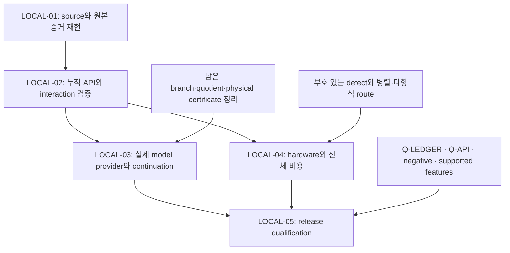

# VigilODE: RVJ/NAG 이론–구현 통합 및 production 감사

2026-10-28. 실행 source: `64004e23042f2cf076da5378be724f50c3856f4c`. Base: PR96 `13f3298bd0213f121e07385903f9508c435ad6a1`. 관련 PR95는 별도 이론 입력이며 merge하지 않았다.

## 1. 판정과 실제 개선

**고정 cyclic 모델의 native 전 구간 인증 계산은 개선됐다. 전체 production solver 자격은 HOLD이다.** 같은 전체 상태 infinity norm과 정확한 물리 오차 cap `1/100000000`을 만족하는 첫 등록 격자를 비교하면, 기존 power/Bernstein 인증의 N=64에서 direct Bernstein 인증의 N=32로 줄었다. 동일한 `direct_bernstein_tight` arm을 세 차원 모두에 적용한 whole-call 중앙값 개선은 **8.7206, 9.3338, 9.1984배**다. 이는 지정된 모델·격자·환경의 일곱 반복 결과이며 일반 stiff solver 성능 보장이 아니다.

Trace 공유 다항식 회로는 candidate field와 interval field를 빠르게 했지만 전체 candidate trajectory 개선은 확인되지 않았다. Direct/shared 시간 중앙값의 비율은 각각 1.1941, 1.4974배인 반면, 전체 candidate trajectory에서는 0.9105배였다. 전체 trajectory의 shared 중앙값은 약 9.824% 느리지만 범위가 겹치고 7회 중 4회는 shared가 빨랐으므로 안정적인 regression 역시 확정하지 않는다. 외부 whole-path oracle 비용은 route별로 계측되지 않아 **완전한 인증 workflow의 trace speedup은 계산하지 않았다.**

현재 추가한 것은 `vigilode-coupled`의 opt-in 구조화 모델 두 개, campaign 예제, 독립 원래 방정식 oracle이다. 기존 dispatcher의 기본 선택이나 public solver 전체를 production-qualified로 승격하지 않는다. Adapter/switcher overhead, 각 적분 모드, 인증 비용은 별도 과제이며 이번 수치를 adapter 개선으로 돌릴 수 없다.

실행 근거는 `RESULTS.json`, `analysis/BENCHMARK_ANALYSIS.{json,md}`, `evidence/registered01/RUN_RECEIPT.json`, `evidence/registered01/RAW_INDEX.json`이다. 원본 JSON은 gzip으로 저장했으며 압축 해제 byte hash를 실행 receipt와 대조했다. 모든 반복과 실패 격자를 보존했다.

## 2. 연구 순서와 최신 PR의 비판적 독해

사용자 요청대로 **이론 연구를 먼저 종료하고 parent admission을 남긴 뒤 코딩 연구를 시작**했다. 세 subagent가 cyclic 원래 방정식 인증, quotient trace와 branch semantics, 최신 PR의 증거·production gate 감사를 병렬 수행했다. Parent는 증명과 적용 범위를 읽고 `THEORY_ADMISSION.md`로 제한된 구현을 승인했다. 이어 같은 분업으로 두 native module과 독립 Fraction oracle를 구현·심사했다. 최종 실제 실행 source를 원격에 먼저 게시하고 readback한 후 native tests, campaign, exact oracle와 Wolfram 지원 검산을 실행했다. 결과를 본 뒤 target이나 acceptance gate를 바꾸지 않았다.

PR96에서 Q-GIVENS의 반환 잔차 제곱에 대한 Fraction oracle 및 변조 negative control, Q-FAIR의 실제 진입/거부/완료/실패 회계, 제한된 Clippy 결과는 유효한 scoped 진전이다. Compact evidence 24개와 선택된 source 5개의 hash도 대조했다. 하지만 해당 자료가 전체 production 근거가 되지는 않는다.

- 기존 authority check는 49건 미해결이었고 Q-API는 HOLD이다. Q-LEDGER 수정 시도 1회는 누적 예산에 남는다. 이번 최종 메타데이터 검사의 원문은 `evidence/metadata/`에 별도 보존한다.
- 여섯 N 과제의 전체 완료와 열 interaction gate는 기존 기록상 `NOT_RUN`이다. 이번 bounded leaf가 N03/N05의 전체 범위를 닫지 않는다.
- 기존 Q-NEGATIVE의 W-filtered 비용 15/7은 허용 1.3을 넘었고 Off는 큰 물리 오차를 남겼다. 이 결과를 성공으로 변경하지 않는다.
- PR96의 broad test 수는 중복 실행 구간을 합산하지 않는다. 첫 integrator timeout과 연장 실행은 겹치는 증거이다.
- 일부 이전 `/tmp` 원본 로그·Givens receipt는 현재 환경에 없었다. Compact 결과를 읽었다는 사실을 원본 회수나 fresh replay로 바꾸어 쓰지 않는다.
- PR96가 기록한 실행 source는 사전등록 source와 달랐고 실행 전 actual source의 원격 게시가 없었다. 이번에는 actual source `64004e2…`의 게시와 readback이 실행보다 앞선다.

세부 판정은 `theory/PR96_AUDIT.md`, `theory/PRODUCTION_GATES.json`, `LOCAL_DEVELOPMENT_PLAN.json`에 있으며, PR95의 chemical model 이론은 `intake/PR95_THEORY_KO.md`의 고정 byte 자료로 보존했다.

첨부 JSON/ZIP은 각각 SHA-256 `959575db9858ed5394012026db46a2169df1113a4f939a80ec676f032effaf6e`, `04727ed33a2fecd92a13e12c2230cf57a79e1a09aa90b63658d4319e9c37301b`에 연결된다. 필요한 원본 23개를 byte-preserving intake로 복사했다. 첨부 보고서의 주장은 원래 소스·가정·반례와 대조했으며, 기존 C++/다른 host timing을 새 Rust speedup의 baseline으로 사용하지 않았다.

## 3. Cyclic closure: 증명으로 줄인 계산량

### 3.1 원래 문제와 branch

지수는 modulo n이며 원래 방정식은

\[
G_i=q_i+\tfrac14q_{i+1}^2-x_i=0,\qquad
x_i'=-x_i+\tfrac1{16}(q_i+q_{i+1})+c_i,
\quad c_i=\tfrac1{32}+\tfrac{i\bmod3}{256}.
\]

`n=4,8,16`, `t∈[0,1]`, `x(0)=q(0)=0`, `X=[−1/8,1/8]^n`, `Q=[−1/4,1/4]^n`이다. 전체 상태는 2n개 성분이다. 고정점 사상 `q_i=x_i−q_(i+1)^2/4`는 Q를 보존하고 정확한 contraction factor가 1/8이다. 따라서 선택된 작은 실근 branch가 유일하며 root sensitivity와 원래 constraint residual의 상태 오차 변환 계수는 8/7이다. Reduced field의 dissipation은 6/7이다.

후보 경로의 slow residual과 constraint residual 상계를 각각 Df,Dg라 하면

\[
D^+e\le-\frac67e+D_f+\frac17D_g,\qquad
\|\widehat q-q(x_{\rm exact})\|_\infty\le\frac87(e+D_g).
\]

작은 solver 내부 residual만 확인하는 것이 아니라 이 부등식으로 원래 물리 오차를 전파한다. Domain, branch, clock, rounding과 dense reconstruction이 모두 이 주장에 포함된다.

### 3.2 Jacobian/matrix/Newton-free의 정확한 의미

Tangent relation은 `v_i=f_i−b_i v_(i+1)`, `b_i=q_(i+1)/2`이다. 한 바퀴의 affine composition을 닫으면 분모가 `1−(−1)^n∏b_i`이며, Q에서 `≥1−8^(−n)>0`이다. 이를 scalar recurrence와 backward substitution으로 O(n)에 계산한다. Runtime에 Jacobian 조립, matrix factorization, Newton, JVP, AD callback은 없다.

다만 원래 식의 해석적 구조를 offline에서 사용하여 만든 circuit이다. 임의의 black-box 함수에 대해 미분 정보 없이 같은 결과를 얻는다는 정리가 아니다. 정확한 field slope가 정의하는 Hermite 경로를 인증하며, 임의의 rounded dense interpolant에 인증을 전용하지 않는다. Interval de Casteljau dense query가 그 선언된 경로를 감싼다.

### 3.3 정확한 3/4와 25/32

Cubic Hermite의 slow residual은 Bernstein 계수 `(0,r1,r2,0)`을 갖는다. 따라서

\[
R_f(\theta)=3\theta(1-\theta)((1-\theta)r_1+\theta r_2),\qquad
D_f\le\frac34\max(|r_1|,|r_2|).
\]

3/4는 가운데서 달성되는 최댓값이다. 경험적인 safety factor가 아니다.

Constraint residual의 degree-six Bernstein 계수는 정확한 tangent identity 때문에 `(g0,g0,β2,β3,β4,g1,g1)`이다. 가운데 세 basis의 합은 `u=θ(1−θ)`를 써서 `15u²−10u³`이고 최댓값은 25/32이다. Endpoint 크기 상계를 g, 가운데 세 계수 상계를 m이라 하면

\[
D_g\le\max\left(g,\frac{7g+25m}{32}\right).
\]

일반 power convolution과 basis transform을 매 slab에 반복할 필요가 없다. 필요한 세 계수를 원래 식에서 직접 계산한다. 상세 coefficient 식과 sharpness 증명은 `theory/CLOSURE.md`와 REVTeX 보고서에 있다. Bernstein enclosure에 관한 문헌은 기반 도구이며 이 모델의 구체적인 산술 절감과 상수는 여기서 직접 유도했다.

### 3.4 Endpoint 재사용과 안전한 radius

같은 endpoint bit·dimension·model epoch가 같은 exact slope를 정의하므로 N개 slab에 필요한 준비는 2N회에서 N+1회가 된다. N=64에서 128→65이고 재사용은 63회이다. Nonautonomous 일반화에는 physical time identity도 필요하다.

`λ=6/7`, `z=λh`, `δ=Df+Dg/7`일 때

\[
U_1=\frac{E+h\delta}{1+z},\qquad
U_2=\frac{(1-z/2)E+h\delta}{1+z/2},\qquad
E_+=\max(U_1,U_2),\quad E_{\rm whole}=\max(E,E_+).
\]

이는 exponential의 두 rational envelope와 `E−δ/λ`의 부호로 증명된다. U1만 사용하면 `E=0,δ>0`에서 부정확한 상계가 된다. Native 구현은 둘의 maximum을 outward arithmetic으로 계산한다. 마지막 cap 비교도 binary64의 약간 큰 `1e−8` 값으로 완화하지 않고 정확한 `1/100000000`을 검사한다.

## 4. Trace: 특이점에서 가능한 것과 불가능한 대체

원래 closure `q1²+q2=a`, `q2²+q1=b`는 division 없이

\[
P_{a,b}(z)=z^4-2az^2+z+a^2-b,\qquad q_1=z,\ q_2=a-z^2
\]

로 환원된다. Monic quotient는 discriminant 위에서도 rank 4이며

\[
\operatorname{Tr}(m_h)=\sum_{P(r)=0}m_rh(r)
\]

가 성립한다. Local factor에서 multiplication operator가 h(r)를 대각에 m_r번 가지므로 repeated root도 포함된다. 이는 root를 enumeration하거나 inverse root separation을 쓰지 않고 합산 observable을 계산하는 근거다. Rank를 유지하는 중복도는 선택 사항이 아니다.

`a=b=3/4`에서는 `P=(z−1/2)^3(z+3/2)`이다. 중복근을 하나로 합쳐버리면 S0가 4에서 2로, S1이 0에서 −1로 바뀌어 target 자체가 달라진다. 반대로 regular point `a=b=2`의 선택된 branch `(1,1)`에서 q1=1이지만 trace와 평균은 0이다. 따라서 trace를 selected real velocity로 대체하면 singularity가 없어도 잘못된 모델이 된다. Native enum은 all-complex algebraic-multiplicity만 수용하고 selected-real/real-only 요청을 거부한다.

Power sums는 `(S0,…,S6)=(4,0,4a,−3,4a²+4b,−10a,4a³+12ab+3)`이다. 지정된 aggregate field를 정리하면

\[
N=\frac{4a^3+16a^2+12ab+16b+3}{512},\quad
F_1=-\frac78a+N,\quad F_2=-b+\frac1{16}a+2N.
\]

공유 circuit의 실제 source-level arithmetic은 field당 13 multiplications/9 additions에서 8/7로 줄었다. 이는 hardware FLOP 계측이 아니다. `D=[1/2,1]^2`에서 infinity lognorm bound는 정확히 `−39/64`이며 해당 row-bound 클래스에서 sharp하다. 이 계산의 미분은 offline 증명에만 사용된다.

실험 원래 target은 `p(t)=3/4+t/8+t^5/64`, `t∈[−1,1]`에 대해 `y'=F(y)+p'(t)1−F(p(t)1)`이고 exact solution은 `(p,p)`이다. t=0에서 triple discriminant를 통과한다. 이 target은 합산 observable의 regularity를 시험하며 selected singular root의 연속성 문제를 해결하지 않는다.

## 5. Native 실험과 phase profiling

Actual source는 원격 readback `2026-10-28T10:37:20Z` 후 실행됐다. Native cohort는 `10:37:24–10:37:47Z`이며 Rust 1.94.1, locked/offline dependency, opt3/no LTO/16 codegen units의 measurement profile이다. CPU는 AMD EPYC 9V74, 허용 affinity는 9개 CPU이며 별도 taskset/frequency 통제는 없었다. Build/test/benchmark는 공유 lock 아래 직렬 실행했다. Native phase wall time과 실제 작업량을 계측했으며 hardware counters를 얻었다고 주장하지 않는다.

### 5.1 Cyclic: 동일 cap과 동일 격자

| n | 기존 N=64 total 중앙값 | Direct/legacy N=32 | Direct/tight N=32 | 기존 / direct-tight |
|---:|---:|---:|---:|---:|
| 4 | 3.148950 ms | 0.369877 ms | 0.361093 ms | 8.7206× |
| 8 | 5.880571 ms | 0.640684 ms | 0.630028 ms | 9.3338× |
| 16 | 11.620309 ms | 1.232214 ms | 1.263291 ms | 9.1984× |

세 차원에서 direct/tight의 first-passing whole-state 상계는 각각 약 `8.40591e−9`, `8.40984e−9`, `8.40978e−9`이다. 기존 arm의 N=64 상계는 약 `1.42e−9`다. 같은 requested cap을 만족하는 비용 비교이지 실제 error가 동일한 두 궤적을 비교했다고 쓰지 않는다. 첫 통과는 미리 지정한 `{16,32,64,128}` 안에서의 결과다.

같은 N=64로 candidate 경로까지 고정하면 direct/tight의 whole-call 개선은 4.2534, 4.6292, 4.7859배다. 이 비교가 certification arithmetic/reuse 절감의 근거다. 같은 cap 비교의 더 큰 비율은 이 효과와 더 작은 N이 허용된 효과가 함께 들어간다.

N=64에서 preparation을 포함한 인증 비중은 기존 약 98.8–99.3%, direct/tight 약 95.4–97.0%다. 여전히 certificate-dominated이다. Candidate-only 시간은 같은 integrator의 동일 계산이므로 변동을 별도 integrator 개선으로 해석하지 않는다. 내부 workspace destruction을 total timer 안에 포함하고 실패 시 partial work를 보존하도록 C9에서 수정했다. JSON export와 외부 독립 oracle는 native whole-call 밖의 비용이다.

총 36개 cell 중 24개가 cap을 통과했고 12개는 보존된 refusal이다. Tight radius는 bound를 줄였지만 direct/legacy와 first-passing N이 같았고 일부 cell의 total median은 더 느렸다. 따라서 radius 수정 자체의 일관된 속도 이득은 주장하지 않는다.

### 5.2 Trace: field-only 이득과 전체 trajectory

| Phase | Direct 중앙값 | Shared 중앙값 | Direct/shared |
|---|---:|---:|---:|
| Candidate field | 75.404 μs | 63.145 μs | 1.1941× |
| Interval field | 1143.962 μs | 763.960 μs | 1.4974× |
| Combined field | 1184.933 μs | 926.304 μs | 1.2792× |
| Candidate trajectory | 607.695 μs | 667.394 μs | 0.9105× |

각 field block은 2,064개 입력, trajectory block은 N=128 궤적 16개이다. 모든 route에 같은 forcing 비용을 포함한다. 일곱 측정 반복 모두 남겼고 느린 반복을 제거하지 않았다. Paired-repeat ratio 중앙값은 1.00837이며 marginal median ratio와 구별한다. Full trajectory는 혼합 결과다.

| N | Node error | Residual whole-path 상계 | 공식 gate | Exact reference whole-path 상계 |
|---:|---:|---:|---|---:|
| 16 | 5.03622e−7 | 2.48785e−5 | 미통과 | 1.80247e−6 |
| 32 | 3.17551e−8 | 2.90805e−6 | 미통과 | 1.15923e−7 |
| 64 | 1.99206e−9 | 3.50361e−7 | 미통과 | 7.34774e−9 |
| 128 | 1.24713e−10 | 4.29562e−8 | 미통과 | 4.62445e−10 |
| 256 | 7.80109e−12 | 5.31653e−9 | PASS | 2.90033e−11 |

양 route의 endpoint/time bits와 위 결과는 이 bounded grid에서 동일하다. N=64·128은 exact-reference whole-path bound가 이미 cap 이하이다. Residual-gate 미통과는 **certificate의 보수성**이지 실제 오차 위반의 증명이 아니다. Gate를 사후에 exact-reference 기준으로 바꾸지 않았다. 현재 trace oracle는 legacy propagation을 사용하며 이론 문서의 더 날카로운 rational radius까지 적용한 결과로 표기하지 않는다.

External Fraction oracle의 내부 시간은 closure 10.775910623 s, trace 2.564409354 s이며 전체 process wall은 13.466613229 s이다. Closure의 native whole-path certificate와 trace의 외부 whole-path certificate는 위치가 다르다. Aggregate oracle 시간을 route별로 임의 배분하지 않는다. Native root-enumeration baseline도 없으므로 enumeration 대비 speedup 주장은 없다.

## 6. 독립 검증과 수정 예산

- Native 단위 테스트: cyclic 6개, trace 9개 PASS; 새 테스트의 ignored는 0.
- Independent original-equation oracle: **732,947 checks PASS**. Cyclic 서로 다른 slab 720개, arm/slab 기록 2,160개, coefficient interval 383,040개 전부 확인. Trace 10 trajectories, 992 slabs 전부 확인.
- 독립 cyclic oracle는 native scalar recurrence를 그대로 베끼지 않고 n-term inverse와 POWER residual을 구성한 후 Bernstein으로 변환했다. Trace는 exact companion trace와 원래 ODE polynomial residual을 사용했다.
- Corrupted coefficient와 잘못된 distinct-root count negative control을 거부했다. Finite/domain/epoch/clock/query semantics와 overflow refusal도 포함한다.
- Wolfram: 등록한 명시적 identity 10개 PASS. Raw response와 source/file digest를 보존했다. 이는 분석적 증명을 지원하며 floating implementation을 대신 검증하지 않는다.

실행 후 runtime, oracle, preregistered theory source는 변경하지 않았다. Report typesetting, 사후 집계, raw evidence 저장과 handoff는 실행 결과를 편집하지 않는 delivery 변경이다.

이번 coherent prepublication C9 repair episode는 기존 N03/N05 각각 **1/3**으로 누적한다. 이후 native 실패에 따른 추가 repair는 0회다. 기존 R-STRUCT와 R-ADAPT는 **3/3 소진**, Q-LEDGER는 **1/3**이다. 새 이름으로 예산을 초기화하지 않는다. Scientific source 변경이 필요하면 남은 예산과 새로운 source publication을 적용한다.

## 7. 이론을 더 해야 하는 부분과 구현으로 진행할 부분

| 과제 | 현재 근거와 문제 | 다음에 필요한 결과 |
|---|---|---|
| Selected singular branch | 두 chart가 같은 `4uv−1` singularity를 가진다. 좌표 변경이 root regularity를 만들지 않는다. | 물리 branch/유일성/continuation 조건 또는 다른 문제 정식화의 증명 |
| F5 global count | 116/58에서 horizontal 4/2가 빠졌다. 수정 120/60도 chart/exclusion completeness에 조건부다. | 전체 atlas, stabilizer, local algebra length를 포함하는 완전한 count |
| Generic quotient | Quartic rank4는 증명됐지만 arbitrary multivariate ideal의 rank가 자동으로 유지되지 않는다. | Finite-free basis, localization, denominator unit, multiplicity semantics 증명 |
| PR95 real chemical provider | Frozen six-variable identity는 유효. Electron feedback를 생략하면 모델이 달라진다. | Rates/time/geometry/full norm/lift/rounding을 포함하는 원래 모델 certificate |
| Trace continuous certificate | N64에서 실제 reference bound는 통과하지만 residual bound가 보수적이다. | Signed defect integral, corrected path/tube 또는 다른 원래-flow certificate의 엄밀한 유도 |
| Cyclic scalar circuit | O(n) 회로와 상수·runtime whole-path certificate가 검증됐다. | 실제 client provider 연결, supported platforms와 generic API 동작 검증 |
| Trace native path certificate | Point/box provider는 native, full-path는 외부 Fraction 경로다. | 원래 residual/tube를 native outward arithmetic으로 구현하고 비용 계측 |
| Parallel affine scan | `(a,c)∘(d,e)=(a+cd,ce)`로 exact O(n) work/O(log n) span이 가능하다. | Interval reassociation, synchronization·workspace 비용을 포함하는 실제 crossover 측정 |
| Polynomial polyalgorithm | Chebyshev/Laguerre/Leja/finite causal 이론의 조건부 route를 유지한다. | 원래 action/domain/tail/roundoff와 full trajectory gate를 충족하는 실제 모델별 선택 |
| Adapter/switcher | 이번 campaign은 dispatcher/session을 계측하지 않았다. | Continuation/epoch/rollback/failed probe를 포함한 분리 계측과 실제 client 계약 |

Trace residual primitive `ρ(t)=∫R`와 corrected path `z=ŷ−ρ`는 후속 후보이다. 조건부로 `z'−F(t,z)=F(t,ŷ)−F(t,z)`이며 이 domain의 `λ=39/64`, absolute Lipschitz bound `L=75/64`를 쓸 수 있다. 그러나 primitive 표현 오차, corrected path의 domain/tube, 원래 ŷ로 돌아오는 `||ρ||`, 전체 비용을 모두 입증해야 한다. 이번에 실행한 개선이나 일반 원인 규명 결과로 승격하지 않는다.

## 8. Local에서 완료할 PR와 DAG

`LOCAL_DEVELOPMENT_PLAN.json`은 기존 **23 nodes / 34 edges**와 수정 예산을 보존하고 이번 두 bounded leaf를 연결한다. 기존 실행 suite parser에 넘기는 plan 형식과는 다르다. 실제 eight-suite 실행 입력은 기존 `research/production_solver_closure_20261027/DEVELOPMENT_PLAN.json`이며 handoff에 정확한 명령을 적었다.

LOCAL-01은 역사적 source의 좁은 재현과 local 실제 source를 구별한다. LOCAL-02는 PR90–96의 이미 통합된 ancestry를 중복 cherry-pick하지 않고 최신 main의 새 worktree에 필요한 delivery를 한 번만 통합한다. Eight suites와 ten interactions의 실제 receipt를 남기되 이미 유효한 scoped 결과는 해당 source/범위에서 재사용한다. LOCAL-03과 LOCAL-04는 LOCAL-02 이후 병렬로 진행할 수 있으나 native 측정 job은 공통 lock으로 직렬화한다. LOCAL-05는 이론적 문제를 시간만 늘려 통과시키거나 negative result를 숨겨 release하지 않는다.

`LOCAL_CODEX_HANDOFF_KO.md`는 그대로 전달 가능한 독립 prompt다. 현재 published validation HEAD를 runner의 `--source-sha`와 실제 `--remote-ref`로 사용하고, 이전 pin을 허위 전달하거나 tracking ref를 조작하지 않는다. 원래 64004…는 역사적 실행 pin으로 유지한다. Release/LTO, ignored supported features, external client, exact Givens oracle, FAIR callback work, vendor setup과 hardware qualification의 명령·한계를 명시했다.

## 9. 문헌과 산출물

SciSpace와 Exa는 탐색에 사용했고 실제 이론 근거는 직접 읽은 primary source와 원래 방정식의 증명으로 제한했다. Wolfram은 등록된 정확한 symbolic identity만 지원 검산으로 사용했다.

1. V. Magron, A. Rocca, T. Dang, *Certified Roundoff Error Bounds using Bernstein Expansions and Sparse Krivine–Stengle Representations*, arXiv:1802.04385v1. Bernstein range와 arithmetic enclosure의 구별: https://arxiv.org/html/1802.04385v1.
2. A. Bostan, P. Flajolet, B. Salvy, É. Schost, *Fast Computation With Two Algebraic Numbers* (2002). Quotient trace와 power sums의 기반: https://algo.inria.fr/flajolet/Publications/BoFlSaSc02.pdf.
3. J. H. Chaudhry, O. L. Lewis, M. A. A. Molla, *Adjoint-based A Posteriori Error Analysis for Semi-explicit Index-1 and Hessenberg Index-2 Differential-Algebraic Equations*, arXiv:2507.03712v2. 선형 QoI error analysis를 이 보고서의 whole-state cap과 혼동하지 않는다: https://arxiv.org/html/2507.03712v2.

REVTeX 본문은 `report/rvj_production.tex`, PDF는 `report/rvj_production.pdf`, full timing ledger는 `analysis/BENCHMARK_ANALYSIS.md`, compact machine record는 `RESULTS.json`, 개발 DAG는 `LOCAL_DEVELOPMENT_PLAN.json`이다. 현재 scientific claim ceiling은 **지정된 모델의 검증된 component와 한정된 환경의 측정 결과**이다.

### 최종 metadata 검사 결과

연구 node/append-only ledger 검사는 PASS였다. 전체 authority 검사는 partial-clone의 자동 object 조회 중 120초 timeout을 먼저 기록했다. 같은 checker를 수정 없이 `GIT_NO_LAZY_FETCH=1`로 실행한 cached-object 감사는 FAIL이며, 813개 distinct SHA 중 missing 178개, allowlisted missing 27개, non-commit 186개, reachable 422개를 기록했다(실패 citation 919개). 이는 더 완전한 이전 checkout에서의 missing49와 직접 비교할 수 없다. 현재 missing에는 아직 보유하지 않은 blob도 포함될 수 있다. 이번 node의 실패 citation 3개는 byte-preserved PR95 입력의 외부 BASS commit/blob을 저장소 구별 없이 VigilODE authority로 해석한 항목이다. 원본·allowlist·checker를 고쳐 성공으로 꾸미지 않았다. Typed repository/object authority 정리가 local Q-LEDGER의 실제 후속 의무다. `FINAL_CHECKS.json`과 `evidence/metadata/`에 모든 완료 출력과 timeout 경위를 보존했다. 전체 whitespace diff의 두 경고는 원본 native stdout의 마지막 빈 줄이며, 이를 제외한 source/documentation 검사에는 오류가 없다.

### 게시 후 CI 보완

[PR97](https://github.com/cosmosapjw-quantum/vigilode/pull/97)의 initial results delivery25e76dd84f1ca71fd460201bdf31476d3cce9545에서 rustdoc interval literal 세 곳이 broken link로 판정됐다. 같은 종류의 네 주석을 code span으로 수정했고 실행 Rust 코드·상수·oracle는 변하지 않았다. 문서 build-only 확인은 별도 receipt로 남기며 새로운 성능 측정으로 세지 않는다. N03 수정 예산은 현재2/3, N05는1/3이다. `FINAL_SOURCE_BINDING.json`은 이 문서 수정 전의 역사적 snapshot이다. CI에는 authority missing56과 기존 CVODE/SUNDIALS comparator의 `mpi.h` include 실패가 남아 있다. `CI_ADDENDUM_KO.md`와 `CURRENT_STATE.json`이 최신 delivery 상태를 정한다.

### 기존 Givens outcome pin의 새 CI 실패

CI `test` job도 기존 `givens_production_differential_contracts`에서 실패했다. RHS scale1e14에서 candidate가 `Ok(3640)`을 반환했지만 역사적 outcome table은 Err를 기대했다. 이 테스트는 반환 해의 별도 binary64 true-residual 검사를 status assertion보다 먼저 수행하므로 해당 검사는 통과한 뒤 outcome pin에서 중단됐다. 그러나 이 CI 관측을 exact Fraction oracle 성공으로 승격하지 않는다. 테스트 및 Krylov runtime 파일은 PR96에서 바뀌지 않았다. Runtime 생성 행렬의 정확한 A/b bits, debug/release 및 platform/libm 차이, 실제 returned x의 exact residual을 먼저 비교해야 한다. 역사적 성공/실패 표를 universal correctness theorem처럼 취급하거나 단순히 expected flag를 뒤집어 CI를 통과시키지 않는다. 필요하면 source/profile별 관측 pin과 보편적인 returned-residual 계약을 분리하되 negative control과 exact oracle를 유지하는 후속 수정으로 등록한다. 현재 Q-GIVENS는 이전 scoped PASS와 새 cross-environment HOLD를 함께 보존한다.

실패 job: https://github.com/cosmosapjw-quantum/vigilode/actions/runs/40676899171/job/122777508533. 전체 decoded log는 `evidence/ci25e/test.log.txt`이다.
