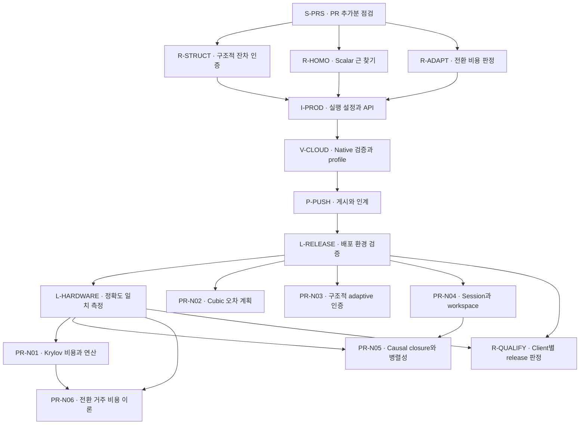

# VigilODE: 유도한 상수, 실제 성능 개선과 production 실행 준비

이번 변경은 **원래 정확도 계약을 유지한 계산량 감소**, **실패한 작업까지 보존하는 API**, **실제로 읽고 실행한 production 설정**을 제공한다. 구조적 mean-field 경로는 전체 stage 잔차를 더 적은 계산으로 outward 검증했고, scalar homotopy는 컨테이너 비용과 비싼 cubic 후보 계산을 줄였다. Adapter에서는 정확한 현재 구간 비용 판정을 구현했지만, 불리한 nonlinear 재진입 사례의 시간 손실도 확인했다. 이 결과에 따라 일반 실행의 기본은 persistent **RHS-only**이고 supplied JVP는 문제별 검증을 거친 선택적 경로다. [구조적 결과](structural/README_KO.md), [homotopy 결과](homotopy/REPORT_KO.md), [adapter 결과](adapter/REPORT_KO.md), [production 설정](PRODUCTION_SETUP.md)

작업 시작 시 GitHub의 최근 30개 PR을 확인했으며 **PR91 이후 새 PR은 없었다**. 기준은 PR91의 `206298b4068d923bb47c7160b111b7439098660c`다. PR90의 callback 비용 하한, PR91의 정확한 entry 비교·cubic 물리 오차 계획·두 채널 구조 분해를 재사용했고, 기존 원래 raw-U 목표와 강한 순차 기준을 유지했다. 게시 commit과 PR 번호는 최종 인계에서 확인한다. [원격 조사 receipt](evidence/PR_SURVEY.json), [기존 PR91 연구](../derivative_free_causal_homotopy_20261027/README_KO.md), [REVTeX 보고서](report/production_solver_closure.tex)

## 먼저 볼 파일

| 목적 | 파일 |
|---|---|
| 실제 모델을 연결하고 실행하기 | [PRODUCTION_SETUP.md](PRODUCTION_SETUP.md) |
| 모든 다음 작업의 권위 있는 계약·argv | [DEVELOPMENT_PLAN.json](DEVELOPMENT_PLAN.json) |
| 16개 node의 의존 관계 | [DAG.mmd](DAG.mmd), 아래 DAG |
| Local Codex에 전달할 전체 지시문 | [LOCAL_CODEX_HANDOFF_KO.md](LOCAL_CODEX_HANDOFF_KO.md) |
| 수학·실험을 함께 읽기 | [REVTeX 원문](report/production_solver_closure.tex), [보고서 build script](report/build_report.sh) |
| 최종 검증 gate와 실행 상태 | [VALIDATION_SUMMARY.json](evidence/VALIDATION_SUMMARY.json) |
| 원자료 복원 및 소스 확인 | [verify_package.py](verify_package.py), [SOURCE_MANIFEST.json](SOURCE_MANIFEST.json) |
| 개별 연구의 식·코드·실패 기록 | [structural](structural/README_KO.md), [homotopy](homotopy/REPORT_KO.md), [adapter](adapter/REPORT_KO.md) |

이 문서의 상대 경로는 현재 연구 디렉터리를 기준으로 한다. 과학적 수용, 실제 실행, 포장·게시 상태는 각각 해당 receipt에서 확인한다. [실행·인계 규약](LOCAL_CODEX_HANDOFF_KO.md)

## 1. 세 연구 과제에서 실제로 바뀐 것

| 연구 과제 | 구현과 증명의 연결 | 같은 목표·정확도에서 확인한 결과 | 수정 루프 |
|---|---|---|---:|
| Structural | 실패 비용을 보존하는 `StructuralResult`; 실제 represented stage의 정확한 잔차 항등식; 평균·RHS·lift 반올림의 outward enclosure | n2048/worker1 전체 궤적 **2.063×** 중앙값, instruction **62.52% 감소**, 모든 grid state가 PR91과 bit 동일 | 3/3 |
| Homotopy/RK | 길이1 Vec를 stack scalar로 특수화; 정확히 유도한 rational cubic inverse 후보; 기존 물리 오차 인증으로 최종 승인 | Scalar instruction **36.26% 감소**. Rational은 cubic cap `1e-5`에서 polynomial 평가 **1659→1024**, predictor 512회 별도 과금; instruction **39.01% 감소** | 1/3 |
| Adapter/switcher | checked integer 복귀 판정, comparator/sentinel의 정확한 cap, 과거 accepted pilot의 step 제안 전달 | Stiff cubic의 PR91 대비 work **10.95% 감소**. 해당 시간 이득은 불확실하며 reentrant selective 경로는 RHS-only보다 느림 | 3/3 |

계산 횟수, guest instruction, 실제 시간은 다른 측정이다. 각 표의 baseline도 명시적으로 다르다. 세 과제의 원자료와 검토는 [structural summary](structural/FINAL_BENCHMARK_SUMMARY.json), [homotopy 분석](homotopy/ANALYSIS.json), [adapter performance](adapter/PERFORMANCE.json), [독립 structural 검토](theory/STRUCTURAL_REVIEW.json), [homotopy 검토](theory/HOMOTOPY_REVIEW.json), [adapter 검토](theory/ADAPTER_REVIEW.json)에 연결된다.

### Structural: 더 강한 전체 잔차 검증을 더 적은 작업으로 수행

선언된 모델은

\[
f(y)=b-dy+\kappa\operatorname{mean}(y)\mathbf1,\qquad d\ge\kappa\ge0.
\]

임의 초기 상태와 forcing의 모든 transverse 성분을 보존한다. 실제 반환 stage를

\[
U_i=t_i(x-\mu\mathbf1)+v_i\mu\mathbf1+\Delta_i
\]

로 쓰고, 계산한 평균 `mu`와 정확한 평균의 차이, 실제 RHS 오차, 전체 차원의 lift 오차 `Delta_i`를 원래 raw-U 잔차에 모두 넣었다. 각 block의 정확한 norm

\[
\nu_n(t,c)=\left|t+\frac{c-t}{n}\right|+(n-1)\left|\frac{c-t}{n}\right|
\]

으로 성분 전체를 상계한다. 검증 비용은 `O(s²n)`에서 `O(sn+s²)`로 바뀐다. `n=1`은 정확히 `P=I`이므로 scalar bound 합을 plan으로 옮겨 step 검증을 `O(s)`로 줄였다. 고정 tableau와 작은 scalar norm-weight table을 사용하며 상태 행렬을 조립하거나 factorization하지 않는다. [정리 S1–S4와 구현 계약](structural/THEORY.md)

n2048의 전체 64-step 작업량은 RHS **576→64**, physical linear action **512→0**, full-state causal accumulation **7,340,032→0**이다. 검증 범위의 원래 residual component **1,048,576개**는 유지하고 평균·lift rounding 검증도 별도 과금했다. 모든 grid state는 PR91과 같고 최대 공통-grid 오차는 약 `2.398e-10`이다. [실제 작업량·정확도](structural/FINAL_BENCHMARK_SUMMARY.json)

초기 scalar probe에서 일반 enclosure는 **0.392×**로 느려졌다. 이 불리한 결과를 보존한 후 정확한 scalar 퇴화와 batch 과금 합산으로 수정하여 최종 **1.190× [1.154, 1.323]**를 얻었다. 최종 n2048/worker1 enclosure는 **2.063× [1.226, 3.614]**였지만, fused direct의 동일 셀은 **0.840× [0.619, 1.220]**였고 two-worker enclosure 범위도 1을 가로질렀다. 이 범위는 5개 paired block의 최솟값·최댓값이다. [수정 기록](structural/CORRECTION_LOOPS.json), [초기 scalar 결과](structural/BENCH_N1_W1.json), [최종 timing](structural/FINAL_BENCHMARK_SUMMARY.json)

최종 Callgrind 차분은 PR91 **347,516,244.75**, fused **309,511,284.25**, enclosure **130,256,982** instruction/trajectory였다. Instruction 감소와 변동이 큰 native 시간을 별도로 유지한다. [Profile summary](structural/instruction_profile/SUMMARY.json), [실행 원자료](structural/instruction_profile/RUNS.json)

### Homotopy: 수학적 계획을 유지한 표현 최적화와 유리식 후보

`ScalarHomotopy`는 기존 scalar 연산 순서와 평가 횟수를 유지하면서 작은 Vec 할당과 station-output 복제를 제거한다. 40개 mode/seed/model 조합에서 generic 결과의 state/error-bound bits와 계산량이 같았다. 새 `RationalPredictor`는 별도의 후보 생성법이며 원래 outward residual 검사를 거쳐 채택한다. [구현·bit parity](homotopy/REPORT_KO.md), [이론](homotopy/THEORY.md)

중점 stage를 정규화하면 `s+beta s³=1`이다. Inverse series와 일치시키는 조건에서

\[
r(\beta)=\frac{1+2\beta}{1+3\beta},\qquad
r+\beta r^3-1=\frac{\beta^3(3+8\beta)}{(1+3\beta)^3}\ge0
\]

을 얻는다. 계수 2, 3과 정확한 defect는 대수적으로 유도된다. 도함수의 하한 1은 증명에 사용하며 runtime의 derivative/JVP/AD 계산을 요구하지 않는다. 후보가 기존 예산을 만족하지 못하면 Scalar Picard와 단조 bisection으로 보정한다. [유도와 범위](homotopy/THEORY.md)

`k=1,g=1/2,Y=T=1`, 물리 cap `1e-5`에서 기존 계획의 N512를 유지한다. Warm Picard의 RHS+interval 평가는 **1147+512=1659**, rational은 **512+512=1024**이며 유리식 후보 512회가 추가된다. Rational 최대 grid 오차는 약 `2.245e-7`, 최종 outward bound는 약 `4.466e-6`이다. Scalar와 Rational의 모든 state bits가 같다는 주장은 하지 않으며 각자의 원래 물리 bound를 통과한다. [24-arm 검증·정확도 표](homotopy/REPORT_KO.md), [독립 고정밀 분석](homotopy/ANALYSIS.json)

강한 비선형 fixture의 generic/scalar 시간비 중앙값은 **1.474 [1.439, 1.828]**, generic/rational은 **1.670 [1.102, 1.767]**이었다. Scalar/rational 범위는 1을 가로질러 두 구현을 명시적 선택으로 제공한다. 비싼 radical predictor가 느렸던 초기 결과도 남아 있다. 최종 instruction은 generic **3,182,149.3**, scalar **2,028,310**, rational **1,940,807**/trajectory다. [Timing 해석](homotopy/REPORT_KO.md), [실제 profile](homotopy/instruction_profile_r1/SUMMARY.json)

### Adapter: 현재 구간의 정확한 비교와 미래 regime의 손실을 분리

기존 목적함수는

\[
W=N_f+N_{Jv}+N_{f_t}+nN_J+N_{\rm solve}
\]

이다. 완료된 동일 구간 explicit 비용 E와 implicit 비용 I에 대해 복귀 조건은 **E<I**다. 미완료 comparator의 nonfatal 비용 하한 L은 **E<L**일 때 사용할 수 있다. 정수 비교와 crossing callback의 과금 순서에서 comparator cap E, challenger cap I−1을 도출한다. 한 DOPRI attempt가 최대 7회 RHS를 사용하므로 productive sentinel에는 **I+E≤2I+6**이라는 현재-window 상한이 생긴다. 이것은 미래 window의 비용을 예측하는 정리가 아니다. [증명과 실제 callsite](adapter/THEORY.md)

다음 표는 모든 rejected/discarded pilot과 probe를 포함한 전체 trajectory work다.

| 모델 | RHS-only | PR91 | Observed-step + 기존 복귀 | Observed-step + strict sentinel |
|---|---:|---:|---:|---:|
| 쉬운 cubic | 79 | 79 | 79 | 79 |
| 강성 cubic | 2,347 | 2,958 | 2,634 | 2,634 |
| 강성→쉬움 nonlinear | 10,375 | 11,407 | 16,331 | 12,195 |
| 강성→쉬움→강성 nonlinear | 17,113 | 18,600 | 27,546 | 24,440 |

[36-arm 원자료와 정확도 분석](adapter/RESULTS.json), [결과 해석](adapter/REPORT_KO.md)

Stiff cubic의 work는 PR91보다 10.95% 줄었지만 instruction은 **0.505% 증가**, paired 시간비 중앙값은 **1.0106 [0.8981, 1.4469]**였다. Reentrant selective 경로는 RHS-only보다 work **42.81%**, instruction **145.02%**가 늘었고 시간비는 **0.3404 [0.1265, 0.5046]**로 모든 paired block에서 느렸다. 따라서 observed-step과 적극적인 sentinel을 일반 기본값으로 켜지 않았다. [실제 시간·instruction profile](adapter/PERFORMANCE.json)

이 adapter 시간·profile은 세 번째 수정인 Clippy의 조건문 정리 이전 binary에서 얻었다. 원래 source/binary hash와 결과를 보존했고, 그 후 수치 정책과 조건 평가 순서를 유지한 lint 정리를 별도의 수정으로 셌다. 마지막 소스의 재측정 결과로 바꾸어 표기하지 않는다. [수정 횟수와 측정 identity](adapter/REPORT_KO.md)

원인은 두 층이다. Adapter가 짧은 prefix의 이득을 뒤의 비싼 implicit window에 이어 적용하는 **거주 결정 문제**가 있고, 해당 implicit mode에는 **norm·QR·orthogonalization·GMRES 비용**이 있다. Adverse profile에서 dispatcher `drive_windows`의 self instruction은 약 0.0225%였으며 `safe_l2`, pivoted QR, two-pass MGS, GMRES가 확인된 hot spot이다. 비용 proxy를 줄이는 것과 이 내부 연산을 줄이는 연구를 분리하여 PR-N01과 PR-N06으로 연결했다. [병목 분해](adapter/REPORT_KO.md), [후속 계약](DEVELOPMENT_PLAN.json)

## 2. 정확한 상수, 사용자 입력과 남은 이론

| 구분 | 이번에 사용하는 값·조건 | 근거·처리 |
|---|---|---|
| 수학적으로 유도한 상수 | half-ULP, `u=2^-53`, `eta=2^-1074`, `nu_n`, rational 계수 2·3과 정확한 defect, 정수 cap E/I−1, `2I+6` | [Structural 정리](structural/THEORY.md), [homotopy 정리](homotopy/THEORY.md), [adapter 정리](adapter/THEORY.md) |
| 유지한 물리 오차 계획 | `C=L² phi(Y)/8`, 최소 admitted dyadic 격자, truncation을 제외한 algebraic 잔여 예산 | [PR91 이론](../derivative_free_causal_homotopy_20261027/theory/THEORY.md), [새 소비자 계약](homotopy/THEORY.md) |
| Caller의 물리·자원 입력 | atol/rtol, 물리 error budget, h0, total-attempt/evaluation cap, 관측 구간 | [완전한 JSON 설정](configs/README.md), [Production API](PRODUCTION_SETUP.md) |
| Operational schedule | pressure, backoff, residence, probe 시점 | 직렬화하여 기록하며 미래 비용 정리의 전제로 별도 다룬다. [PR-N06](DEVELOPMENT_PLAN.json) |

새 경계에 임의의 gain margin을 넣지 않았다. 기존 스케줄 선택 전체가 이론적으로 최적화되었다는 주장도 하지 않는다. 실제로 얻은 조건부 정리의 범위와 다음 의무는 다음과 같다. [보고서의 이론/최적화 구분](report/production_solver_closure.tex)

| 연구 대상 | 현재 확보한 것 | 추가 이론·구현 과제 |
|---|---|---|
| 구조적 affine 모델 | 전체 상태를 보존하는 정확한 분해와 실제 stage 잔차 enclosure | 가변 h의 누적 residual transport, 시간 절단오차, endpoint/시간 반올림을 합친 physical trajectory 정리 — N03 |
| Scalar cubic root | 유일한 근, residual-to-root bound, rational defect와 기존 전체 물리 오차 인증 | 실제 decay envelope를 이용한 더 작은 격자, 유한-step 전구간 상계 — N02 |
| 일반 vector homotopy | bounded failure·원래 residual 검사와 기존 알고리즘 | 분지·영역·단조성 또는 inverse-control 조건, 정확한 workspace/session identity — N04 |
| 일반 causal 경로 | PR91의 exact-input/prefix 재사용 | carrier 변경의 고차 order, nonlinear closure remainder, full-space 증폭과 work/span 선택 — N05 |
| Adapter 선택 | 현재 동일 구간의 strict 비용 우세와 sentinel 상한 | 과거 근거를 미래 regime에 적용할 수 있는 변화율·dwell-time·영역 조건 및 누적 탐색 손실 — N06 |
| 작은 Krylov 내부 | 실제 norm/QR/MGS/GMRES hotspot 식별 | operation/byte 모델, rank/breakdown·true-residual 보존과 연산 최적화 — N01 |

일반 causal 경로에는 frozen JVP와 작은 projected LU가 남는다. 엄격한 derivative-free 주장은 모델 전용 structural/cubic 경로에서 확보한 범위로 기술한다. 일반 nonlinear 문제의 전역 수렴·고차 order에 필요한 가정은 위 PR의 실제 증명 의무다. [적용 범위](PRODUCTION_SETUP.md), [기존 causal 근거](../derivative_free_causal_homotopy_20261027/causal/REPORT_KO.md)

## 3. Production 실행 setup

`ProductionSolver`의 기본 사용 범위는 smooth forward identity-mass IVP의 endpoint 관측이다. `ProductionConfig::rhs_only`는 persistent explicit session을 사용하며 derivative callback을 허용하지 않는다. `ProductionConfig::selective_jvp`는 supplied JVP, 양의 pilot budget, callback replay 계약과 strict entry/return 비교를 요구한다. 지원되지 않는 provider/output 조합은 callback 전에 거부한다. [Public API](../../crates/vigilode/src/production.rs), [전체 사용 계약](PRODUCTION_SETUP.md)

Schema1 JSON은 최상위·switching·nested options·atol의 미지 필드와 필수 필드 누락을 거부한다. 선택 필드 `switching.entry_probe_adaptation`은 생략하면 `None`이며 다른 필수 제어값을 자동으로 채우지는 않는다. 실제 native example이 생성하고 다시 읽은 두 설정을 제공한다. 수치 값은 n16 linear-decay smoke fixture의 계약이며 실제 client의 물리량·오차·자원 계약으로 지정한다. [설정 파일 설명](configs/README.md), [RHS-only JSON](configs/rhs-only.json), [Selective-JVP JSON](configs/selective-jvp.json)

```bash
rustup toolchain install 1.94.1 --profile minimal --component rustfmt --component clippy
rustup override set 1.94.1
cargo metadata --locked --offline --format-version 1 --no-deps
python3 research/production_solver_closure_20261027/verify_package.py --extract-evidence

cargo build --release --locked --offline -p vigilode --example production_from_json
target/release/examples/production_from_json \
  research/production_solver_closure_20261027/configs/rhs-only.json 1000
target/release/examples/production_from_json \
  research/production_solver_closure_20261027/configs/selective-jvp.json 1000
```

의존성 cache가 비어 있으면 `cargo fetch --locked`로 먼저 준비한다. `CARGO_TARGET_DIR`을 지정했다면 그 경로의 실행 파일을 사용한다. 새로운 worktree를 만들고 정확한 전달 SHA를 고정하는 전체 절차는 [Local Codex 인계문](LOCAL_CODEX_HANDOFF_KO.md)에 있다.

호출자는 결과의 `success`, `final_time`, `message`, `stats.accounting_complete`를 확인한다. 실패한 시도와 승인된 prefix가 결과에 남는다. Selective replay에서는 callback이 같은 입력에 같은 수치 함수를 제공해야 하며 외부 효과를 확정하지 않는 계약을 명시한다. [반환·callback 계약](PRODUCTION_SETUP.md)

모델 전용 경로는 명시적으로 선택한다.

| 용도 | 실행 API | 반환 근거 |
|---|---|---|
| Cubic 권장 opt-in 구현 | `integrate_cubic_decay_accuracy_with_solver(..., ScalarHomotopy(Picard), ...)` | 모든 반환점의 기존 outward physical bound |
| Cubic 유리식 대안 | 같은 API의 `RationalPredictor` | 원래 residual로 승인한 동일 physical budget |
| Affine mean-field stage | `MeanFieldAffine::enclosure_plan(h)` → `MeanFieldEnclosurePlan::step` | 모든 실제 stage의 outward original-space residual와 charged failure |
| 기존 구조적 API로 retry/fallback 연결 | `step_charged`, `sequential_step_charged` | 실패까지 포함한 `StructuralFailure.work` |

[모델별 사용과 선택](PRODUCTION_SETUP.md), [RHS-only 구현](../../crates/vigilode-coupled/src/rhs_homotopy.rs), [구조적 구현](../../crates/vigilode-coupled/src/structural_mean_field.rs)

## 4. 검증 상태와 측정의 해석

최종 counter 보정 후 facade **297개**, coupled **127개**, 합계 **424개 PASS / 0 failed / 0 ignored**를 다시 확인했다. 두 doctest, 변경한 두 package의 all-target compile 및 경고를 오류로 취급한 rustdoc의 이전 실행 근거도 보존한다. 각 lane의 11·23·35개 focused 계약은 이 수에 별도로 더하지 않는다. [최종 facade/coupled receipt](evidence/facade_coupled_final/RECEIPT.json), [all-target suite](evidence/all_targets/SUITE_RECEIPT.json), [docs suite](evidence/docs/SUITE_RECEIPT.json)

확장된 다섯 package 실행은 **1,312 passed / 1 failed / 45 ignored**에서 종료했다. 실패는 PR91과 동일한 기존 lagged 코드가 실패한 JVP의 물리 호출을 한 번 덜 센 문제였다. 표현 가능한 counter에서 진입 수 A와 이미 과금한 물리 호출 P를 구별하고 **A−P**를 보정했다. 기존 실패 테스트는 기대값을 유지한 채 통과했다. 관련 8개 target의 추가 검증 범위와 source/route에 근거한 기존 증거 재사용은 [LAGGED_VALIDATION_SCOPE.json](theory/LAGGED_VALIDATION_SCOPE.json), 실제 결과는 [최종 검증 요약](evidence/VALIDATION_SUMMARY.json)에 있다. 전체 다섯 package sweep을 보정 후 다시 실행한 것으로 주장하지 않으며, full release/LTO 검증은 로컬 단계에 남긴다.

직렬화된 두 설정 × rate1/1000의 **4개 실제 smoke solve**도 통과했다. RHS-only의 JVP는 0이고, selective의 쉬운 rate1도 JVP 0을 유지했다. 실제 callback atomics와 native accounting을 대조했다. [Smoke 결과](evidence/production_smoke_pass0/SUMMARY.json), [실행 receipt](evidence/production_smoke_pass0/RECEIPT.json)

Repository gate의 최종 판정은 [VALIDATION_SUMMARY.json](evidence/VALIDATION_SUMMARY.json)을 따른다. 초기 fmt 검사에서 드러난 상속 파일과 export 순서를 고정 toolchain으로 정리하고, 기존 example의 lint와 국소적인 API 표현 문제를 수정했다. 최종 범위의 [fmt](evidence/fmt_final/RECEIPT.json)와 [Clippy](evidence/clippy_final/RECEIPT.json)는 실제 실행에서 통과했다. 변경의 성격과 이전 실패는 [CI_HYGIENE.md](CI_HYGIENE.md), [fmt 분류](evidence/fmt_gate/BASELINE_CLASSIFICATION.json), [format 교정](evidence/fmt_gate/FORMAT_CORRECTION.json)에 보존했다. 이 검사들의 통과와 전체 native/CI 완료는 구별한다.

공유 호스트 측정은 Rust1.94.1의 `measurement` profile(opt-level3, LTO 없음, codegen-units16)에서 수행했다. Local qualification은 실제 배포 CPU의 `release` profile(fat LTO, codegen-units1), libm, target features, affinity와 thread 설정을 기록한다. Outward 산술은 binary64 round-to-nearest, gradual underflow와 명시한 FMA 의미를 전제로 한다. [호스트 receipt](evidence/HOST.json), [도구·환경 계획](DEVELOPMENT_PLAN.json)

## 5. Local 검증: 8개 실행 suite

정확한 argv는 [DEVELOPMENT_PLAN.json](DEVELOPMENT_PLAN.json)의 `execution_suites`가 기준이다. `run_local.py`는 기본적으로 dry-run이며, `--execute`가 있을 때 명시한 suite를 하나씩 실행하고 source hash·stdout/stderr·종료 코드·wall time을 보존한다. [Runner](run_local.py), [runner 계약 검사](evidence/runner_contracts/SUMMARY.json)

| Suite | 목적 |
|---|---|
| `facade-contracts` | Measurement profile의 facade 전체 lib/integration 계약 |
| `coupled-contracts` | Measurement profile의 coupled 전체 lib/integration 계약 |
| `all-targets` | 두 package의 모든 target compile |
| `release-contracts` | 배포 profile의 facade·coupled·core·Krylov·integrator lib/integration tests |
| `docs` | Rustdoc와 doctests |
| `smoke-release` | 실제 JSON의 RHS-only/selective-JVP 네 solve |
| `local-benchmarks` | Cubic·structural·adapter 전체 궤적과 adverse 대조군의 paired 비교 |
| `local-profiles` | 같은 release binary의 startup을 뺀 instruction profile |

```bash
python3 research/production_solver_closure_20261027/run_local.py \
  --suite release-contracts --output /tmp/vigilode-local-release
python3 research/production_solver_closure_20261027/run_local.py \
  --suite release-contracts --output /tmp/vigilode-local-release --execute --timeout 1800
```

`1800`초는 caller가 지정하는 명령별 자원 상한이다. 새 output 경로를 사용하고, build·native timing·profiling은 하나의 lock으로 직렬화한다. 증명·문헌·독립 source 편집은 병렬로 수행한다. Runner 자체가 lock을 잡으므로 같은 lock으로 이 runner를 다시 감싸지 않는다. 실패·timeout·signal·입력 변경의 partial receipt를 보존한다. [전체 실행 순서와 반환 계약](LOCAL_CODEX_HANDOFF_KO.md)

## 6. 16-node DAG와 여섯 후속 PR

이 DAG의 node·선행 조건은 [DEVELOPMENT_PLAN.json](DEVELOPMENT_PLAN.json)과 같다. PR-N01…N06은 개발 과제 ID이며 실제 GitHub PR 번호는 게시 시 정한다. 처음 세 연구는 병렬로 진행했고, local에서는 N01–N04를 각자의 선행 조건이 충족된 범위에서 병렬 수행할 수 있다. [Machine-readable 계획](DEVELOPMENT_PLAN.json), [독립 계획 검토](theory/DEVELOPMENT_PLAN_REVIEW.md)



| 후속 PR | 목적과 첫 수학적 의무 | 실제 코드 대상 | 선행 조건 |
|---|---|---|---|
| **N01 — Krylov 비용** | 실제 Krylov 차원·restart·provider의 operation/byte 모델; norm/QR 대체 시 rank·breakdown·true-residual 계약 보존 | `gmres_into.rs`, `small.rs`, `norms.rs`, `selection_evidence.rs` | L-HARDWARE |
| **N02 — Cubic 격자** | 실제 decay envelope의 유한-step defect와 outward 누적 상계; 이를 만족하는 최소 격자와 잔여 예산 도출 | `rhs_homotopy.rs:CubicDecayAccuracyPlan` | L-RELEASE |
| **N03 — Structural adaptive** | 가변 h의 product-form residual transport, 시간 절단·endpoint 반올림 및 필요한 commutation 조건 | `structural_mean_field.rs`, `adaptive.rs` | L-RELEASE |
| **N04 — Session/workspace** | 상태·epoch·controller·FSAL·callback 효과를 포함한 정확한 continuation identity와 history 무효화 조건 | `session.rs`, `switching.rs`, `rhs_homotopy.rs` | L-RELEASE |
| **N05 — Causal closure** | 변경되는 carrier의 full-space remainder·고차 order; forward 기준을 포함한 전체 work/span | `causal.rs`, `algebra.rs`, `execution_policy.rs` | L-HARDWARE + N04 |
| **N06 — Residence 이론** | 시간적 변화·dwell/domain 가정 아래 exploration/residence loss와 재검증 규칙 도출 | `switching.rs`, `selection_evidence.rs` | L-HARDWARE + N01 |

각 PR에는 정확한 branch 제안, 재사용할 근거, 원래 정확도 계약, 출력 파일과 수용 기준을 JSON으로 넣었다. 이미 활성화된 least-squares workspace를 다시 구현하지 않고, 기존 nonnormal Givens 반례도 N01의 제약으로 유지한다. 각 과제의 수정·재실험은 최대 3회이며 마지막 실패와 가장 최근에 검증된 구현을 보존한다. [상세 PR 계약](DEVELOPMENT_PLAN.json)

`R-QUALIFY`는 L-RELEASE와 L-HARDWARE를 바탕으로 **실제 client의 provider/output/model 조합**을 승인하는 단계다. 장시간 적분, restart, 자원 소진, 실제 domain 입력을 해당 계약으로 검증한다. N01–N06의 확장 결과는 각자의 정리·회귀·정확도·시간 조건을 충족한 뒤 지원 범위에 추가한다. [Release 판단 기준](DEVELOPMENT_PLAN.json), [Local Codex handoff](LOCAL_CODEX_HANDOFF_KO.md)
