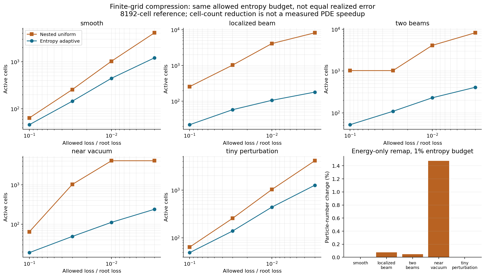
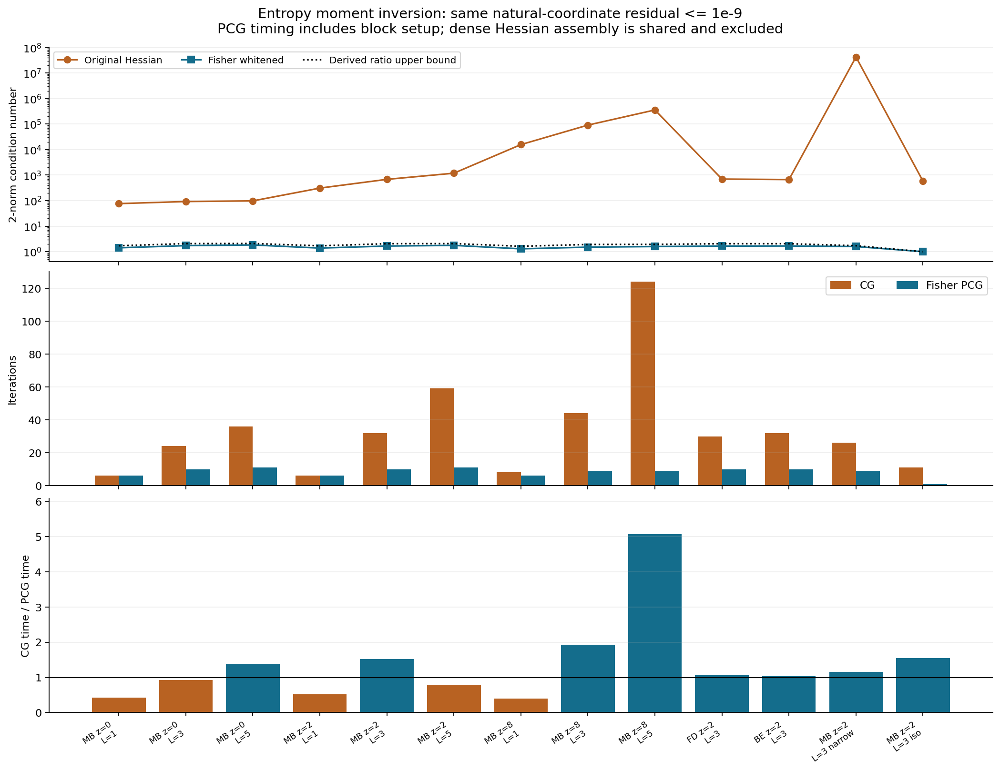
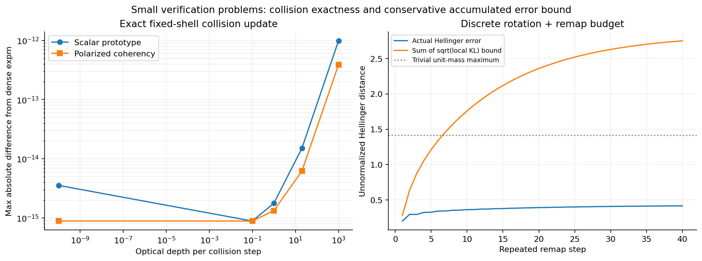

# 구면 격자 kinetic solver의 정보기하 기반 가속

**2026-10-23 · 두 Angular Calculus v13 초안에 기초한 이론 및 경량 구현 연구**

## 초록

두 초안의 kinetic Bregman divergence, thermochemical susceptibility, velocity-dressed angular representation을 구면 이산화의 계산 비용과 오차 제어에 연결했다. 결과는 (i) 정확한 이산 정보 손실을 이용한 보존형 격자 병합, (ii) 각도 모드별 해석적 Fisher 전처리와 조건수 상한, (iii) 기존 저랭크 Thomson 연산자의 정확한 충돌 부분흐름, (iv) 반복 remap의 누적 관측량 오차 상한, (v) massive shell별 각도 cutoff와 Laguerre 분석 기저다. 작은 Python 구현과 독립 검토를 수행했다. 실제 시간 의존 Bianchi–복사–물질 결합 문제의 전체 실행 시간은 이번 실험의 대상이 아니다.

8192-cell 기준의 국소 빔에서는 같은 허용 이산 정보 손실 아래 중첩 균일 격자 4096개 대신 106개 셀을 사용했다. 이는 필요한 상태 수의 감소다. 모멘트 역산의 한 어려운 사례에서는 Fisher 전처리로 조건수가 356678에서 1.59005로, 같은 실제 잔차 기준의 CG 반복이 124회에서 9회로 감소했다. 기존 유한체적 Thomson 연산자의 정확한 부분흐름은 작은 행렬 지수함수로 구현했으며 dense 기준과 약 8.11×10⁻¹⁵ 이내로 일치했다. 에너지 한 변수만 보존하는 열적 병합의 입자수 변화도 측정하고, 이를 피하는 joint number–energy 및 full-occupation remap을 유도했다.

## 1. 입력, 기준, 적용 범위

입력은 사용자가 제공한 *An Entropic Angular Calculus for Relativistic Kinetic States* I·II의 v13 LaTeX 초안이다. 각각 2026-10-20 날짜를 표시한다. 원본 ZIP SHA256은 다음과 같다.

| 입력 | SHA256 |
|---|---|
| Paper I | `25c67a4f0fcc3a44eee9d8bd8fad17aa38e01d84d4967182baca160bc27b5585` |
| Paper II | `3aa88e68135a6bbb24121d36e7dea4ff91895ab4fe287f300e63e9a6d2a7bd61` |

VigilODE의 읽기 기준은 commit `14c74978b93339a79d7228a324fa77552dae548e`다. 이 snapshot에는 이미 full-sphere FVM의 scalar rank-6 Thomson RHS가 있다. 따라서 저랭크 RHS 자체를 이번의 새 구현 성과로 세지 않았다. 새 코드는 이 보고서의 독립 재현 패키지에 있으며, 로컬 개발 중인 native solver에 대한 동시 변경은 하지 않았다. NCP도 사용하지 않았다.

기하 convention은 metric signature $(-,+,+,+)$, 고정 관측자의 단위 방향 $\hat n\in S^2$다. 물리 상수는 유지한다. 에너지는 $x=E/E_*,\ E_*=k_{\rm B}T_*>0$, 질량은 $z=mc^2/E_*$로 무차원화한다. Paper I의 reference-cell state-counting normalization에서 $\rho$는 무차원 방향 에너지, 실제 에너지는 $k_{\rm B}T_{\rm ref}\rho$, 정보량의 물리 엔트로피 환산은 $k_{\rm B}D$다. Paper II의 밀도 정규화를 쓰면 같은 양은 밀도 단위를 가진다. 비교 도중 이 정규화를 바꾸지 않는다.

코드별 각도 측도도 고정했다. mesh와 Fisher 실험은 $d\Omega$, Thomson 실험은 $d\omega=d\Omega/(4\pi)$를 사용한다. 전자는 적분값 1로 정규직교한 $Y_{\ell m}$, 후자는 그에 맞춘 평균 정규화를 쓴다. 세부 source-map JSON은 식의 label과 실제 읽은 파일 해시를 기록한다.

## 2. 초안에서 재사용한 수학

Paper I의 `eq:angular-power-functional`, `eq:divergence-preserving-lift`, `eq:exact-two-axis-budget`는 radial thermal section에서

$$
F(\rho)=-\kappa_\xi\rho^{3/4},\qquad
F''(\rho)=\frac{3\kappa_\xi}{16}\rho^{-5/4}>0
$$

와 spectral/angular 정보 손실의 분해를 제공한다. Paper II의 `eq:kinetic-bregman`, `eq:massive-fisher-block`, `eq:nested-radial-bregman`은 number–energy score와 susceptibility

$$
W=f(1+\xi f),\qquad h_\xi''(f)=W^{-1},\qquad
\xi=0,+1,-1\quad(\mathrm{MB,BE,FD})
$$

를 제공한다. 이는 실험 잡음의 likelihood Fisher matrix와 구별되는 kinetic entropy geometry다. 정보 반경은 해상도가 높은 상태, 독립 잔차, 또는 명시적인 regularity prior에서 받아야 한다. 보유 모멘트만으로 빠진 정보의 크기가 정해지지는 않는다.

아래 셀 평균은 초안의 harmonic natural-field maximum-entropy projection과 다른 이산 projection이다. 필요한 항등식은 셀 평균의 보존성으로 직접 유도했다. 초안 전체의 모든 정리와 신규성을 다시 감사한 것은 아니며, 이번 수치 방법이 사용하는 정의와 전이를 집중 검토했다.

## 3. 엔트로피 손실을 계산하는 적응형 구면 격자

### 3.1 정확한 셀 정보 예산과 관측량 상한

양의 각도 가중치 $w_i$, 양의 방향 에너지 $\rho_i$를 주자. 셀 $C$에서

$$
W_C=\sum_{i\in C}w_i,\qquad
\bar\rho_C=\frac{\sum_iw_i\rho_i}{W_C},\qquad
\eta_C=\sum_iw_iF(\rho_i)-W_CF(\bar\rho_C).
\tag{1}
$$

평균의 보존 항등식으로 $\sum_iw_i(\rho_i-\bar\rho_C)=0$이므로

$$
\eta_C=\sum_{i\in C}w_iD_F(\rho_i\Vert\bar\rho_C)\ge0.
\tag{2}
$$

parent를 child $C_j$로 나누면 중간 entropy 합을 더하고 빼서

$$
\eta_C=\sum_j\eta_{C_j}+\Delta_C,\qquad
\Delta_C=\sum_jW_{C_j}F(\bar\rho_{C_j})-W_CF(\bar\rho_C)\ge0
\tag{3}
$$

를 얻는다. 추가 셀당 $\Delta_C$가 큰 곳을 먼저 세분화하는 controller를 구성할 수 있다.

이 정보량을 실제 관측량으로 옮긴다. $O_K=\sum_iw_iK_i\rho_i$, $b_C=\max_{i\in C}\rho_i$, $m_C=3\kappa_\xi b_C^{-5/4}/16$와 $V_{K,C}=\sum_iw_i(K_i-\bar K_C)^2$를 정의하면

$$
|O_K(\rho)-O_K(\bar\rho)|
\le \sum_C\sqrt{\frac{2\eta_CV_{K,C}}{m_C}}.
\tag{4}
$$

증명은 두 단계다. Taylor 적분 나머지에서 $D_F\ge m_C(\rho-\bar\rho)^2/2$를 얻고, 셀 오차에서 보존성 때문에 사라지는 $\bar K_C$를 뺀 뒤 weighted Cauchy–Schwarz를 적용한다. 작은 perturbation 가정은 필요 없다. 강한 진폭 대비에서는 상한이 느슨해질 수 있다.

### 3.2 필요한 자유도에 대한 조건부 보장

매끄럽고 양의 $\rho$, 작은 shape-regular 셀, 동일한 점근 셀 형상을 가정한다. $A=F''(\rho)|\nabla_{S^2}\rho|^2$, 셀 면적 $a(x)$라 두면 leading entropy loss와 셀 수는

$$
I\simeq c_{\rm shape}\int Aa\,d\Omega,\qquad
N\simeq\int a^{-1}d\Omega.
$$

Cauchy–Schwarz로 $(\int\sqrt A)^2\le(\int Aa)(\int a^{-1})$이며, 등호는 $a\propto A^{-1/2}$에서 성립한다. 따라서 같은 leading 오차 $\epsilon$에서

$$
\frac{N_{\rm adapt}}{N_{\rm uniform}}
\simeq
\frac{(\int\sqrt A\,d\Omega)^2}{4\pi\int A\,d\Omega}\le1.
\tag{5}
$$

정보 gradient가 면적 비율 $f$의 작은 영역에 집중되면 이 비는 대략 $f$다. 이는 명시한 해상도 모델에서의 자유도 절감식이며, 모든 비정형 격자에 대한 비점근 wall-time 정리가 아니다. 현재 equal-area $(\mu,\phi)$ quadtree는 극점 부근에 shape-regular하지 않으므로 식 (5)의 최적성 상수로 검증하지 않았다. 실제 실험 판정은 식 (1)–(4)의 이산값을 사용했다.

### 3.3 구현과 결과

`src/spherical_mesh.py`는 64×128 fine grid에서 5개 profile과 4개 예산을 계산한다. prefix aggregate, 안정한 pointwise Bregman 계산, 정확한 fine-cell fallback을 사용한다. 실제 min/max와 안정화 재계산에는 fine-cell scan이 포함되어 균형 hierarchy의 전체 진단 비용은 최악 $O(N_{\rm fine}\log N_{\rm fine})$다. 압축 상태를 매 RHS마다 fine grid로 복원한다면 상태 수 절감이 실행 비용 절감으로 이어지지 않는다.

| root 정보 손실의 1% 허용 | 중첩 균일 셀 | 적응 셀 | 상태 수 비율 |
|---|---:|---:|---:|
| 국소 빔 | 4096 | 106 | 38.64 |
| 두 빔 | 4096 | 229 | 17.89 |

이 비교는 **같은 허용 예산**을 사용한다. 균일 격자의 중첩 refinement 간격 때문에 실제로 달성한 오차는 서로 다르다. 8개 단위 검사, 20개 구성, 두 방법의 40개 예산 검사 및 120개 관측량 경계 검사가 통과했다. 최대 상대 에너지 drift는 $2.92\times10^{-15}$다. 현재 controller는 entropy budget을 만족시키고 관측량 상한을 사후 계산한다. 각 관측량의 사용자 tolerance를 직접 종료 조건으로 삼는 완성된 goal-oriented controller는 다음 구현 단계다.

이산 fine grid 자체가 놓친 각도 구조, radial closure, 시간 적분 오차는 위 숫자에 포함되지 않는다. 실험의 bound 통과는 부동소수점 tolerance 아래의 수치 확인이며 directed-rounding interval certificate는 아니다.

## 4. 입자수까지 보존하는 정보기하

one-field 열적 section에서는 $n=A_\xi\rho^{3/4}$다. 따라서 에너지만 평균한 후 열적 상태를 재구성하면

$$
\Delta N_C=\frac{A_\xi}{\kappa_\xi}\eta_C\ge0.
\tag{6}
$$

zero-log-fugacity massless MB에서는 $H=-4n$이므로 정확히 $\Delta N_C=\eta_C/4$다. near-vacuum 실험에서 1% 정보 예산은 약 1.474%, 느슨한 10% 예산은 약 14.38% 입자수 증가를 허용했다. photon-number ledger가 있는 client에는 보존변수를 바꾸어야 한다.

massless MB thermochemical section은

$$
n=2Ce^\alpha\beta^{-3},\quad \rho=6Ce^\alpha\beta^{-4},\quad
\beta=3n/\rho,\quad \alpha=\ln\frac{27n^4}{2C\rho^3}
$$

이므로 축약 entropy와 Hessian이 닫힌식으로 주어진다.

$$
F_{NE}=n\ln\frac{27n^4}{2C\rho^3}-4n,\qquad
\nabla^2F_{NE}=
\begin{pmatrix}4/n&-3/\rho\\-3/\rho&3n/\rho^2\end{pmatrix},\qquad
\det\nabla^2F_{NE}=3/\rho^2>0.
\tag{7}
$$

$(n,\rho)$를 함께 셀 평균하면 두 보존량을 유지하면서 식 (2)–(3)과 같은 Bregman telescope를 얻는다. $\vartheta=\rho/(3n)=T/T_{\rm ref}$를 사용하면

$$
ds^2=\frac{dn^2}{n}+3n(d\ln\vartheta)^2.
\tag{8}
$$

열·화학 좌표의 상관이 이 물리적 좌표에서 사라진다. 식 (7)–(8)은 Wolfram의 정확 대수 계산과 독립적인 작은 코드 검사로 확인했다. BE·FD에는 같은 MB 상수를 복사하지 않고 각 통계의 susceptibility를 사용한다.

비열적 전체 분포에서는 energy bin마다 occupation $f_{ri}$를 양의 각도 평균으로 병합한다. 이것은 bin population, 고정된 bin energy weight, MB/BE 양성성과 FD 상한을 보존한다. 필요한 정보 손실은 $\sum_{ri}\nu_rw_i d_{h_\xi}(f_{ri}\Vert\bar f_{rC})$다. 현재 VigilODE FVM의 변수는 occupation이 아니라 bin contents이므로 $f_{ri}=N_{ri}/(\nu_r\Omega_i)$에 필요한 state-counting weight를 명시해야 한다. `N`에 occupation entropy를 그대로 적용하면 다른 함수를 계산한다.

## 5. Fisher 전처리: 해상도가 증가해도 유지되는 조건수 상한

자연 score 벡터 $t_i$, 양의 구적 $w_i$에 대해 entropy moment inversion의 dual Hessian은

$$
H=\sum_iw_iW_it_it_i^T,\qquad W_i=f_i(1+\xi f_i).
$$

등방 기준의 $H_0$는 각 $(\ell,m)$마다 2×2 block이다. 열·화학 score 순서 $(\delta b,\delta\eta)$에서

$$
G_\ell=\begin{pmatrix}M_{\ell,2}&-M_{\ell,1}\\-M_{\ell,1}&M_{\ell,0}\end{pmatrix},\quad
\mu_\ell=M_1/M_0,\quad \sigma_\ell^2=\sum_r\widehat w_r(x_r-\mu_\ell)^2.
$$

중심화하면 $\delta q^TG_\ell\delta q=M_0[(\delta\eta-\mu_\ell\delta b)^2+\sigma_\ell^2\delta b^2]$다. 이 표현은 작은 분산을 큰 두 모멘트의 차이로 계산하는 수치 상쇄를 피한다.

**조건수 정리.** 같은 score와 격자에서 $H_0\succ0$, $0<a\le W_i/W_{0i}\le b<\infty$이면

$$
aH_0\preceq H\preceq bH_0,\qquad
\kappa_2(H_0^{-1/2}HH_0^{-1/2})\le b/a.
\tag{9}
$$

임의 $u$에 대해 $u^THu=\sum_iw_iW_i(t_i^Tu)^2$를 점별 상·하한으로 끼우면 증명된다. MB·FD에서는 $|\Delta\psi_i|\le\delta$로부터 $b/a\le e^{2\delta}$가 따른다. BE에서는 score 선분이 $\psi\le-\gamma<0$를 지킬 때 $e^{2\delta\coth(\gamma/2)}$를 쓸 수 있다. 실제 finite-grid ratio가 더 작은 상한을 줄 수 있다.

고정된 ratio bound 아래 PCG의 에너지 norm 수렴률

$$
\|e_k\|_H/\|e_0\|_H\le
2\left(\frac{\sqrt{b/a}-1}{\sqrt{b/a}+1}\right)^k
\tag{10}
$$

은 각도 cutoff에 직접 의존하지 않는다. $d=2(L+1)^2$, quadrature 수 $Q$일 때 일반 score evaluation으로도 matrix-free 곱은 $O(Qd)$, block inverse는 $O(d)$다. 기준 block setup은 $O(N_E(L+1)+(L+1)^2)$다. 이는 entropy 역산 선형계에 대한 보장이고 일반 ODE Jacobian의 보장은 아니다.

### 5.1 실제 검증과 반대 결과

`src/fisher_demo.py`는 MB·FD·정칙 BE, 질량비 $z=0,2,8$, $L=1,3,5$, 좁은 energy band와 등방 기준을 포함한 13개 사례를 검사했다. 모든 perturbation이 선언한 자연 score family에 속함을 별도로 확인했다. 7개 단위 검사와 고유값·susceptibility enclosure가 통과했다.

| 사례 | 원래 조건수 | 전처리 조건수 | CG→PCG 반복 |
|---|---:|---:|---:|
| MB, $z=8,L=5$ | 356678.31 | 1.59005 | 124→9 |
| 좁은 energy band | 42464852.82 | 1.58573 | 26→9 |
| 등방 기준 | 579.17 | 1.00000 | 11→1 |

종료 기준은 실제 자연좌표 잔차 $\|Hx-b\|_2/\|b\|_2\le10^{-9}$다. 같은 잔차가 같은 해 오차를 의미하지 않으므로 알려진 해에 대한 오차도 저장했다. 첫 사례의 setup 포함 짧은 batched timing은 약 5.07배였지만, 가장 작은 massless 사례는 비율 0.42로 전처리가 더 느렸다. Hessian assembly는 두 방법이 공유하며 이 timing에는 포함하지 않았다. 코드가 실제 측정한 것은 **dense Hessian 위의 CG/PCG**이고, matrix-free 비용식은 유도 결과다.

### 5.2 Newton-free 후보

whitened dual potential의 해 주변 admissible ball 전체에서 $aI\preceq\nabla^2\widetilde F\preceq bI$이면

$$
z_{k+1}=z_k-\frac{2}{a+b}\nabla\widetilde F(z_k)
$$

는 $(b-a)/(b+a)$로 수축한다. 해와 현재점 사이의 Hessian 적분에 spectral bound를 적용하면 된다. 이 경로는 moment residual과 고정 block metric만 쓰므로 Newton factorization과 Krylov history가 필요 없다. ball의 포함 관계와 전 구간 ratio bound를 실제로 확보해야 한다. 이번에는 이 수렴을 유도했으며 별도 nonlinear closure solve의 성능 실험은 하지 않았다.

entropy Hessian의 whitening 자체는 Alldredge et al. (2014)의 선행 방법이다. 이번 연결은 초안의 해석적인 thermal–chemical block과 명시적 ratio certificate를 구면 score에 적용한 것이다.

## 6. 기존 rank-6 충돌 구조에서 정확한 부분흐름으로

### 6.1 실제 finite-volume 격자에 적용되는 공식

기존 scalar gain을 $S=UV^T$, $U,V\in\mathbb R^{N\times r}$, $r=6$로 쓰고 $B=V^TU$라 하자. 고정 격자의 충돌식은

$$
\dot y=\kappa(t)(UV^T-I)y,\qquad
\tau=\int_{t_n}^{t_{n+1}}\kappa(t)\,dt
$$

다. 같은 행렬에 scalar rate만 곱하므로 서로 다른 시간의 generator가 commute한다. 행렬 거듭제곱 $(UV^T)^j=UB^{j-1}V^T$를 지수함수 급수에 넣으면

$$
y_{n+1}=e^{-\tau}y_n+
e^{-\tau}U\,\tau\varphi_1(\tau B)V^Ty_n,
\quad \varphi_1(Z)=\sum_{j\ge0}\frac{Z^j}{(j+1)!}.
\tag{11}
$$

이 공식은 singular $B$도 포함한다. 구현은 역행렬 대신 12×12 block exponential을 사용했다. cached symmetric eigen 방식에서는 setup $O(Nr^2+r^3)$, step $O(Nr+r^2)$가 가능하다. 현재 generic Python 구현은 호출마다 작은 행렬을 다시 구성·exponentiate하므로 그 setup 비용도 실제 비용에 포함된다.

독립적인 collision stability 제한은 이 부분흐름에서 사라진다. 예를 들어 감쇠 $y'=-\kappa y$를 explicit Euler로 다루면 안정성에 $h\kappa\le2$가 필요하지만 식 (11)은 모든 $\tau\ge0$에서 정확하다. 결합된 streaming·반응·opacity feedback의 오차와 stiffness는 별도다. Strang splitting을 그대로 사용하면 보통 전역 2차이며, 기존 5차 적분기에 넣었다고 결합 차수가 5차가 되지 않는다.

### 6.2 finite-cell Gram matrix를 생략하면 생기는 실제 오류

continuum scalar Thomson의 quadrupole eigenvalue는 0.1이지만 기존 FVM은 cell-average basis를 쓴다. irregular 25-cell 사례에서 실제 비영 고유값은 대략 $(1,0.08357,0.07708,0.06908,0.06513,0.02353)$였다. continuum 값을 강제로 넣은 shortcut은 최대 $2.43\times10^{-6}$ 오류를 보였다. 실제 $B$를 사용한 식 (11)은 기존 고정 oracle의 dense exponential과 $8.11\times10^{-15}$ 이내였다. rank-deficient 격자도 검사했다.

현재 코드도 이미 rank-6 RHS를 사용하므로 dense $N^2$ matvec 대비 속도 비율을 VigilODE 개선율로 보고하지 않는다. 실제 이식의 이득은 반복 stage/linear solve에서 충돌 stiffness를 떼어내는 데 있다.

### 6.3 선형 편광을 포함하는 여섯 모멘트

고정된 전자 rest frame의 한 frequency shell, cold elastic Thomson, circular polarization $V=0$를 가정한다. 실수 대칭 transverse coherency $F(\hat n)\succeq0$, $P=I-\hat n\hat n^T$, $T=\int F\,d\omega$에 대해

$$
(SF)(\hat n)=\frac32P(\hat n)T P(\hat n).
\tag{12}
$$

등방 2차·4차 방향 평균을 사용하면

$$
B(T)=\frac32\int PTP\,d\omega
=\frac7{10}T+\frac1{10}\operatorname{tr}(T)I.
\tag{13}
$$

따라서 trace, traceless image, 나머지의 gain eigenvalue는 각각 $1,7/10,0$, collision 감쇠율은 $0,3\kappa/10,\kappa$다. $T_0=\operatorname{tr}(T)I/3$, $T_2=T-T_0$라 하면

$$
F_{n+1}=e^{-\tau}F_n+
U\left[(1-e^{-\tau})T_0+
\frac{e^{-3\tau/10}-e^{-\tau}}{7/10}T_2\right],\quad
U(T)=\tfrac32PTP.
\tag{14}
$$

양성성을 드러내려면 괄호를 $a_2T+(a_0-a_2)T_0$로 쓴다. $a_2\ge0$이고, convexity로 $e^{-0.3\tau}\le0.7+0.3e^{-\tau}$이므로 $a_0-a_2\ge0$다. 따라서 PSD와 transverse 조건을 보존한다. 작은 $\tau$에서 이 계수의 차이는 $3\tau^2/20-13\tau^3/200+\cdots$로 계산해 상쇄를 피했다. 식 (13)과 series는 Wolfram으로 독립 확인했다.

54차원 독립 dense exponential과 $\tau\le1000$에서 최대 절대 차이는 $3.89\times10^{-13}$ 미만이었다. 24개 PSD·trace·entropy stress case도 수치 tolerance 아래 통과했다. 이 비교에는 dense `expm`의 rounding error도 포함된다. scalar intensity-only 충돌을 반복하는 것은 편광을 생성하는 물리적 Thomson 진화와 다르다. 실제 예에서 두 intensity 결과의 차이를 원자료에 보존했다.

## 7. remap을 반복할 때의 전체 오차 예산

한 번의 entropy budget을 시간 전체의 budget으로 사용할 수 있도록 별도 추정을 구성했다. 이는 MB의 동일 질량 이산 상태와 양의 질량 보존 지도에 대한 정리다. 일반적인 고차 ODE step이 이 조건을 만족한다고 가정하지 않는다.

상태를 셀 질량 $p_i,q_i\ge0$, $\sum p_i=\sum q_i=M$로 쓰고

$$
d_{\mathrm H}(p,q)=\|\sqrt p-\sqrt q\|_2,\qquad
D(p\Vert q)=\sum_i[p_i\ln(p_i/q_i)-p_i+q_i]
$$

라 하자. 첫째, $d_{\mathrm H}^2\le D$다. $s=\sqrt{p_i/q_i}$를 대입하면 두 integrand의 차이는 $2q_is(s\ln s-s+1)\ge0$다. 둘째, column-stochastic $T$에 대해 Cauchy–Schwarz가 $\sqrt{(Tp)_i(Tq)_i}\ge\sum_jT_{ij}\sqrt{p_jq_j}$를 주므로 $d_{\mathrm H}(Tp,Tq)\le d_{\mathrm H}(p,q)$다.

reference가 $p_j=T_jp_{j-1}$, 근사가 $q_j=C_jT_jq_{j-1}$이고 측정한 remap loss가 $\eta_j=D(T_jq_{j-1}\Vert q_j)$이면 삼각부등식과 위 수축성으로

$$
d_{\mathrm H}(p_J,q_J)\le d_{\mathrm H}(p_0,q_0)+\sum_{j=1}^{J}\sqrt{\eta_j}.
\tag{15}
$$

관측 kernel의 상수항은 같은 질량 때문에 소거된다. 또한 $\|p-q\|_1\le2\sqrt M d_{\mathrm H}(p,q)$이므로

$$
|K\cdot(p_J-q_J)|\le
\operatorname{range}(K)\sqrt M\left[d_{\mathrm H}(p_0,q_0)+\sum_j\sqrt{\eta_j}\right].
\tag{16}
$$

따라서 실제 controller는 $\eta_j$의 단순 합보다 $\sqrt{\eta_j}$ 예산을 관리할 수 있다. 근사 propagation에 별도 Hellinger local error $\delta_j$가 있으면 같은 recurrence에 더한다. 비선형 결합이 이 metric에서 $L_j$-Lipschitz인 경우에는 $E_j\le L_jE_{j-1}+\delta_j+\sqrt{\eta_j}$로 바꾸어야 한다.

`remap_budget_demo.py`는 discrete sphere rotation와 isotropic relaxation의 8개 구성, 320개 시간 단계 및 30개 독립 stochastic-map 검사를 수행했다. 모두 해당 상한을 만족했다. 상한이 단순한 최대 거리 $\sqrt{2M}$보다 커지는 경우도 있으므로 실용적 budget은 더 작은 상한을 함께 사용한다. 이것은 full PDE 수렴 시험이 아니라 정리의 가정과 누적식을 구현한 검산이다.

## 8. Laguerre 기저와 energy shell별 각도 cutoff

massless MB의 radial Fisher weight는 $x^2e^{-x}dx$다. 따라서

$$
P_n(x)=(-1)^n\sqrt{\frac{n!}{(n+2)!}}L_n^{(2)}(x)
$$

가 정규직교하며 첫 두 기저는 $P_0=1/\sqrt2$, $P_1=(x-3)/\sqrt6$다. Paper II의 number–energy 두 score와 정확히 같은 span이다. 여기서 Laguerre는 radial 정보 기저로 사용한다. 무한 energy 구간의 exponent에 임의의 고차 polynomial을 넣는 경우에는 tail integrability를 별도로 지켜야 한다.

massive shell의 $v=\sqrt{1-z^2/x^2}<1$에 대해 초안의 Poisson multiplier는 $v^\ell$이다. Parseval로

$$
\|\mathcal P_vA-\Pi_L\mathcal P_vA\|_2\le v^{L+1}\|A\|_2.
\tag{17}
$$

따라서 tail norm의 유효한 상한이 있으면 각 shell의 cutoff를 서로 다르게 선택할 수 있다. addition theorem를 사용한 $L^\infty$ 상한으로 inverse-temperature 양의 margin도 확인한다. $v=1$인 질량 없는 photon에는 이 velocity suppression이 없다. photon angular adaptivity에는 식 (1)–(4)의 실제 정보 손실이나 별도의 tail regularity를 사용해야 한다.

작은 검산에서 Laguerre 첫 8개 Gram matrix의 최대 오차는 $2.45\times10^{-15}$ 미만이었다. 알려진 유한 $L_{\max}=24$ field와 $v=(0,0.3,0.7,0.9,0.95,1)$, 지정한 $L^2$ 허용오차 0.02에서 평가 기저 수는 $(1,16,121,625,625,625)$였다. 총 3750항 대신 2013항으로 **46.32%** 줄었고 L²·L∞·양성 margin 조건을 만족했다. 이는 알려진 tail을 가진 field의 기저 평가 항 수 감소다.

## 9. 로컬 구현에 넘길 우선순위

| 순서 | 구체적 변경 | 성공 조건 | 현재 근거 |
|---|---|---|---|
| 1 | 기존 `thomson6_factors`의 실제 $V^TU$로 cached collision propagator 작성 | 원래 FVM RHS·dense exp와 동일, rank-deficient·큰 $\tau$·질량·양성 통과 | 공식·기존 oracle의 작은 검산 완료 |
| 2 | $N_{ri}$와 state-counting weights를 명시하는 full-occupation remap | bin-wise number/energy, FD 상한, 실제 정보 손실 및 observer bound | scalar/joint prototype 완료; native full-f 미구현 |
| 3 | moment closure에 rank별 Fisher block 적용 | 원래 좌표 residual와 해 오차, setup 포함 time, BE margin | 13개 linear-system 사례 검증 |
| 4 | accepted-step 뒤에만 격자 변경하고 cache/norm 재구성 | coarse→fine→coarse invariants, remap/time-error 별도 계측 | 설계·bound 완료; native callback 미구현 |
| 5 | 목표 관측량 tolerance로 분할 종료 조건 확장 | 식 (4)를 모든 지정 kernel에서 충족 | 상한 계산은 구현, 직접 제어는 후속 |
| 6 | streaming–collision 결합의 IMEX 또는 exponential integrator 비교 | 같은 global work–precision, stiff limit, time-dependent rate·matter feedback | 미실행 |
| 7 | massive shell별 cutoff와 Laguerre residual 기저 | tail provenance·positivity·massless fallback·evaluation cost | 작은 계수 검산 완료 |

첫 통합은 고정 격자에서 충돌 부분흐름만 대체하는 것이 유리하다. 그다음 remap과 closure를 각각 켜서 오차 원인을 분리한다. scalar thermal $\rho$ prototype을 photon-number client에 바로 이식하지 않는다. 일반 DOPRI/RODAS에 entropy repair를 붙여 음수 trial을 숨기기보다, trial rejection 또는 명시적인 positivity-preserving 단계와 연결한다.

local 검증은 NCP 없이 먼저 작은 deterministic case로 시작한다. 비교 축은 angular cell 수, $L$, anisotropy, near-vacuum, optical depth, remap 빈도, energy resolution이다. 측정값은 전체 wall time, setup/update 시간, RHS·선형 반복 수, 메모리, number·energy drift, PSD/FD 범위, 각 관측량의 실제 오차다. 재현 명령과 구체적 수용 조건은 `REPRODUCE.md`, `NEXT_STEPS.json`, `HANDOFF_KO.md`에 둔다.

## 10. 자기비판적 평가

이번의 강한 결과는 필요한 조건을 명시한 오차·조건수·충돌 부분흐름 공식과 그 작은 구현 검산이다. 셀 수 감소, 모멘트 선형계 가속, 충돌 안정성 제한 제거는 서로 다른 성과이며 곱하여 전체 solver 가속률을 만들 수 없다. 일반적인 entropy 기반 변화량이 physical detector error를 자동 제어하지 않으므로 kernel별 식 (4)나 (16)을 사용한다. 기준 fine grid에 없는 가느다란 구조는 같은 grid 위의 entropy 검사만으로 탐지되지 않는다. 기존 goal-based angular adaptivity 문헌의 ray-effect 문제와 같은 이유로 독립 refinement 또는 residual probe가 필요하다.

겉보기 양성 검사와 엄밀한 continuum 양성 certificate도 구별한다. 부동소수점 PSD의 약 10⁻¹⁵ 음수는 roundoff 규모로 기록했고 tolerance 안의 결과를 interval proof로 표기하지 않았다. 원래 사고방식의 entropy budget을 유지하면서도 number conservation, finite-cell Gram matrix, residual norm을 실제 코드 계약으로 옮긴 점이 이번 작업의 핵심이다.

## 원전과 재현 자료

1. 사용자 초안 Paper I·II v13. 정확한 식 label·source SHA256은 `analysis/PAPER_I_SOURCE_MAP.json`, `analysis/PAPER_II_SOURCE_MAP.json`.
2. Alldredge, Hauck, O’Leary, Tits, *Adaptive change of basis in entropy-based moment closures for linear kinetic equations*, JCP 258 (2014) 489–508. [arXiv:1306.2881](https://arxiv.org/abs/1306.2881), [author manuscript](https://user.eng.umd.edu/~andre/ahot12.pdf), DOI 10.1016/j.jcp.2013.10.049. 선행 whitening 방법과 realizability 경계의 conditioning을 확인했다.
3. Dargaville et al., *Goal-based angular adaptivity for Boltzmann transport in the presence of ray-effects*. [arXiv:1911.01747](https://arxiv.org/abs/1911.01747). angular adaptivity의 미해상도 ray-effect와 goal estimator의 실패 가능성을 비교했다.
4. Sason, *On Data-Processing and Majorization Inequalities for f-Divergences with Applications*, Entropy 21 (2019) 1022. [원문](https://www.mdpi.com/1099-4300/21/10/1022). 식 (15)–(16)의 Markov contraction에 대한 문헌 맥락이며 본 보고서에는 필요한 유도를 직접 적었다.
5. Portsmouth & Bertschinger, *A tensor formalism for transfer and Compton scattering of polarized light*, [arXiv:astro-ph/0412094](https://arxiv.org/abs/astro-ph/0412094), 특히 식 (160), (168). coherency·screen-projection 충돌식의 물리 원전이다.

검색·원전 확인일은 2026-10-23이다. SciSpace 검색은 후보 발견에 사용했고, 채택한 외부 기술 근거는 원 논문·저자 자료로 확인했다. 개별 증명, 코드, 독립 검토, 측정 결과는 `analysis/`, `src/`, `results/`, Wolfram 입력·출력은 `evidence/`에 포함한다.
