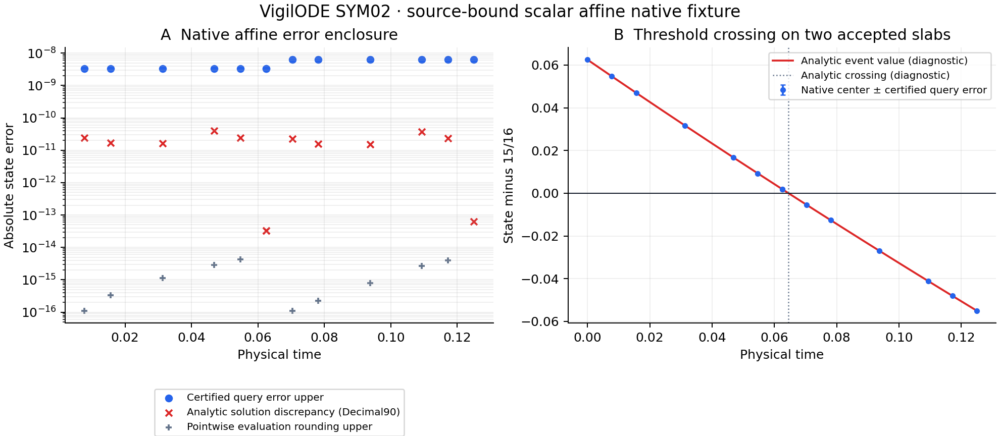

# VigilODE SYM02 이론·코딩 연구 결과

작성일: 2026-10-29 (Asia/Seoul) · 판정: **PASS_SCOPED_NATIVE_AFFINE**

기존 exact-rational 이벤트 오라클을 실제 RODAS accepted dense segment에 연결하는 opt-in Rust provider를 구현했다. 저장된 H/stage/endpoint bits로 정확한 실수 quartic을 구성하고, 전 slab 원방정식 잔차와 상태 오차를 감싼다. 실제 binary64 query 반환값에는 별도의 pointwise rounding 상계를 더한다. Source·clock·unit·event·epoch 변경과 잘못된 error carry는 거부한다.

## 조사와 재개 지점

초기 관측에서7개 관련 저장소의 branch metadata1512개와 open PR metadata1015개를 확인했다. VigilODE는 전체 PR101개를 두 terminal page까지 읽었고, 다른6개 저장소는 open PR을 전부 열거한 뒤 최신12개 본문씩 읽었다. 전체 과거 commit 본문·모든 대화 원문·모든 백업 바이트의 독립 감사를 주장하지 않는다. 최신 대화 검색은 출처 단서로, Git 원문·파일·원격 응답을 상태 근거로 사용했다.

| 저장소 | Branch metadata | Open PR metadata | 이번에 사용한 위치 |
|---|---:|---:|---|
| vigilode |238|71|PR101 bc5ddbe4; PR1008615b365; PR99e46704cb; PR9536104bfc|
| rei_bianchi |302|244|중앙4824eec8,28/88; working33/88와 분리|
| bass |322|207|PR234c74317ce optical-depth1×30 row; PR233464aff9d chemical6×23 geometry block|
| BASS_HE |119|103|PR103de6bcbd9 H–Li registry, 조건부 source|
| bass_cr |197|117|PR1180fb1551b same-bin conditional capacity|
| rec_bianchi |171|119|PR15367d8baa0 인쇄 source precision|
| WU088_HH |163|154|PR15431d3270e, 별도33/48|

기존 chemical SOURCE103552725bytes/509members, SHA2563ebd7559b6d0383477e6258beef6eca498ea9b1432d61cbf46ba8fba85de05ad와 Drive/Dropbox ACK 기록을 확인했다. 기존 chemical20/20 CLOSED_NO_REPLAY를 재사용했다. 이 조사는 그 원격 ZIP 전체를 새로 복원한 검증과 구분된다.

PR100의 다음 보조 단위 SYM02를 선택했다. 최신 PR101을 native baseline으로 삼았고, 두 PR 사이 관련6개 native blob identity가 같음을 확인했다. 새 전달은 Draft PR102, branch research/sym02-native-affine-20261029다. 최종 검증 code commit은 **0d722b4ed71413926c76bc0037f02f3a6bbdd362**다.

## 수학적 결과와 코드

모델은 동일 clock의 y'=-lambda*y+b, 일정 parameter boxes lambda.lo>0, scalar absolute norm, event y-threshold다. 초기 global error E0와 실제 방정식의 parameter/source binding은 caller가 제공하는 명시적 전제다. ID 문자열은 이 전제를 묶으며 일반 RHS callback의 식별성을 증명하지 않는다.

Native dense 식의 power 계수는

    (y0, y1-y0+d0, d1-d0, d2-d1, -d2),  d_r=sum_j H_rj*u_j

다. 일반적으로4차이며 기존 third-degree 주석을 교정했다. Exact real h=t1-t0에 대해 r=p_theta'/h+lambda*p-b를 outward interval과 Bernstein hull로 감싼다. Dini 비교 E'=-lambda.lo*E+delta의 두 유리수 envelope로 endpoint/whole-slab radius를 얻는다. 엄격한 endpoint signs와 whole-tube derivative sign을 함께 사용해 unique crossing을 판정한다.

실제 query q와 exact polynomial interval I 사이의 거리 rho=max(|q-I.lo|,|I.hi-q|)를 outward 계산해 |q-y|<=rho+E를 반환한다. 이 값은 해당 실제 query의 인증이며 전체 query 공간의 하나의 균일 상수를 표본으로 추정한 값과 구분된다. Native endpoint copy, 시간 정규화 underflow, exact real width와 rounded subtraction의 차이도 처리한다.

생산 crate의 forbid(unsafe_code)를 유지했다. FP check는 safe arithmetic probes이며, register 관측으로 기술하지 않는다. Test crate만7개 MXCSR mode/FTZ/DAZ 설정을 변경하고 복원한다.

코드 경로: crates/rodas5p-integrators/src/affine_event_certificate.rs 및 FastDenseSegments의 certify/query/carry adapter. 기본 controller/route/tolerance 동작은 유지된다.

## 실제 검증

| 검증 | 결과 |
|---|---|
| 새 Rust contract tests |13/13 PASS|
| 기존 fast-dense regression |8/8 PASS|
| Clippy -D warnings / rustfmt / diff check |PASS|
| Native·declared bits 독립 재구성 |6records,42queries,381검사 PASS(367exact comparisons+14Decimal90 diagnostics)|
| 실제 native 범위 |y'=-y,[0,0.125],2accepted segments,14query records|
| 별도 이론 판별 |324rational cases,16524exact assertions,11016Decimal90 diagnostics PASS|
| 독립 수학·코드 검토 |차단0, PASS_SCOPED|
| 독립 결과·실제 PNG 검토 |차단0, PASS_SCOPED|

최종5개 source file은 fetched immutable Git blob과 일치한다. 테스트와 probe는 source 게시 후 --locked --offline Rust1.94.1로 실행했다. Error carry의 인접 시간·endpoint state·index·source/epoch 일치를 검사했다. 합성4종과 실제 native2segment의 provenance를 구분했으며, analytic exp 계산은 진단으로 명시했다. Figure의 시간·상태는 선언한 fixture 단위다. Log축에서0인6개 series entry만 표시를 생략했고 raw42queries는 모두 보존했다.

연속 포함의 근거는 THEORY.md의 Bernstein/Dini 논증이다. 그림의 유한 점들은 이를 대체하지 않는다. 기존 방법 배경은 Neumaier의 원전 https://arnold-neumaier.at/ms/ode.pdf 에 대조했고, SciSpace·Exa로 원전 후보를 조사하고 Wolfram으로 quartic/Bernstein/Dini identities를 독립 검산했다.

## DAG와 채택

R1–R10+C1–C10은20/20이며, 이번에 선택한 보조 노드 SYM02는1/1 PASS_SCOPED_NATIVE_AFFINE다. 원래23-node DAG의 **7/23은 inherited complete_scoped 집계**로 delta0이다. 최신 current_evidence_status와 broad R-QUALIFY HOLD를 별도 유지한다(DAG_BASIS.json). 중앙 REI28/88도 delta0이다.

새 범용 no-go 또는 solver speedup을 주장하지 않는다. actual BASS30 accepted capsule, source/rate/clock uncertainty, full nonlinear Jacobian/lognorm/solution enclosure와 실제 physical consumer qualification이 후속 의무다. 원격 a019082c 시점 범용 Production/GMRES/ledger/Audit2/E4/long-test CI 실패도 별도로 보존했다. 이번 focused21tests/Clippy의 성공을 해당 release gate의 종료로 사용하지 않는다.

## 수정·보존

Clippy component 부재는 제공된 Rust bundle의 component 설치로 해결했다. 새 test helper의 needless_range_loop를 동등한 iterator로 바꿨고, probe sum의 순서를 보존했다. 생산3파일은 독립 검토본에 rustfmt를 적용한 바이트와 같고, 수정 전후6개 raw record는 모두 bit-identical이다. 수정 후21tests,Clippy,381검산을 다시 통과했다.

Git CLI의 HTTPS credential 부재는 승인된 GitHub connector의 expected-SHA/force=false 게시로 처리했다. Backup R4/C9의 source FETCH_FAILED는 목적지 부재 확인 후 동일 바이트를 새 local transfer path로 한 번씩 재게시했다. 과학적 실패로 분류하지 않았다. 단계 payload 출력 절단은 chunked 전송으로 고쳤다.

매 단계의 commit·source ZIP·SHA256·Drive/Dropbox 실제 ACK는 외부 DELIVERY_RECEIPTS.json과 stage별 receipt에 남겼다. R1–C9의 receipt는 다음 checkpoint에도 들어간다. 마지막 C10 outer ZIP의 SHA와 provider ACK는 자기참조를 피하도록 ZIP 밖 최종 receipt에 둔다.

## 재현과 다음 작업

CODE commit0d722b4e를 checkout하고 Rust1.94.1과 Cargo.lock을 사용한다.

    cargo test --locked --offline -p rodas5p-integrators --test affine_event_certificate_contracts --test fast_dense_contracts -- --test-threads=1
    cargo run --locked --offline -p rodas5p-integrators --example sym02_certificate_probe
    python3 research/sym02_native_affine_20261029/verify_native_bits.py

실제 실행은 전용 CARGO_HOME/target, single Cargo lock, CARGO_BUILD_JOBS=2로 고정했다. Compiler 설치·명령·실행 로그는 evidence/와 FINAL_SOURCE_IDENTITY.json에 있다. 이미 종료된 campaign 예산·원래 correction counters를 초기화하지 않는다.

다음 단위는 SYM02 결과를 재사용하고 actual owner accepted capsule의 equation/clock/unit/parameter/E0 identity를 먼저 확보하는 source-bound consumer 연결이다. 일반 DOPRI의 piecewise evaluator나 full nonlinear tube로 넓히려면 그 실제 식과 전구간 defect·signed lognorm·transversality 계약을 별도로 충족해야 한다. 현재 source가 공급되지 않은 BASS30 의무는 null을 유지한다.

