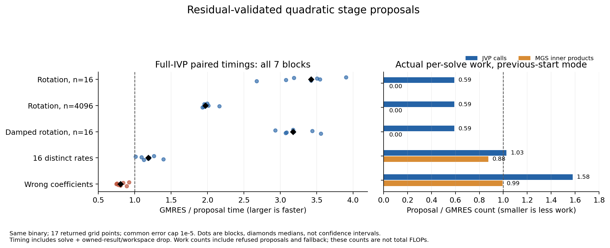

# VigilODE: 구조적 stage solver와 증명 우선 병목 연구

이번에는 할당 감소에서 더 나아가 **방향별 quadratic resolvent 후보를 실제 8-stage RODAS matrix-free 경로에 이식**했다. 원래 선형계의 live residual을 기존 허용오차로 검사하고, 통과한 stage에서 Arnoldi/MGS/QR를 생략한다. 같은 실행 파일에서 기존 GMRES와 비교한 결과는 **회전16차원3.43배, 회전4096차원1.97배, 감쇠 회전3.17배,16-rate time-JVP1.19배의 paired 시간비를 얻었다. 잘못된 계수 대조군은 시간비0.804로 느려졌다**이다. 이 성과는 명시된 모델·입력·정확도 범위에 묶여 있으며 **전체 production 판정은 HOLD**다.

## 수학적 근거와 실제 구조 변경

configured warm start `x0`를 유지한 채 `A=I−σJ`, `v=f−Ax0`를 두고

\[
D=1-a\sigma-b\sigma^2,\qquad
q=\frac{(1-a\sigma)v+\sigma Jv}{D}
\]

를 구성했다. 직접 계수 소거로

\[
v-Aq=\frac{\sigma^2}{D}(J^2v-aJv-bv)
\]

가 성립한다. 따라서 **현재 방향**에 `J²v=aJv+bv`가 성립하면 exact-real stage correction을 얻는다. 관계가 근사적이면 우변이 그 잔차를 정량화한다. 전체 공간의 다항식 항등식이나 다른 stage의 관계는 요구하거나 추론하지 않는다.

native 구현은 `q=((2−aσ)v−Av)/D`를 이용해 실제 shifted operator를 호출한다. 후보 생성 후 `f−A(x0+q)`를 새로 계산해 기존 `max(linear_atol,linear_rtol*||f||₂)`를 통과할 때만 채택한다. 분모·범위·잔차 거절은 기존 warm start의 GMRES fallback으로 연결하며 이미 발생한 작업량을 보존한다. 실제 callback 실패와 불완전/nonfinite 출력은 오류로 전달한다. 옵션은 기본 off이며 ordinary MF-fast 경로에서 명시적으로 켠다.

비자명한 nonzero-shift 성공에는 zero start에서2회, nonzero start에서3회 action과 O(n) vector 작업이 필요하고 Arnoldi columns/MGS/QR는0이다. 실제 이득 조건은 `(m_base−m_accept)C_J+C_K>C_V`다. 거절 가능성이 있으면 `p(C_base−C_accept)>(1−p)C_refusal`도 만족해야 한다. 이 조건 때문에 exact relation 양성군뿐 아니라 다중 rate·잘못된 계수 대조군을 함께 측정했다.

회전 모델에서는 `J²=−9I`, `D=1+9σ²≥1`이고

\[
(I-\sigma J)^T(I-\sigma J)=(1+9\sigma^2)I,
\qquad
\|(I-\sigma J)^{-1}\|_2=(1+9\sigma^2)^{-1/2}
\]

다. 이 resolvent 항등식은 잔차에서 stage error로의 안정된 전달 근거다. 16개 distinct rates의 대각 time-JVP 모델은 일반적으로 exact degree2 관계를 만족하지 않는다. `p(z)=(z+2)(z+31/8)` 후보에 대해 정규 대각성 및 완전제곱으로 `||p(J)||₂≤225/256`을 얻어 작은 shift의 근사 후보를 정당화했다. 이 spectral norm 결론을 nonnormal J에 일반화하지 않는다.

자세한 가정, 증명, 반례, floating-point 한계와 식–코드 대응은 [STRUCTURAL_NATIVE](theory/STRUCTURAL_NATIVE.md)에 있다. generic floating residual PASS는 물리 오차의 outward certificate와 다르다. residual 평가오차 `η_eval`과 inverse bound `K`가 별도로 확보되어야 `||x−x*||≤K(τ+η_eval)`가 정당화된다.

## 병목별 연구와 합성

| 병목 | 분류 | 완료한 연구·이식 및 남은 경계 |
|---|---|---|
| Arnoldi/MGS/QR | 알고리즘·수치 | K3 quotient와 원래 residual 식을 native quadratic 제안으로 이식. 적합 모델에서 실제 Krylov 작업 제거. 일반 모델의 admission·선택 이득은 별도 |
| GMRES unused directions pool | 저장소 구현 | K1 live-state 동치에 근거한 준비 생략. phase1에서 이미 검증 |
| facade 반환 복사 | adapter 소유권 | A1 반환값·효과 관측의 동치로 move 이식. phase1에서 이미 검증 |
| strict/RHS reentrant 비용 | switcher·동역학 | discarded work를 포함한 비용 조건과 neutral clock/fiber forcing 증명. 자동 selection 승격 없음 |
| whole-slab 및 event 인증 | 수치 이론·provider | nonlinear invariant tube, norm/reset/event의 시간순 합성, triangular stage 전달 증명. 실제 nonlinear outward provider는 OPEN |
| release/API/authority | 계약·환경·입력 | 현재 실패의 source별 분류와 원자료 보존. scoped numerical PASS로 대체하지 않음 |

이론 R1–R10을 먼저 수행한 병목별 연구를 코딩 C1–C10으로 넘기고, 별도 subagent의 코드·수학 검토를 거쳤다. 최종 합성은 `방향별 stage 후보 → 원래 residual → 연속 구간 defect/tube → event/route-word → 반환 관측`이다.

stage inverse margins와 RHS Lipschitz 상계가 검증되면 strict lower-triangular `T`에 대해 stage error는 `B=(I+T+⋯+T^(s−1))D`로 전달된다. reconstruction의 원래 residual을 직접 인증하면 이 stage error 항을 다시 더하지 않는다. nonlinear `D+E≤−αE+ΓE²+δ`에서는 `E0≤R`, `ΓR²−αR+δ≤0`와 실제 compact-domain 전제가 invariant tube를 준다. clock–fiber 문제에서는 neutral clock error와 `rho_j−g' rho0` forcing를 지우지 않았다. symbolic controller word 동치와 물리 event word 인증도 구분했다.

PR102의 native scalar-affine accepted quartic/Bernstein/query/carry는 `Γ=δJ=0` 특수 경우로 재사용할 수 있다. 이번에 read-only 검토했으며 현재 structural source에 병합하거나 재실행한 결과로 세지 않았다. 실제 nonlinear source/clock/rate/domain은 별도 provider 의무다. 최신 PR103 head `1845e1d8bdfda222bf77637e8d38d5076743f238`의 signed weighted-infinity logarithmic norm 연구도 별도로 검토했다: **정확 signed-row/vertex/rate-endpoint 정리는 scoped static 수용했다. 다만 일반 isotope 입력의 electron coefficient outward 준비, event-dual arithmetic guard, public interval 유효성 경계가 미완료여서 native 일반 입력 재사용은 HOLD다**. 조건부 bound14.2857% tightening은 실행시간 개선이 아니며 양의 mu는 contraction을 뜻하지 않는다. vector quartic/nonlinear defect와 metric transport의 재사용 입력으로 연결하고 원본 R6/C9 미실행을 보존한다.

## 실제 native 검증과 전체 IVP 비교

구조적 native source는 `0a2a8eb9b9b0b775561f42f42cf36b1ef6e96f4b`, tree는 `5795e928f78fe3e99bfa91a4e7d10eaa7540c4db`다. 소스 publication/fetch 확인 후 빌드했고 실행 전후 native hashes와 binary/build binding을 검사했다. baseline arm과 proposal arm은 **동일 실행 파일**이다.

| 실제 실행 | 결과 |
|---|---:|
| MF-fast structural inline contracts |3 PASS |
| directional kernel contracts |8 PASS |
| matrix-free problem contracts |2 PASS |
| warm-start contracts |4 PASS,2 ignored |
| time-FD contracts |2 PASS |
| 독립 Fraction native-bit oracle |88 checks PASS:6 accepted,2 refused |
| integrator/probe focused Clippy |각 exit0 |
| raw receipt·manifest·trial·pair 독립 재집계 |37,829 checks PASS; native 추가 실행0 |

Rust19 PASS/2 ignored는 이 source의 실제 실행 합계다. 최초 source `cdbee50feb6b7b5d60bd36a278caaf93fa60f665`에서도 수치 tests/oracle은 통과했지만 probe Clippy의 parity 표현 lint2건으로 benchmark 진입을 중단했다. parity 표현3곳을 동치 형태로 교정하고 새 published source에서 검사했다. 최초 실패45.130343208초를 유지하며 Q-LINT의 남은 회차를2/3→3/3으로 사용했다. 수치식·허용오차·대조군·timing 표본을 사후 변경하지 않았다.

독립 Fraction oracle는 emitted native rotation kernel bits에서 exact represented original residual과 exact solution error를 재계산한다. 그 유한 kernel records를 전체 ODE stage나 일반 floating 연산자의 rigorous enclosure로 확대하지 않는다.

전체 IVP 측정은 `t∈[0,0.25]`의17개 고정 반환점, ODE tolerance1e-7/1e-10, linear tolerance1e-10/1e-14, 동일 initial state/controller를 사용했다. 양쪽 모두 binary64 analytic grid error1e-5 cap을 만족해야 timing에 포함된다. 경로의 bitwise 동일성을 요구하는 phase1과 달리, 구조적 알고리즘은 다른 adaptive trajectory를 만들 수 있다. 이 비교는 반환 격자의 같은 정확도 목표이며 whole-slab physical enclosure가 아니다. 모든 solve의 최대 반환격자 diagnostic 오차는1.86517468137e-13이었다.

| Case | n | GMRES 중앙값 µs | 후보 중앙값 µs | GMRES/후보 비 중앙값 [min,max] | 후보가 빠른 blocks |
|---|---:|---:|---:|---:|---:|
| rotation | 16 | 247.424 | 76.969 | 3.425328 [2.675085,3.903079] | 7/7 |
| rotation-large | 4096 | 22745.464 | 11577.926 | 1.972945 [1.930496,2.161135] | 7/7 |
| damped-rotation | 16 | 241.880 | 76.558 | 3.174434 [2.930166,3.558505] | 7/7 |
| time-jvp | 16 | 2560.370 | 2227.634 | 1.186286 [1.010904,1.395022] | 7/7 |
| badcoeff | 16 | 240.494 | 300.547 | 0.803978 [0.746615,0.920267] | 0/7 |

시간비는 기존 GMRES/proposal이며1보다 크면 proposal이 빠르다. 7개의 alternating ABBA/BAAB block을 사용하고 child별16회 solve+drop의 중앙값을 합해 각 block 비를 계산했다. 모든 block과 adverse case를 보존했다. min/max 범위는 confidence interval이 아니다. 실제 완료 solve 수는 **2460회: correctness60, warmup160, timed2240**다.

회전·감쇠 회전에서는 같은18회 outer attempts를 유지하면서144개 stage proposal을 모두 채택했다. Arnoldi columns와 MGS/QR가0이 되었고 JVP도699→412(큰 차원702→414)로 줄었다. 이는 저장소 할당 감소와 구별되는 실제 알고리즘 작업 감소다.

time-JVP는144개 중18개만 채택하고126개는 fallback했다. JVP는2718→2790, strict integer work는3060→3132로 늘었지만 MGS inner products는39168→34272로 줄어 전체 solve가 측정상 빨라졌다. Baseline은144개 stage마다16 Arnoldi columns를 사용했다. 후보의18개 zero-iteration log는 각8-stage attempt의8번째 위치에 해당하며 다른126개는 fallback했다. 이를 일반 stage의 exact degree2 관계로 해석하지 않는다. 반면 잘못된 계수에서는142회 거절 비용 때문에 JVP가699→1104로 늘고 모든7개 block에서 느려졌다. 이 반례는 모든 문제에 후보를 자동 활성화할 근거가 없음을 보여준다.

| Case | JVP old→new | MGS inner products old→new | MGS updates old→new | Arnoldi columns old→new | QR/LS cycles old→new | Proposals accept/refuse | Outer attempts old→new | Grid max error old→new |
|---|---:|---:|---:|---:|---:|---:|---:|---:|
| rotation | 699→412 | 858→0 | 1001→0 | 286→0 | 143→0 | 144/0 | 18→18 | 8.50431e-14→8.01581e-14 |
| rotation-large | 702→414 | 864→0 | 1008→0 | 288→0 | 144→0 | 144/0 | 18→18 | 8.21565e-14→7.9492e-14 |
| damped-rotation | 699→412 | 858→0 | 1001→0 | 286→0 | 143→0 | 144/0 | 18→18 | 9.9809e-14→9.82547e-14 |
| time-jvp | 2718→2790 | 39168→34272 | 39312→34398 | 2304→2016 | 144→126 | 18/126 | 18→18 | 1.83409e-13→1.85407e-13 |
| badcoeff | 699→1104 | 858→852 | 1001→994 | 286→284 | 143→142 | 2/142 | 18→18 | 8.50431e-14→8.52651e-14 |

위 작업량은 previous-start의 한 full-IVP solve이며3회 probe의 counters가 일치한다. 모든 warm/timed solve에서도 같은 작업량을 확인했다. QR/LS 수는 이 ordinary GMRES-into 경로에서 `least_squares_solves=cycles`인 코드 계약에 따라 기록된 cycles로부터 얻었다. 별도의 QR hardware/function counter는 아니다. 후속 우선 연구는 현재 full-restart 이전 prefix 후보를 원래 residual로 인증해 종료하는 규칙과, 그 검사·QR 비용까지 포함한 선택 조건이다. relative residual이 rtol보다 커도 absolute atol이 지배할 수 있으므로 relative 값만으로 통과/실패를 판정하지 않는다.

WorkCounters의 dot/axpy는 기존 계측 kernel을 세며 새 일반 vector loop의 총 FLOP 수는 아니다. 전체 wall time은 후보 생성·원래 residual 검사·거절 후 fallback 및 결과/workspace drop을 포함한다. JSON 직렬화와 독립 error audit는 양쪽에서 제외한다. 이 환경에 perf/Callgrind/heaptrack이 없어 이번 새 profile은 실제 callback·Krylov work·CPU/maxRSS와 시간으로 한정했다. PR101의 function Ir 수치는 원래 source evidence로만 재사용한다.

## 이전 phase와 negative evidence 보존

phase1 source `ef84aa3d6c028b0922bb5c1e66202b95fd88a2fc`에서25 Python 연구 methods,99 library tests(1 ignored),280 facade tests,115 Krylov PASS/1 parallel allocator FAIL,2 time-FD tests가 기록되었다. allocator target은 같은 source에서 직렬3/3 PASS였으며 최초 FAIL을 지우지 않았다. 57쌍의 관측값이 맞고 할당은 감소했지만 dense/banded 시간비 중앙값0.96549/0.96415로 회귀했다. banded는7개 block 모두 느렸다.

첫 compile/Decimal reference 실패, stale shared-target binary 사건, 누적비용·cold/warm 분석 가정 교정을 보존했다. 기존3/3 correction episodes는 그대로다. 이후 사용자의 명시적 구조적 연구 요청에 따라 K3의 첫 native 이식을 수행해 PR-N01은2/3→3/3이 되었다. 구조적 최초 이식 뒤 추가 numerical repair iteration은 **0(수치 변경·사후 성능 조정 없음; 최초 이식의 비수치 lint 교정은 별도 기록)**이다. 소진된 node의 횟수를 초기화하지 않았다. Q-LINT는 최초 이식의 별도 비수치 lint 교정을 포함해3/3이다.

phase1 결과와 원자료는 [RESULTS](RESULTS.json), [RAW_MANIFEST](evidence/RAW_MANIFEST.json)에 남겨 ledger-covered bytes를 보존했다. 구조적 raw170개 trial과35개 paired block을 별도 분석기에서 다시 구성하고 export 값과 정확히 대조했다. 그 분석은 native를 다시 실행하지 않았다. 새로운 구조적 결과는 [STRUCTURAL_RESULTS](STRUCTURAL_RESULTS.json)와 별도 raw manifest가 기준이다. 누적 scientific wall은 **602.900460228/900초**이며 compile preparation과 postprocessing 비용은 별도 receipt에 있다.

## 조사·전달 범위와 production 판정

조사 baseline은 PR101 `bc5ddbe42b24b1a6364bf653c3e2d6d938ca4087`이며, main 확인 pin은 `8d0c79184e09efb5bdadc24a6315c60a71a44264`다. PR90–101 관련 source-bound 연구, PR99/100, 첨부 RVJ/NAG/프로토콜, Exa·SciSpace·Wolfram 원응답을 재사용했다. 뒤늦게 확인한 PR102 delivery8357faa…/code0d722b… 및 그 위 PR103 head1845e1d…도 별도 입력으로 검토했다. 원격 변경·의존성·실패 gate와 관련 native 경로의 조사이며, 모든 역사적 source line이나 사용자 local 파일을 읽었다는 의미는 아니다.

기존23-node/34-edge DAG,73 paths,8 suites,10 interactions와 negative evidence를 보존했다. 새 보조 정리와 focused 실행은 core DAG 전체 통과를 뜻하지 않는다. 단일 opt-in MF-fast 후보 lane과 기존 selective-JVP 설정 invocation이 존재하지만, 실제 BASS/REI client 전체 영역의 qualification은 완료하지 않았다.

남은 gate는 Q-API, Givens의 profile별 차이, SUNDIALS/MPI portability, full authority/Q-LEDGER3/3,10 interactions, 실제 source/rate/domain/clock 계약, nonlinear outward provider, 부적합 모델의 선택·총비용 검증이다. main이나 선행 PR을 merge하지 않았다. [local Codex handoff](LOCAL_CODEX_HANDOFF_KO.md)에 기존 구현을 재사용할 후속 연구와 정확한 source/build/benchmark 규칙을 정리했다.

## 현재 process audit

Published native tree `0a2a8eb9`에 대한 lazy-fetch 비활성 read-only authority 검사는 현재 노드에서 missing1/unreachable3(6 diagnostics), 전체에서 missing59/repository-unavailable16/invalid-repository11/unreachable3(178 diagnostics)로 FAIL이었다. missing은 이 checkout의 객체 부재이며 원격 객체의 비존재를 증명하지 않는다. 원본 snapshot의 synthetic merge metadata와 실행하지 않은 준비 source 기록도 보존했다. 앞선 full check의 도구 세션 중단은 결과 미확정으로 남겼고, 실패를 통과로 바꾸지 않았다. PR101 기준 node/append-only 검사는 통과했고 main 기준 기존40 diagnostics는 남았다. 최종 문서 tree의 scoped node 확인은 별도 receipt에 둔다.

최종 이론 합성은 [STRUCTURAL_SYNCHRONIZATION](theory/STRUCTURAL_SYNCHRONIZATION.md), 독립 데이터 감사는 [STRUCTURAL_RESULT_REVIEW](reviews/STRUCTURAL_RESULT_REVIEW.md)를 읽는다. 동일 binary의 baseline에도 phase1 할당·소유권 변경이 이미 들어 있으므로, 이 시간 비교는 quadratic 옵션의 효과를 분리한다.

최종 문서·ledger staging 기준 scoped node 검사는186 rows PASS였다. 이 tree의 authority 재검사는231 citations/64 typed identities에서 missing1/unreachable5, 총9 diagnostics로 FAIL이다. 원자료 실패 식별자를 요약 JSON에도 보존하면서 같은 SHA가 다른 object-kind로 다시 집계된 경우를 포함한다. native tree의 앞선202citations 결과와 구별하며, exact stdout은 `evidence/final_process/authority-node.stdout`에 남겼다.
