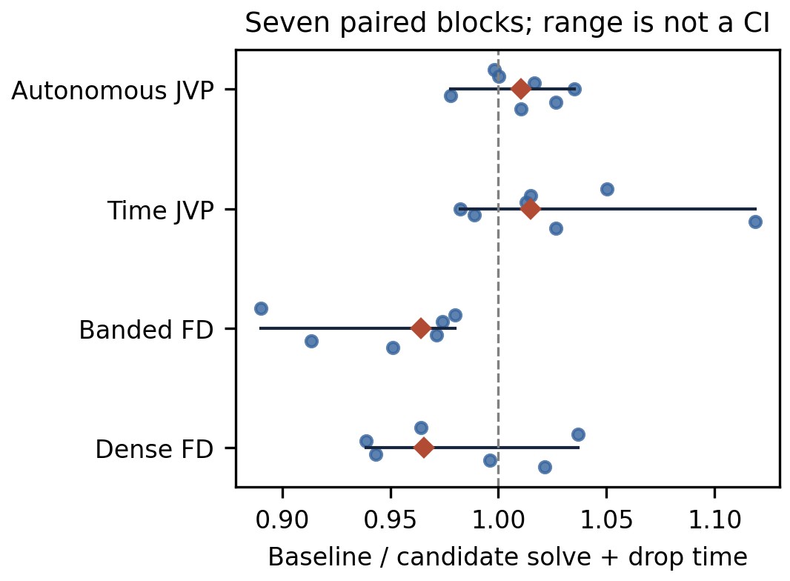
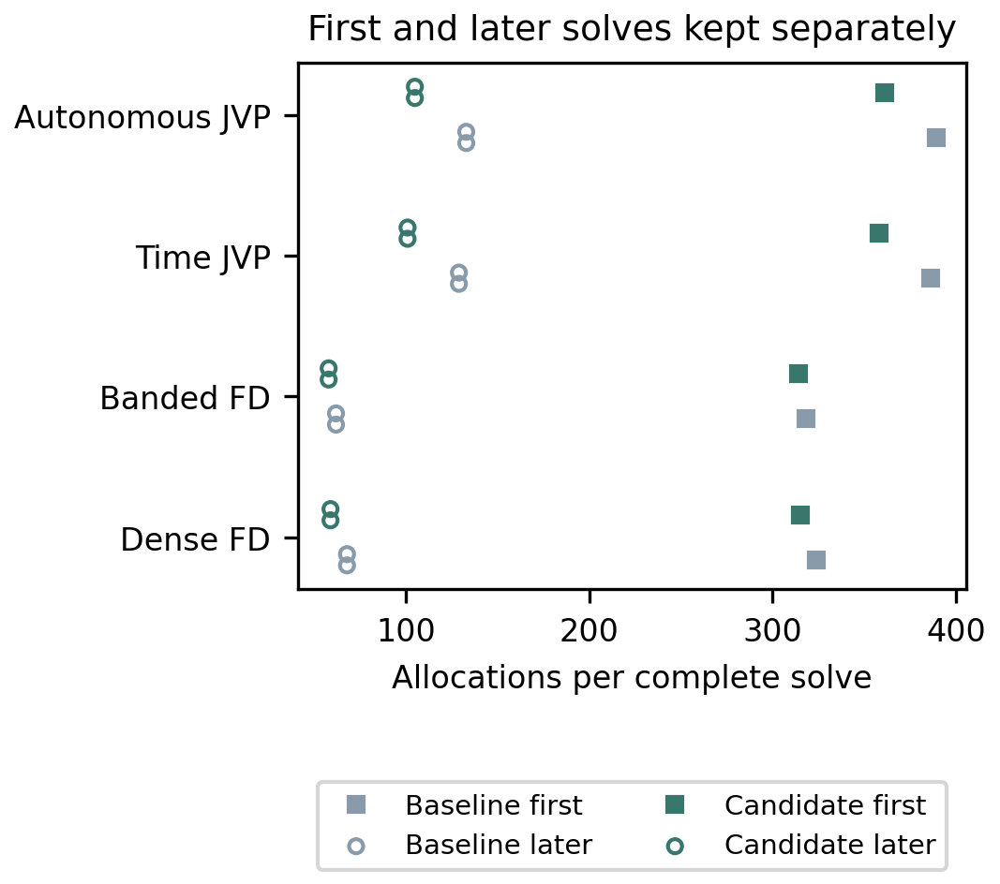

# VigilODE: 증명 우선 병목 연구와 단일 후보 lane

세 병목 단위를 subagent로 병렬 연구하고 각 이론 R1–R10 뒤에 코딩 C1–C10을 수행했다. 마지막에는 stage residual에서 연속 궤적 인증까지 연결하는 합성 정리를 도출했다. 이번 native 변경은 GMRES의 사용하지 않는 방향 저장소 준비와 facade 반환값 복사를 제거한다. 실제 반환 관측은 유지됐고 할당은 줄었다. 짧은 시간 측정에서는 dense/banded 경로의 지연 증가도 관찰되어, 일반적인 속도 향상과 production 승격은 주장하지 않는다. **전체 production 판정은 HOLD**다.

## 1. 재개·조사 범위와 출처

- baseline solver: PR101 `bc5ddbe42b24b1a6364bf653c3e2d6d938ca4087`.
- 실제 최종 native 실행: `ef84aa3d6c028b0922bb5c1e66202b95fd88a2fc`, tree `2989f07fb04134aa7bab38e38d7272e45d6a0917`.
- preregistration: `c41caffa68d9f4eb9d1976422f7f74ec7e764cca`. 첫 실행 `7fce5a4c…`의 실패도 보존했다.
- main은 최종 확인에서도 `8d0c79184e09efb5bdadc24a6315c60a71a44264`다. PR99/100 및 최신 PR102는 별도 연구 입력이다.
- 최종 원격 재조회에서 PR102 `8357faa5b42724a8be24609d4d2f16aec8a6eb3a`를 발견해 검토에 추가했다. 그 native code pin은 `0d722b4ed71413926c76bc0037f02f3a6bbdd362`다. 현재 실행 source에 병합된 것으로 세지 않는다.

이전 PR90–101의 source-bound 연구 기록, PR98→101 변경 목록, 현재 실패 CI, 관련 native 경로, 첨부 RVJ/NAG 및 연구 프로토콜을 재사용했다. Exa·SciSpace·Wolfram의 원응답과 사용 범위는 theory/evidence에 보존했다. 역사적 모든 source line 및 사용자 local 파일을 읽었다는 의미의 전수조사는 아니다. 원격에서 확인 가능한 변경·의존성·실패 gate의 inventory와 이 작업의 관련 코드 경로를 조사했다.

원래 23-node/34-edge DAG, 73 paths, 8 suites, 10 interaction, negative evidence와 누적 correction budget을 보존했다. 새 검증을 과거 8-suite 전체 재실행이나 core DAG 진척으로 바꾸지 않았다. 기존 7/23 scoped와 신규 보조 정리는 구분한다.

## 2. 병목 분류와 코드에 연결한 수학

| 병목 | 분류 | 이번에 확립한 근거와 처리 |
|---|---|---|
| GMRES-into의 directions pool 준비 | 저장소 구현 | K1: 읽기·쓰기 상태의 귀납적 동치. 실제 사용하지 않는 저장소만 준비하지 않는다. public reserve와 augmented 경로는 유지 |
| MGS/Arnoldi/QR 비용 | 알고리즘·수치 | K2–K4: residual gap, 방향별 다항식 resolvent, shifted recycle image의 오차 계약. 새로운 native dispatch는 아직 도입하지 않음 |
| RoutedRun/Observed 반환 복사 | adapter 소유권 | A1: 값을 소비해서 옮겨도 시간/상태/실패/metadata와 effectful callback 관측을 보존. clone 제거 이식 완료 |
| strict/RHS reentrant 손실 | switcher·선택 및 모델 동역학 | A2–A4: discarded work를 포함한 비용 비교; clock–fiber contraction과 clock defect 전달. 서로 다른 수치 궤적의 비용비를 순수 wrapper 비용으로 해석하지 않음 |
| whole-slab 및 물리 event 인증 | 수치 이론·입력 provider | D1–D11: 원래 방정식의 defect, quadratic remainder, carrier mismatch, 불변 반경, norm/reset/event 합성. 정확 Fraction 소비자 구현 |
| CI·API·authority | 구현/환경/계약/외부 입력 | Copy lint 수정 및 focused 재검증. API breaking fixture, 다른 profile의 Givens, SUNDIALS/MPI, authority 실패는 별도로 보존 |

### K: 현재 RHS 방향에서만 필요한 resolvent 관계

monic polynomial \(p(z)=\sum_{j=0}^d p_jz^j\)에 대해
\(D_\sigma=\sum_jp_j\sigma^{d-j}\),
\(Q_\sigma(z)=\sum_{k=0}^{d-1}(\sum_{j>k}p_j\sigma^{d-j+k})z^k\)라 두면 계수 소거로

\[
(1-\sigma z)Q_\sigma(z)=D_\sigma-\sigma^dp(z).
\]

따라서 \(D_\sigma\ne0\)일 때 제안값 \(x=Q_\sigma(J)v/D_\sigma\)의 원래 시스템 잔차는
\(r=v-(I-\sigma J)x=\sigma^dp(J)v/D_\sigma\)다.
이는 전체 공간에서 \(p(J)=0\)을 요구하지 않는다. 현재 stage RHS에 대한 관계면 충분하며, 다른 stage RHS로 자동 이전할 수 없다.
가중 내적의 logarithmic norm으로 \(\alpha=1-\sigma\mu_W(J)>0\)가 검증되면 coercivity와 Cauchy–Schwarz로 \(\|x-x_*\|_W\le\|r\|_W/\alpha\)를 얻는다.
실제 코드에는 coefficient/action/rounding/domain/epoch 및 pole 처리와 원래 잔차의 outward bound가 필요하다. 이것이 작은 방향 공간에서 Arnoldi/MGS 작업을 줄일 수 있는 구체적 이식 근거이며, 실행시간 개선 자체의 증명은 아니다.

### A: reentrant fixture의 clock–fiber 분해

실제 모델의 \(x_0'=1\), \(e_j=x_j-g(x_0)\)는
\(e_j'=-\lambda(x_0)(e_j+e_j^3/2)\)를 준다.
공통 원래 시간에서 clock 오차 \(C+s\delta_0\)를 별도로 운반하고, fiber residual에 \(\rho_j-g'\rho_0\)를 포함했다. \(\lambda\ge1\), 실제 \(\lambda',g'\)의 상계를 사용한 convolution bound를 유도했다. 원래 좌표로 복귀할 때도 \(G(C+s\delta_0)\)를 더한다. clock 오차를 0으로 지워 얻는 잘못된 contraction 주장을 배제했다.

### D: nonlinear tube와 시간순 인증

\(D^+E\le-\alpha E+\Gamma E^2+\delta\),
\(\alpha=\lambda_{carrier}-\delta_J\), \(\delta=\delta_{residual}+\epsilon_{source}\)에 대해

\[
E_0\le R,\qquad \Gamma R^2-\alpha R+\delta\le0
\]

이면, 관련 벡터장·미분 상계가 유효한 실제 compact tube 안에서 \(E\le R\)가 유지된다. 경계의 비엄격 부등호도 radial projection과 Gronwall로 증명했다. \(\beta=\alpha-\Gamma R\)의 감쇠를 두 유리함수 envelope로 감싸 Fraction으로 계산한다. 이후 norm 변환과 reset은 \(E_{next}\le\kappa E_{end}+\eta\)로 시간순 합성한다. strict event sign과 transverse crossing은 각각 별도 margin을 요구한다.

PR102의 native scalar-affine certificate는 이 계약의 \(\Gamma=\delta_J=0\) 특수 경우에 재사용할 수 있다. 실제 accepted quartic, Bernstein defect, query rounding 구현이 새로 존재하므로 이를 다시 만들 필요가 없다. 다만 caller가 공급하는 affine source 전제는 실제 nonlinear 물리 provider의 증거가 아니다. [PR102 검토](reviews/PR102_REUSE_REVIEW.md)를 참조한다.

### S: 세 연구 결과의 최종 합성

stage 시스템 \(A_ik_i=b_i(k_{<i})\)의 inverse margin \(\alpha_i\)와 RHS Lipschitz 상계 \(L_{ij}\), 원래 stage residual \(d_i\)가 검증되면

\[
\eta\le (I+T+\cdots+T^{s-1})D,
\quad D_i=d_i/\alpha_i,\quad T_{ij}=L_{ij}/\alpha_i\;(j<i).
\]

엄격 하삼각성 \(T^s=0\)과 stage 귀납으로 증명되므로 추가적인 spectral-radius 가정이 필요 없다. reconstruction의 \(C_0,C_1\)와 원래 field의 \(L_f\)를 통해 defect는 \(\delta_{base}+(C_1+L_fC_0)\|B\|\)로 전달된다. 실제 reconstruction의 원래 잔차를 직접 인증했다면 이 stage 항을 다시 더하지 않는다.

이 잔차를 D의 불변 tube와 시간순 route-word 합성에 넣는다. A1/K1은 값 자체를 바꾸지 않으므로 추가 reset error는 0이다. **방향별 stage 제안 → 원래 잔차 → 연속 구간 인증 → event/route-word → 반환 관측**이라는 이식 계약이 최종 산출물이다. symbolic dynamics의 controller word 동치와 물리 궤적의 event word 인증은 구분했다. 자세한 증명은 [KRYLOV](theory/KRYLOV.md), [ADAPTER](theory/ADAPTER.md), [DEFECT](theory/DEFECT.md), [SYNTHESIS](theory/SYNTHESIS.md)에 있다.

## 3. 실제 검증과 보존한 실패

| 최종 source의 실행 | 결과 |
|---|---:|
| Python exact/research tests |25 PASS: K9, D12, S4; 일부 고정밀 진단 포함 |
| native library |99 PASS, 1 ignored |
| facade integration |280 PASS |
| Krylov integration |115 PASS, 1 FAIL |
| time-FD contract |2 PASS |
| facade/Krylov 및 time-FD focused Clippy |PASS |
| 실패 allocator target 직렬 대조 |같은 source에서 3 PASS |

Krylov 실패는 process-global LIVE_BYTES를 세 테스트가 병렬로 측정한 경우다. 같은 target을 `--test-threads=1`로 실행한 결과 3/3 통과했다. 최초 FAIL을 PASS로 덮어쓰지 않았다. 다른 CI profile의 Givens 실패도 이번 measurement-profile PASS로 닫지 않는다.

첫 실행의 missing token 컴파일 실패와 Decimal80 정상상태 reference의 반올림 오류를 보존했다. 정확 Fraction 경계 및 2^-300 과소상계 mutation으로 테스트를 교정했고 tolerance는 완화하지 않았다. 공유 Cargo target에서 stale baseline과 동일한 candidate binary가 나온 사건도 보존했다. 해당 실행파일은 측정에 사용하지 않고 독립 target에서 재빌드하여 hash와 source binding을 검증했다.

수정 episode는 보수적으로 초기 이식/검토까지 포함해 **3/3**을 사용했다. 마지막 episode는 allocator 실행 격리와 분석기 수정이다. cold/warm 할당이 같다는 잘못된 가정, 이전 실패 phase 시간을 누락하는 subtotal 문제, 그림 잘림을 고쳤다. raw observations는 바꾸지 않았다. 이 캠페인의 추가 solver 수정은 하지 않는다.

## 4. 같은 반환 정확도에서 측정한 비용

4 fixtures × 2 modes × 3 repeats =24쌍, 별도 ownership 11 fixtures ×3 =33쌍에서 허용한 resource/time 필드를 제외한 반환 관측이 정확히 일치했다. 실패·max-steps·zero-span·dense event·nested RHS도 포함한다. endpoint diagnostic 최대 오차는 4.4617096684e-9로 기존 1e-5 cap 이내다. 이는 binary64 analytic reference이며 rigorous reference enclosure나 모든 interior 궤적의 보증은 아니다.

| 경로 | 첫 호출 할당 old→new | 같은 process 후속 호출 old→new | 시간비 old/new 중앙값 [범위] |
|---|---:|---:|---:|
| Dense FD |324→315 |68→59 |0.96549 [0.93893,1.03682] |
| Banded FD |318→314 |62→58 |0.96415 [0.89009,0.98013] |
| Time JVP |386→358 |129→101 |1.01486 [0.98224,1.11859] |
| Autonomous JVP |389→361 |133→105 |1.01049 [0.97792,1.03521] |

7개 alternating ABBA/BAAB block, child당16회, 전체1792 timed solves를 모두 재집계했다. 비가 1보다 작으면 후보가 느리다. 특히 banded는 7개 모두 느렸으므로 local 성능 연구의 우선 반례다. 범위는 confidence interval이 아니다. 별도의 시간 기준을 사후 완화하거나 유리한 표본만 선택하지 않았다.

clone 경로별 예상 감소9/4/7/16과 unchanged dense-event 대조군은 관측과 맞는다. JVP의 전체 감소28은 출력 소유권과 unused direction pool의 결합 효과다. K1만의 시간 인과 효과로 분리하려면 factorial ablation이 필요하다. WorkCounters와 callback 작업량은 유지된다.

현재 환경에 perf/Callgrind/heaptrack이 없어 새 profiling은 allocation 및 WorkCounters로 한정했다. 이전 PR101의 MGS24.22%, Arnoldi7.36%, QR5.60% function profile은 원래 source의 근거로만 재사용했다. 이번 binary의 profile로 바꾸지 않았다.

각 점은 한 paired block, 붉은 표식은 중앙값, 가로선은 전체 범위다. 불리한 block도 전부 표시했다.

사각형은 첫 process 호출, 빈 원 둘은 후속 호출이다. process 초기화와 solve 비용을 섞어 평균하지 않았다.

## 5. 단일 후보 실행과 남은 gate

하나의 source와 기존 selective-JVP ProductionConfig로 `production_from_json`을 실행했다. rate1/1000 모두 PASS, callback/segment accounting 일치; 반환 격자 오차는 각각3.3718316472e-9,1.0654127077e-9다. rate1은8 segments/0 switches, rate1000은11 segments/1 switch다. 실제 물리 client 배포가 아니라 manufactured invocation 검증이다.

실패 최초 실행·직렬 대조까지 포함한 scientific phase wall은491.539초/900초다. 별도 compile 준비 비용과 postprocessing 비용은 각 receipt에 남아 있다. 원자료557파일, build bindings, 실패 및 제외 binary provenance는 [RAW_MANIFEST](evidence/RAW_MANIFEST.json)와 [RAW_EVIDENCE](evidence/RAW_EVIDENCE.tar.gz)에 보존했다. 실행파일 자체는 source·compiler·hash·build receipt로 식별한다.

API breaking fixtures, Givens의 profile 차이, full authority 실패와 Q-LEDGER3/3, 10 interaction, 실제 물리 source/rate/domain/clock 계약, nonlinear outward provider, dense/banded 성능 악화는 열린 의무다. PR102의 conditional native affine 성과는 별도로 재사용한다. main 또는 선행 PR을 수정하거나 merge하지 않았다.

독립 검토는 원로그 hash, executable binding,57관측쌍,1792시간표본,모든 block과 deployment accounting을 재계산했다. [독립 검토](reviews/FINAL_INDEPENDENT_REVIEW.md), [기계 상태](CURRENT_STATE.json), [결과](RESULTS.json), [local Codex handoff](LOCAL_CODEX_HANDOFF_KO.md)를 이어 읽으면 된다.
